# Data Flow Patterns

This document describes the data flow patterns within the rfmedia-apps CLI tools, including command
execution flows and Docker orchestration patterns.

## CLI Execution Flow

Both CLI tools follow a consistent execution flow from user input to operation completion.

### General CLI Flow

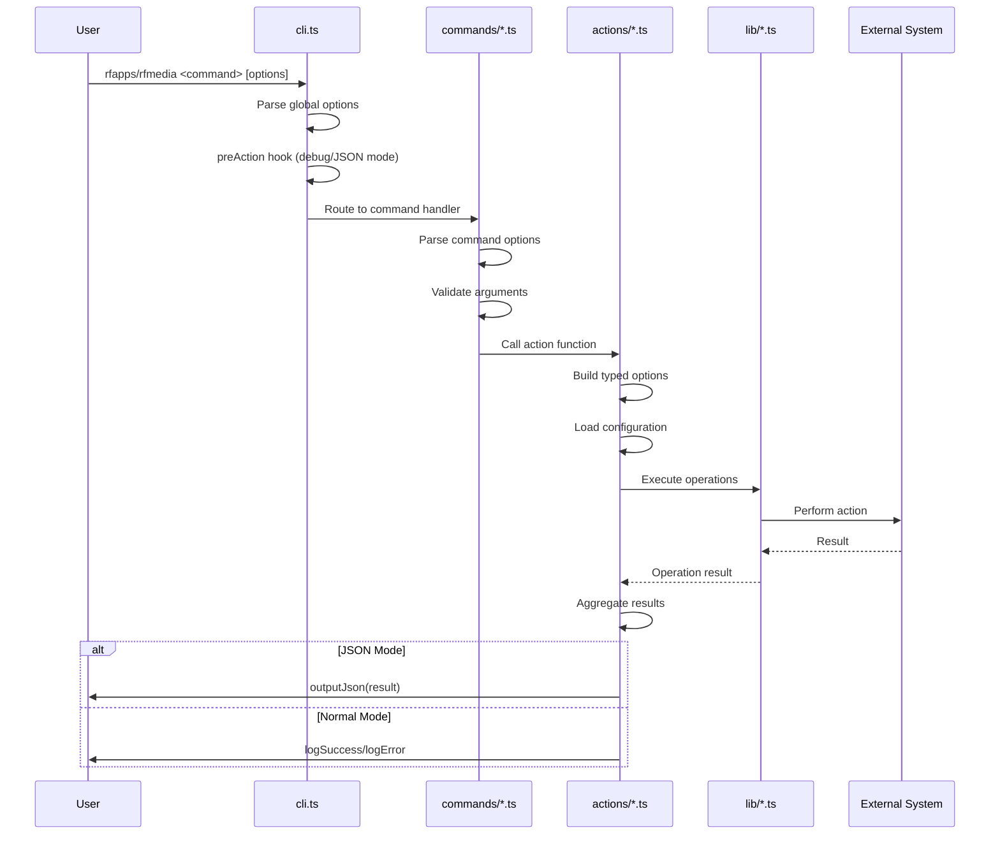

### rfapps Deploy Flow

Detailed flow for the `rfapps deploy` command:

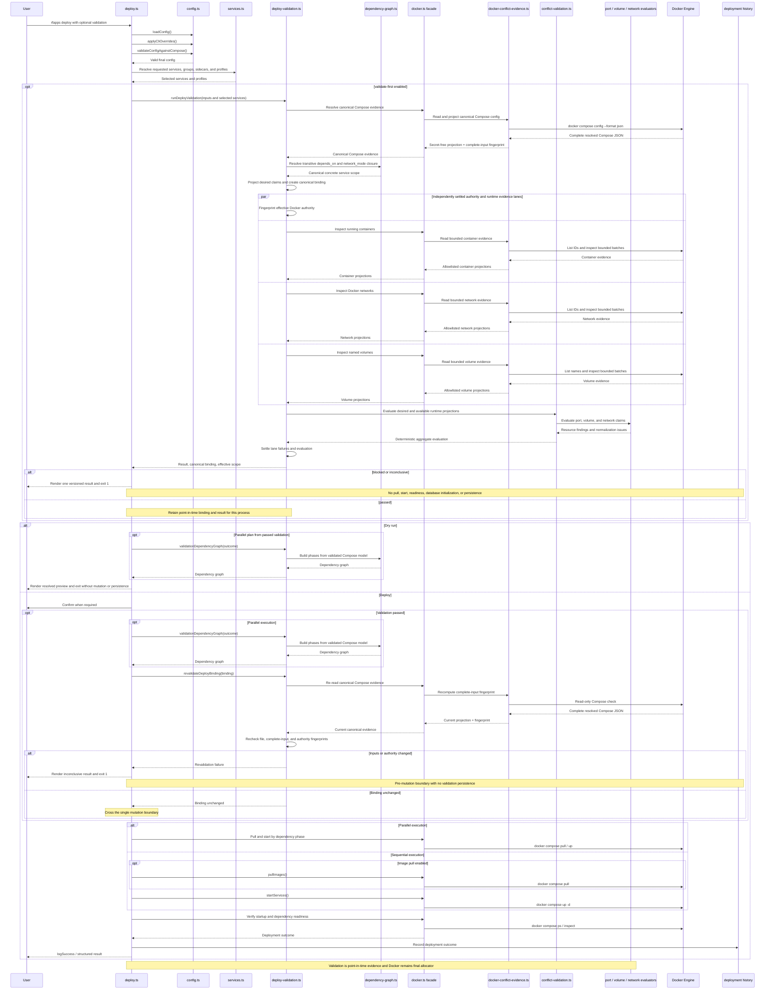

The deploy action owns CLI interaction, result rendering, confirmation, and dry-run, pass/non-pass,
parallel, and mutation branches. The deploy-validation coordinator owns canonical binding and
complete-input fingerprint retention, effective-scope and desired-state projection, independently
settled evidence lanes, aggregate evaluation, dependency-graph coordination from the validated
Compose model, and immediate pre-mutation revalidation.

The `docker.ts` facade delegates conflict evidence to `docker-conflict-evidence.ts`.
`conflict-validation.ts` delegates resource policy to `conflict-port-evaluator.ts`,
`conflict-volume-evaluator.ts`, and `conflict-network-evaluator.ts`; those evaluators depend on the
budget and sanitization utilities in `conflict-evaluator-shared.ts`. The canonical Compose model,
Docker snapshot, and binding remain ephemeral. Only a `passed` result can reach the existing
confirmation and execution paths, and the binding is checked again immediately before the first
write.

### rfapps Managed Update Flow

`rfapps update` is a CLI-only, preview-first image lifecycle. Bare invocation stops after detection
and persists a secret-free managed plan. Mutation requires `--apply` and approval; generic
`rfapps apply` does not accept managed-update plans.

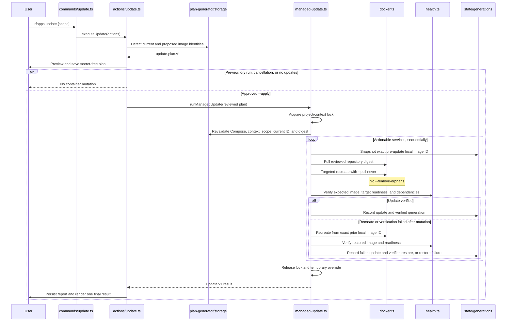

Update and restore use the current Compose configuration and affect images only. The flow does not
restore volumes, databases, application data, or migrations, and it does not schedule work or update
services in parallel.

### rfapps Reconciliation Flow

`rfapps reconcile` is a same-process, report-first controller. It observes resolved Compose intent
and complete Docker runtime evidence, then deterministically plans one
`none|create|start|recreate|blocked` action for every selected service. Report mode and global
`--dry-run` stop after this planning boundary: they do not prompt, lock, mutate Docker, save a plan,
or write deployment history or generations.

```mermaid
sequenceDiagram
    participant User
    participant Command as commands/reconcile.ts
    participant Action as actions/reconcile.ts
    participant Observe as drift.ts / docker.ts
    participant Coordinator as reconcile.ts
    participant Lock as lifecycle-lock.ts
    participant Verify as health.ts

    User->>Command: rfapps reconcile [scope]
    Command->>Action: executeReconcile(options)
    Action->>Observe: Resolve scope and capture Compose/Docker evidence
    Observe-->>Action: Canonical authority, observations, and drift
    Action->>Coordinator: Build deterministic reconcile.v1 plan
    Coordinator-->>Action: Complete reviewed result + action fingerprint

    alt Report, dry run, or no actionable work
    Action-->>User: Render result; no mutation or persistence
    else Approved --auto-apply
    Action->>User: Show report and request confirmation unless --yes
    Action->>Coordinator: Run reviewed lifecycle
    Coordinator->>Lock: Acquire shared project/Docker lock
    Coordinator->>Observe: Revalidate scope, authority, policy, drift, and actions

    loop Reviewed services in dependency phases and stable order
    Coordinator->>Observe: Re-observe service and recheck policy
    alt Service became in sync
    Coordinator->>Coordinator: Record became_in_sync
    else Evidence still matches review
    Coordinator->>Observe: Targeted Compose up for exact service
    Note over Observe: --pull never --no-deps; recreate alone adds --force-recreate
    Coordinator->>Verify: Check readiness
    Coordinator->>Observe: Capture fresh zero-drift evidence
    Coordinator->>Coordinator: Record converged or not_converged
    end
    end

    Coordinator->>Lock: Release in finally
    Coordinator-->>Action: Terminal reconcile.v1 result
    Action-->>User: Render one final result
    end
```

Reconciliation shares its lock with managed image update, but the lifecycles have different
authority and durability. Reconciliation corrects current containers toward the existing Compose
declaration without pulling registry images, persisting intent, or attempting rollback. Managed
update instead persists reviewed image identities, pulls the reviewed digest, records verified
generations, and can restore the exact prior local image. Ordinary `plan`/`apply` persists a
deployment plan that can be applied by a later process; reconciliation cannot be resumed from a
saved artifact and a later run simply observes current state again.

Version 1 injects an allow-all action policy after explicit `--auto-apply` authorization. It does
not implement maintenance schedules or windows; issue #169 can replace that policy decision while
leaving observation available.

### rfmedia Copy Flow

Detailed flow for the `rfmedia copy` command in album mode:

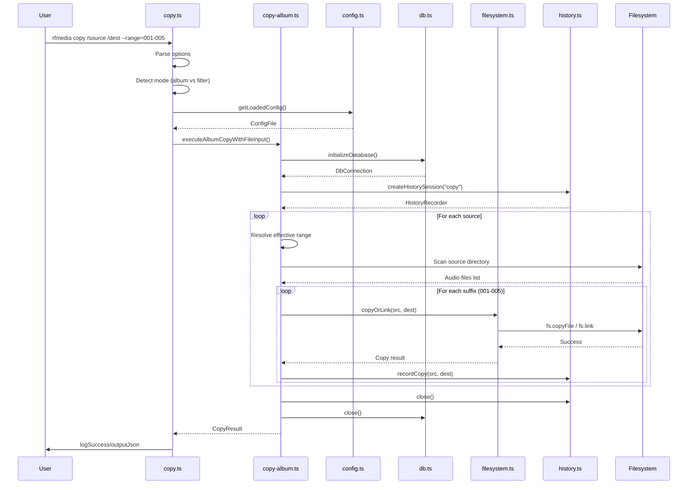

### rfmedia Interactive Selection Flow

Interactive selection is used in workflows that require user choice (tracks or deletions):

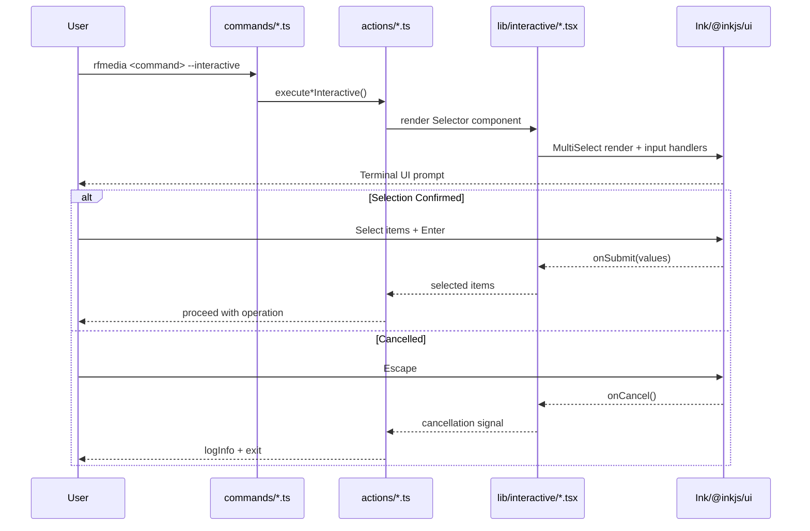

## Docker Orchestration Flow

### Docker Command Execution

The `lib/docker.ts` module handles all Docker interactions:

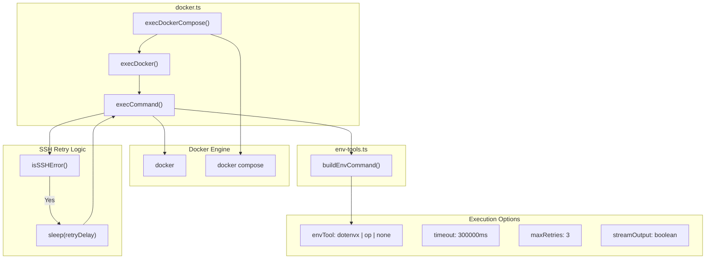

### Service Sidecar Expansion (optional CLI feature)

When `sidecars.enabled: true` and mappings are defined, `expandServicesWithSidecars()` includes
paired sidecars. **This repo disables sidecars** (`sidecars.enabled: false`, empty mapping), so
targeting `plex` returns `[plex]` only.

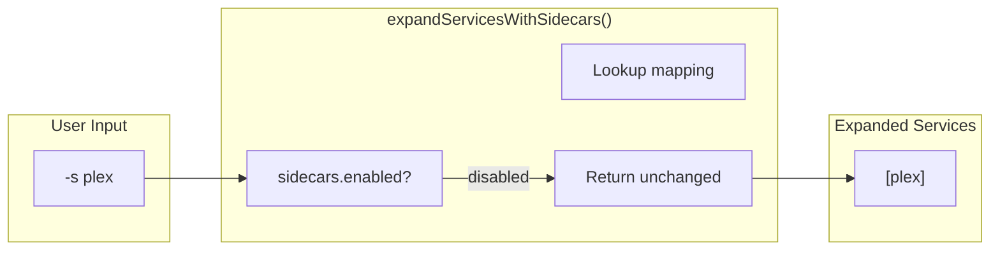

Tailnet ingress uses Docktail labels on `plex`, `jellyfin`, and `immich-server` — not sidecar
`network_mode` sharing.

## Configuration Loading Flow

### rfapps Configuration

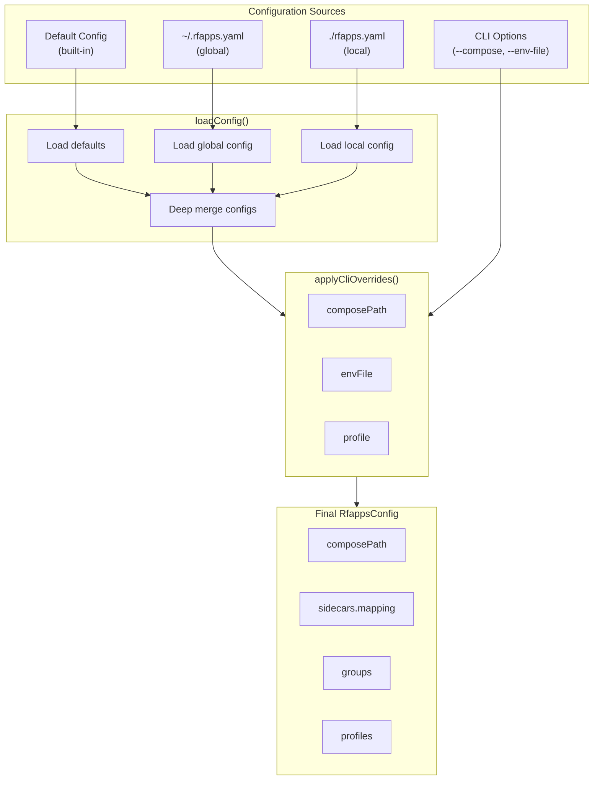

### rfmedia Configuration

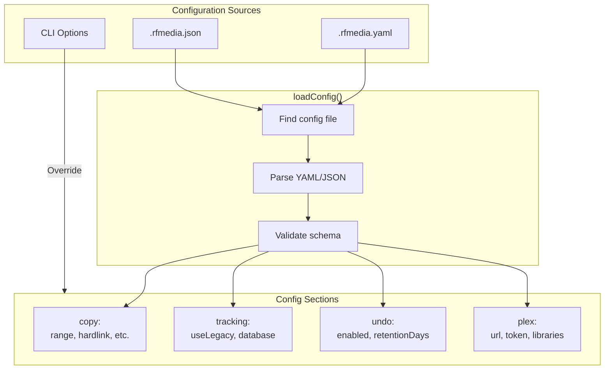

## Tracking System Data Flow

### Dual-Mode Tracking

The tracking system supports both database and legacy file modes:

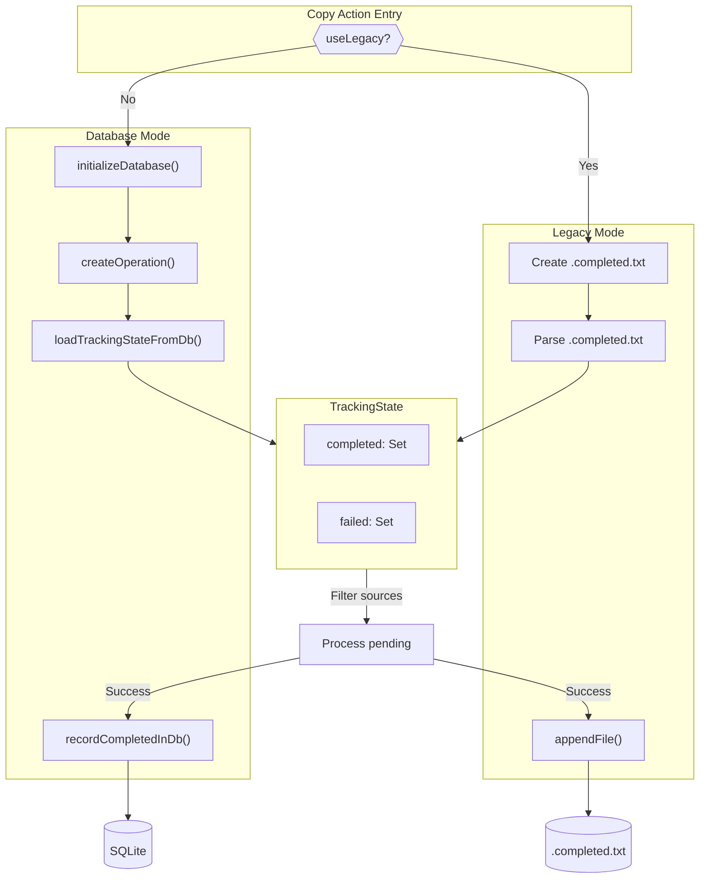

### History Recording Flow

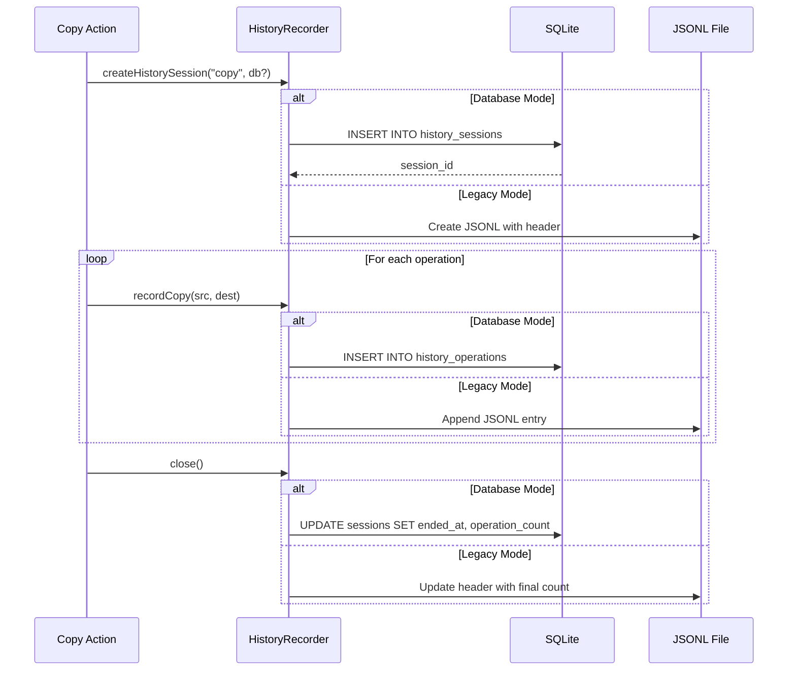

## Signal Handling Flow

Graceful interruption for long-running operations:

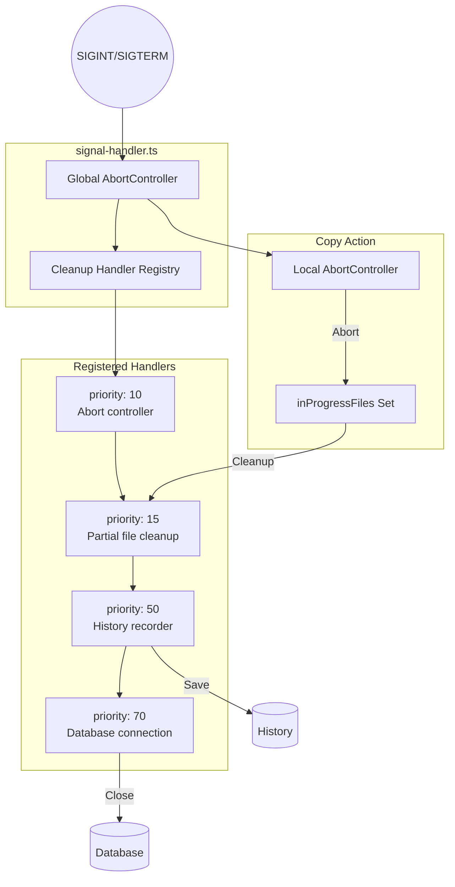

## Error Propagation Flow

The rfapps-cli uses a structured error handling system built on the `@rfmedia/common` error
formatting pipeline. Errors are represented as custom error classes with context-rich fields and
formatted through registered formatters that produce user-friendly messages with actionable
suggestions.

### Library Error Path

Validation and lookup errors thrown in library code propagate through Commander.js to the `main()`
catch block, where `handleCliError()` formats and outputs them.

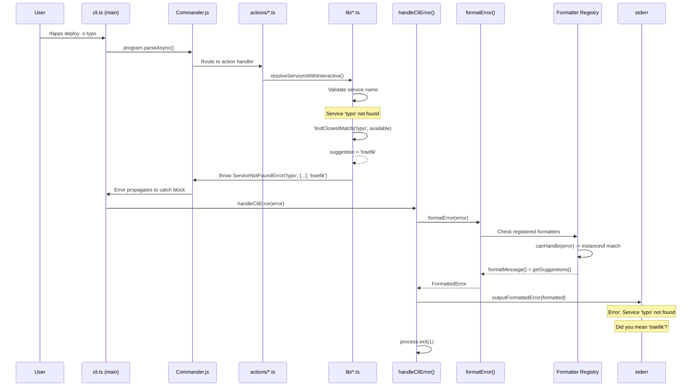

### Action Docker Error Path

Actions that execute Docker operations process multiple services in loops. When one service fails,
the loop continues processing remaining services. These actions use local formatting instead of
throwing.

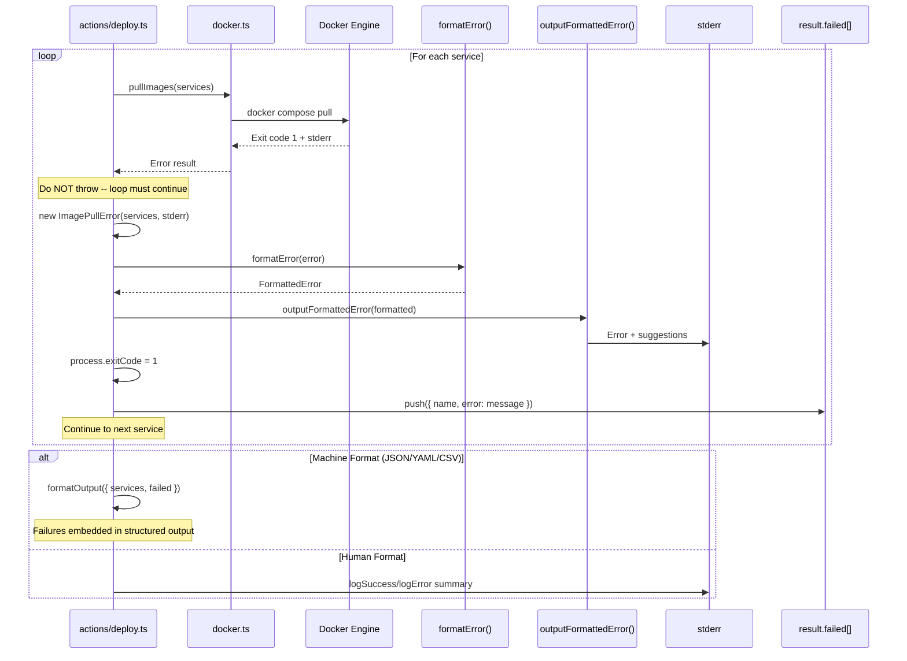

### Error Formatting Pipeline

When an error is passed to `formatError()`, it traverses the formatter registry to find a matching
handler. Formatters are checked in registration order, with more specific formatters registered
before generic ones. If no registered formatter matches, a default formatter provides a generic
message.

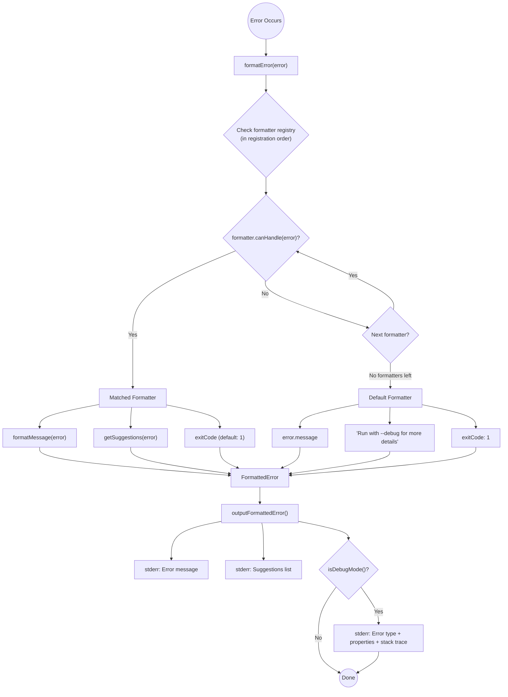

### Hybrid Error Strategy

The rfapps-cli uses a hybrid approach where the error propagation method depends on where the error
originates. Library-level errors throw and rely on the global catch handler, while action-level
Docker errors are formatted locally to preserve multi-service loop execution and structured output.

```mermaid
flowchart LR
    subgraph LibraryErrors["Library Errors (throw)"]
        direction TB
        L1["ServiceNotFoundError"]
        L2["GroupNotFoundError"]
        L3["ProfileNotFoundError"]
        L4["ConfigNotFoundError"]
        L5["ConfigValidationError"]
        L6["InvalidArgumentError"]
        L7["PlanValidationError"]
        L8["DeploymentNotFoundError"]
        L9["InsufficientHistoryError"]
    end

    subgraph DockerErrors["Docker Errors (local format)"]
        direction TB
        D1["DockerCommandError"]
        D2["ImagePullError"]
        D3["ServiceStartError"]
    end

    LibraryErrors -->|"throw"| COMMANDER["Commander.js catch"]
    COMMANDER --> HANDLE["handleCliError()"]
    HANDLE --> FORMAT_THROW["formatError()"]
    FORMAT_THROW --> OUTPUT_THROW["outputFormattedError()"]
    OUTPUT_THROW --> EXIT["process.exit(1)"]

    DockerErrors -->|"instantiate"| FORMAT_LOCAL["formatError()"]
    FORMAT_LOCAL --> OUTPUT_LOCAL["outputFormattedError()"]
    OUTPUT_LOCAL --> EXIT_CODE["process.exitCode = 1"]
    EXIT_CODE --> CONTINUE["Continue loop + result.failed[]"]
```

Key rules for the hybrid strategy:

- Library errors (validation, lookup, config) **throw** and propagate to `handleCliError()`, which
  calls `process.exit()`
- Docker operation errors are **formatted locally** inside action functions to preserve
  multi-service loop execution
- `formatError()` always returns a `FormattedError` (never null), so no null-check is needed at call
  sites
- Machine-format output (JSON/YAML/CSV) embeds failures in the `result.failed[]` array, not just
  stderr

## JSON Output Flow

All commands support JSON output for scripting:

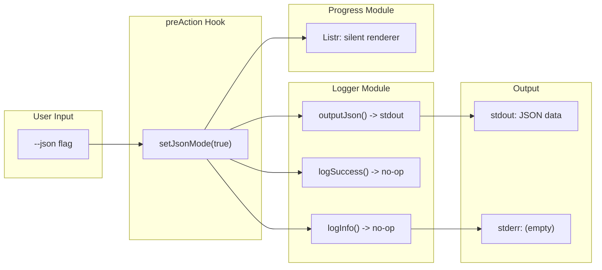

## Related Documentation

- [Architecture Overview](./overview.md) - High-level system architecture
- [Sidecar Linking](../features/sidecar-linking.md) - Automatic sidecar management
- [Plan/Apply Workflow](../features/plan-apply-workflow.md) - Deployment planning
