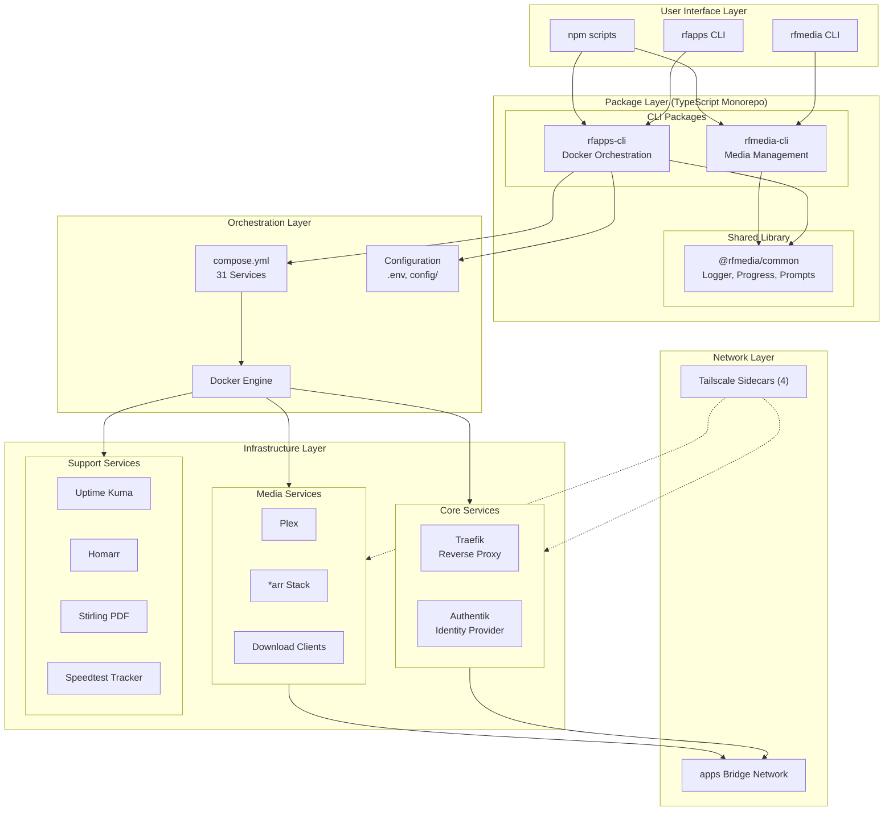
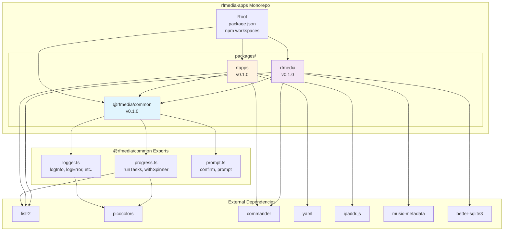
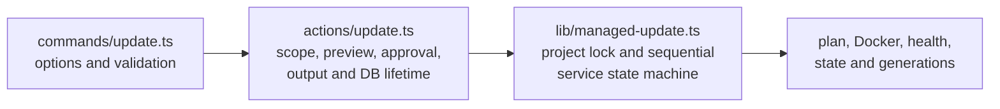
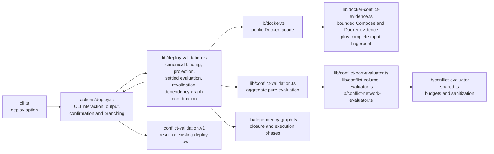

# Architecture Overview

This document provides a high-level overview of the rfmedia-apps system architecture, covering both
the infrastructure layer (Docker services) and the package layer (CLI tools and shared utilities).

## System Architecture

The rfmedia-apps project is a comprehensive self-hosting platform that combines:

1. **Infrastructure Layer**: 31 containerized applications managed via Docker Compose
2. **Package Layer**: TypeScript monorepo with CLI tools for orchestration and media management
3. **Shared Utilities**: Common library providing consistent UX across all CLI tools

## Layer Descriptions

### User Interface Layer

Users interact with the system through:

- **rfapps CLI**: Primary tool for Docker orchestration (`rfapps deploy`, `rfapps update`, etc.)
- **rfmedia CLI**: Media library management (`rfmedia copy`, `rfmedia sync`, etc.)
- **npm scripts**: Convenience wrappers in root `package.json` for common operations
- **Interactive Ink UI**: Terminal-based selectors for track and delete workflows

### Package Layer

The TypeScript monorepo provides type-safe tooling:

| Package           | Purpose              | Key Dependencies               |
| ----------------- | -------------------- | ------------------------------ |
| `@rfmedia/common` | Shared CLI utilities | listr2, picocolors             |
| `rfapps`          | Docker orchestration | commander, yaml, ipaddr.js     |
| `rfmedia`         | Media management     | music-metadata, better-sqlite3 |

All packages use:

- TypeScript with ES2023 target
- ESM modules with NodeNext resolution
- Node.js 22+ runtime

### Orchestration Layer

Configuration and service definitions:

- **compose.yml**: Single Docker Compose file defining all 31 services
- **Configuration**: Environment variables (`.env`), service configs (`config/`)
- **Docker Engine**: Local or remote Docker context for container management

### Infrastructure Layer

Three categories of containerized services:

- **Core**: Traefik (reverse proxy), Authentik (authentication)
- **Media**: Plex, Sonarr, Radarr, Bazarr, SABnzbd, etc.

### Network Layer

Networking uses a hybrid approach with Docker bridge as the primary network:

- **apps Bridge Network**: Primary internal communication between all services
- **Docktail**: Tailnet ingress; advertises Traefik and labeled services as Tailscale Services
- **Docktail**: Tailnet ingress; advertises Traefik, media, and labeled services as Tailscale Services

## Package Architecture

The monorepo follows a layered dependency structure where CLI packages depend on the shared library,
but not on each other.

## Design Principles

### Separation of Concerns

- **Commands** define CLI interface (arguments, options, help text)
- **Actions** own interaction, configuration, output, and resource lifetimes
- **Lib** provides reusable utilities and typed, framework-independent coordinators

### Managed Update Boundary

Managed image updates preserve the command/action/library split:

The default command detects updates and saves a secret-free review plan without mutation. An
approved apply acquires a project/Docker-context lock, revalidates the reviewed scope and immutable
identities, then processes actionable services one at a time. Each service gets an exact local-image
snapshot before the reviewed repository digest is pulled, recreated, verified, and recorded. A
post-mutation failure restores and verifies that exact same-daemon image ID when recovery is enabled.

This mutation path is CLI-only, sequential, image-only, and lock-scoped. Its injected plan, Docker,
health, state, lock, signal, filesystem, and clock dependencies are extension and testing seams; they
do not imply background scheduling, parallel service mutation, or rollback of volumes, databases,
application data, or migrations.

### Service Conflict Validation Boundary

The opt-in deploy preflight preserves the command/action/library split and keeps external evidence
collection separate from policy:

The deploy action owns CLI-facing interaction, rendering, confirmation, and pass/non-pass, dry-run,
parallel, and mutation branching. `deploy-validation.ts` owns canonical input binding, effective
service closure and desired-state projection, aggregation of independently settled authority and
runtime evidence lanes, evaluation, pre-mutation revalidation, and reuse of the validated Compose
model for dependency-graph coordination.

`docker.ts` preserves the public Docker facade while `docker-conflict-evidence.ts` resolves and
strictly projects bounded, allowlisted Compose, container, network, and volume evidence. The adapter
fingerprints the complete parsed Compose payload before discarding secret-bearing fields; the
coordinator retains only that one-way representation of the complete payload in the binding.
`conflict-validation.ts` performs no I/O and delegates resource policy to
`conflict-port-evaluator.ts`, `conflict-volume-evaluator.ts`, and
`conflict-network-evaluator.ts`. Those modules share deterministic budgets and display sanitization
through `conflict-evaluator-shared.ts`. Validation evidence is ephemeral and is not written to
deployment history.

### Type Safety

- Strict TypeScript configuration (`noUncheckedIndexedAccess: true`)
- Discriminated unions for mode-specific options
- Explicit `.js` extensions for ESM imports

### Consistent UX

- All log output to stderr (stdout reserved for JSON/data)
- JSON mode for scripting (`--json` flag)
- Debug mode via environment variables or flags

### Fail-Fast Philosophy

- Throw errors early, avoid fallbacks
- Validate configuration before operations
- Provide clear error messages with actionable context

## CLI Components

### rfapps-cli

- **Role**: Docker orchestration and deployment planning
- **Entry**: `packages/rfapps-cli/src/cli.ts`
- **Key modules**:
  - `src/commands/*`: CLI surface (arguments, options, help)
  - `src/actions/*`: Interaction and orchestration policy (pull, deploy, plan/apply, update)
  - `src/actions/deploy.ts`: Deploy interaction, output, confirmation, and execution branching
  - `src/types/validation.ts`: Versioned conflict-validation contracts and resource projections
  - `src/lib/deploy-validation.ts`: Deploy preflight binding, projection, settled evaluation,
    revalidation, and dependency-graph coordination
  - `src/lib/docker-conflict-evidence.ts`: Bounded Compose/Docker conflict evidence and complete-input
    fingerprinting behind the `docker.ts` facade
  - `src/lib/conflict-validation.ts`: Aggregate pure service-conflict evaluation and human projection
  - `src/lib/conflict-port-evaluator.ts`, `src/lib/conflict-volume-evaluator.ts`,
    `src/lib/conflict-network-evaluator.ts`: Resource-specific conflict evaluators
  - `src/lib/conflict-evaluator-shared.ts`: Shared deterministic budgets and display sanitization
  - `src/lib/managed-update.ts`: Locked sequential managed-image-update coordinator
  - `src/lib/docker.ts`: Docker Compose execution and public evidence facade
  - `src/lib/health.ts`: Target identity/readiness and dependency verification
  - `src/lib/plan-storage.ts`: Deployment and managed-update plan/report persistence
  - `src/lib/state-storage.ts`, `src/lib/generations.ts`: History and exact-image recovery anchors
  - `src/lib/services.ts`: Service group expansion and sidecar linking

### rfmedia-cli

- **Role**: Media file operations, tracking, and Plex-driven workflows
- **Entry**: `packages/rfmedia-cli/src/cli.ts`
- **Key modules**:
  - `src/commands/*`: CLI surface for copy, sync, clean, Plex actions
  - `src/actions/*`: Business logic (copy modes, playlists, filters)
  - `src/lib/interactive/*`: Ink-based interactive selectors for track/delete flows
  - `src/lib/tracking/*`: SQLite tracking and legacy file mode

### @rfmedia/common

- **Role**: Shared CLI primitives and logging
- **Entry**: `packages/rf-common/src/index.ts`
- **Key exports**:
  - Logging helpers (`logInfo`, `logWarn`, `logError`, `logSuccess`)
  - Progress helpers (Listr2 wrappers)
  - Prompt helpers for confirmations and input

## Related Documentation

- [Data Flow Patterns](./data-flow.md) - CLI execution and Docker orchestration flows
- [Service Conflict Detection](../features/service-conflict-detection.md) - Opt-in deploy preflight
  architecture and operator contract
- [Smart Playlists](../features/smart-playlists.md) - Playlist generation subsystem
