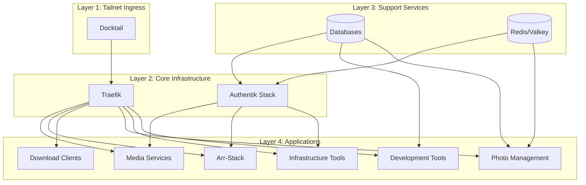
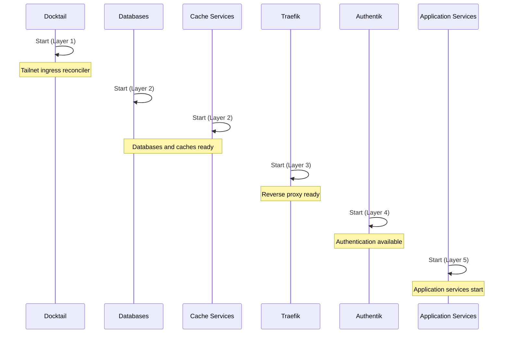

# Docker Compose Service Profiles and Selective Deployment

## Overview

This document describes the service deployment strategy for the rfmedia-apps platform. While Docker
Compose natively supports profiles for selective service deployment, this project uses an
alternative approach through the `rfapps` CLI due to architectural constraints specific to the
Tailscale sidecar pattern.

## Why Not Docker Compose Profiles?

Docker Compose profiles were evaluated during the compose.yml refactoring effort but were not
implemented due to several architectural constraints:

### 1. Docktail and Traefik on `apps`

Traefik connects directly to the `apps` bridge network. **Docktail** advertises Traefik over the
tailnet. Deploy both for core ingress:

```bash
rfapps deploy --services docktail,traefik --yes
```

### 2. Cross-Profile Middleware References

Traefik labels reference `authentik-dev@docker` and `authentik-media@docker` middlewares. These
middlewares are defined on the `authentik-server` container, meaning core authentication services
must be running regardless of which "profile" the user wants to deploy.

### 3. Circular Dependency Issues

Testing revealed circular dependency problems when services span profile boundaries. For example,
media services need Traefik for routing, Traefik needs Authentik for authentication, and some media
services reference Authentik directly.

### 4. Complexity vs. Benefit

Users would need to specify multiple profiles for most operations (e.g.,
`--profile core --profile media --profile downloads`), negating the simplicity benefit that profiles
are designed to provide.

### 5. Breaking Default Behavior

With profiles enabled, `docker compose up` starts nothing without an explicit `--profile` flag. This
would break existing workflows and scripts that expect all services to start by default.

## Alternative Approach: rfapps CLI

The `rfapps` CLI provides granular control over service deployment without the limitations of Docker
Compose profiles. The CLI handles service group expansion and provides a modern TypeScript
implementation.

### Using rfapps CLI

```bash
# Deploy all services (38 total)
rfapps deploy --yes

# Deploy a specific service
rfapps deploy -s uptime-kuma --yes

# Deploy a service group
rfapps deploy -g media-stack --yes

# Rebuild specific services
rfapps rebuild -s plex --yes

# Stop specific services
rfapps stop -s homarr --yes

# Dry-run to preview actions
rfapps deploy -s plex --dry-run

# Check service status
rfapps status
```

The `rfapps` CLI works well for the tightly-coupled architecture where services share network stacks
and reference each other's middlewares.

## Service Categories

Although profiles are not implemented in Docker Compose, services are logically organized into
categories for documentation and operational purposes.

### Category Summary

| Category       | Service Count | Description                                                               |
| -------------- | ------------- | ------------------------------------------------------------------------- |
| Core           | 8             | Essential infrastructure (Docktail, Traefik, Authentik)                   |
| Infrastructure | 6             | Management and productivity tools                                         |
| Downloads      | 6             | Download clients and helpers                                              |
| Arr-Stack      | 7             | Media automation (Sonarr, Radarr, Bazarr)                                 |
| Media          | 6+            | Media servers (Plex, Tautulli, Plexseerr, Jellyseerr, Kometa, WatchState) |
| Photos         | 4             | Photo management (Immich)                                                 |

**Total: 35 services**

### Core Infrastructure (8 services)

Essential services required for the platform to function. These must be running for other services
to operate correctly.

| Service          | Type        | Purpose                                   |
| ---------------- | ----------- | ----------------------------------------- |
| docktail         | Application | Tailnet ingress via Tailscale Services    |
| traefik          | Application | Reverse proxy and SSL termination         |
| cloudflared      | Application | Cloudflare Tunnel to Traefik              |
| authentik-server | Application | Identity provider and SSO                 |
| authentik-worker | Application | Background job processing                 |
| authentik-db     | Database    | PostgreSQL for Authentik                  |
| authentik-redis  | Cache       | Redis cache for Authentik                 |
| authentik-media  | Application | Authentication outpost for media services |

### Infrastructure Management (6 services)

Tools for managing and monitoring the platform.

| Service           | Type        | Purpose                  |
| ----------------- | ----------- | ------------------------ |
| homarr            | Application | Dashboard and homepage   |
| uptime-kuma       | Application | Uptime monitoring        |
| stirling-pdf      | Application | PDF manipulation tool    |
| speedtest-tracker | Application | Network speed monitoring |
| forgejo           | Application | Self-hosted Git forge    |
| forgejo-postgres  | Database    | PostgreSQL for Forgejo   |

Optional profile `t3` (not part of `all`) holds a single service, `t3`. It is a socat bridge that
publishes a host-run T3 Code server at `t3.${DOMAIN}`. Enable it with `rfapps deploy -s t3 --yes` or
`docker compose --profile t3 up -d t3`. See [T3 Code Setup](../services/t3-setup.md).

### Downloads (6 services)

Download clients and indexers for content acquisition.

| Service   | Type        | Purpose                   |
| --------- | ----------- | ------------------------- |
| sabnzbd   | Application | Usenet download client    |
| nzbget    | Application | Alternative Usenet client |
| slskd     | Application | P2P file sharing client   |
| autobrr   | Application | IRC announce automation   |
| unpackerr | Application | Archive extraction        |
| prowlarr  | Application | Indexer manager           |

### Arr-Stack (7 services)

Media automation and management applications.

| Service     | Type        | Purpose                         |
| ----------- | ----------- | ------------------------------- |
| sonarr      | Application | TV series management            |
| radarr      | Application | Movie management                |
| lidarr      | Application | Music management                |
| bazarr      | Application | Subtitle management             |
| notifiarr   | Application | Notification integration        |
| praxrr      | Application | Profile management for arr apps |
| arr-scripts | Application | Automation scripts and helpers  |

### Media (8 services)

Media servers and related services.

| Service    | Type        | Purpose                                   |
| ---------- | ----------- | ----------------------------------------- |
| plex       | Application | Media server with hardware transcoding    |
| plex-music | Application | Second Plex instance dedicated to music   |
| jellyfin   | Application | Media server with hardware transcoding    |
| kometa     | Application | Plex metadata and collections             |
| tautulli   | Application | Plex analytics and monitoring             |
| plexseerr  | Application | Plex media request management (Seerr)     |
| jellyseerr | Application | Jellyfin media request management         |
| watchstate | Application | Cross-server play-state and progress sync |

### Photos (4 services)

Photo and video management platform.

| Service         | Type        | Purpose                             |
| --------------- | ----------- | ----------------------------------- |
| immich-server   | Application | Photo/video management server       |
| immich-ml       | Application | Machine learning for photo features |
| immich-redis    | Cache       | Valkey/Redis for Immich             |
| immich-postgres | Database    | PostgreSQL with vector extensions   |

## Service Dependency Hierarchy

The following diagram illustrates the dependency relationships between service categories:



## Service Startup Order

Due to the dependency relationships, services start in a specific order:



## Deployment Patterns

### Full Deployment

Deploy all 38 services:

```bash
rfapps deploy --yes
```

### Core Infrastructure Only

Deploy just the essential infrastructure for testing:

```bash
# Deploy core services
rfapps deploy --services docktail,traefik,authentik-server,authentik-worker,authentik-db,authentik-redis --yes
```

### Media Stack

Deploy media-related services using the predefined group:

```bash
# Deploy the entire media stack
rfapps deploy -g media-stack --yes

# Or deploy individual services
rfapps deploy -s plex --yes
rfapps deploy --services sonarr,radarr,bazarr,plexseerr,jellyseerr --yes
```

### Download Stack

Deploy download clients using the predefined group:

```bash
# Deploy the entire download stack
rfapps deploy -g download-stack --yes

# Or deploy individual services
rfapps deploy --services sabnzbd,prowlarr --yes
```

### Photo Management

Deploy Immich photo platform using the predefined group:

```bash
# Deploy the entire Immich stack
rfapps deploy -g photo-stack --yes

# Or deploy individual services
rfapps deploy -s immich-server --yes
```

## Direct Docker Compose Usage

For direct Docker Compose operations without `rfapps`:

```bash
# Start all services
docker compose up -d

# Start specific services
docker compose up -d docktail traefik

# Stop specific services
docker compose stop sonarr radarr

# View logs for a service
docker compose logs -f plex

# Check service status
docker compose ps
```

## Best Practices

### 1. Use Service Groups for Logical Deployments

The `rfapps` CLI supports service groups for deploying related services together. In this repo,
`sidecars.enabled: false` — Tailscale sidecar linking is not active; tailnet exposure is handled
by Docktail labels on the `apps` network instead:

```bash
# Deploy plex
rfapps deploy -s plex --yes

# Deploy traefik
rfapps deploy -s traefik --yes

# Preview services included in a group
rfapps deploy -g media-stack --dry-run
```

For direct Docker Compose usage:

```bash
docker compose up -d plex
```

### 2. Verify Core Infrastructure First

Before deploying application services, ensure core infrastructure is running:

```bash
# Check service status
rfapps status

# Check specific services with Docker Compose
docker compose ps traefik authentik-server authentik-db authentik-redis

# Deploy core infrastructure if needed
rfapps deploy --services docktail,traefik --yes
```

### 3. Use rfapps for Complex Operations

The `rfapps` CLI handles proper startup sequencing:

```bash
# Rebuild a service (stop + build + start)
rfapps rebuild -s plex --yes

# Deploy with verbose output
rfapps deploy -v --yes

# Delete services and their volumes
rfapps delete -s plex --volumes --yes

# Prune services with smart image removal
rfapps prune -s plex --yes
```

### 4. Group Related Services

Use predefined service groups for common operations:

```bash
# Deploy the arr-stack (sonarr, radarr, lidarr, bazarr, prowlarr + sidecars)
rfapps deploy -g arr-stack --yes

# Deploy the media-stack (plex, sonarr, radarr, lidarr, bazarr)
rfapps deploy -g media-stack --yes

# Deploy the download-stack (unpackerr, autobrr, sabnzbd, slskd, nzbget)
rfapps deploy -g download-stack --yes

# Deploy the auth-stack (all authentik services)
rfapps deploy -g auth-stack --yes

# Or specify multiple services manually
rfapps deploy --services sonarr,radarr,prowlarr --yes
```

## Troubleshooting

### Service Not Starting

If a service fails to start, check its logs and dependencies:

```bash
# Check service status
docker compose ps plex

# View service logs
docker compose logs plex
```

### Authentication Errors

Ensure Authentik services are healthy:

```bash
# Check Authentik health
docker compose ps authentik-server authentik-db authentik-redis

# Rebuild if needed
rfapps rebuild --services authentik-server,authentik-worker --yes

# Or rebuild the entire auth stack
rfapps rebuild -g auth-stack --yes
```

### Network Issues

Verify tailnet and sidecar connectivity:

```bash
# Docktail reconciler
docker compose logs docktail --tail 30

# Media sidecar example
docker exec tailscale status
```

## Related Documentation

- [Quick Reference](quick-reference.md) - One-page command reference card
- [rfapps CLI Reference](../reference/rfapps-cli-reference.md) - Complete command documentation
- [Docker Compose Extensions](docker-compose-extensions.md) - Reusable configuration templates
- [Tailscale Integration](tailscale-integration.md) - Sidecar pattern architecture
- [Traefik Reverse Proxy](traefik-reverse-proxy.md) - Routing and SSL configuration
- [Sidecar Linking](sidecar-linking.md) - Automatic sidecar management
