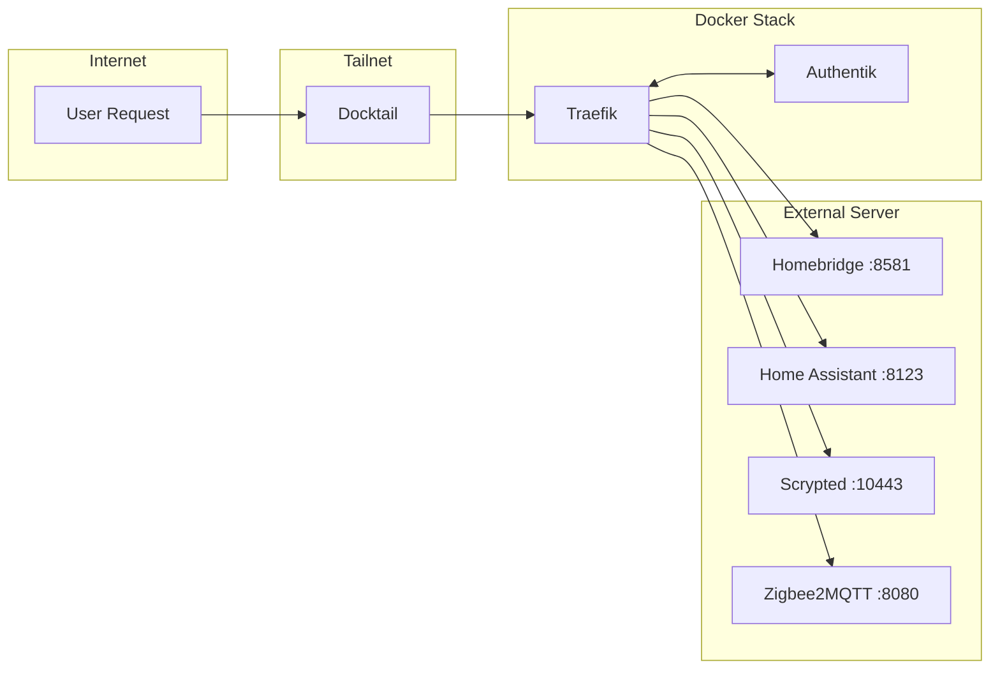

# Home Automation Proxy

## Overview

The home automation proxy feature enables Traefik to route traffic to home automation services running on an external server (such as a dedicated home automation hub or NAS). This provides centralized access control, SSL termination, and unified authentication for services that are not part of the Docker stack.

## Architecture

### Components

1. **Traefik Reverse Proxy** - Routes incoming requests to external home automation services
2. **File-Based Configuration** - Dynamic routing rules defined in `config/traefik/homeauto.yml`
3. **Authentik Forward Authentication** - Provides SSO for all home automation services
4. **External Home Automation Server** - Separate server hosting the actual services

### Data Flow



## Proxied Services

The following home automation services are proxied through Traefik:

| Service        | Subdomain              | Port  | Protocol | Description                                  |
| -------------- | ---------------------- | ----- | -------- | -------------------------------------------- |
| Homebridge     | `homebridge.${DOMAIN}` | 8581  | HTTP     | HomeKit bridge for non-HomeKit devices       |
| Home Assistant | `ha.${DOMAIN}`         | 8123  | HTTP     | Open-source home automation platform         |
| Scrypted       | `scrypted.${DOMAIN}`   | 10443 | HTTPS    | Camera and NVR platform with HomeKit support |
| Zigbee2MQTT    | `z2m.${DOMAIN}`        | 8080  | HTTP     | Zigbee to MQTT bridge for device control     |

## Configuration

### Environment Variable

The `HOMEAUTO_SERVER` environment variable must be set to the IP address or hostname of the external home automation server:

```bash
# In .env or .env.local
HOMEAUTO_SERVER=192.168.1.100
```

This variable is:

- Passed to the Traefik container via the `environment` section in `compose.yml`
- Used in file-based configuration via Go template syntax: `{{ env "HOMEAUTO_SERVER" }}`

### Traefik Configuration

The home automation routes are defined in `config/traefik/homeauto.yml`:

```yaml
http:
  routers:
    homebridge:
      rule: Host(`homebridge.{{ env "DOMAIN" }}`)
      entryPoints:
        - websecure
      service: homebridge
      middlewares:
        - authentik-dev-file
      tls:
        certResolver: letsencrypt

  services:
    homebridge:
      loadBalancer:
        servers:
          - url: http://{{ env "HOMEAUTO_SERVER" }}:8581
```

### File Provider Setup

Traefik loads the file-based configuration via the file provider:

```yaml
# In compose.yml traefik command section
- --providers.file.directory=/etc/traefik/dynamic
- --providers.file.watch=true
```

The configuration files are mounted from `${DOCKER_DIR}/traefik` which contains a `dynamic/` subdirectory with the home automation configuration.

## Routing Patterns

### Standard HTTP Services

Most home automation services use HTTP internally:

```yaml
services:
  homebridge:
    loadBalancer:
      servers:
        - url: http://{{ env "HOMEAUTO_SERVER" }}:8581
```

### HTTPS Services with Self-Signed Certificates

Scrypted uses HTTPS with a self-signed certificate, requiring the `insecureTransport` configuration:

```yaml
services:
  scrypted:
    loadBalancer:
      servers:
        - url: https://{{ env "HOMEAUTO_SERVER" }}:10443
      serversTransport: insecureTransport
```

The `insecureTransport` is defined in `config/traefik/network.yml`:

```yaml
http:
  serversTransports:
    insecureTransport:
      insecureSkipVerify: true
```

## Authentication

All home automation services use the `authentik-dev-file` middleware for forward authentication:

```yaml
http:
  middlewares:
    authentik-dev-file:
      forwardAuth:
        address: https://authentik-server:9443/outpost.goauthentik.io/auth/traefik
        trustForwardHeader: true
        maxResponseBodySize: 1048576
        authResponseHeaders:
          - X-authentik-username
          - X-authentik-groups
          - X-authentik-email
          - X-authentik-name
          - X-authentik-uid
        tls:
          insecureSkipVerify: true
```

This provides:

- Single Sign-On (SSO) across all home automation services
- User identity headers passed to backend services
- Centralized access control via Authentik policies

## SSL/TLS Configuration

### Certificate Management

All proxied services receive automatic SSL certificates via Let's Encrypt:

```yaml
routers:
  homebridge:
    tls:
      certResolver: letsencrypt
```

### Certificate Storage

Certificates are stored in `${DOCKER_DIR}/traefik/acme/acme.json` and automatically renewed by Traefik.

## Network Requirements

### Connectivity

The Docker host running Traefik must have network access to the home automation server:

- Ensure the `HOMEAUTO_SERVER` IP/hostname is reachable from the Docker host
- Required ports: 8581 (Homebridge), 8123 (Home Assistant), 10443 (Scrypted), 8080 (Zigbee2MQTT)
- No special firewall rules needed on the Docker side (outbound connections)

### DNS Configuration

Each service requires a DNS record pointing to the Traefik entry point:

- `homebridge.${DOMAIN}` -> Tailscale IP or external IP
- `ha.${DOMAIN}` -> Tailscale IP or external IP
- `scrypted.${DOMAIN}` -> Tailscale IP or external IP
- `z2m.${DOMAIN}` -> Tailscale IP or external IP

## Adding New Home Automation Services

To add a new external home automation service:

1. **Add router configuration** in `config/traefik/homeauto.yml`:

   ```yaml
   routers:
     new-service:
       rule: Host(`new-service.{{ env "DOMAIN" }}`)
       entryPoints:
         - websecure
       service: new-service
       middlewares:
         - authentik-dev-file
       tls:
         certResolver: letsencrypt
   ```

2. **Add service configuration**:

   ```yaml
   services:
     new-service:
       loadBalancer:
         servers:
           - url: http://{{ env "HOMEAUTO_SERVER" }}:PORT
   ```

3. **For HTTPS backends**, add `serversTransport`:

   ```yaml
   services:
     new-service:
       loadBalancer:
         servers:
           - url: https://{{ env "HOMEAUTO_SERVER" }}:PORT
         serversTransport: insecureTransport
   ```

4. **Create DNS record** for the new subdomain

5. **Reload Traefik** (automatic if `--providers.file.watch=true` is enabled)

## Troubleshooting

### Service Not Accessible

1. **Verify HOMEAUTO_SERVER is set**:

   ```bash
   docker exec traefik printenv HOMEAUTO_SERVER
   ```

2. **Check Traefik logs for routing errors**:

   ```bash
   docker logs traefik 2>&1 | grep homebridge
   ```

3. **Verify network connectivity**:

   ```bash
   docker exec traefik wget -qO- http://${HOMEAUTO_SERVER}:8581
   ```

### Authentication Issues

1. **Check Authentik server is running**:

   ```bash
   docker logs authentik-server
   ```

2. **Verify middleware configuration**:

   ```bash
   docker exec traefik cat /etc/traefik/dynamic/homeauto.yml
   ```

### Certificate Errors

1. **Check Let's Encrypt rate limits**:

   ```bash
   docker exec traefik cat /etc/traefik/acme/acme.json | jq '.letsencrypt.Certificates'
   ```

2. **Verify DNS records are correct**:

   ```bash
   dig homebridge.${DOMAIN}
   ```

## Related Documentation

- [Traefik Reverse Proxy](traefik-reverse-proxy.md) - Complete Traefik architecture
- [Authentik Integration](authentik-integration.md) - Authentication setup
- [Environment Variables Reference](../reference/environment-variables.md) - All configuration options
