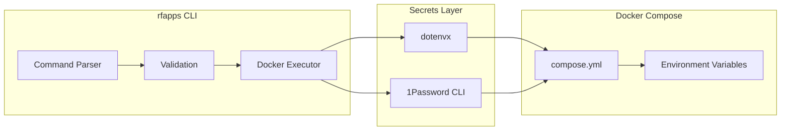
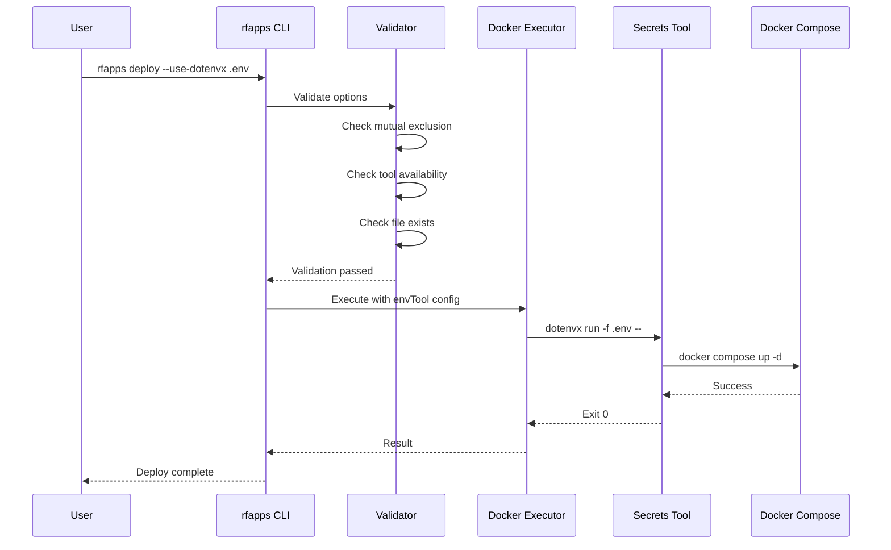

# Secrets Management

This document describes the secrets injection features for the rfmedia-apps tooling, which provides
secure management of sensitive configuration values at both the CLI and config file levels.

## Overview

The rfmedia-apps platform supports secrets injection at two levels:

1. **CLI-Level Secrets** - Environment variable injection for Docker Compose commands via dotenvx or
   1Password CLI
2. **Config-Level Secrets** - Template-based secrets in `.rfmedia.yaml` and `.rfapps.yaml`
   configuration files

Both approaches ensure sensitive values are never hardcoded in committed files while providing a
seamless developer experience.

## Config-Level Secrets Injection

The `rfmedia-cli` and `rfapps-cli` tools support template-based secrets injection in their
configuration files using the `{{ VAR_NAME }}` syntax. Templates are resolved at runtime from
environment variables before YAML parsing.

### Template Syntax

Use double curly braces with the environment variable name:

```yaml
token: "{{ PLEX_TOKEN }}"
```

Whitespace inside the braces is flexible:

```yaml
# All of these work identically
token: "{{ PLEX_TOKEN }}"
token: "{{PLEX_TOKEN}}"
token: "{{  PLEX_TOKEN  }}"
```

### Supported Configuration Files

| File            | CLI         | Purpose                            |
| --------------- | ----------- | ---------------------------------- |
| `.rfmedia.yaml` | rfmedia-cli | Plex server configuration, filters |
| `.rfapps.yaml`  | rfapps-cli  | Docker orchestration settings      |

### Usage Examples

#### Before: Hardcoded Secrets (Not Recommended)

```yaml
# .rfmedia.yaml - DO NOT COMMIT THIS
plex:
  url: https://plex.example.com
  token: your-plex-token-here # Exposed secret!
```

#### After: Template-Based Secrets (Recommended)

```yaml
# .rfmedia.yaml - Safe to commit
plex:
  url: "{{ PLEX_URL }}"
  token: "{{ PLEX_TOKEN }}"
```

#### Complex Configurations

Templates work in any YAML context including nested structures and arrays:

```yaml
# Multiple templates in different contexts
plex:
  url: "{{ PLEX_URL }}"
  token: "{{ PLEX_TOKEN }}"

# Templates in arrays
radarr:
  instances:
    - name: radarr-4k
      apiKey: "{{ RADARR_4K_API_KEY }}"
    - name: radarr-hd
      apiKey: "{{ RADARR_HD_API_KEY }}"
```

### Environment Variable Sources

Template variables are resolved from `process.env`, which can be populated by:

1. **Shell Environment** - Variables exported in your shell session

   ```bash
   export PLEX_TOKEN="your-token-here"
   rfmedia scan
   ```

2. **dotenvx** - Encrypted environment files with automatic decryption

   ```bash
   dotenvx run -f .env.local -- rfmedia scan
   ```

3. **1Password CLI** - Secrets from 1Password vaults

   ```bash
   op run --env-file .env -- rfmedia scan
   ```

4. **rfapps CLI Integration** - Use `--use-dotenvx` or `--use-op` flags

   ```bash
   rfapps deploy --use-dotenvx .env.local --yes
   ```

### Error Handling

When a template variable is not found in the environment, the CLI throws a `SecretsInjectionError`
and halts execution immediately:

```bash
$ rfmedia scan
Error: Environment variable 'PLEX_TOKEN' is not set (required by config template in .rfmedia.yaml)
```

This strict behavior ensures:

- No silent failures with unresolved templates
- Clear error messages identifying the missing variable
- Configuration path included for debugging

**Empty Values**: An empty string (`""`) is treated as a valid value. Only `undefined` (missing)
variables trigger an error.

### Security Notes

1. **Never commit resolved secrets** - Config files with templates are safe to commit; resolved
   values are not
2. **Use example files** - Create `rfmedia.example.yaml` with template syntax for documentation
3. **Add to .gitignore** - If you have local copies with resolved secrets, exclude them

   ```gitignore
   # Ignore local configs with resolved secrets
   .rfmedia.local.yaml
   .rfapps.local.yaml
   ```

4. **Secrets are never logged** - The injection system only logs variable names, never values
5. **Validate before commit** - Use `git diff` to ensure no secrets are staged

### Out-of-Band Credentials (Plex Enrollment)

`rfmedia plex auth login` enrolls the device with a Plex account and stores the resulting
credential **outside the configuration system entirely**. This is the recommended alternative to
`token: "{{ PLEX_TOKEN }}"` when you do not need the token for anything else.

| Property               | Behavior                                                                      |
| ---------------------- | ----------------------------------------------------------------------------- |
| Location               | `~/.config/rfmedia/plex-auth/store.json` (mode `0600`, in a `0700` directory) |
| Path override          | `RFMEDIA_PLEX_AUTH_DIR` (a directory), then `plex.auth.storePath`             |
| Template substitution  | **None.** The store is not a config file and is never `{{ VAR }}`-templated   |
| Secrets-tool injection | Not applicable — no environment variable holds the credential                 |

Why templating does not and should not apply: `injectSecrets` runs on the **raw config text before
parsing**, so it only ever sees config files. The credential store is read separately by the Plex
adapter, with its own path-safety and permission checks, and #251 introduced **no new
secret-bearing configuration field** — `plex.auth` holds a mode, a path, a device label, and a
number of seconds, none of which are secrets.

Practical consequences:

- Nothing to add to `.env`, `.env.encrypted`, or a 1Password vault for Plex.
- Nothing new to add to `.gitignore`: the store never lives in the repository.
- `--use-dotenvx` and `--use-op` are unaffected — enrollment neither requires nor conflicts with
  them, and `plex.token` with `{{ PLEX_TOKEN }}` continues to work exactly as before.
- The store is **local-filesystem only**; its atomic-write and single-flight refresh guarantees
  depend on `link(2)`/`rename(2)` semantics that NFS and SMB do not provide.
- `rfmedia plex auth logout` destroys the local material. It does **not** revoke the device
  server-side; finish that from your Plex Authorized Devices page.

See
[Plex Configuration Guide](../../packages/rfmedia-cli/docs/features/plex-configuration.md)
for the full credential-precedence, migration, and rollback tables.

### Example Configuration Files

See the example files in the repository root:

- `rfmedia.example.yaml` - Template for rfmedia configuration
- `.rfapps.yaml.example` - Template for rfapps configuration (if applicable)

### Migrating from Hardcoded Secrets

If you have existing configuration files with hardcoded secrets, follow these steps to migrate to
template-based secrets:

#### Step 1: Identify Sensitive Values

Review your config files for hardcoded secrets:

```yaml
# Look for patterns like these:
plex:
  token: "your-plex-token-here" # Hardcoded secret!
  url: "https://plex.example.com"
```

#### Step 2: Create Environment Variables

Add the secrets to your environment file (`.env.local` or 1Password vault):

```bash
# .env.local
PLEX_TOKEN=your-plex-token-here
PLEX_URL=https://plex.example.com
```

#### Step 3: Replace with Templates

Update your config file to use template syntax:

```yaml
plex:
  token: "{{ PLEX_TOKEN }}"
  url: "{{ PLEX_URL }}"
```

#### Step 4: Verify the Migration

Test that templates resolve correctly:

```bash
# With dotenvx
dotenvx run -f .env.local -- rfmedia filter --list movies

# With 1Password
op run --env-file .env -- rfmedia filter --list movies
```

#### Step 5: Remove Old Secrets

1. Ensure the templated config works correctly
2. Remove any backup files containing hardcoded secrets
3. Commit the updated config file (now safe to commit)

#### Migration Checklist

- [ ] Identified all hardcoded secrets in config files
- [ ] Created corresponding environment variables
- [ ] Replaced hardcoded values with `{{ VAR_NAME }}` templates
- [ ] Tested with your secrets management tool (dotenvx or 1Password)
- [ ] Removed files containing unencrypted secrets
- [ ] Committed the updated, template-based config files

### Future Enhancements

**Default Values**: A future enhancement may support default value syntax like
`{{ VAR_NAME:default_value }}`. This would allow templates to fall back to a default when the
environment variable is not set:

```yaml
# Potential future syntax (not yet implemented)
plex:
  timeout: "{{ PLEX_TIMEOUT:30 }}" # Default to 30 if not set
```

For now, all template variables must be explicitly set in the environment.

---

## CLI-Level Secrets Injection

The rfapps CLI supports two secrets injection tools for Docker Compose commands:

- **dotenvx** - Encrypted environment file management with local key storage
- **1Password CLI (op)** - 1Password vault integration for team-based secrets

These options wrap Docker Compose commands with the appropriate secrets tool, injecting environment
variables at runtime without exposing them in shell history or process listings.

### When to Use Each Approach

| Feature             | dotenvx                        | 1Password CLI                   |
| ------------------- | ------------------------------ | ------------------------------- |
| **Best for**        | Local development, single user | Team environments, enterprise   |
| **Encryption**      | AES-256-GCM with local keys    | 1Password vault encryption      |
| **Key management**  | Local `.env.keys` file         | 1Password account               |
| **Sharing secrets** | Share encrypted file + keys    | Share vault access              |
| **Offline support** | Yes (fully offline)            | Requires initial auth           |
| **Cost**            | Free                           | Requires 1Password subscription |

**Recommendation**:

- Use **dotenvx** for personal projects or when you need offline support
- Use **1Password CLI** for team environments where secrets need centralized management

### Architecture



### Setup Instructions

#### dotenvx Setup

1. **Install dotenvx**:

   ```bash
   # Using npm (recommended)
   npm install -g @dotenvx/dotenvx

   # Verify installation
   dotenvx --version
   ```

2. **Create your environment file**:

   ```bash
   # Create .env.local with your variables
   cat > .env.local << 'EOF'
   TZ=America/New_York
   PUID=1000
   PGID=1000
   DOCKER_DIR=/opt/docker/config
   AUTHENTIK_SECRET_KEY=your_secret_key_here
   DB_PASSWORD=your_database_password
   EOF
   ```

3. **Encrypt the environment file**:

   ```bash
   # Encrypt the file (creates .env.local.encrypted and .env.keys)
   dotenvx encrypt .env.local

   # The original .env.local is now encrypted
   # Store .env.keys securely (it contains the decryption key)
   ```

4. **Use with rfapps**:

   ```bash
   rfapps deploy --use-dotenvx .env.local --yes
   ```

#### 1Password CLI Setup

1. **Install 1Password CLI**:

   ```bash
   # macOS
   brew install 1password-cli

   # Linux (Debian/Ubuntu)
   curl -sS https://downloads.1password.com/linux/keys/1password.asc | \
     sudo gpg --dearmor --output /usr/share/keyrings/1password-archive-keyring.gpg
   echo "deb [arch=amd64 signed-by=/usr/share/keyrings/1password-archive-keyring.gpg] https://downloads.1password.com/linux/debian/amd64 stable main" | \
     sudo tee /etc/apt/sources.list.d/1password.list
   sudo apt update && sudo apt install 1password-cli

   # Verify installation
   op --version
   ```

2. **Sign in to 1Password**:

   ```bash
   # Interactive sign-in
   op signin

   # Or non-interactively with a service account (scope it to the secrets vault)
   export OP_SERVICE_ACCOUNT_TOKEN=<service-account-token>

   # Verify authentication
   op whoami
   ```

3. **Create environment file with 1Password references**:

   ```bash
   # .env with 1Password secret references
   cat > .env << 'EOF'
   TZ=America/New_York
   PUID=1000
   PGID=1000
   DOCKER_DIR=/opt/docker/config

   # 1Password secret references (format: op://vault/item/[section/]field)
   AUTHENTIK_SECRET_KEY=op://Private/authentik-secrets/secret-key
   DB_PASSWORD=op://Private/database-credentials/password
   PLEX_CLAIM=op://Private/plex-server/claim-token
   EOF
   ```

4. **Use with rfapps**:

   ```bash
   rfapps deploy --use-op .env --yes
   ```

   rfapps and rfmedia run the wrapper as `op run --no-masking`. By default `op run` replaces every
   resolved value in the child's output with `<concealed by 1Password>`, even when that output is
   piped, which would corrupt output the CLIs parse (such as `docker compose config`). This matches
   dotenvx, which never masks.

#### Migrating a dotenvx file to 1Password

Both tools stay supported, and the two formats can coexist (for example, one file per
environment). To move an encrypted file to 1Password:

1. Store each decrypted value as a concealed field on one secure note, one field per key. Pipe
   `dotenvx decrypt -f .env.local --stdout` into a script that writes an `op item create
--template` JSON file with permissions `0600`. A template keeps values off the command line.
   Delete the template afterwards.
2. Rewrite the env file so every line is a reference, for example
   `PLEX_TOKEN=op://EnvSecrets/RFMEDIA_SECRETS/.env.local/PLEX_TOKEN`. Drop the
   `DOTENV_PUBLIC_KEY_*` lines, because the file is no longer encrypted.
3. Verify before switching over. `op run --no-masking --env-file .env.local -- env` must resolve
   every key to the same value that `dotenvx run -f <old file> -- env` produced.
4. Set `envTool.tool: op` in `rfapps.config.yaml`, and pass `--use-op` instead of `--use-dotenvx`.
   `scripts/tf.sh` detects the format by itself.

### Usage Examples

#### Using dotenvx

```bash
# Deploy all services with encrypted secrets
rfapps deploy --use-dotenvx .env.local --yes

# Rebuild specific service with secrets
rfapps rebuild -s traefik --use-dotenvx .env.local --yes

# Build with secrets injection for production
rfapps build -g media-stack --use-dotenvx .env.prod --yes

# Deploy with verbose output
rfapps deploy --use-dotenvx .env.local -v --yes
```

#### Using 1Password CLI

```bash
# Deploy with 1Password secrets
rfapps deploy --use-op .env --yes

# Rebuild with 1Password
rfapps rebuild -s plex --use-op .env.local --yes

# Deploy specific group
rfapps deploy -g arr-stack --use-op .env --yes
```

#### Environment-Specific Deployments

```bash
# Development environment
rfapps deploy --use-dotenvx .env.dev --yes

# Staging environment
rfapps deploy --use-dotenvx .env.staging --yes

# Production environment (with 1Password)
rfapps deploy --use-op .env.prod --yes
```

### Validation

The CLI performs validation before executing commands:

1. **Mutual Exclusion**: Only one secrets tool can be used at a time
2. **Tool Availability**: Verifies the specified tool (dotenvx or op) is installed
3. **File Existence**: Confirms the environment file exists

```bash
# This will fail - can't use both tools
rfapps deploy --use-dotenvx .env --use-op .env --yes
# ERROR: Cannot use both --use-dotenvx and --use-op

# This will fail - missing tool
rfapps deploy --use-dotenvx .env --yes
# ERROR: dotenvx is not available

# This will fail - missing file
rfapps deploy --use-dotenvx .env.missing --yes
# ERROR: Environment file not found: .env.missing
```

### Shell Completion Benefits

One of the key benefits of integrated secrets injection is preserved shell completion:

**Without integration (external wrapping):**

```bash
# Shell completion doesn't work after --
dotenvx run -f .env.local -- rfapps deploy --<TAB>
# No completions available
```

**With integration:**

```bash
# Full shell completion works
rfapps deploy --use-dotenvx .env.local --<TAB>
# Shows: --service --group --skip-pull --force-recreate etc.
```

### Command Execution Flow

When a secrets tool is specified, the CLI wraps Docker commands:



### Supported Commands

All Docker orchestration commands support secrets injection:

| Command   | Description               |
| --------- | ------------------------- |
| `pull`    | Pull Docker images        |
| `build`   | Build containers          |
| `deploy`  | Deploy services           |
| `stop`    | Stop services             |
| `rebuild` | Rebuild services          |
| `delete`  | Delete services           |
| `prune`   | Prune services and images |

## Managed Update Plans and Reports

`rfapps update` threads `--use-dotenvx` or `--use-op` through image detection, revalidation,
recreation, verification, and exact-image restore. Secret providers remain runtime execution
boundaries: resolved values are not copied into managed plans or reports.

Managed update uses two distinct persisted schemas:

- `update-plan.v1` records the reviewed service scope, Compose hash, non-secret Docker-context
  fingerprint, configured image references, immutable image IDs/digests, restore policy, and
  verification policy.
- `update.v1` records sanitized lifecycle outcomes, stages, verification/restore evidence,
  generation transitions, stable error codes, and bounded operator-facing messages.

Both schemas use strict runtime-validated allowlists. Fields outside the contract are rejected rather
than copied through. Managed artifacts exclude:

- Resolved environment values and Compose environment diffs
- dotenvx plaintext, 1Password values, and secret-provider output
- Registry credentials, credential-helper output, and Docker connection credentials
- Unbounded Docker/Compose stdout or stderr
- Temporary immutable-image override contents beyond the validated service and image identity

Error messages persisted in a plan or report are sanitized and bounded. Debug output may contain
additional operational context, so review it before sharing even though the managed artifact itself
uses the restricted schema.

### Private and Atomic Persistence

Managed plan and report writers apply the following checks:

1. Reject empty, overlong, traversal-containing, root, symlinked, and non-file paths.
2. Require the artifact parent to be a real directory owned by the current user and inaccessible to
   group or other users.
3. Create private parent directories with mode `0700` where the platform supports POSIX modes.
4. Write a new same-directory temporary file with exclusive creation, no symlink following, and mode
   `0600`.
5. Flush the temporary file, atomically rename it into place, and enforce mode `0600` on the result.
6. Cap managed artifact size and reject malformed, unknown-schema, or wrong-intent input.

This protects readers from partial writes and prevents an untrusted saved plan from injecting extra
fields into the lifecycle. Keep the artifact directory private when copying plans or reports between
hosts; file permissions do not protect data after it is pasted into chat, tickets, or public logs.

### Safe `--out` Behavior

The meaning of `--out` follows the lifecycle mode:

```bash
# Preview: writes a secret-free update-plan.v1 file
rfapps update -s plex --out .rfapps/plans/plex-update.json

# Apply: writes the final update.v1 report
rfapps update --from-plan .rfapps/plans/plex-update.json \
  --apply --yes --out .rfapps/reports/plex-update-result.json
```

Custom output paths are validated before mutation. Existing files are not silently overwritten,
symlinked or traversal-based targets are rejected, and ambiguous requests fail with usage exit `2`.
During apply, the action reserves a validated report destination before lifecycle mutation and only
replaces that reservation with the final report through the managed atomic writer.

Do not use the managed plan itself as the report path. Keep input plans and output reports at distinct
paths, and do not place either artifact in a public or shared directory.

## Security Best Practices

### General Practices

1. **Never commit unencrypted secrets** to version control
2. **Use separate env files** for different environments (dev/staging/prod)
3. **Rotate secrets regularly**, especially API keys and tokens
4. **Limit access** to production secrets files and 1Password vaults

### dotenvx Best Practices

1. **Store `.env.keys` separately** from encrypted env files
2. **Never commit `.env.keys`** to version control
3. **Back up encryption keys** securely (password manager, secure notes)
4. **Use unique keys per environment** to limit blast radius

### 1Password Best Practices

1. **Use separate vaults** for different environments
2. **Enable MFA** on your 1Password account
3. **Use service accounts** for CI/CD rather than personal accounts
4. **Audit vault access** regularly

### File Permissions

```bash
# Set restrictive permissions on env files
chmod 600 .env*
chmod 600 .env.keys

# Verify permissions
ls -la .env*
```

## Troubleshooting

### dotenvx not found

```bash
# Check if dotenvx is installed
which dotenvx

# Install if missing
npm install -g @dotenvx/dotenvx

# Verify installation
dotenvx --version
```

### dotenvx decryption fails

```bash
# Ensure .env.keys exists
ls -la .env.keys

# Check that DOTENV_PRIVATE_KEY is set (if using env var)
echo $DOTENV_PRIVATE_KEY

# Re-encrypt if keys are lost (requires original plaintext)
dotenvx encrypt .env.local
```

### 1Password CLI not authenticated

```bash
# Sign in to 1Password
op signin

# Verify authentication
op whoami

# Check session token
op account list
```

### 1Password reference not found

```bash
# List available vaults
op vault list

# List items in a vault
op item list --vault "Private"

# Get specific item details
op item get "database-credentials" --vault "Private"
```

### Environment file not found

```bash
# Check file path (relative to current directory)
ls -la .env.local

# Use absolute path if needed
rfapps deploy --use-dotenvx /path/to/.env.local --yes

# Check current directory
pwd
```

## Related Documentation

- [Quick Reference](quick-reference.md) - One-page command reference card
- [rfapps CLI Reference](../reference/rfapps-cli-reference.md) - Complete command documentation
- [Environment Variables Reference](../reference/environment-variables.md) - All configuration
  variables
- [Shell Completion](shell-completion.md) - Tab completion setup
- [Dry-Run Mode](dry-run-mode.md) - Preview actions without executing
- [Plan/Apply Workflow](plan-apply-workflow.md) - Terraform-inspired preview workflow
- [JSON Output](json-output.md) - `update.v1` result schema and stream behavior
- [Error Handling](error-handling.md) - Managed update exit codes and failure semantics
