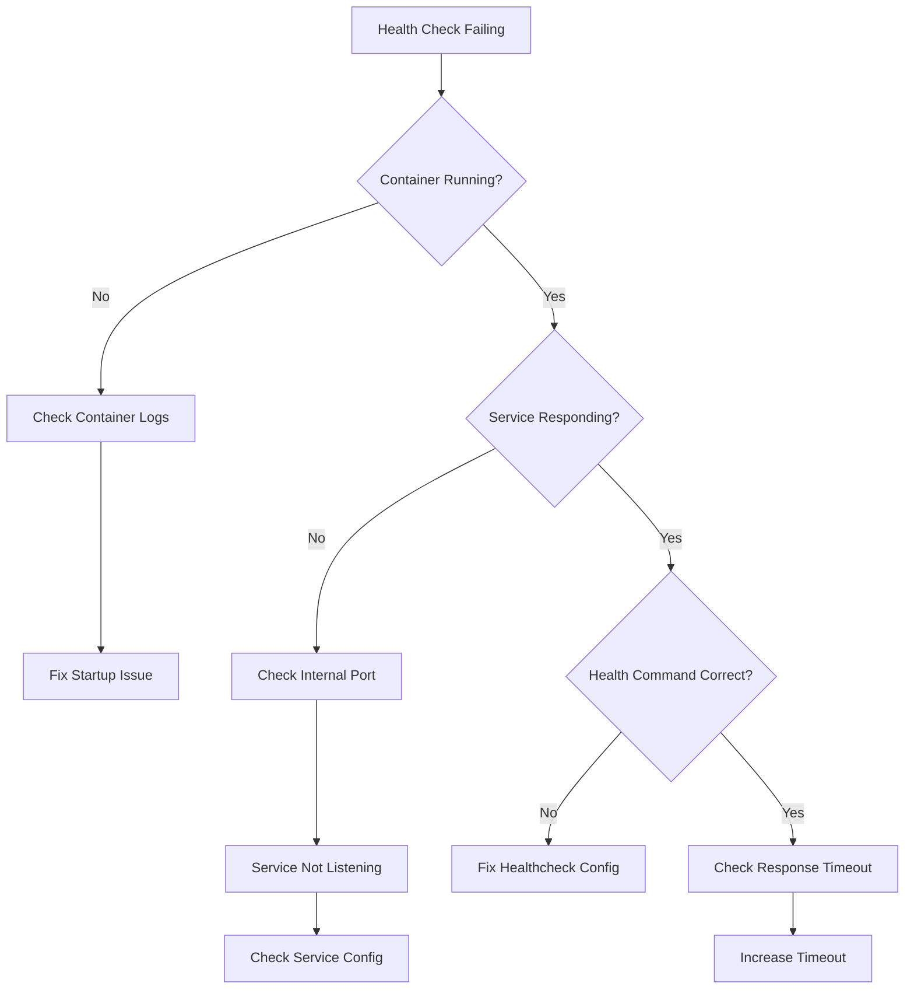
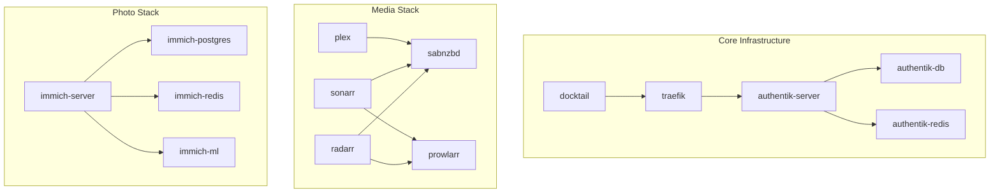
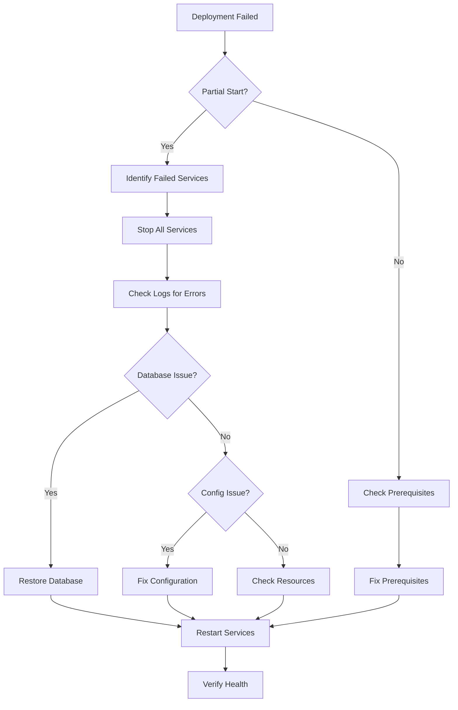
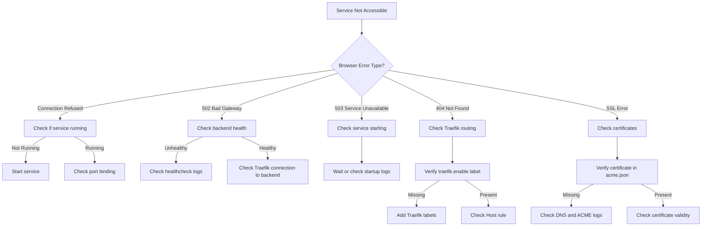
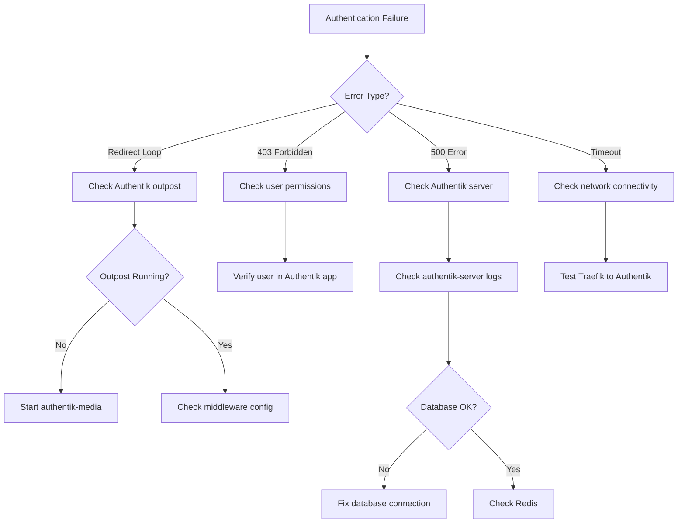
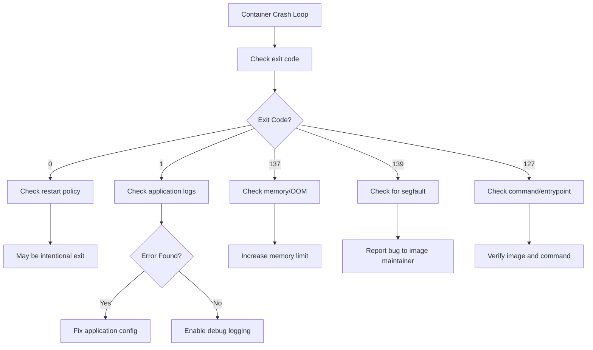

# Troubleshooting Guide

This guide covers common issues, diagnostic commands, and recovery procedures for the rfmedia-apps
Docker infrastructure.

## Table of Contents

- [Quick Diagnostics](#quick-diagnostics)
- [Service-Specific Debugging](#service-specific-debugging)
  - [Traefik Routing Issues](#traefik-routing-issues)
  - [Authentik Authentication Failures](#authentik-authentication-failures)
  - [Plex Transcoding Problems](#plex-transcoding-problems)
  - [Arr Stack Download/Import Issues](#arr-stack-downloadimport-issues)
  - [Database Connection Failures](#database-connection-failures)
  - [Tailscale Connectivity Problems](#tailscale-connectivity-problems)
  - [Immich Upload/Processing Errors](#immich-uploadprocessing-errors)
- [Common Error Patterns](#common-error-patterns)
  - [Health Check Failures](#health-check-failures)
  - [Container Restart Loops](#container-restart-loops)
  - [Volume Permission Issues](#volume-permission-issues)
  - [Network Connectivity Between Services](#network-connectivity-between-services)
  - [SSL/TLS Certificate Problems](#ssltls-certificate-problems)
  - [Resource Exhaustion](#resource-exhaustion)
- [Diagnostic Command Sequences](#diagnostic-command-sequences)
- [Log Analysis Examples](#log-analysis-examples)
- [Advanced Debugging Techniques](#advanced-debugging-techniques)
- [Recovery Procedures](#recovery-procedures)
- [Troubleshooting Decision Trees](#troubleshooting-decision-trees)
- [Getting Help](#getting-help)

## Quick Diagnostics

### Check Overall System Status

```bash
# View all running containers with status
rfapps status

# Show all status sections (health, stats, network, volumes, system, logs)
rfapps status --all

# Check specific service
rfapps status -s uptime-kuma

# Show resource usage
rfapps status --stats
```

### Check Container Logs

```bash
# View logs for specific service
docker compose logs -f uptime-kuma

# View last 100 lines
docker compose logs --tail 100 sonarr

# View logs with timestamps
docker compose logs -t radarr

# View logs for multiple services
docker compose logs -f sonarr radarr bazarr
```

### Health Check Commands

```bash
# Check health status of all services with healthchecks
rfapps status --health

# Inspect specific container health
docker inspect --format='{{json .State.Health}}' authentik-server | jq

# List containers by health status
docker ps --filter "health=unhealthy"
docker ps --filter "health=healthy"
docker ps --filter "health=starting"
```

### Docker System Information

```bash
# View Docker disk usage
docker system df

# Detailed disk usage
docker system df -v

# Check Docker daemon status
docker info

# View Docker events in real-time
docker events
```

## Service-Specific Debugging

### Traefik Routing Issues

Traefik serves as the reverse proxy for all services. Common issues include 502, 503, and 404
errors.

See [Traefik Reverse Proxy Documentation](../features/traefik-reverse-proxy.md) for architecture
details.

#### 502 Bad Gateway

**Symptoms**: Browser shows "502 Bad Gateway" when accessing a service.

**Common Causes**:

1. Backend service is not running
2. Backend service is unhealthy
3. Wrong port configured in Traefik labels
4. Service not on the correct network

**Diagnostic Commands**:

```bash
# Check if the backend service is running
docker compose ps [service_name]

# Verify service health
docker inspect --format='{{json .State.Health.Status}}' [container_name]

# Check Traefik logs for routing errors
docker compose logs traefik 2>&1 | grep -i "502\|error\|[service_name]"

# Verify the service port is correct
docker exec [container_name] ss -tlnp

# Check Traefik labels on the container
docker inspect [container_name] | jq '.[0].Config.Labels | to_entries[] | select(.key | startswith("traefik"))'
```

**Example: Debugging Sonarr 502 Error**:

```bash
# 1. Verify Sonarr is running and healthy
docker compose ps sonarr
docker inspect --format='{{.State.Health.Status}}' sonarr

# 2. Check if Sonarr responds on its port
docker exec sonarr curl -s http://localhost:8989/ping

# 3. Verify Traefik can reach Sonarr
docker exec traefik wget -qO- --timeout=5 http://sonarr:8989/ping || echo "Cannot reach Sonarr"

# 4. Check Traefik router configuration
docker compose logs traefik 2>&1 | grep sonarr
```

#### 503 Service Unavailable

**Symptoms**: Intermittent 503 errors or service temporarily unavailable.

**Common Causes**:

1. Service is starting up
2. Health check is failing
3. Service overloaded
4. Docktail reconciler not ready

**Diagnostic Commands**:

```bash
# Check service startup status
docker compose logs --tail 50 [service_name] | grep -i "start\|ready\|listen"

# Monitor health check status over time
watch -n 2 'docker inspect --format="{{json .State.Health}}" [container_name] | jq'

# Check if a Docktail-advertised service is healthy (example: plex)
rfapps status -s plex --health
```

#### 404 Not Found

**Symptoms**: Page shows "404 Not Found" for a valid service URL.

**Common Causes**:

1. Incorrect Host header in Traefik router rule
2. Service not enabled for Traefik (`traefik.enable: false`)
3. Wrong domain configured
4. Traefik not detecting the container

**Diagnostic Commands**:

```bash
# List all Traefik routers
docker exec traefik wget -qO- http://localhost:8080/api/http/routers | jq

# Check specific router
docker exec traefik wget -qO- http://localhost:8080/api/http/routers/[service_name]@docker | jq

# Verify container labels include traefik.enable=true
docker inspect [container_name] | jq '.[0].Config.Labels["traefik.enable"]'

# Check domain configuration in labels
docker inspect [container_name] | jq '.[0].Config.Labels' | grep -i "rule\|host"
```

**Resolution Steps**:

```bash
# Verify environment variables are set correctly
grep -E "^DOMAIN|^DOMAIN2" .env.local

# Validate compose configuration
docker compose config | grep -A20 "[service_name]:"

# Restart Traefik to reload configuration
rfapps rebuild -s traefik --yes
```

### Authentik Authentication Failures

Authentik provides forward authentication for all services. See
[Traefik Reverse Proxy Documentation](../features/traefik-reverse-proxy.md) for middleware
configuration.

#### Infinite Redirect Loop

**Symptoms**: Browser continuously redirects between service and Authentik.

**Common Causes**:

1. Authentik outpost not running
2. Incorrect middleware configuration
3. Cookie domain mismatch
4. Authentik server not healthy

**Diagnostic Commands**:

```bash
# Check all Authentik containers
docker compose ps | grep authentik

# Verify Authentik server health
docker inspect --format='{{json .State.Health}}' authentik-server | jq

# Check Authentik server logs for errors
docker compose logs authentik-server 2>&1 | grep -i "error\|warn" | tail -20

# Test forward auth endpoint
curl -I -k https://authentik-server:9443/outpost.goauthentik.io/auth/traefik
```

**Resolution Steps**:

```bash
# 1. Restart Authentik stack
rfapps rebuild --services authentik-server,authentik-worker,authentik-media --yes

# 2. Verify database connectivity
docker exec authentik-db pg_isready -U authentik

# 3. Check Redis connectivity
docker exec authentik-redis redis-cli ping

# 4. Clear browser cookies for the domain
```

#### 403 Forbidden After Login

**Symptoms**: Successfully authenticate but receive 403 when accessing service.

**Common Causes**:

1. User not authorized in Authentik application
2. Group permissions not configured
3. Outpost not synced with application

**Diagnostic Commands**:

```bash
# Check Authentik worker logs for sync issues
docker compose logs authentik-worker 2>&1 | grep -i "sync\|outpost\|error"

# View authentication headers being passed
docker compose logs traefik 2>&1 | grep "X-authentik"
```

#### SSO Session Issues

**Symptoms**: Login works once but session not maintained across services.

**Checklist**:

- [ ] Authentik server is healthy
- [ ] Application is configured in Authentik admin
- [ ] Redirect URIs are correctly configured
- [ ] SSL certificates are valid
- [ ] Cookies are being set (check browser developer tools)
- [ ] Cookie domain matches service domain

### Plex Transcoding Problems

Plex uses hardware transcoding via Intel Quick Sync. The Plex container requires access to
`/dev/dri`.

#### Transcoding Fails or Falls Back to Software

**Symptoms**: High CPU usage during playback, "Conversion failed" errors.

**Diagnostic Commands**:

```bash
# Check if GPU device is available in container
docker exec plex ls -la /dev/dri

# Verify Intel GPU driver
docker exec plex ls -la /dev/dri/renderD128

# Check Plex transcoder logs
docker exec plex cat "/config/Library/Application Support/Plex Media Server/Logs/Plex Transcoder Statistics.log" | tail -50

# Monitor GPU usage during transcoding
intel_gpu_top -d drm:/dev/dri/renderD128
```

**Common Causes and Solutions**:

1. **Missing device mount**: Ensure `/dev/dri:/dev/dri` is in compose volumes
2. **Permission denied**: Add user to `render` and `video` groups

   ```bash
   sudo usermod -aG render,video $(whoami)
   # Restart Plex container after group change
   ```

3. **Driver issues**: Check Intel driver installation

   ```bash
   vainfo
   ```

#### Playback Buffering

**Symptoms**: Video playback stops and buffers frequently.

**Diagnostic Commands**:

```bash
# Check Plex server network statistics
docker exec plex cat "/config/Library/Application Support/Plex Media Server/Logs/Plex Media Server.log" | grep -i "bandwidth\|buffer"

# Monitor container network
docker stats plex --no-stream

```

**Resolution Steps**:

```bash
# 1. Check Plex transcoder settings
docker exec plex cat "/config/Library/Application Support/Plex Media Server/Preferences.xml" | grep -i transcode

# 2. Verify media path is accessible
docker exec plex ls -la /data/media

# 3. Check disk I/O on media storage
iostat -x 1 5
```

### Arr Stack Download/Import Issues

The Arr stack (Sonarr, Radarr, Bazarr, Prowlarr, Lidarr) manages media automation.

#### Downloads Not Importing

**Symptoms**: Downloads complete but media not appearing in library.

**Diagnostic Commands**:

```bash
# Check Sonarr/Radarr activity queue
docker exec sonarr curl -s http://localhost:8989/api/v3/queue -H "X-Api-Key: YOUR_API_KEY" | jq

# View import logs
docker exec sonarr cat /config/logs/sonarr.txt | grep -i "import\|error" | tail -50

# Check file permissions on download directory
docker exec sonarr ls -la /data/usenet/complete

# Verify path mappings
docker exec sonarr df -h
```

**Common Causes and Solutions**:

1. **Permission mismatch**: PUID/PGID not matching

   ```bash
   # Check current container user
   docker exec sonarr id

   # Verify file ownership
   ls -la ${DATA_DIR}/usenet/complete
   ```

2. **Path mismatch between services**: Ensure consistent path structure

   ```bash
   # Compare mount points
   docker inspect sonarr | jq '.[0].Mounts'
   docker inspect sabnzbd | jq '.[0].Mounts'
   ```

3. **Hardlink/move failure**: Cross-filesystem moves

   ```bash
   # Check if paths are on same filesystem
   docker exec sonarr stat -f /data/usenet/complete
   docker exec sonarr stat -f /data/media
   ```

#### Indexer Connection Issues

**Symptoms**: Prowlarr shows indexer errors, searches fail.

**Diagnostic Commands**:

```bash
# Test Prowlarr indexer connectivity
docker exec prowlarr curl -s "http://localhost:9696/api/v1/indexerstatus" -H "X-Api-Key: YOUR_API_KEY" | jq

# Check for DNS resolution issues
docker exec prowlarr nslookup google.com

# Verify FlareSolverr if using protected indexers
docker compose logs flaresolverr 2>&1 | tail -20
```

**Resolution Steps**:

```bash
# 1. Test indexer directly
docker exec prowlarr curl -I https://[indexer-url]

# 2. Check container network connectivity
docker exec prowlarr curl -s http://prowlarr:9696/api/v1/health

# 3. Restart Prowlarr
rfapps rebuild -s prowlarr --yes
```

### Database Connection Failures

The platform uses PostgreSQL (Authentik, Immich) and MariaDB (legacy npm).

#### PostgreSQL Connection Refused

**Symptoms**: Services fail with "connection refused" or "could not connect to server" errors.

**Diagnostic Commands**:

```bash
# Check PostgreSQL container status
docker compose ps | grep -E "authentik-db|immich-postgres"

# Test database readiness
docker exec authentik-db pg_isready -U authentik -d authentik
docker exec immich-postgres pg_isready -U immich -d immich

# Check database logs
docker compose logs authentik-db 2>&1 | tail -30

# Verify network connectivity from application
docker exec authentik-server python3 -c "import socket; socket.create_connection(('authentik-db', 5432), timeout=5); print('Connected')"
```

**Common Causes**:

| Issue                    | Symptom                          | Solution                                              |
| ------------------------ | -------------------------------- | ----------------------------------------------------- |
| Database not initialized | "database does not exist"        | Wait for initialization or recreate container         |
| Wrong credentials        | "password authentication failed" | Verify `POSTGRES_PASSWORD` matches application config |
| Network isolation        | "could not connect"              | Ensure both containers share network                  |
| Max connections reached  | "too many connections"           | Increase `max_connections` or reduce connection pool  |

**Resolution Steps**:

```bash
# 1. Check database initialization status
docker compose logs authentik-db 2>&1 | grep -i "ready\|init\|listen"

# 2. Verify credentials match
grep AUTHENTIK_POSTGRES_PASSWORD .env.local
docker exec authentik-db psql -U authentik -d authentik -c "SELECT 1"

# 3. Check network connectivity
docker network inspect apps | jq '.[0].Containers | to_entries[] | select(.value.Name | contains("authentik"))'
```

#### Redis Connection Issues

**Symptoms**: Authentik or Immich shows Redis connection errors.

**Diagnostic Commands**:

```bash
# Test Redis connectivity
docker exec authentik-redis redis-cli ping
docker exec immich-redis redis-cli ping

# Check Redis memory usage
docker exec authentik-redis redis-cli INFO memory | grep used_memory_human

# Monitor Redis connections
docker exec authentik-redis redis-cli CLIENT LIST
```

### Tailscale Connectivity Problems

Tailnet ingress uses **Docktail** for Tailscale Services (`traefik`) and **tsdproxy-rfapps** for
shareable hosts (`git`, `plex`, `plex-music`, `jellyfin`, `images`). See
[Tailscale Integration Documentation](../features/tailscale-integration.md).

#### Docktail / Tailnet Ingress

**Symptoms**: Traefik or Docktail-labeled services unreachable on the tailnet.

**Diagnostic Commands**:

```bash
# Check Docktail reconciler
docker compose logs docktail 2>&1 | tail -50

# Verify host Tailscale daemon
tailscale status

# Confirm Traefik responds on apps network
docker exec traefik wget --no-verbose --tries=1 --spider https://localhost:443
```

**Common Causes and Solutions**:

1. **Host Tailscale not running**: Restart `tailscaled` on the host
2. **OAuth credentials missing or invalid**: Verify `TAILSCALE_OAUTH_CLIENT_ID` and
   `TAILSCALE_OAUTH_CLIENT_SECRET` in `.env.local`, then redeploy Docktail
3. **ACL tag not approved**: Ensure the host node can advertise the Docktail service tag
4. **Missing labels**: Verify `docktail.service.*` labels on Traefik and other exposed services

#### Media / Photo Services Not on Tailnet

**Symptoms**: Cannot reach `plex`, `plex-music`, `jellyfin`, or `images` via Tailscale MagicDNS.

**Diagnostic Commands**:

```bash
# Plex, Jellyfin, and Immich are tsdproxy hosts, not Docktail services
docker compose logs tsdproxy-rfapps 2>&1 | grep -E 'plex|plex-music|jellyfin|images|git'
rfapps status -s plex --health
rfapps status -s plex-music --health
docker exec traefik curl -sk https://plex:32400/identity
docker exec traefik curl -sk https://plex-music:32400/identity
docker inspect plex --format '{{json .Config.Labels}}' | jq 'with_entries(select(.key | startswith("tsdproxy")))'
```

**Common Causes and Solutions**:

1. **Missing tsdproxy labels**: Verify `tsdproxy.proxyprovider: rfapps` and the correct
   `tsdproxy.port.1` on `plex`, `plex-music`, `jellyfin`, and `immich-server`
2. **tsdproxy-rfapps not running**: `rfapps deploy -s tsdproxy-rfapps --yes`
3. **Duplicate `*-1` machines**: Another tsdproxy (usually `praxrr-tsdproxy`) is claiming the same
   labels — see [Duplicate tsdproxy Tailscale machines](#duplicate-tsdproxy-tailscale-machines)
4. **Service not on `apps` network**: Ensure `networks: apps: {}` and explicit `hostname`
5. **OAuth / ACL issues**: Same as Docktail / tailnet ingress section above

#### Service Not Accessible via Tailnet

**Symptoms**: Cannot reach service through Tailscale MagicDNS name.

**Diagnostic Commands**:

```bash
# Docktail-advertised service: check reconciler logs
docker compose logs docktail | grep -iE 'traefik'

# tsdproxy hosts
docker compose logs tsdproxy-rfapps | grep -iE 'plex|plex-music|git|jellyfin|images'

# Test connectivity from another Tailscale node
tailscale ping traefik.[tailnet-name].ts.net
```

#### Duplicate tsdproxy Tailscale machines

**Symptoms**: Admin console shows `git` and `git-1` (or `plex` / `plex-1`). The `-1` host is
connected but not reachable.

**Cause**: Two TSDProxy containers (`tsdproxy-rfapps` and `praxrr-tsdproxy`) both watch the Docker
socket. Each creates a tsnet node for the same `tsdproxy.name`. Tailscale keeps the first hostname
and suffixes the second with `-1`. The extra node is on the wrong Docker network, so it cannot
reach the backend.

**Fix**:

1. Confirm labels include `tsdproxy.proxyprovider: rfapps` (this stack) or `praxrr` (praxrr
   compose.dev.yml)
2. Confirm live `tsdproxy.yaml` provider keys match (`rfapps` vs `praxrr`)
3. Delete the `-1` machines in the Tailscale admin console
4. Remove stolen hostname dirs from the other instance's data directory
   (`praxrr/.tsdproxy/data/<provider>/git`, and so on)

### Immich Upload/Processing Errors

Immich provides photo and video management with AI-powered features.

#### Upload Failures

**Symptoms**: Photos fail to upload or uploads timeout.

**Diagnostic Commands**:

```bash
# Check Immich server logs
docker compose logs immich-server 2>&1 | grep -i "error\|upload" | tail -30

# Verify disk space
docker exec immich-server df -h /data

# Check upload directory permissions
docker exec immich-server ls -la /data
docker exec immich-server touch /data/test-write && rm /data/test-write && echo "Write OK"
```

**Common Causes**:

1. **Disk space exhausted**: Clear old thumbnails or expand storage
2. **Permission denied**: Fix PUID/PGID settings
3. **Database connection failed**: Check PostgreSQL connectivity
4. **Redis queue full**: Monitor Redis memory

#### ML Processing Stuck

**Symptoms**: Photos uploaded but faces/objects not being detected.

**Diagnostic Commands**:

```bash
# Check ML container status
docker compose ps immich-ml

# View ML processing logs
docker compose logs immich-ml 2>&1 | grep -i "error\|process\|model" | tail -30

# Check GPU/OpenVINO availability
docker exec immich-ml ls /dev/dri

# Monitor model cache volume
docker exec immich-ml du -sh /cache
```

**Resolution Steps**:

```bash
# 1. Restart ML container
rfapps rebuild -s immich-ml --yes

# 2. Clear model cache if corrupted
docker volume rm model-cache
rfapps deploy -s immich-ml --yes

# 3. Check Redis job queue
docker exec immich-redis redis-cli LLEN immich:jobs:queue
```

#### Database Errors with Vector Extensions

**Symptoms**: Immich shows errors related to pgvecto.rs or vector search.

**Diagnostic Commands**:

```bash
# Check if vector extension is installed
docker exec immich-postgres psql -U immich -d immich -c "SELECT extname FROM pg_extension WHERE extname = 'vectors';"

# View PostgreSQL logs
docker compose logs immich-postgres 2>&1 | grep -i "error\|vector" | tail -30
```

## Common Error Patterns

### Health Check Failures

**Symptoms**: Container shows "unhealthy" status, services restart unexpectedly.



**Diagnostic Commands**:

```bash
# View healthcheck configuration
docker inspect --format='{{json .Config.Healthcheck}}' [container_name] | jq

# View healthcheck history (last 5 results)
docker inspect --format='{{json .State.Health}}' [container_name] | jq '.Log[-5:]'

# Manually run healthcheck command
HEALTHCHECK_CMD=$(docker inspect --format='{{join .Config.Healthcheck.Test " "}}' [container_name])
docker exec [container_name] sh -c "${HEALTHCHECK_CMD#CMD-SHELL }"
```

**Example: Sonarr Health Check**:

```bash
# The healthcheck command
docker exec sonarr curl --fail http://localhost:8989

# If failing, check if Sonarr is listening
docker exec sonarr ss -tlnp | grep 8989

# Check Sonarr startup logs
docker compose logs sonarr 2>&1 | grep -i "listen\|start\|error"
```

### Container Restart Loops

**Symptoms**: Container restarts repeatedly, showing "Restarting" status.

**Diagnostic Commands**:

```bash
# Check restart count
docker inspect --format='{{.RestartCount}}' [container_name]

# View recent container events
docker events --filter container=[container_name] --since 5m

# Check last exit code
docker inspect --format='{{.State.ExitCode}}' [container_name]

# View container logs before crash
docker logs --tail 100 [container_name]
```

**Exit Code Reference**:

| Exit Code | Meaning                | Typical Cause                       |
| --------- | ---------------------- | ----------------------------------- |
| 0         | Success                | Normal exit (check restart policy)  |
| 1         | General error          | Application error, check logs       |
| 126       | Command not executable | Binary permissions or missing       |
| 127       | Command not found      | Missing binary or bad PATH          |
| 137       | SIGKILL (128+9)        | OOM killer or `docker kill`         |
| 139       | SIGSEGV (128+11)       | Segmentation fault                  |
| 143       | SIGTERM (128+15)       | Graceful shutdown via `docker stop` |

**Resolution by Exit Code**:

```bash
# Exit code 137 (OOM): Check memory limits
docker stats --no-stream [container_name]
docker inspect --format='{{.HostConfig.Memory}}' [container_name]

# Exit code 1: Check application logs
docker logs --tail 200 [container_name] 2>&1 | grep -i "error\|fatal\|exception"

# Exit code 127: Check entrypoint/command
docker inspect --format='{{.Config.Entrypoint}} {{.Config.Cmd}}' [container_name]
```

### Volume Permission Issues

**Symptoms**: Container fails with permission errors on mounted volumes.

**Diagnostic Commands**:

```bash
# Check current PUID/PGID in .env
grep -E "^(PUID|PGID)" .env.local

# Check ownership of mounted directories
ls -la ${DOCKER_DIR}/[service_name]
ls -la ${DATA_DIR}

# Check container user
docker exec [container_name] id

# Test write permissions inside container
docker exec [container_name] touch /config/test-write && \
docker exec [container_name] rm /config/test-write && echo "Write OK"
```

**Resolution**:

```bash
# Fix ownership recursively
sudo chown -R $(id -u):$(id -g) ${DOCKER_DIR}/[service_name]

# Or set specific PUID/PGID
sudo chown -R 1000:1000 ${DOCKER_DIR}/[service_name]

# Verify PUID/PGID in .env matches your user
id  # Shows your UID and GID
```

### Network Connectivity Between Services

**Symptoms**: Services unable to reach each other by container name.

**Diagnostic Commands**:

```bash
# Check network configuration
docker network ls
docker network inspect apps

# List containers on apps network
docker network inspect apps | jq '.[0].Containers | to_entries[] | {name: .value.Name, ip: .value.IPv4Address}'

# Test connectivity between containers
docker exec sonarr ping -c 3 radarr
docker exec sonarr curl -s http://radarr:7878/api/v3/system/status

# Check DNS resolution inside container
docker exec sonarr nslookup radarr
```

**Service Dependency Diagram**:



**Common Network Issues**:

1. **Different networks**: Ensure services are on the same network (`apps`)

   ```bash
   # Reconnect container to network
   docker network connect apps [container_name]
   ```

2. **Docktail tailnet**: Services requiring tailnet access use Docktail labels on the `apps` network;
   there are no `network_mode: service:` sidecar containers in this repo

   ```bash
   # Verify plex is running and Docktail labels are present
   docker compose ps plex
   rfapps rebuild -s docktail --yes
   ```

3. **Network not created**: Recreate the network

   ```bash
   docker network create apps
   ```

### SSL/TLS Certificate Problems

**Symptoms**: Browser SSL warnings, certificate errors, HTTPS not working.

**Diagnostic Commands**:

```bash
# Check certificate status via Traefik
docker exec traefik cat /etc/traefik/acme/acme.json | jq '.letsencrypt.Certificates'

# Test SSL certificate
echo | openssl s_client -servername [service].${DOMAIN} -connect localhost:443 2>/dev/null | openssl x509 -noout -dates

# Check Cloudflare DNS (if using DNS challenge)
dig +short TXT _acme-challenge.[subdomain].${DOMAIN}

# View Traefik certificate resolver logs
docker compose logs traefik 2>&1 | grep -i "acme\|certificate\|letsencrypt"
```

**Common Issues**:

| Issue                | Symptom                        | Solution                                            |
| -------------------- | ------------------------------ | --------------------------------------------------- |
| Rate limited         | "too many certificates" error  | Wait 1 hour, use staging server for testing         |
| DNS not propagated   | "DNS problem" in logs          | Wait for DNS propagation, check Cloudflare settings |
| Invalid domain       | Certificate shows wrong domain | Verify domain labels on container                   |
| ACME storage corrupt | Certificates not renewing      | Delete `acme.json` and restart Traefik              |

**Resolution**:

```bash
# Force certificate renewal (WARNING: May cause rate limit issues)
docker exec traefik rm /etc/traefik/acme/acme.json
rfapps rebuild -s traefik --yes

# Use staging server for testing (edit traefik command in compose.yml)
# Add: --certificatesresolvers.letsencrypt.acme.caserver=https://acme-staging-v02.api.letsencrypt.org/directory
```

### Resource Exhaustion

**Symptoms**: Services slow, containers OOM killed, disk full errors.

#### CPU Exhaustion

```bash
# Check CPU usage by container
docker stats --no-stream --format "table {{.Name}}\t{{.CPUPerc}}\t{{.MemUsage}}"

# Find high CPU containers
docker stats --no-stream --format "{{.Name}}: {{.CPUPerc}}" | sort -t: -k2 -rn | head -10

# Check host CPU
top -bn1 | head -20
```

#### Memory Exhaustion

```bash
# Check memory usage
docker stats --no-stream

# View OOM kill events
dmesg | grep -i "out of memory\|oom"
journalctl -k | grep -i oom

# Check container memory limits
docker inspect --format='{{.Name}}: {{.HostConfig.Memory}}' $(docker ps -q)
```

**Setting Memory Limits**:

```yaml
# In compose.yml
services:
  service-name:
    deploy:
      resources:
        limits:
          memory: 2G
        reservations:
          memory: 512M
```

#### Disk Exhaustion

```bash
# Check disk space
df -h

# Check Docker disk usage
docker system df
docker system df -v

# Find large containers/volumes
docker ps -s --format "table {{.Names}}\t{{.Size}}"

# Clean up unused Docker resources
docker system prune -af --volumes
```

## Diagnostic Command Sequences

### Complete Service Health Check

Run this sequence when a service is misbehaving:

```bash
#!/bin/bash
SERVICE=$1

echo "=== Checking $SERVICE ==="

# 1. Container status
echo -e "\n--- Container Status ---"
docker compose ps $SERVICE

# 2. Health check
echo -e "\n--- Health Status ---"
docker inspect --format='{{json .State.Health}}' $SERVICE 2>/dev/null | jq || echo "No healthcheck"

# 3. Recent logs
echo -e "\n--- Recent Logs (last 20 lines) ---"
docker compose logs --tail 20 $SERVICE

# 4. Resource usage
echo -e "\n--- Resource Usage ---"
docker stats --no-stream $SERVICE

# 5. Network connectivity (if on apps network)
echo -e "\n--- Network Info ---"
docker inspect --format='{{json .NetworkSettings.Networks}}' $SERVICE | jq

# 6. Volume mounts
echo -e "\n--- Volume Mounts ---"
docker inspect --format='{{json .Mounts}}' $SERVICE | jq '.[].Destination'
```

### Database Diagnostics

```bash
# PostgreSQL full check
DB_CONTAINER=$1  # e.g., authentik-db

# 1. Connection test
docker exec $DB_CONTAINER pg_isready

# 2. Active connections
docker exec $DB_CONTAINER psql -U postgres -c "SELECT count(*) FROM pg_stat_activity;"

# 3. Database sizes
docker exec $DB_CONTAINER psql -U postgres -c "SELECT pg_database.datname, pg_size_pretty(pg_database_size(pg_database.datname)) FROM pg_database ORDER BY pg_database_size(pg_database.datname) DESC;"

# 4. Check for locks
docker exec $DB_CONTAINER psql -U postgres -c "SELECT * FROM pg_locks WHERE NOT granted;"

# 5. Recent errors in logs
docker compose logs --tail 50 $DB_CONTAINER 2>&1 | grep -i "error\|fatal"
```

### Network Debugging

```bash
# Full network diagnostic
SERVICE=$1
TARGET=$2  # Target service to test connectivity

echo "=== Network Diagnostics for $SERVICE ==="

# 1. Check network membership
echo -e "\n--- Networks ---"
docker inspect --format='{{range $k, $v := .NetworkSettings.Networks}}{{$k}} {{end}}' $SERVICE

# 2. Get container IP
echo -e "\n--- IP Address ---"
docker inspect --format='{{range .NetworkSettings.Networks}}{{.IPAddress}}{{end}}' $SERVICE

# 3. Test DNS resolution
echo -e "\n--- DNS Resolution for $TARGET ---"
docker exec $SERVICE nslookup $TARGET 2>/dev/null || docker exec $SERVICE getent hosts $TARGET

# 4. Test connectivity
echo -e "\n--- Connectivity Test ---"
docker exec $SERVICE ping -c 3 $TARGET 2>/dev/null || echo "Ping not available"

# 5. Check open ports
echo -e "\n--- Listening Ports ---"
docker exec $SERVICE ss -tlnp 2>/dev/null || docker exec $SERVICE netstat -tlnp
```

## Log Analysis Examples

### Traefik Log Patterns

**Successful Request**:

```json
{"level":"debug","msg":"Serving default certificate for request","routerName":"sonarr@docker","serverName":"sonarr.media.example.com"}
{"level":"debug","msg":"Forwarding request to backend","routerName":"sonarr@docker","serviceURL":"http://sonarr:8989"}
```

**502 Error Pattern**:

```json
{
  "level": "error",
  "msg": "'502 Bad Gateway' caused by: dial tcp 172.18.0.15:8989: connect: connection refused",
  "routerName": "sonarr@docker"
}
```

**Analysis**: Backend service (Sonarr) is not responding on port 8989. Check if Sonarr container is
running and healthy.

**Certificate Error Pattern**:

```json
{
  "level": "error",
  "msg": "Unable to obtain ACME certificate for domains",
  "domains": ["sonarr.media.example.com"],
  "error": "error: one or more domains had a problem"
}
```

**Analysis**: Let's Encrypt challenge failed. Check DNS configuration and Cloudflare settings.

### Authentik Log Patterns

**Successful Authentication**:

```json
{
  "event": "login",
  "level": "info",
  "user": "admin",
  "client_ip": "100.64.0.1",
  "action": "authentication"
}
```

**Failed Authentication**:

```json
{
  "event": "login_failed",
  "level": "warning",
  "user": "unknown",
  "client_ip": "100.64.0.1",
  "reason": "invalid_credentials"
}
```

**Outpost Connection Issue**:

```json
{
  "level": "error",
  "msg": "Failed to connect to outpost",
  "outpost": "authentik-media",
  "error": "connection refused"
}
```

**Analysis**: The `authentik-media` outpost container is not running or not reachable.

### Arr Stack Log Patterns

**Sonarr Import Success**:

```
2024-01-15 10:30:45|Info|DownloadedEpisodeImportService|Importing episode: /data/usenet/complete/Series.Name.S01E01.mkv
2024-01-15 10:30:46|Info|MediaFileService|Episode imported: Series Name - S01E01 - Episode Title
```

**Sonarr Import Failure**:

```
2024-01-15 10:30:45|Error|DownloadedEpisodeImportService|Import failed, path does not exist or is not accessible: /data/usenet/complete/Series.Name.S01E01.mkv
```

**Analysis**: Path not accessible. Check volume mounts and permissions.

**Indexer Connection Error**:

```
2024-01-15 10:30:45|Error|IndexerBase|Unable to connect to indexer, please check your DNS settings
```

**Analysis**: DNS resolution failing. Check container DNS configuration or network connectivity.

### Immich Log Patterns

**Successful Upload**:

```json
{
  "level": "log",
  "message": "Asset uploaded successfully",
  "assetId": "abc123",
  "userId": "user1"
}
```

**ML Processing**:

```json
{
  "level": "log",
  "message": "Processing facial recognition",
  "assetId": "abc123",
  "faces": 3
}
```

**Database Connection Error**:

```json
{
  "level": "error",
  "message": "Database connection failed",
  "error": "ECONNREFUSED 172.18.0.10:5432"
}
```

**Analysis**: Cannot connect to PostgreSQL. Check if `immich-postgres` is running.

## Advanced Debugging Techniques

### Using Docker Exec for Container Inspection

```bash
# Get a shell in the container
docker exec -it [container_name] /bin/sh
# or for bash
docker exec -it [container_name] /bin/bash

# Run commands as specific user
docker exec -u 1000:1000 [container_name] ls -la /config

# Check environment variables
docker exec [container_name] env | sort

# View running processes
docker exec [container_name] ps aux

# Check file descriptors
docker exec [container_name] ls -la /proc/1/fd
```

### Database Query Debugging

**PostgreSQL**:

```bash
# Interactive psql session
docker exec -it authentik-db psql -U authentik -d authentik

# Run specific query
docker exec authentik-db psql -U authentik -d authentik -c "SELECT * FROM authentik_core_user LIMIT 5;"

# Export query results
docker exec authentik-db psql -U authentik -d authentik -c "COPY (SELECT * FROM authentik_events_event) TO STDOUT WITH CSV HEADER" > events.csv

# Check slow queries
docker exec authentik-db psql -U authentik -d authentik -c "SELECT pid, now() - pg_stat_activity.query_start AS duration, query FROM pg_stat_activity WHERE (now() - pg_stat_activity.query_start) > interval '5 seconds';"
```

**Redis**:

```bash
# Interactive redis-cli
docker exec -it authentik-redis redis-cli

# Check all keys
docker exec authentik-redis redis-cli KEYS '*'

# Monitor commands in real-time
docker exec authentik-redis redis-cli MONITOR

# Check memory usage by key pattern
docker exec authentik-redis redis-cli --bigkeys
```

### Network Packet Capture

```bash
# Capture packets on Docker network (requires tcpdump on host)
# Find container PID
PID=$(docker inspect --format '{{.State.Pid}}' [container_name])

# Capture traffic
sudo nsenter -t $PID -n tcpdump -i eth0 -w capture.pcap

# Capture specific port
sudo nsenter -t $PID -n tcpdump -i eth0 port 8989 -w sonarr-traffic.pcap
```

### Resource Monitoring

```bash
# Real-time container stats
docker stats

# Export stats to file
docker stats --no-stream --format "{{.Name}},{{.CPUPerc}},{{.MemUsage}},{{.NetIO}},{{.BlockIO}}" > stats.csv

# Monitor specific container
watch -n 1 'docker stats --no-stream [container_name]'

# Check I/O statistics
docker exec [container_name] iostat -x 1 5

# Memory breakdown
docker exec [container_name] cat /proc/meminfo
```

### Debug Mode Configuration

Enable debug logging for specific services:

**Traefik**:

```yaml
# In compose.yml command section
command:
  - --log.level=DEBUG
```

**Authentik**:

```yaml
environment:
  AUTHENTIK_LOG_LEVEL: debug
```

**Arr Stack** (Sonarr/Radarr):

```bash
# Access Settings > General > Log Level
# Set to "Debug" or "Trace"
```

**Immich**:

```yaml
environment:
  LOG_LEVEL: debug
```

## Recovery Procedures

### Failed Deployment Recovery

When a deployment fails mid-way:



**Recovery Steps**:

```bash
# 1. Stop all services safely
rfapps stop --yes

# 2. Check what went wrong
docker compose logs --tail 100 2>&1 | grep -i "error\|fatal"

# 3. Verify prerequisites
docker info
docker compose config --quiet

# 4. Start core services first
rfapps deploy --profile core --yes

# 5. Wait for core to be healthy
rfapps status --health

# 6. Start remaining services
rfapps deploy --profile all --yes
```

### Database Backup and Restore

See [Backup and Restore Guide](backup-restore.md) for comprehensive backup procedures.

**Quick Database Restore**:

```bash
# PostgreSQL restore (Authentik example)
rfapps stop --services authentik-server,authentik-worker --yes

# Drop and recreate database
docker exec -i authentik-db psql -U authentik -c "DROP DATABASE IF EXISTS authentik;"
docker exec -i authentik-db psql -U authentik -c "CREATE DATABASE authentik;"

# Restore from backup
docker exec -i authentik-db psql -U authentik authentik < authentik-backup.sql

# Restart services
rfapps deploy --services authentik-server,authentik-worker,authentik-media --yes
```

### Container State Recovery

When containers are in an inconsistent state:

```bash
# 1. Force stop all containers
rfapps stop --yes

# 2. Remove all containers (keeps volumes)
rfapps delete --yes

# 3. Clean up dangling resources
docker system prune -f

# 4. Recreate networks
docker network create apps

# 5. Fresh deployment
rfapps pull --yes
rfapps deploy --yes
```

### Configuration Rollback

When configuration changes break services:

```bash
# 1. If using git, check recent changes
git diff HEAD~1 compose.yml
git diff HEAD~1 .env.local

# 2. Rollback compose.yml
git checkout HEAD~1 -- compose.yml

# 3. Or restore from backup
cp /mnt/backups/docker-config-backup/compose.yml .

# 4. Validate configuration
docker compose config --quiet

# 5. Redeploy
rfapps rebuild --yes
```

### Emergency Stop

When services need to be stopped immediately:

```bash
# Force stop all containers immediately
rfapps stop --yes

# Or using Docker directly
docker compose kill

# Stop specific container immediately
docker kill [container_name]

# If compose is unresponsive, stop all containers
docker stop $(docker ps -q)

# Nuclear option: kill all containers
docker kill $(docker ps -q)
```

### Restart Failed Services

```bash
# Restart single service
rfapps rebuild -s [service_name] --yes

# Restart with fresh pull
rfapps pull -s [service_name] --yes
rfapps rebuild -s [service_name] --yes

# Force restart without graceful shutdown
rfapps stop -s [service_name] --yes
rfapps deploy -s [service_name] --yes
```

### Rebuild from Scratch

Complete system rebuild when other recovery methods fail:

```bash
# 1. Stop all services
rfapps stop --yes

# 2. Remove containers and networks
rfapps delete --yes

# 3. Clean Docker resources (WARNING: removes unused volumes too)
docker system prune -af --volumes

# 4. Fresh deployment
rfapps pull --yes
rfapps deploy --yes
```

## Troubleshooting Decision Trees

### Service Not Accessible



### Authentication Failure



### Container Crash Loop



## Exit Codes Reference

The `rfapps` CLI uses standard exit codes for scripting and automation:

| Code | Meaning       | Common Causes                                               |
| ---- | ------------- | ----------------------------------------------------------- |
| 0    | Success       | Command completed without errors                            |
| 1    | General error | Docker command failed, service unhealthy, invalid arguments |

**Usage in scripts**:

```bash
# Basic error handling
rfapps deploy -s uptime-kuma --yes
if [ $? -ne 0 ]; then
    echo "Deployment failed - check logs for details"
    exit 1
fi

# Using JSON output for detailed error information
result=$(rfapps deploy -s uptime-kuma --yes --json 2>&1)
if [ $? -ne 0 ]; then
    echo "$result" | jq '.error // "Unknown error"'
fi

# Dry-run validation before deployment
rfapps deploy -g media-stack --dry-run --json
if [ $? -eq 0 ]; then
    rfapps deploy -g media-stack --yes
fi
```

**Debugging failed commands**:

```bash
# Enable verbose output for more context
rfapps deploy -s uptime-kuma --verbose --yes

# Enable debug mode for detailed diagnostics
rfapps deploy -s uptime-kuma --debug --yes
```

## Log Locations

### Docker Container Logs

All containers use JSON file logging with rotation:

```bash
# Default log location
/var/lib/docker/containers/[container-id]/[container-id]-json.log

# View current log file location
docker inspect --format='{{.LogPath}}' [container_name]

# Log rotation settings (from compose.yml)
# max-file: ${DOCKERLOGGING_MAXFILE}
# max-size: ${DOCKERLOGGING_MAXSIZE}
```

### Script Logs

```bash
# Script logs (when LOG_TO_FILE=true)
${LOG_DIR:-./logs}/docker-apps-YYYYMMDD.log

# Default location
./logs/docker-apps-$(date +%Y%m%d).log
```

### Application-Specific Logs

| Service   | Log Location (inside container)                               |
| --------- | ------------------------------------------------------------- |
| Traefik   | `/var/log/traefik/` or stdout                                 |
| Authentik | stdout (JSON format)                                          |
| Plex      | `/config/Library/Application Support/Plex Media Server/Logs/` |
| Sonarr    | `/config/logs/`                                               |
| Radarr    | `/config/logs/`                                               |
| Prowlarr  | `/config/logs/`                                               |
| Immich    | stdout (JSON format)                                          |

**Access application logs**:

```bash
# Sonarr logs
docker exec sonarr cat /config/logs/sonarr.txt

# Plex logs
docker exec plex ls "/config/Library/Application Support/Plex Media Server/Logs/"
docker exec plex cat "/config/Library/Application Support/Plex Media Server/Logs/Plex Media Server.log" | tail -100

# Radarr logs
docker exec radarr cat /config/logs/radarr.txt | tail -100
```

## Getting Help

### Enable Debug Mode

```bash
# Run with verbose output
rfapps deploy --verbose --yes

# Enable debug logging
rfapps deploy --debug --yes

# Dry run to see what would happen
rfapps deploy --dry-run
```

### Information to Collect Before Asking for Help

Collect the following information when seeking help:

```bash
# 1. System information
uname -a
docker version
docker compose version

# 2. Container status
rfapps status --all > status.txt

# 3. Recent logs for affected service
docker compose logs --tail 200 [service_name] > logs.txt

# 4. Docker events
docker events --since 30m > events.txt

# 5. Environment (sanitized - remove secrets!)
grep -v -E "(PASSWORD|SECRET|TOKEN|KEY)" .env.local > env_sanitized.txt

# 6. Compose configuration validation
docker compose --profile all config > compose_parsed.txt 2>&1
```

### Common Debug Commands Summary

```bash
# Check container status
docker compose ps -a

# Follow logs in real-time
docker compose logs -f [service_name]

# Execute command in container
docker exec -it [container_name] /bin/sh

# View container resource usage
docker stats --no-stream

# Check network connectivity
docker exec [container_name] ping -c 3 [other_container]

# Inspect container configuration
docker inspect [container_name] | jq '.'

# View Docker system events
docker events --since 10m

# Check disk space
df -h
docker system df
```

## Related Documentation

- [Quick Reference](../features/quick-reference.md) - One-page command reference card
- [Backup and Restore Guide](backup-restore.md) - Comprehensive backup and recovery procedures
- [Traefik Reverse Proxy](../features/traefik-reverse-proxy.md) - Traefik architecture and
  configuration
- [Tailscale Integration](../features/tailscale-integration.md) - Docktail setup and
  troubleshooting
- [Authentik Integration](../features/authentik-integration.md) - SSO and authentication
  configuration
- [Getting Started Guide](getting-started.md) - Initial setup and configuration
