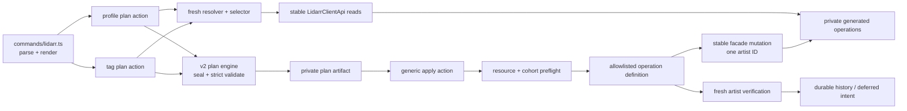

# Technical Design — Lidarr Artist Bulk Profile and Tag Management

## Executive Summary

Issue #199 should extend the existing sealed `lidarr plan`/`lidarr apply` boundary rather than add a
direct artist-edit command. Two new plan producers are recommended:
`lidarr plan artist-profiles` for quality/metadata profile assignment and
`lidarr plan artist-tags` for explicit add/remove/set/clear tag intent. Both resolve a fresh,
complete artist cohort locally, write exact before/after state into a checksum-sealed artifact, and
delegate all writes to the existing operation registry and apply scheduler.

The pinned generated SDK already contains the artist editor and the three resource-list operations.
The stable facade must expose only narrow validated projections and narrow mutations; commands and
actions must not import generated types or endpoint paths. Execution remains one artist per editor
request. That preserves the current per-target history, deferred intent, idempotency, interruption,
and resume guarantees even though Lidarr's editor accepts multiple IDs.

This feature requires no database migration. The existing deferred-intent table stores an opaque
operation name and JSON payload, and per-plan history is JSONL keyed by plan ID/checksum/entry ID.
The only persisted schema evolution is a new version of the plan artifact.

## Architecture Design



The dependency direction remains:

```text
command -> action -> selection/plan engine -> stable Lidarr facade
        -> private generated SDK -> sole authenticated transport -> Lidarr
```

Planning uses a client with `allowStale: false` and `retryAttemptsOverride: 0`. Cached artist data
may continue to serve the read-only `lidarr list` command, but must never select mutation targets or
resolve resources. Apply performs one all-target preflight before any write, then re-reads each
target immediately before admission. A successful editor response is not sufficient evidence:
Lidarr actually returns `202 Accepted` while the pinned OpenAPI schema declares an unknown `200`
body, so the operation must discard the body and verify the desired state with a fresh artist read.

## Data Models

### Public resource projections

Add generated-type-independent projections to `src/types/lidarr.ts`:

```ts
interface LidarrQualityProfileRef {
  readonly id: number;
  readonly name: string;
}

interface LidarrMetadataProfileRef {
  readonly id: number;
  readonly name: string;
}

interface LidarrTagRef {
  readonly id: number;
  readonly label: string;
}
```

Projectors must require a positive safe integer ID and a non-empty, bounded name/label, construct
fresh frozen objects, reject malformed arrays as `invalid-response`, and never leak generated
models. Artist tag arrays are normalized to sorted unique positive IDs at this boundary.

### Selection model

Use one reusable selector for both new plan actions:

```ts
type LidarrArtistSelection =
  | { readonly kind: "all" }
  | {
      readonly kind: "criteria";
      readonly artistIds: readonly number[];
      readonly monitored: boolean | null;
      readonly qualityProfile: LidarrQualityProfileRef | null;
      readonly metadataProfile: LidarrMetadataProfileRef | null;
      readonly allTags: readonly LidarrTagRef[];
      readonly excludedArtistIds: readonly number[];
    };
```

The canonical artifact uses `null`/empty arrays rather than optional selector fields so exact-key
validation and checksum generation are unambiguous. `excludedArtistIds` records exact IDs removed
by additional filters; it is review context, not an apply-time selector. Targets themselves remain
the authority and are always sorted by ascending artist ID.

Selection semantics are:

- `--all` is exclusive with every selector.
- Without `--all`, at least one of `--ids`, a monitoring selector, a profile selector, or a tag
  selector is required.
- IDs form the candidate universe; all supplied filters then narrow that universe with AND
  semantics.
- Repeated tag selectors mean the artist contains every requested tag.
- Duplicate or unknown exact IDs fail; exact IDs excluded by filters are reported.
- Zero matches fail and no artifact is written.
- Selection ignores `lidarr list` pagination (`limit: 50` and `offset`) and stale-cache behavior.
- Resolve the complete cohort first, then reject `matched > maxBatch`; never truncate.

### Plan schema evolution

Introduce `rfmedia.lidarr-plan.v2`. Keep the current exact validator and canonicalizer for
`rfmedia.lidarr-plan.v1` so existing artist-monitoring artifacts remain applicable. New producers,
including artist monitoring after this change, write v2. The reader dispatches on `version`, returns
a `LidarrMutationPlanV1 | LidarrMutationPlanV2`, and never silently rewrites an old artifact because
its original checksum is its history identity.

```ts
type LidarrMutationOperationV2 =
  | {
      readonly kind: "artist-monitoring";
      readonly desiredMonitored: boolean;
    }
  | {
      readonly kind: "artist-profile-assignment";
      readonly qualityProfile: LidarrQualityProfileRef | null;
      readonly metadataProfile: LidarrMetadataProfileRef | null;
    }
  | {
      readonly kind: "artist-tag-mutation";
      readonly mode: "add" | "remove" | "set" | "clear";
      readonly tags: readonly LidarrTagRef[];
    };
```

Profile assignment requires at least one non-null profile. Tag add/remove/set require a non-empty
unique tag list; clear requires an empty list. `set` with no tags is rejected in favor of explicit
`clear`. Resource arrays are sorted by ID. Names/labels are review context; numeric IDs are
authoritative.

Entries are also discriminated so operation-specific code cannot accidentally compare or execute
another state shape:

```ts
type LidarrMutationPlanEntryV2 =
  | {
      readonly kind: "artist-monitoring";
      readonly id: `artist:${number}`;
      readonly artistId: number;
      readonly artistName: string;
      readonly before: { readonly monitored: boolean };
      readonly after: { readonly monitored: boolean };
      readonly idempotencyKey: string;
    }
  | {
      readonly kind: "artist-profile-assignment";
      readonly id: `artist:${number}`;
      readonly artistId: number;
      readonly artistName: string;
      readonly before: {
        readonly qualityProfile: LidarrQualityProfileRef | null;
        readonly metadataProfile: LidarrMetadataProfileRef | null;
      };
      readonly after: {
        readonly qualityProfile: LidarrQualityProfileRef | null;
        readonly metadataProfile: LidarrMetadataProfileRef | null;
      };
      readonly idempotencyKey: string;
    }
  | {
      readonly kind: "artist-tag-mutation";
      readonly id: `artist:${number}`;
      readonly artistId: number;
      readonly artistName: string;
      readonly before: { readonly tags: readonly LidarrTagRef[] };
      readonly after: { readonly tags: readonly LidarrTagRef[] };
      readonly delta: {
        readonly added: readonly LidarrTagRef[];
        readonly removed: readonly LidarrTagRef[];
        readonly retained: readonly LidarrTagRef[];
      };
      readonly idempotencyKey: string;
    };
```

For profile entries, `null` means that dimension is unmanaged; a managed Lidarr profile is never
represented by `0` or `null`. The builder resolves and stores the actual before profile reference
for every managed dimension and copies `null` for an unmanaged dimension. Tag before/after/delta
arrays are complete, unique, and ID-sorted.

V2 adds the canonical `selection` object to the plan and retains the v1 top-level provenance,
target, cap, review, risk, and checksum fields. Review remains
`{ requested, changed, unchanged }`; renderers derive grouped transition counts from entries rather
than store a second source of truth.

### Idempotency and deferred payloads

Idempotency keys remain SHA-256 values over canonical secret-free JSON:

- Profiles: origin, operation kind, artist ID, desired quality profile ID or `null`, and desired
  metadata profile ID or `null`.
- Tags: origin, operation kind, artist ID, mode, and requested sorted tag IDs. For `set`/`clear`,
  the requested IDs are the exact desired set.

Register these exact executor names:

```text
lidarr.artist-profile-assignment
lidarr.artist-tag-mutation
```

Deferred payloads have exact keys and no labels:

```ts
{ artistId, qualityProfileId: number | null, metadataProfileId: number | null }
{ artistId, mode: "add" | "remove" | "replace", tagIds: number[] }
```

`clear` maps to wire mode `replace` with `tagIds: []`. Resume continues to skip durable
`succeeded`/`satisfied` outcomes and replays only an exact operation/payload/idempotency match.

## API Design

### CLI contract

Add these commands without changing `lidarr apply`:

```bash
rfmedia lidarr plan artist-profiles [selectors] \
  [--quality-profile <id-or-name>] \
  [--metadata-profile <id-or-name>] \
  [--max-batch <n>] [--plan-file <path>]

rfmedia lidarr plan artist-tags [selectors] \
  (--add-tag <id-or-name>... | --remove-tag <id-or-name>... |
   --set-tag <id-or-name>... | --clear-tags) \
  [--max-batch <n>] [--plan-file <path>]
```

Shared selectors are:

```text
--ids <comma-separated-positive-ids>
--all
--select-monitored | --select-unmonitored
--select-quality-profile <id-or-name>
--select-metadata-profile <id-or-name>
--select-tag <id-or-name>        repeatable, all-of
```

The `select-` prefix deliberately separates targeting from desired profile/tag options. A resource
reference consisting only of a positive integer resolves by ID. Otherwise trim it and match names
case-insensitively and exactly; zero or multiple normalized matches fail. No fuzzy match and no
implicit tag creation are allowed.

Commander should enforce simple conflicts, while actions repeat every invariant because they are
also callable outside Commander. `--add-tag`, `--remove-tag`, and `--set-tag` are repeatable
collectors and mutually exclusive with one another and `--clear-tags`.

Existing apply remains:

```bash
rfmedia lidarr apply <plan-file> --dry-run
rfmedia lidarr apply <plan-file> [--yes] [--resume]
```

Machine envelopes remain `lidarr-plan` and `lidarr-apply`. JSON/YAML plan results contain the full
operation, selection, review, risk, and entries. CSV keeps scalar plan fields and JSON-encodes
selection/operation/entries. Apply entry results should add operation-specific `before`, `after`,
and optional `observed` values so machine output has the same before/after evidence as text output.

### Stable facade contract

Extend `LidarrClientApi` with:

```ts
listQualityProfiles(signal?: AbortSignal): Promise<readonly LidarrQualityProfileRef[]>;
listMetadataProfiles(signal?: AbortSignal): Promise<readonly LidarrMetadataProfileRef[]>;
listTags(signal?: AbortSignal): Promise<readonly LidarrTagRef[]>;

setArtistProfiles(
  artistIds: readonly number[],
  patch: {
    readonly qualityProfileId?: number;
    readonly metadataProfileId?: number;
  },
  signal?: AbortSignal,
): Promise<void>;

updateArtistTags(
  artistIds: readonly number[],
  mutation: {
    readonly mode: "add" | "remove" | "replace";
    readonly tagIds: readonly number[];
  },
  signal?: AbortSignal,
): Promise<void>;
```

The facade calls only generated `getApiV1Qualityprofile`, `getApiV1Metadataprofile`,
`getApiV1Tag`, and `putApiV1ArtistEditor`. Mutation validation requires unique positive artist IDs,
at least one profile field, positive profile IDs, unique positive tag IDs, and an explicit tag
mode. It constructs allowlisted bodies only:

```json
{"artistIds":[42],"qualityProfileId":7,"metadataProfileId":3}
{"artistIds":[42],"tags":[5,9],"applyTags":"add"}
{"artistIds":[42],"tags":[],"applyTags":"replace"}
```

It must never populate monitoring, root-folder, move, delete, import-list-exclusion, or other editor
fields. Any valid `2xx`, including `202`, is acceptance; the response body is ignored. The apply
operation then performs a fresh artist read and verifies the postcondition before recording remote
success.

### Stale classification

Profile classification examines only managed dimensions:

- `satisfied`: every managed current ID equals its desired ID.
- `ready`: every managed current ID equals either reviewed-before or desired, with at least one
  still at reviewed-before.
- `drifted`: any managed current ID is neither reviewed-before nor desired.

This safely permits partial independent convergence when both profiles were requested. Unmanaged
dimensions never conflict and are omitted from the editor body.

Tag classification is mode-specific:

- `add`: satisfied when all requested tags exist; otherwise ready. Unrelated tag edits do not
  conflict because Lidarr unions tags.
- `remove`: satisfied when no requested tag exists; otherwise ready. Unrelated tag edits do not
  conflict because Lidarr subtracts only requested tags.
- `set`/`clear`: satisfied when current IDs equal after IDs; ready only when current IDs equal
  before IDs; otherwise drifted because replace would overwrite concurrent edits.

Before any write, apply freshly verifies every referenced desired profile/tag still exists. Missing
resources block the entire run. Profile/tag renames are reported as context but do not redirect or
invalidate the stable ID. Every target is then re-read immediately before mutation. Late target
drift stops admission and marks remaining targets `not-attempted`, matching the current engine.

### Responses and errors

Planning returns `LidarrPlanGenerationResult` with the v2 plan and path. Text output shows canonical
origin, selector summary, selected/changed/unchanged counts, risk, grouped transitions, and every
artist's before/after values.

Use the existing error families:

- `InvalidArgumentError`/`MissingRequiredArgumentError`: malformed or conflicting CLI flags.
- `LidarrPlanValidationError`: no selector, duplicate/unknown IDs, zero matches, ambiguous or
  missing resource names, invalid tag mode, cap overflow, unsupported artifact version, or
  operation/entry/risk/idempotency inconsistency.
- `LidarrPlanStaleError`: artist missing/state drift or a referenced profile/tag deleted before
  apply. Evolve the finding into a discriminated union for target findings and resource findings;
  add codes `quality-profile-missing`, `metadata-profile-missing`, and `tag-missing`.
- `LidarrValidationError`: malformed facade input, malformed projection, or postcondition failure.
- Existing retryable `LidarrError`: record `deferred`; existing non-retryable error: record
  `failed`; successful remote write plus failed history persistence: record `uncertain` and stop.

Dry-run performs artifact, origin, resource, history/resume, and fresh-state validation, returns
`would-apply`/`satisfied`, and writes neither Lidarr state, apply history, deferred intents, nor
claims.

## System Constraints

- Default `maxBatch` remains 25; hard maximum and entry maximum remain 1,000; artifact/history cap
  remains 10 MiB.
- Execution is deterministic ascending artist ID and one ID per editor request. Multi-ID HTTP
  batching is not part of issue #199 because the engine cannot durably attribute a crash or
  incomplete response to individual members of a remote batch.
- The operations remain `local-only`; profile/tag edits do not need metadata-provider health.
- Mutation methods are not added to the in-place retry allowlist. New resource-list reads may be
  allowlisted as idempotent reads, but plan/apply explicitly set retry attempts to zero and never
  allow stale fallback.
- Tag arrays are mathematical sets: sort and deduplicate for artifacts, checksums, comparisons,
  previews, requests, and verification.
- The plan stores no API key, raw response, header, credential, or generated DTO.
- Exact-key, forbidden-sensitive-key, terminal-control, symlink, no-follow, private-mode,
  canonical-origin, and atomic-write protections remain mandatory for v2.
- No general `--force` bypass is introduced. Operators must create a new reviewed plan after
  relevant drift.
- No database schema change is required. Existing operation-generic deferred rows and plan-history
  records support the new executor names and payloads.

## Codebase Changes

- `packages/rfmedia-cli/src/types/lidarr.ts`: add stable profile/tag projections.
- `packages/rfmedia-cli/src/lib/lidarr/types.ts`: add strict profile/tag array projectors and
  normalize artist tags.
- `packages/rfmedia-cli/src/lib/lidarr/client.ts`: add the three reads and two narrow editor
  mutations; discard editor bodies for any successful 2xx.
- `packages/rfmedia-cli/src/lib/lidarr/resilience.ts`: forward every new facade method; allowlist
  only the three reads for in-place retry and never stale-cache them.
- `packages/rfmedia-cli/src/types/lidarr-plan.ts`: preserve v1, add v2 discriminated plan,
  operation, selection, entry, stale-finding, and richer apply-result types.
- `packages/rfmedia-cli/src/lib/lidarr/plan-engine.ts`: version-dispatched canonicalization and
  validation; new operation definitions, risk, classification, payload, deferred executor,
  idempotency, and resource-preflight hooks.
- `packages/rfmedia-cli/src/actions/lidarr/selection.ts` (new): resolve exact references and select
  a complete fresh cohort independently of list pagination.
- `packages/rfmedia-cli/src/actions/lidarr/plan-profiles.ts` and `plan-tags.ts` (new): build and
  write operation-specific plans; no mutation imports or calls.
- `packages/rfmedia-cli/src/actions/lidarr/apply.ts`: operation-specific resource preflight,
  post-write verification, richer results, and operation-neutral task labels.
- `packages/rfmedia-cli/src/actions/lidarr/index.ts`: export the two new plan actions/types.
- `packages/rfmedia-cli/src/commands/lidarr.ts`: register both plan subcommands, parsers/conflicts,
  operation-specific text tables, and machine projections.
- `packages/rfmedia-cli/src/actions/test-helpers/lidarr-client-mocks.ts` and
  `lidarr-fixtures.ts`: complete defaults and fixtures for profiles/tags.
- `packages/rfmedia-cli/scripts/generate-lidarr-client.mjs` and refresh tests: make the three reads
  and artist editor required generated contracts so a future refresh cannot silently remove them.
- `packages/rfmedia-cli/scripts/check-direct-plex-imports.mjs` and its tests: retain the generated
  import/path/fetch gates and add a mutation-call ownership rule allowing facade editor methods only
  in `client.ts` and the registered plan operation owner. This prevents a future direct command or
  action write path.
- `packages/rfmedia-cli/src/lib/shell-completions/{bash,zsh,fish}.ts` and
  `templates.spec.ts`: add both plan operations, every shared selector, profile/tag modes, conflicts
  where supported, plan paths, and cap candidates.
- `packages/rfmedia-cli/docs/features/lidarr-plan-apply.md`,
  `lidarr-generated-client.md`, and `packages/rfmedia-cli/README.md`: document commands, v1
  compatibility, resolution rules, safety, resume, and response verification.
- `ROADMAP.md` and `CHANGELOG.md`: record issue completion and operator-visible command additions.

Tests should cover:

- projector acceptance/rejection, fresh frozen copies, and sorted unique tags;
- exact generated operation method/path/body, `202` acceptance, invalid mutation rejection, API-key
  isolation, aborts, and no response-body dependence;
- ID/name resolution, case-insensitive exact names, ambiguity, missing resources, selector AND
  semantics, unknown/excluded IDs, `--all` conflicts, zero matches, no paging, and cap overflow;
- every profile single/dual-field before/after and partial-convergence classification;
- every tag mode, no-ops, clear, unrelated concurrent delta edits, replacement drift, and sorted
  deltas;
- v1 read/apply compatibility, v2 round trip/checksum/tamper/unknown-key/risk/operation-entry
  consistency, resource deletion, and secret-key rejection;
- one-ID editor calls, post-write verification, preflight zero-write behavior, late drift, retryable
  defer, non-retryable continuation, uncertain stop, cancellation, exact deferred matching, and
  resume skipping;
- command hierarchy, flag forwarding/conflicts, approval, text/JSON/YAML/CSV parity, exit codes, and
  all three completion templates;
- architecture failures for generated imports, handwritten API paths, extra fetch owners, and
  direct mutation calls outside the allowlisted operation owner;
- offline codegen drift/check tooling and the full package typecheck, test, build, lint, format, and
  pack gates.

## Technical Decisions

1. **Use two operation kinds, not one combined profile/tag patch.** Profile and tag changes have
   different stale semantics, risk, summaries, and rollback considerations.
2. **Bulk means one frozen cohort and plan, not one multi-ID write.** Per-target requests preserve
   durable attribution and safe resume.
3. **Use a v2 artifact and retain the v1 reader.** Expanding an exact allowlist without changing its
   version would make the same version string mean two schemas; rejecting all existing v1 plans
   would break safe resume.
4. **Treat IDs as authority and labels as review context.** A rename cannot redirect intent; a
   deleted desired resource blocks apply.
5. **Use delta semantics for add/remove and exact-set semantics for set/clear.** This avoids false
   conflicts for unrelated concurrent tag changes while protecting destructive replacement.
6. **Require an explicit clear mode.** An empty variadic value must never erase all tags.
7. **Verify after accepted writes.** The generated editor response contract disagrees with Lidarr's
   `202` implementation and cannot prove per-target state.
8. **Strengthen the architecture gate.** A facade method alone is not a sufficient safety boundary;
   production mutation call sites must remain confined to registered plan operations.

Rejected alternatives:

- A direct `lidarr artists edit` command bypasses review, checksum, stale checks, history, and
  resume.
- Reusing paged `lidarr list` output risks silent truncation and stale-cache target selection.
- Sending one editor request for the whole cohort loses per-target durable outcome attribution.
- Implicitly creating unknown tags combines two remote mutations with different failure/resume
  semantics.
- Keeping the expanded schema labeled v1 weakens the exact-version contract.
- Trusting the editor response body couples the feature to an incorrect OpenAPI response schema.

## Open Questions

1. Should profile/tag references accept names in the first release, or ship ID-only first? The
   recommended contract supports both because fresh exact resolution is bounded and materially
   improves usability.
2. Should exact IDs plus filters be allowed? The recommendation allows them as
   candidate-universe-plus-AND-filters and reports excluded IDs; making them mutually exclusive is
   simpler but removes a useful safety workflow.
3. Should `lidarr list` also gain a metadata-profile filter now? The shared selector can support it,
   but it is not required for safe mutation planning and can remain a separate additive change.
4. Should post-write verification use the existing full artist list or add a narrow facade method
   for a generated single-artist read if the pinned contract is confirmed? Start with the proven
   full-list projection for correctness; optimize only behind the facade with equivalent tests.
