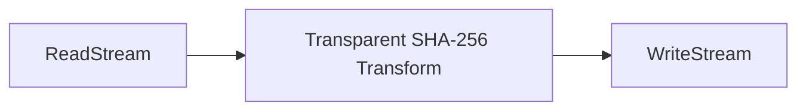

# Feature Spec: Content Hashing During Copy Operations

## Executive Summary

Issue [#111](https://github.com/yandy-r/rfmedia-apps/issues/111) is an audit, hardening, and
closeout release for functionality initially merged in
[PR #233](https://github.com/yandy-r/rfmedia-apps/pull/233). Preserve the existing schema version 9
architecture, close its remaining correctness gaps, document the contract, update the roadmap, and
close the issue through a template-compliant PR. The lowercase SHA-256 value is an expected
write-time fingerprint of final artifact bytes, not destination read-back proof. Scope is limited to
workflows that own SQLite inventory rows: album/filter copy, sync, and their delegated entry points.
GitHub currently reports no child issues under #111; broader artifact-ledger and read-time
verification work remains separate.

## External Dependencies

### APIs and Services

- Use Node.js 22 built-ins: `node:crypto`, `node:fs`, `node:stream`, and
  `node:stream/promises`.
- Retain the pinned `better-sqlite3` database boundary and synchronous prepared transactions.
- Add no hashing package, worker pool, external command, SQLite extension, or runtime service.
- Pass the existing `AbortSignal` into the stream pipeline so cancellation reaches file I/O.
- Keep filesystem work asynchronous and outside `better-sqlite3` transaction functions.

## Business Requirements

### User Stories

- Successful, tracked copy and sync inventory rows provide stable content fingerprints for later
  verification, deduplication, caching, analytics, and incremental-sync work.
- Existing databases and legacy inventory remain usable without a mandatory backfill.
- Operators see no new flags, routine hash output, or changed machine-output schema.
- Failures are explicit: a hash or database failure cannot be converted into successful completion
  with an unknown hash.

### Acceptance criteria

1. Every successful non-dry-run in-scope inventory row produced by current code contains a non-null
   SHA-256 matching `/^[a-f0-9]{64}$/`.
2. The hash represents the final destination artifact. Converted files are hashed after conversion;
   hardlinks are snapshot-hashed after link creation.
3. Existing version 8 databases migrate to version 9 with historical rows left `NULL`; existing
   version 9 databases reopen without schema churn.
4. Databases with a schema version newer than the CLI supports are rejected before schema DDL is
   executed and remain unchanged.
5. Cancellation or exhausted stream-copy retries do not leave a newly created partial destination,
   inventory row, or completion marker.
6. Invalid non-null digest strings are rejected at both shared SQLite inventory write APIs, and a
   rejected batch is rolled back.
7. Normal output and shell completion content remain unchanged. Existing completion tests pass.
8. Direct-copy benchmark evidence uses like-for-like workloads and reports variance honestly. No
   flaky timing threshold is added to CI.
9. User documentation distinguishes write-time fingerprinting from `--verify`, legacy `NULL`,
   conversion behavior, hardlink snapshot semantics, and tracking-disabled behavior.
10. All current #111 entries in `ROADMAP.md` are marked shipped with PR #233 credited as the initial
    implementation and the closeout PR linked after it exists.
11. The final PR uses the repository template, includes `Closes #111`, passes review and CI, is
    squash-merged, and its branch/worktree are cleaned up.

### Compatibility rules

- Hashing remains mandatory only for successful database-inventoried writes; there is no
  `--hash`, `--no-hash`, or algorithm selector.
- `content_hash` remains nullable for legacy/unknown records. New successful in-scope records may
  not silently store `NULL`.
- Disabling completed tracking or selecting legacy tracking does not create a hidden database
  lifecycle solely for hashes.
- Dry-run performs no copy, hash read, schema migration, or inventory write.
- Routine logs do not expose full hashes.

## Technical Specifications

### Architecture

The required per-file ordering is:

Regular copies use the existing one-pass stream:

The transform updates a fresh SHA-256 accumulator and forwards each unchanged chunk. Each retry
creates new streams, transform, and hash state. After the pipeline completes, timestamps are
restored and the lowercase digest is returned with copy metadata. The `AbortSignal` is passed to
`pipeline()`.

Hardlinks have no copy stream, so they are hashed by reading the linked bytes after link creation.
Conversions are hashed by reading the final output only after the converter exits successfully.
These are deliberately reported separately in performance evidence because their cost model differs
from a byte copy.

### Filesystem failure contract

- If a stream attempt fails, its stream/hash state is discarded before retry.
- If all attempts fail or cancellation aborts the pipeline, remove only a destination that the
  helper established did not exist before its attempt and that it may have partially created.
- Never recursively remove a pre-existing path or replace atomicity/ownership semantics in this
  issue.
- Preserve abort classification and the original filesystem error as far as the current error model
  permits.
- No inventory or completion write occurs after copy/hash failure.

### Database contract

- Keep `CURRENT_SCHEMA_VERSION = 9` and nullable `inventory.content_hash TEXT`.
- Keep the guarded version 8 to 9 migration: inspect `PRAGMA table_info(inventory)`, add the column
  only when absent, then store version 9.
- Before executing `schema.sql` on an existing versioned database, inspect the metadata table and
  reject a version above 9. Distinguish absent metadata for a new database from malformed metadata
  in an existing versioned database.
- Validate every non-null `contentHash` against `/^[a-f0-9]{64}$/` before statement execution in
  both `recordInventoryFile()` and `recordInventoryFiles()`.
- Retain positional prepared parameters and the existing synchronous batch transaction. Validate
  inside the batch transaction so any malformed entry rolls back the entire batch.
- Keep current read APIs and map database `NULL` through the portable inventory model.
- Do not add a schema version, table, constraint rebuild, hash index, or backfill in this change.

### In-scope workflows

| Workflow                  | Contract                                                                                                |
| ------------------------- | ------------------------------------------------------------------------------------------------------- |
| Album copy                | Stream/hash regular copies; hash final conversion/hardlink artifacts; batch inventory before completion |
| Filter copy               | Hash the accepted final destination and persist before successful tracking                              |
| Sync                      | Persist the hash for the destination represented by its existing one-row-per-source inventory model     |
| Queue and MCP copy routes | Inherit behavior by delegation; require only delegation regression coverage                             |

### Explicitly deferred workflows

- Plex query copy and playlist export/sync, which do not own general copy-operation inventory rows.
- Repair/conflict writes and video linking, which are not copy-operation inventory producers.
- Watch execution where tracking is explicitly unavailable or disabled.
- One-to-many destination artifact storage for ranged outputs.
- Read-time verification tiers, stale-hardlink policy, and legacy backfill (#116).
- Deduplication and hash lookup indexes (#38/#120).
- Conversion-cache keys, algorithm agility, authenticity/signatures, and atomic temp-file
  replacement.

### Testing requirements

- Filesystem: known regular-copy digest, hardlink digest, cancellation propagation, retry isolation,
  and newly-created partial-output cleanup.
- Database: new v9 database, v8 migration, v9 reopen, newer-version immutability, nullable retrieval,
  invalid single-write rejection, invalid batch rejection/rollback, and valid batch persistence.
- Inventory: present, null, and omitted hash mapping for database/JSONL inputs.
- Actions: focused album/filter/sync success and failure ordering, including conversion and dry-run
  paths where existing coverage does not already prove the contract.
- Delegation: queue/MCP routes remain routed through the in-scope actions.
- Completions: run existing Bash/Zsh/Fish template parity tests without editing templates.
- Validation: package typecheck/tests/build, repository-native gates, `git diff --check`, and any
  scoped benchmark/report validation introduced by the plan.

### Performance evidence

- Compare the same direct-copy action with the benchmark-only hash-disable seam as the only changed
  behavior.
- Use identical fixtures, destination filesystem, tracking/database mode, worker count, overwrite
  policy, warmup, and iteration count.
- Include repeated small-file and representative media-sized-file samples where practical.
- Report medians, spread, throughput, and peak memory; keep direct copy separate from hardlink and
  conversion results.
- Evaluate the issue's `<5%` target against direct byte copies. If variance crosses the threshold,
  report the result as inconclusive rather than claiming success from a noisy faster sample.
- Do not add a wall-clock performance assertion to CI.

## UX Considerations

### User Workflows

- Hash persistence is quiet and automatic when database tracking is active.
- Existing progress, summaries, JSON output, MCP schemas, and exit-code behavior remain stable.
- `--verify` continues to mean immediate source/destination comparison. Documentation must not call
  the stored stream digest a completed destination read-back verification.
- Missing hashes on migrated rows are represented as unknown (`NULL`), not mismatch or corruption.
- A hash/database failure follows existing failed-operation reporting and must not produce a false
  successful completion.
- No command or option changes means Bash, Zsh, and Fish completion files remain untouched.

## Recommendations

### Implementation strategy

1. Audit and surgically harden PR #233 rather than reimplement the feature.
2. Keep schema version 9, SHA-256 lowercase hex, nullable legacy rows, and current inventory identity.
3. Preflight future schemas before DDL and validate hashes at the shared database boundary.
4. Thread cancellation through the copy pipeline and perform ownership-bounded partial cleanup.
5. Change action ordering only where focused tests demonstrate a violation.
6. Use repeated, like-for-like performance measurements and clearly label inconclusive results.
7. Update canonical docs and all roadmap references; do not rewrite historical PR #233 evidence.
8. Close #111 through the new PR and defer broader artifact-ledger/read-time consumer work.

## Risk Assessment

### Technical Risks

| Risk                                                  | Likelihood | Impact | Mitigation                                                                |
| ----------------------------------------------------- | ---------- | ------ | ------------------------------------------------------------------------- |
| Existing implementation is duplicated or destabilized | Medium     | High   | Preserve current modules/schema; make only test-backed changes            |
| Newer database mutates before rejection               | Low        | High   | Compatibility preflight plus exact schema snapshot regression test        |
| Partial destination survives abort/failure            | Medium     | High   | Signal-aware pipeline and helper-owned, new-path-only cleanup             |
| Malformed digest enters trusted inventory             | Low        | Medium | Shared lowercase 64-hex validation and batch rollback test                |
| Write-time hash is overstated as read-back proof      | Medium     | High   | Precise types/docs; defer comparison behavior to #116                     |
| Conversion stores the wrong bytes' hash               | Low        | High   | Hash final output and retain focused conversion coverage                  |
| Completion precedes persistence                       | Medium     | High   | Enforce/test write -> hash -> inventory -> completion ordering            |
| Benchmark gives false confidence                      | High       | Medium | Repeated controlled runs, variance disclosure, no CI timing gate          |
| Literal every-copy scope expands the release          | High       | Medium | Document inventory-backed boundary and deferred operation-identity design |
| Completion artifacts drift unnecessarily              | Low        | Low    | No template edits; existing completion tests only                         |

## Task Breakdown Preview

### Phase 1: Contract and baseline

- Confirm issue/child-issue/PR state and current copy/inventory graph.
- Capture focused baseline tests and benchmark behavior.
- Validate this design and derive dependency-aware implementation tasks.

### Phase 2: Minimal hardening

- Add pre-DDL future-schema compatibility checking and immutability tests.
- Add shared digest validation and atomic batch rejection tests.
- Add signal-aware stream hashing, retry isolation, bounded cleanup, and tests.
- Audit album/filter/sync ordering; change only demonstrated gaps.

### Phase 3: Evidence and documentation

- Run focused/full tests, typecheck, build, completion tests, and repository-native gates.
- Run and record controlled benchmark evidence without a flaky CI threshold.
- Update canonical user docs and `ROADMAP.md`; link the closeout PR once created.

### Phase 4: Delivery

- Commit and push intentionally from the feature worktree.
- Open a template-compliant PR with exact validation and `Closes #111`.
- Run structured code review, fix actionable findings, and rerun affected validation.
- Monitor required CI through green, squash merge, verify #111 closed, and clean up the branch and
  worktree.

## Decisions Needed

The implementation plan adopts these defaults unless repository evidence disproves them:

| Decision            | Adopted choice                                                          |
| ------------------- | ----------------------------------------------------------------------- |
| Delivery            | Audit, harden, document, and close the existing implementation          |
| Scope               | Inventory-backed album/filter copy and sync plus delegated entry points |
| Hash meaning        | Expected final-artifact SHA-256 captured at write/finalization time     |
| Encoding            | Fixed lowercase 64-character hexadecimal SHA-256                        |
| Schema              | Keep version 9 and nullable legacy `content_hash`; no backfill/index    |
| Failure ordering    | File finalization -> digest -> inventory -> completion                  |
| Verification        | Preserve `--verify`; stored-hash comparison belongs to #116             |
| Performance gate    | Direct-copy `<5%` target with repeated evidence; no CI timing assertion |
| Completions         | No content changes; regression tests only                               |
| Broad copy surfaces | Deferred until a durable operation/artifact identity is designed        |

Open implementation questions to resolve from code/tests rather than expanding scope:

1. What is the smallest reliable test seam for aborting after destination creation without a flaky
   timer-based large-file test?
2. Can the compatibility preflight reject future schemas before all write-affecting pragmas while
   preserving new-database initialization?
3. Do any current action branches mark completion before the inventory write, or is documentation
   and regression coverage sufficient?
4. Which existing benchmark fixture can produce credible repeated media-sized results in this
   environment, and must the final conclusion be labeled inconclusive?

## Research References

- [External APIs and platform behavior](research-external.md)
- [Business requirements and scope](research-business.md)
- [Technical architecture and contracts](research-technical.md)
- [UX and compatibility](research-ux.md)
- [Security and failure analysis](research-security.md)
- [Codebase patterns and modularity](research-practices.md)
- [Consolidated recommendations](research-recommendations.md)
- GitHub issue [#111](https://github.com/yandy-r/rfmedia-apps/issues/111)
- Prior implementation PR [#233](https://github.com/yandy-r/rfmedia-apps/pull/233)
