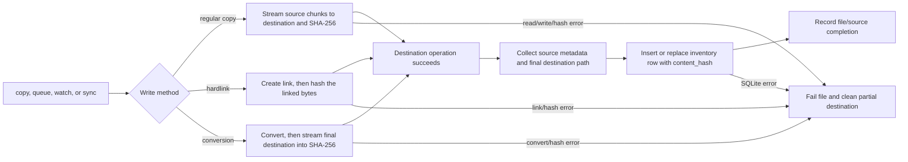

# Content Hashing During Copy Operations: Technical Research

## Executive Summary

Issue [#111](https://github.com/yandy-r/rfmedia-apps/issues/111) asks rfmedia-cli to compute a
SHA-256 hash during every copy, store it beside copy metadata in SQLite, keep overhead below 5%,
and make the value available to later verification, deduplication, caching, and sync work.

The current `master` branch already contains most of that implementation. PR
[#233](https://github.com/yandy-r/rfmedia-apps/pull/233) merged the following contracts without
closing or linking issue #111:

- schema version 9 adds nullable `inventory.content_hash`;
- the v8-to-v9 migration preserves existing rows and adds the column idempotently;
- album-mode `rfmedia copy`, filter-mode `rfmedia copy`, and `rfmedia sync` persist hashes when
  database-backed tracking is active;
- regular album copies can hash the stream while writing, while converted outputs and other copy
  paths hash the final destination after the write;
- database read APIs return `content_hash`, and JSONL inventory entries tolerate an optional
  `contentHash`;
- focused unit tests and a copy benchmark exist.

The correct implementation workflow is therefore not to create the issue's suggested
`src/lib/hasher.ts`, `src/lib/copy.ts`, `src/types/database.ts`, or `src/lib/database.ts`; those paths
do not match this repository. It should audit and, where necessary, strengthen the existing
implementation in `filesystem.ts`, `integrity.ts`, the copy actions, and the inventory/database
modules. The completion PR must use `Closes #111`, update `ROADMAP.md` from pending to shipped, and
document the exact scope.

The recommended scope is the inventory-backed copy pipeline: direct `rfmedia copy`, queued copy,
watch-triggered copy, and `rfmedia sync`. Queue and watch already delegate to the same album/filter
actions. `rfmedia plex copy` and playlist export/sync are distinct pipelines that currently open
SQLite for query/export state but do not create a copy-tracking operation to own inventory rows.
If “every rfmedia-cli copy” is intended literally to include those surfaces, they require an
explicit child issue and a shared operation-identity design rather than an ad hoc hash column write.

No new CLI option is required. Hash persistence is an internal invariant of successful,
non-dry-run, database-tracked writes; `--verify` remains the separate, opt-in immediate
source-versus-destination check.

## Architecture Design

### Authoritative copy entry points

| User/runtime entry point                   | Actual action path                                                                                                                       | Byte-writing primitive                                           | Current hash/persistence behavior                                                                                                    | Recommended disposition                                                                 |
| ------------------------------------------ | ---------------------------------------------------------------------------------------------------------------------------------------- | ---------------------------------------------------------------- | ------------------------------------------------------------------------------------------------------------------------------------ | --------------------------------------------------------------------------------------- |
| `rfmedia copy` album mode                  | `commands/copy.ts` -> `executeAlbumCopyWithFileInput()` -> `executeAlbumCopy()` -> `processAlbum()`                                      | `copyDirectoryWithConversion()` or `copyDirectoryWithProgress()` | Plain copy uses `copyOrLinkWithHash()` when inventory capture is enabled; conversion hashes the final output; rows are batch-written | In scope; retain and add edge coverage where missing                                    |
| `rfmedia copy` filter mode                 | `commands/copy.ts` -> `executeFilterCopyWithFileInput()` -> `executeFilterCopy()` -> `processAlbumMode()` or `processTracksInParallel()` | `copyOrConvertFile()`, `copyOrLink()`, or `convertFile()`        | `recordCopiedFileInventory()` hashes `destPath` after success and inserts one row                                                    | In scope; candidate for streamed plain-copy hashing if benchmark evidence requires it   |
| `rfmedia queue run` copy jobs              | `actions/queue.ts` -> album/filter `*WithFileInput()` actions                                                                            | Same as direct copy                                              | Inherits the core copy behavior                                                                                                      | In scope and already covered by delegation                                              |
| `rfmedia watch`                            | `actions/watch.ts` -> `executeAlbumCopy()` or `executeFilterCopy()`                                                                      | Same as direct copy                                              | Inherits hashing only when a database tracking context exists                                                                        | In scope; explicitly test or document tracking-context behavior                         |
| `rfmedia sync`                             | `executeSyncWithFileInput()` -> `syncFile()`                                                                                             | `copyOrLink()` or `convertFile()`                                | Hashes the final destination before `appendFileRecord()`; only the first suffix destination is inventoried                           | In scope because it owns inventory rows; preserve its one-row-per-source-file semantics |
| `rfmedia plex copy`                        | `executePlexCopy()`                                                                                                                      | Direct `copyOrLink()` or `convertFile()` loops                   | No copy operation/inventory identity; explicitly documented as not persisting hashes                                                 | Out of the first scope unless issue owner makes all copy-named surfaces literal         |
| Playlist export/sync                       | `executePlaylistExport()` / `executePlaylistSync()`                                                                                      | Direct `copyOrLink()` or `convertFile()` loops                   | Playlist-specific tables track exports, not general copy inventory hashes                                                            | Out of the first scope; requires a separate data-contract decision                      |
| `rfmedia verify --fix` and conflict repair | verify actions and `conflict-resolver.ts`                                                                                                | Direct repair copies/conversions                                 | Repairs existing state rather than executing a copy command; no copy inventory row                                                   | Out of scope; issue #116 should define read-time verification/update semantics          |

### Runtime flow



Hash persistence must occur before the affected file or source is marked complete. A destination
can exist without a row if the process dies between the filesystem write and SQLite transaction;
this is an unavoidable cross-resource boundary in the current architecture. Retry/conflict logic
must make that state recoverable by rehashing the existing destination or recreating it, never by
marking the source complete without a stored hash.

### Streaming versus post-write semantics

The persisted contract is the lowercase SHA-256 of the final destination bytes, not the source
path, source metadata, options hash, or converted input bytes.

- **Regular byte-identical copies:** `copyOrLinkWithHash()` should remain the preferred primitive.
  Its `Transform` updates SHA-256 for each source chunk passed to the destination writer, avoiding a
  second read. This represents the bytes submitted to the writer. It does not prove durable media
  contents after the write; later read-time verification belongs to issue #116.
- **Hardlinks:** no copy stream exists. Hash after link creation, using either source or destination;
  both names reference the same inode at that instant. Hashing `dest` communicates the contract more
  clearly, while hashing `source` is equivalent and is what the current helper does.
- **Converted audio:** hash only after `convertFile()` closes successfully, and hash the final
  converted destination. A source hash is not a content hash for the output artifact.
- **Existing destinations accepted as skip:** if the workflow creates an inventory row for the
  accepted file, hash the existing destination. A skipped operation must not reuse a source hash or
  a stale database value without reading the accepted destination.
- **`--verify`:** immediate verification may read source and destination and compare them for
  byte-identical copy/hardlink paths. It stays orthogonal to hash persistence and continues to skip
  source/output comparison for conversion.

All hashing runs inside the existing per-file/per-album worker limit. No separate unbounded hash
pool should be introduced.

## Data Models/contracts

### SQLite schema

The existing version 9 schema is the recommended contract:

```sql
CREATE TABLE inventory (
  id INTEGER PRIMARY KEY AUTOINCREMENT,
  operation_id INTEGER NOT NULL,
  source_path TEXT NOT NULL,
  relative_path TEXT NOT NULL,
  mtime INTEGER NOT NULL,
  size INTEGER NOT NULL,
  rating REAL,
  genre TEXT,
  year INTEGER,
  bpm REAL,
  artist TEXT,
  dest_path TEXT NOT NULL,
  content_hash TEXT,
  copied_at INTEGER NOT NULL,
  FOREIGN KEY (operation_id) REFERENCES operations(id) ON DELETE CASCADE,
  UNIQUE(operation_id, source_path, relative_path)
);
```

`content_hash` remains nullable for pre-v9 rows and for legacy/file-backed inventory compatibility.
Producers must emit lowercase hexadecimal strings matching `/^[a-f0-9]{64}$/`. A SQLite `CHECK`
constraint is not recommended in this migration because SQLite cannot add it to the existing table
without rebuilding the table, and nullable legacy rows must remain valid.

Do not add a `content_hash` index in issue #111. Current reads are scoped by operation/source or
destination path; no current query filters or joins on the hash. An index would add write
amplification before deduplication or content-addressed lookup exists. The downstream feature that
introduces `WHERE content_hash = ?` should add and justify `idx_inventory_content_hash`, likely as a
partial index excluding `NULL`.

### Migration contract

`CURRENT_SCHEMA_VERSION` remains `9`; do not create a second migration for a column already present.
The authoritative v8-to-v9 behavior is:

1. inspect `PRAGMA table_info(inventory)`;
2. execute `ALTER TABLE inventory ADD COLUMN content_hash TEXT` only when absent;
3. update `metadata.schema_version` to `9`;
4. leave all historical rows as `NULL`;
5. reject databases newer than the supported schema version.

The column guard makes recovery idempotent if the column addition succeeds but the metadata update
does not. New databases receive the column from `schema.sql`; `INSERT OR IGNORE` initializes version
9 after all base tables are created.

### TypeScript and database API contracts

Retain the current snake-case database/camel-case application boundary:

```typescript
interface DbInventoryEntry {
  // existing columns
  content_hash: string | null;
}

interface FileInventoryEntry {
  // existing fields
  contentHash?: string | null;
}

interface InventoryFileRecordParams {
  // existing fields
  contentHash?: string | null;
}

function recordInventoryFile(db: DbConnection, operationId: number, entry: InventoryFileRecordParams): void;

function recordInventoryFiles(db: DbConnection, operationId: number, entries: InventoryFileRecordParams[]): void;

function getInventory(db: DbConnection, operationId: number): DbInventoryEntry[];

function getInventoryForSource(db: DbConnection, operationId: number, sourcePath: string): DbInventoryEntry[];
```

`recordInventoryFiles()` must keep one prepared statement inside one SQLite transaction. Both write
APIs bind parameters positionally and normalize missing hashes to `NULL`; they must never
interpolate paths or hashes into SQL. Existing read APIs already use `SELECT *`, so the new field is
retrieved without a second query. `loadInventoryFromDb()` maps it back to `contentHash`, including
`NULL`, so future verify/sync consumers do not lose database values.

The filesystem API should stay small and result-oriented:

```typescript
interface CopyWithHashResult {
  method: CopyMethod;
  contentHash: string;
  mtime: number;
  size: number;
}

copyOrLinkWithHash(
  source: string,
  dest: string,
  useHardlink: boolean,
  signal?: AbortSignal,
): Promise<CopyWithHashResult>;

calculateHash(filePath: string): Promise<string>;
```

No public hash algorithm enum is needed. Changing algorithms later requires an algorithm/version
column and cannot safely reinterpret existing `content_hash` values.

## CLI/API Design

Hashing is mandatory for successful database-inventoried copies and does not need a user-facing
enable/disable option. Adding `--hash`, `--no-hash`, or an algorithm selector would weaken the
invariant needed by downstream features and multiply compatibility states.

Current option behavior should be documented explicitly:

- normal `rfmedia copy` uses database-backed tracking by default and persists hashes;
- `--dry-run` neither writes files nor opens/writes tracking inventory, so it computes no hash;
- `--no-track-completed` and legacy tracking intentionally do not create SQLite inventory rows and
  therefore cannot persist a database hash;
- `--verify` requests immediate source/destination comparison in addition to persistence;
- `--tracking-database <path>` selects the database that receives the inventory row;
- machine and text output do not expose full hashes by default.

Because no command, option, or argument is added, Bash, Zsh, and Fish completion templates require
no content change. Their existing `copy` options already include `--verify`, `--no-verify`, and
`--tracking-database`. Completion template tests should still run as part of full validation, but a
no-op edit to generated templates would be noise.

No MCP schema change is required. Hash retrieval is currently an internal database/inventory API;
an MCP field should be introduced only with a user-facing inventory or integrity query tool.

## System Constraints

### Compatibility and lifecycle

- Runtime is Node.js 22+ and ESM/NodeNext; imports require `.js` suffixes.
- Use built-in `node:crypto` and stream APIs; add no runtime hashing dependency.
- Existing version 8 databases must migrate in place without losing inventory or requiring a
  backfill. Old rows remain readable with `content_hash = NULL`.
- JSONL inventory records written before this feature omit `contentHash`; loaders must accept that.
- `INSERT OR REPLACE` retains the existing inventory identity
  `(operation_id, source_path, relative_path)` and replaces the hash with the current destination
  value on a recopy.
- Routine logs must not print full content hashes. Existing immediate-verification mismatch logging
  is a separate diagnostic behavior and should not be copied into ordinary persistence.

### Error handling

- Abort before or during streaming rejects the file operation and must not insert inventory or
  completion rows.
- Source read, destination write, transform, hardlink, conversion, final hash read, and SQLite write
  failures all fail the affected file/source through existing failed-operation tracking.
- Copy/stream errors must trigger partial-destination cleanup. The shared helper or its immediate
  caller should remove a partially written file; process-level signal cleanup remains a final safety
  net, not the only cleanup path.
- A hash failure after a successful conversion or hardlink must not mark the item complete. The
  destination may be removed or safely rehashed on retry; whichever policy the action already uses
  must be tested.
- A SQLite failure after the destination write must not silently downgrade to a `NULL` hash. Fail
  the tracked operation so a retry can reconcile the filesystem/database boundary.
- The existing filesystem retry loop must create fresh hash and stream state per attempt. Reusing a
  finalized or partially updated `Hash` object produces a corrupt digest.

### Performance instrumentation

The `<5%` target must compare like with like: the same database tracking, metadata collection,
source fixtures, worker count, destination filesystem, overwrite behavior, and number/size
distribution, with hashing as the only changed variable.

`packages/rfmedia-cli/benchmarks/copy.bench.ts` already includes an internal
`benchmarkDisableContentHashing` baseline. Keep that escape hatch benchmark-only and inaccessible
from CLI/config. Strengthen acceptance evidence as follows:

1. benchmark regular copied files, hardlinks, and converted files separately;
2. include representative media-sized files, not only many tiny fixtures where setup and SQLite
   noise dominate;
3. report median/mean for baseline and hash-enabled cases plus
   `(hash_ms - baseline_ms) / baseline_ms * 100`;
4. use multiple runs and treat a result whose variance crosses 5% as inconclusive;
5. avoid dry-run results because they execute no hash path;
6. verify process memory remains bounded as file size grows, proving streams rather than buffering.

The previously captured benchmark, where hash-enabled runs were faster than the disabled baseline,
shows no obvious regression but cannot by itself prove hashing overhead below 5%; the difference is
dominated by benchmark variance or unrelated work. Completion evidence should either provide a
stable ratio or explicitly document why the target cannot be asserted from the current fixture.

## Codebase Changes with exact paths

### Existing implementation to retain and audit

| Path                                              | Responsibility / required audit                                                                                                                                                                    |
| ------------------------------------------------- | -------------------------------------------------------------------------------------------------------------------------------------------------------------------------------------------------- |
| `packages/rfmedia-cli/src/lib/filesystem.ts`      | Own streamed copy/hardlink hashing, retry-state isolation, abort handling, timestamp preservation, and partial-file cleanup                                                                        |
| `packages/rfmedia-cli/src/lib/integrity.ts`       | Own final-file SHA-256 calculation and immediate verification; return lowercase hex                                                                                                                |
| `packages/rfmedia-cli/src/actions/copy-album.ts`  | Capture hashes for every final album destination, including conversion, hardlink, first-copy optimization, renamed conflicts, and parallel suffix copies; batch inventory writes before completion |
| `packages/rfmedia-cli/src/actions/copy-filter.ts` | Capture final destination hashes in flat, preserve-structure, album-mode, library-root, conversion, hardlink, overwrite, rename, and accepted-skip paths                                           |
| `packages/rfmedia-cli/src/actions/sync.ts`        | Persist the hash of the inventoried final destination and preserve one inventory row per source file                                                                                               |
| `packages/rfmedia-cli/src/lib/schema.sql`         | Define nullable `inventory.content_hash` and schema version 9                                                                                                                                      |
| `packages/rfmedia-cli/src/lib/migrations.ts`      | Perform guarded v8-to-v9 migration and reject newer schemas                                                                                                                                        |
| `packages/rfmedia-cli/src/lib/db.ts`              | Bind hash in single/batch inventory writes and retrieve it in inventory queries                                                                                                                    |
| `packages/rfmedia-cli/src/lib/inventory.ts`       | Preserve `contentHash` across database and JSONL adapters                                                                                                                                          |
| `packages/rfmedia-cli/src/types/db.ts`            | Expose `content_hash: string \| null` on DB rows                                                                                                                                                   |
| `packages/rfmedia-cli/src/types/inventory.ts`     | Expose optional nullable `contentHash` on portable inventory entries                                                                                                                               |

### Tests and evidence

| Path                                                   | Required coverage                                                                                                                       |
| ------------------------------------------------------ | --------------------------------------------------------------------------------------------------------------------------------------- |
| `packages/rfmedia-cli/src/lib/filesystem.test.ts`      | Known SHA-256 for streamed copy, hardlink behavior, retry creates fresh state, abort/read/write error rejection, no full-file buffering |
| `packages/rfmedia-cli/src/lib/integrity.test.ts`       | Known digest, missing/unreadable file propagation, lowercase 64-character output                                                        |
| `packages/rfmedia-cli/src/lib/db.test.ts`              | New schema, v8 migration, idempotent column guard, legacy `NULL`, single and batched persistence/retrieval, replace behavior            |
| `packages/rfmedia-cli/src/lib/inventory.test.ts`       | DB-to-domain and JSONL mappings preserve present, null, and omitted hashes                                                              |
| `packages/rfmedia-cli/src/actions/copy-album.test.ts`  | Regular copy, hardlink, conversion, subsequent suffix, dry-run, failure-before-completion, and batch-row hashes                         |
| `packages/rfmedia-cli/src/actions/copy-filter.test.ts` | Flat/structured/album/library-root paths, conversion, hardlink, rename/overwrite/accepted skip, dry-run, and hash failure               |
| `packages/rfmedia-cli/src/actions/watch.test.ts`       | Watch delegation receives database tracking or explicitly documents the no-inventory behavior                                           |
| `packages/rfmedia-cli/benchmarks/copy.bench.ts`        | Like-for-like overhead and bounded-memory evidence at representative sizes                                                              |

### Documentation and repository closeout

- Update `ROADMAP.md` in all three current #111 locations: “What's unblocked,” Sprint 2 ordering,
  and the high-priority backlog. Mark the feature shipped and link the closing PR (and PR #233 as
  prior implementation history where useful).
- Update `packages/rfmedia-cli/README.md` or the existing tracking/integrity feature documentation
  with the persistence invariant, nullable legacy behavior, and distinction from `--verify`.
- Do not edit `packages/rfmedia-cli/src/lib/shell-completions/bash.ts`, `zsh.ts`, or `fish.ts` unless
  the final implementation adds a CLI option. If it does, all three templates and
  `shell-completions/templates.spec.ts` must change together.
- Use `.github/pull_request_template.md` for the closing PR and put `Closes #111` in
  `## Related Issues`; PR #233 used `N/A`, which is why merged code did not close the issue.
- Run `graphify update .` after code changes when the worktree has graphify output available. This
  research worktree did not contain `graphify-out/graph.json`, so no graph query/update can be
  performed inside it.

## Technical Decisions/options/recommendation/rationale

| Decision               | Options considered                                                           | Recommendation                                                                  | Rationale                                                                                                                           |
| ---------------------- | ---------------------------------------------------------------------------- | ------------------------------------------------------------------------------- | ----------------------------------------------------------------------------------------------------------------------------------- |
| Persistence location   | Add `copied_files` table; add hash to history operations; extend inventory   | Extend `inventory`                                                              | Inventory already owns source metadata, destination path, operation identity, and incremental-sync reads                            |
| Hash implementation    | New service/class; third-party dependency; built-in helper                   | Built-in `node:crypto` in existing filesystem/integrity modules                 | One fixed algorithm does not justify a service abstraction or dependency                                                            |
| Regular-copy hashing   | Hash source before copy; hash while streaming; reread destination after copy | Hash while streaming; later verification rereads destination                    | Meets “during copy,” avoids an extra read, and preserves read-time verification as a separate concern                               |
| Converted output       | Hash source stream; hash encoder input; hash final file                      | Hash final destination after conversion                                         | Only final output bytes identify the artifact users retain                                                                          |
| Hardlink               | No hash; hash source; hash destination                                       | Hash the linked bytes after link creation; prefer destination name semantically | There is no write stream, but source/destination are the same inode at capture time                                                 |
| Historical rows        | Eager backfill; non-null migration; nullable                                 | Nullable with no automatic backfill                                             | Old destinations may be missing or changed; fabricating/backfilling during migration is expensive and unreliable                    |
| Hash validation        | SQLite table rebuild with `CHECK`; application invariant                     | Application invariant, tested at producers                                      | Avoids destructive migration while keeping old null rows compatible                                                                 |
| Hash index             | Add immediately; defer                                                       | Defer until a hash lookup lands                                                 | No current query uses it; premature index adds write cost                                                                           |
| User control           | `--hash`/`--no-hash`; config algorithm; invariant                            | Internal invariant for DB-tracked writes                                        | Downstream integrity features need predictable availability, not optional fingerprints                                              |
| Immediate verification | Always source/destination verify; retain `--verify`                          | Retain opt-in `--verify`                                                        | Always rereading both files conflicts with the overhead goal and conversion semantics                                               |
| Broad copy scope       | Patch every direct `copyOrLink()` call; inventory-backed core only           | Core copy/sync now; child issue for Plex/playlist if required                   | Those workflows lack a shared copy operation/inventory identity; hashing without a durable owner does not satisfy storage/retrieval |
| Existing merged work   | Reimplement issue from scratch; audit and close                              | Audit, strengthen gaps, document, and close                                     | Current master already contains schema v9 and core persistence; duplicate implementation creates migration/API risk                 |

## Open Questions

1. **Does “every rfmedia-cli copy” mean only the `rfmedia copy` command and inventory-backed sync,
   or also `rfmedia plex copy`, playlist export/sync, and verify repair?** Recommended default:
   close #111 around the core inventory-backed pipeline and create a child issue for a shared copy
   operation identity before extending Plex/playlist surfaces.
2. **Should `--no-track-completed` or legacy tracking still write hashes to SQLite?** Recommended
   default: no. The user explicitly disabled the tracking backend that owns inventory rows. Document
   this exception rather than opening a hidden second database lifecycle.
3. **What does “verified at read time” require in #111?** Recommended default: storage/retrieval API
   availability only. Tiered read-time verification, stale/missing hash policy, and updating null
   legacy rows belong to issue #116.
4. **Must the `<5%` target be a hard CI threshold?** Recommended default: record stable benchmark
   evidence now, but avoid a flaky timing assertion in shared CI. Add a threshold only after fixture
   size, runner class, and variance policy are standardized.
5. **Is the existing implementation sufficient to close the issue without code changes?** Current
   source shows the main contracts are shipped, but completion still requires a requirements audit,
   current test/benchmark rerun, user-facing documentation, ROADMAP update, and a PR carrying
   `Closes #111`. Any uncovered hardlink/conversion/failure gap should be fixed in that PR rather than
   silently treating PR #233's historical validation as current proof.
6. **Are there child issues today?** GitHub currently reports no sub-issues for #111. If the broad
   copy scope or rigorous benchmark work is intentionally deferred, create child issues through the
   repository's required issue forms and link them before closing the parent.
