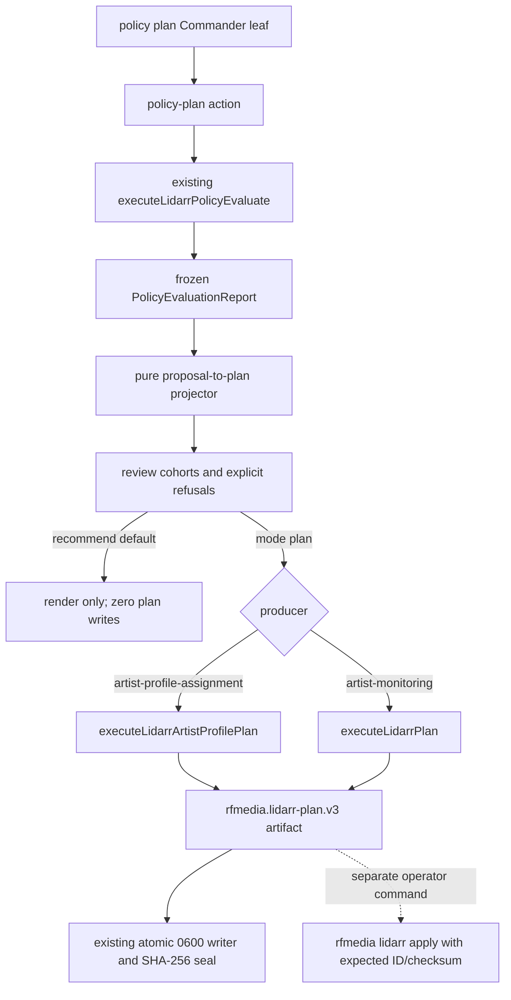

# Technical Research: `lidarr policy plan`

## Executive Summary

Issue #311 can be implemented as a thin orchestration layer over the shipped policy evaluator and
the two shipped Lidarr plan producers. The new leaf should evaluate once, purely project every
`PolicyProposal` into either a reviewable producer cohort or an explicit refusal, and only seal
cohorts when the operator selects an explicit plan mode. It must not execute `handoff.argv`, add a
plan schema/version, or weaken the existing `policy evaluate` write-free boundary.

The safest command contract follows `lidarr sync-ratings`: `rfmedia lidarr policy plan` defaults to
review-only output, while `--mode plan` writes checksum-sealed v3 artifacts. There is deliberately
no apply mode; applying remains the separate `rfmedia lidarr apply` authorization boundary.

## Recommended CLI Contract

```text
rfmedia lidarr policy plan [options]

Selection:
  --plex-library <name>
  --rule <ids>                 repeatable/comma-separated; same parser and values as evaluate
  --max-proposals <n>          same per-rule bound as evaluate (1..100)

Safety:
  --mode <recommend|plan>      default recommend; only plan may write artifacts

Output:
  -v, --verbose

Connection:
  --plex-url <url>
  --plex-token <token>
  --lidarr-url <url>
  --lidarr-api-key <key>
```

Do not add `--yes`, `--apply`, `--dry-run`, or a single `--plan-file`. Review mode is inherently
dry, apply is out of scope, and one evaluation may produce more than one artifact. Sealed artifacts
should use each producer's existing secure default path. Human output should print each path,
`plan.id`, `plan.payloadChecksum`, and a separately runnable pinned apply command.

## Architecture Design



1. The command validates options inside its action handler, before the lazy action import, and
   forwards the same evaluation selection and raw connection overrides as `policy evaluate`.
2. `executeLidarrPolicyEvaluate` performs the one Plex/Lidarr evidence pass and returns the original
   deep-frozen report. The new action must not alter that action or import a writer into it.
3. A pure `projectPolicyPlan(report)` walks every proposal exactly once. Every proposal is present
   in one cohort or one refusal; no filtering operation may silently discard a row.
4. The complete projection is validated before the first producer call. This prevents malformed
   proposal N from being discovered only after artifact N-1 was written.
5. Review mode returns the projection with no producer calls. Plan mode orders sealable cohorts by
   `POLICY_PRODUCER_IDS`, invokes producers sequentially, and reports each artifact immediately.
6. Producers re-read fresh Lidarr state, build canonical v3 facts, compute cascade analysis and the
   payload checksum, then atomically write the artifact. The evaluation report never directly
   authorizes or supplies a request body.

The wrapper must not acquire a scheduler slot. Evaluation and both producers already run in the
`local-only` lane; wrapping them in another `runSingle` can deadlock when lane concurrency is one.

## Exact Reusable Producers and Contracts

| `handoff.producer`          | Existing action                                                                       | Required projection                                                                                   | Existing sealed operation                                             |
| --------------------------- | ------------------------------------------------------------------------------------- | ----------------------------------------------------------------------------------------------------- | --------------------------------------------------------------------- |
| `artist-profile-assignment` | `executeLidarrArtistProfilePlan(options)` in `actions/lidarr/plan-artist-profiles.ts` | Positive `subject.artistId`; positive numeric `after["qualityProfileId"]`; group by target profile ID | `{ kind: "artist-profile-assignment", qualityProfile: { id, name } }` |
| `artist-monitoring`         | `executeLidarrPlan(options)` in `actions/lidarr/plan.ts`                              | Positive `subject.artistId`; boolean `after["monitored"]`; group by desired boolean                   | `{ kind: "artist-monitoring", desiredMonitored }`                     |
| `discovery`                 | No mutation-plan producer                                                             | Explicit `unsupported-producer` refusal                                                               | None; discovery remains an inert `lidarr discover` handoff            |

Concrete producer calls:

```ts
await executeLidarrArtistProfilePlan({
  artistIds: cohort.artistIds,
  qualityProfile: String(cohort.targetQualityProfileId), // bind by ID, not display name
  maxBatch: cohort.artistIds.length,
  lidarrUrl,
  lidarrApiKey,
});

await executeLidarrPlan({
  artistIds: cohort.artistIds,
  monitored: cohort.desiredMonitored,
  maxBatch: cohort.artistIds.length,
  lidarrUrl,
  lidarrApiKey,
});
```

Both actions resolve the canonical Lidarr origin, read the complete fresh artist list, reject
missing exact IDs, build through `buildLidarrMutationPlanV3`, and write through
`writeLidarrPlanArtifact`. The profile producer additionally resolves the numeric profile reference
against the live profile list. Binding `String(id)` is important: numeric references resolve before
names and cannot become ambiguous.

The shared plan contracts already provide all required safety properties:

- `LIDARR_PLAN_VERSION_V3 = "rfmedia.lidarr-plan.v3"`;
- `LIDARR_PLAN_MAX_BATCH` and `LIDARR_PLAN_MAX_ENTRIES` are both 1,000;
- `LidarrPlanGenerationResultV3<T>` is `{ planPath, plan }`;
- the v3 builder canonicalizes/sorts entries, derives review/risk/cascade summaries, and computes
  `sha256:<hex>` over canonical payload material;
- the writer revalidates the schema and checksum, uses a private safe parent, refuses overwrite,
  and writes atomically with private permissions.

No change is needed in `types/lidarr-plan.ts`, `plan-engine.ts`,
`plan-operation-definitions.ts`, apply dispatch, history, claims, or resume.

## Data Models

Keep these contracts in `src/types/lidarr-policy.ts`, which must retain its zero-value-import rule.
Types may use type-only imports from `lidarr-plan.ts`.

```ts
export const POLICY_PLAN_SCHEMA = "rfmedia.lidarr-policy-plan.v1" as const;
export const POLICY_PLAN_MODES = ["recommend", "plan"] as const;
export type PolicyPlanMode = (typeof POLICY_PLAN_MODES)[number];

export type PolicyPlanRefusalCode = "unsupported-producer" | "conflicting-intent";

export interface PolicyPlanRefusal {
  readonly code: PolicyPlanRefusalCode;
  readonly decisionKey: PolicyDecisionKey;
  readonly producer: PolicyHandoff["producer"];
  readonly artistId: number | null;
  readonly detail: string;
  readonly remedy: string | null;
}

export interface PolicyPlanChange {
  readonly decisionKey: PolicyDecisionKey;
  readonly ruleId: PolicyRuleId;
  readonly artistId: number;
  readonly artistName: string;
  readonly before: PolicyProposal["before"];
  readonly after: PolicyProposal["after"];
  readonly checks: PolicyProposal["checks"];
  readonly summary: string;
}

export type PolicyPlanCohort =
  | {
      readonly producer: "artist-profile-assignment";
      readonly targetQualityProfileId: number;
      readonly gate: "sealable" | "no-changes";
      readonly changes: readonly PolicyPlanChange[];
      readonly artistIds: readonly number[];
    }
  | {
      readonly producer: "artist-monitoring";
      readonly desiredMonitored: boolean;
      readonly gate: "sealable" | "no-changes";
      readonly changes: readonly PolicyPlanChange[];
      readonly artistIds: readonly number[];
    };

export type PolicyPlanArtifact = Extract<
  LidarrMutationPlanV3,
  {
    readonly operation: {
      readonly kind: "artist-monitoring" | "artist-profile-assignment";
    };
  }
>;

export interface PolicyPlanOutcome {
  readonly producer: PolicyProducerId;
  readonly decisionKeys: readonly PolicyDecisionKey[];
  readonly generated: LidarrPlanGenerationResultV3<PolicyPlanArtifact>;
}

export interface LidarrPolicyPlanReport {
  readonly schema: typeof POLICY_PLAN_SCHEMA;
  readonly mode: PolicyPlanMode;
  readonly evaluation: PolicyEvaluationReport; // unchanged original report
  readonly cohorts: readonly PolicyPlanCohort[];
  readonly refusals: readonly PolicyPlanRefusal[];
  readonly outcomes: readonly PolicyPlanOutcome[];
  readonly summary: {
    readonly proposals: number;
    readonly projectable: number;
    readonly refused: number;
    readonly artifacts: number;
  };
}

export interface LidarrPolicyPlanActionResult {
  readonly report: LidarrPolicyPlanReport;
  readonly execution: LidarrExecutionSuccessMetadata; // evaluation lane metadata
}
```

`outcomes` is empty in recommend mode. The report, nested arrays, cohorts, refusals, and changes
should be frozen. Policy decision keys remain in the wrapper result only; strict v3 artifacts cannot
accept policy provenance fields without a version change, which is explicitly out of scope.

## Projection and Refusal Rules

The projector belongs in `src/lib/bridge/policy-plan.ts`; it has zero I/O and imports only types and
the closed policy registries.

For every proposal, in this order:

1. Reject duplicate `proposal.key` values as an invariant error.
2. Confirm `proposal.handoff.producer` agrees with
   `POLICY_RULE_DESCRIPTORS[proposal.ruleId].producer`. A mismatch is a programmer-contract error,
   not an operator refusal.
3. Route `discovery` to one `unsupported-producer` refusal. It has no Lidarr artist ID or compatible
   v3 producer; it must remain visible and must never be coerced into `artist-add`.
4. For a mutation producer, require a positive safe-integer `subject.artistId`.
5. For profile assignment, require a positive safe-integer `after["qualityProfileId"]` and group on
   `(producer, profileId)`. Ignore `qualityProfileName` for binding; it is display-only.
6. For monitoring, require a boolean `after["monitored"]` and group on `(producer, boolean)`.
7. Detect an artist present in two incompatible intents (different producers or different desired
   values). Withhold every affected proposal as `conflicting-intent`; never let independent
   artifacts race to define the same artist's state.
8. Sort cohorts by `POLICY_PRODUCER_IDS`, then desired scalar, and sort/deduplicate artist IDs
   ascending. A duplicated artist with the same intent may share one artifact entry, but every
   contributing decision key remains in `changes`/`decisionKeys`.

Malformed producer data throws `PolicyPlanProjectionError(decisionKey, detail)` before any producer
is called. Expected unsealable data (`discovery` and cross-intent conflicts) is a refusal, not an
omission or fabricated plan. This distinction mirrors the existing policy engine: expected safety
gates are data; a broken internal invariant fails the run.

Do not parse or execute `handoff.argv`. It is intentionally inert presentation data and may contain
operator-controlled names. The typed producer discriminator selects an existing action, while the
typed `subject`/`after` values supply arguments.

## Action and Error Handling

`src/actions/lidarr/policy-plan.ts` should compose existing collaborators through dependency
injection:

```ts
interface LidarrPolicyPlanDependencies {
  readonly executeEvaluate: typeof executeLidarrPolicyEvaluate;
  readonly projectPlan: typeof projectPolicyPlan;
  readonly executeArtistProfilePlan: typeof executeLidarrArtistProfilePlan;
  readonly executeMonitoringPlan: typeof executeLidarrPlan;
}
```

- Forward raw Plex/Lidarr overrides and the exact selected rule set to evaluation.
- In recommend mode, return before producer dispatch; this is the regression seam proving zero
  artifact writes.
- In plan mode, size `maxBatch` to the exact cohort, check `1..LIDARR_PLAN_MAX_BATCH`, and seal
  sequentially. Current rules yield at most two cohorts, but grouping supports future homogeneous
  targets without changing the result schema.
- Check `AbortSignal` between evaluation, projection, and producer calls. Existing producer actions
  currently do not accept a signal; do not add broad cancellation work to this issue.
- Sealing multiple artifacts is not transactional. Expose an `onPlanSealed(outcome)` callback, as
  `sync-ratings` does, so artifact 1 is reported before artifact 2 can fail. Never delete a valid
  first artifact as rollback.
- The command's catch path must use the existing failure envelope and pass both API-key/token values
  as sensitive values. Human output stays on stderr; JSON/YAML/CSV stays on stdout.
- Machine output should carry the complete wrapper report. CSV should flatten cohort/refusal/
  artifact rows with JSON-encoded compound cells, following the evaluate presenter pattern.

The action must never call `executeLidarrApply`; therefore plan mode writes artifacts but does not
mutate Lidarr. A later apply should use the returned path plus `expectedPlanId` and
`expectedPlanChecksum`, retaining the existing swap/drift/claim/history protections.

## Compatibility, Performance, and Security Constraints

### Compatibility

- `policy evaluate` remains byte-for-byte behaviorally write-free and retains its existing command,
  report, exit, and completion contracts.
- Additive `policy plan` registration changes the `policy` child order from `["evaluate"]` to
  `["evaluate", "plan"]`; the top-level `lidarr` command order does not change.
- No config key, database migration, MCP method, plan v4, operation kind, apply authorization, or
  generated Lidarr client change is required.
- `sync-ratings` remains the ratings-specific recommend/plan/apply workflow. Its tailored config
  tri-state and cross-decision logic should not be called from the generic policy leaf.

### Performance

- One policy-plan run performs exactly one policy evaluation. With the shipped rules that still
  means a full Plex track drain; `--rule` narrows evaluation but is not currently a track-read cost
  lever.
- Each sealed producer intentionally re-reads fresh Lidarr state. With both cohorts, that is two
  complete artist reads plus the profile producer's profile read. Do not optimize this away by
  building directly from stale evaluation rows.
- Projection is O(proposals log proposals), bounded today by three per-rule caps of 100. Plan
  entries remain under the existing 1,000-entry engine limit.
- Seal sequentially for deterministic partial-failure order and immediate artifact reporting.

### Security

- Never execute `handoff.argv`, spawn a shell, import generated Lidarr modules, construct mutation
  request bodies, or call a client mutation from the new projector/action.
- Numeric profile-ID binding prevents ambiguous or terminal-controlled profile names from becoming
  authority.
- Existing producers preserve canonical-origin binding, fresh exact-ID reads, strict v3 validation,
  cascade evidence, private atomic no-overwrite writes, and checksum verification.
- SHA-256 is an integrity seal, not authentication. The separate apply command must still pin the
  returned plan ID/checksum and revalidate live state.
- Policy rationale remains in the report, not the artifact. Operators who need durable provenance
  must retain the machine report beside the sealed plan.

## Critical Test Seams

Keep coverage focused on the new contract; do not duplicate plan-engine or apply suites.

1. `src/lib/bridge/policy-plan.test.ts`
   - one profile and one monitoring proposal project to correctly ordered cohorts using numeric
     profile ID and boolean monitoring state;
   - a discovery proposal becomes an `unsupported-producer` refusal and is not dropped;
   - incompatible intents for one artist become explicit refusals and enter no cohort;
   - missing/wrong `artistId` or producer-specific `after` scalar throws
     `PolicyPlanProjectionError` before a partial projection can be consumed.
2. `src/actions/lidarr/policy-plan.test.ts`
   - recommend mode calls evaluation/projection but neither producer;
   - plan mode calls the two existing producers with exact sorted IDs, numeric profile reference,
     desired monitored state, and cohort-sized `maxBatch`, in producer declaration order;
   - a projection error calls no producer; a second-producer failure preserves/reports the first
     sealed outcome.
3. Extend `src/commands/lidarr-policy.test.ts`
   - child order, default recommend mode, explicit `--mode plan`, lazy-load validation, redaction,
     and human/machine boundary only.
4. Extend `src/lib/shell-completions/templates.spec.ts`
   - exact Bash/Zsh/Fish parity for `policy` children, plan options, and
     `recommend|plan` mode values; preserve the existing executable Bash routing check.
5. Retain the existing evaluate write-free tests as the regression proof. Do not add artifact
   engine/checksum/apply tests already owned by `plan*.test.ts` and `apply.test.ts`.

## Files to Create or Modify

### Create

- `packages/rfmedia-cli/src/lib/bridge/policy-plan.ts` — pure total projection and typed invariant
  error.
- `packages/rfmedia-cli/src/lib/bridge/policy-plan.test.ts` — critical projection/refusal tests.
- `packages/rfmedia-cli/src/actions/lidarr/policy-plan.ts` — evaluate/review/seal orchestration.
- `packages/rfmedia-cli/src/actions/lidarr/policy-plan.test.ts` — mode and producer-dispatch seams.

### Modify

- `packages/rfmedia-cli/src/types/lidarr-policy.ts` — mode, refusal, cohort, outcome, result, and
  option-long contracts; preserve zero value imports.
- `packages/rfmedia-cli/src/actions/lidarr/index.ts` — lazy barrel export for the new action/types.
- `packages/rfmedia-cli/src/commands/lidarr-policy.ts` — register the plan leaf after evaluate and
  reuse its validation/lazy-loading/failure patterns.
- `packages/rfmedia-cli/src/commands/lidarr-policy-presenter.ts` — review/refusal/artifact rendering
  and machine CSV projection.
- `packages/rfmedia-cli/src/commands/lidarr-policy.test.ts` — critical command contract.
- `packages/rfmedia-cli/src/lib/shell-completions/bash.ts` — add `plan` operation, options, mode
  values, and routing branch.
- `packages/rfmedia-cli/src/lib/shell-completions/zsh.ts` — add described child and plan option
  branch.
- `packages/rfmedia-cli/src/lib/shell-completions/fish.ts` — add child/active predicate/options.
- `packages/rfmedia-cli/src/lib/shell-completions/templates.spec.ts` — exact cross-shell parity.
- `packages/rfmedia-cli/docs/features/lidarr-consumption-policy.md` and
  `packages/rfmedia-cli/README.md` — replace the three-command/manual-transcription guidance with
  recommend/seal examples while retaining a separate apply step and evaluate's zero-write promise.
- `ROADMAP.md` — mark issue #311 delivered and remove it from the unfiled/follow-up wording without
  changing unrelated live roadmap counts.

## Architectural Patterns

- **Command/action/pure-lib separation:** Commander validates and renders; the action owns I/O;
  projection is deterministic and framework-free.
- **Closed discriminated routing:** `PolicyProducerId` and `POLICY_PRODUCER_IDS` define the complete
  mutation producer map; exhaustive switches fail compilation on a future producer.
- **Evidence is not authority:** evaluation proposes from evidence; existing producers independently
  re-read fresh live state before creating apply authority.
- **Refusals are data:** expected unsupported/conflicting proposals remain countable and explainable.
- **Sealed mutation boundary:** all writes still flow through existing v3 producer/writer/apply
  contracts; no parallel mutation implementation is introduced.

## Gotchas and Edge Cases

- `PolicyHandoff.producer` includes `"discovery"`, but `PolicyProducerId` does not. Treating the
  former as the latter silently invents an artist-add path that policy intentionally does not own.
- `before`/`after` are string-index records. Use bracket access and runtime narrowing; dot access
  hides malformed proposal shapes.
- A profile display name is not authority. The policy proposal already carries the resolved numeric
  ID, and the producer resolves numeric tokens first.
- Both producers reject empty cohorts and default `maxBatch` to 25, while policy rules allow up to
  100 proposals. Bind `maxBatch` to the exact cohort or high-cap runs fail after the expensive Plex
  drain.
- Do not add a wrapper scheduler slot; nested local-only scheduling can deadlock at concurrency one.
- Multiple artifacts are not atomic. Deterministic order and immediate reporting are required;
  rollback deletion would itself be an unsafe filesystem mutation.
- Completion templates are handwritten. Updating the Commander tree alone leaves Bash/Zsh/Fish
  stale; the parity suite intentionally locks all four surfaces together.
- The strict v3 validator rejects unknown top-level/per-entry keys. Policy decision keys and
  rationale cannot be inserted into artifacts without an out-of-scope schema version.

## Open Questions

1. Confirm `--mode recommend|plan` as the public syntax. It maximizes parity with `sync-ratings`;
   a one-off `--seal` flag would be shorter but creates a second safety vocabulary.
2. Decide whether any explicit refusal should set exit code 1 after rendering. Recommendation:
   keep refusals as successful structured data in recommend mode, but set exit 1 in plan mode when
   `summary.refused > 0`, even though independently sealable cohorts may still be written and fully
   reported.
3. Confirm whether CSV is required for the first release. Root output conventions suggest yes, but
   a multi-row schema adds presenter work beyond the critical projection/refusal path.

## Relevant Files

- `packages/rfmedia-cli/src/types/lidarr-policy.ts` — policy registry, proposal/handoff contract,
  evaluation report, and static option-surface constants.
- `packages/rfmedia-cli/src/actions/lidarr/policy-evaluate.ts` — existing read-only evidence action.
- `packages/rfmedia-cli/src/lib/bridge/policy-rule-rating-upgrade.ts` — emits profile proposals and
  resolved profile IDs.
- `packages/rfmedia-cli/src/lib/bridge/policy-rule-stale-monitoring.ts` — emits unmonitor proposals.
- `packages/rfmedia-cli/src/actions/lidarr/plan-artist-profiles.ts` — shipped profile plan producer.
- `packages/rfmedia-cli/src/actions/lidarr/plan.ts` — shipped artist-monitoring plan producer.
- `packages/rfmedia-cli/src/actions/lidarr/sync-ratings.ts` and
  `packages/rfmedia-cli/src/lib/bridge/rating-sync.ts` — closest orchestration/projection precedent.
- `packages/rfmedia-cli/src/lib/lidarr/plan-engine.ts` — canonical v3 builder, checksum, validation,
  and secure artifact writer.
- `packages/rfmedia-cli/src/commands/lidarr-policy.ts` — existing parent/evaluate leaf and lazy
  command seam.
- `packages/rfmedia-cli/src/lib/shell-completions/templates.spec.ts` — cross-shell static contract.

## Relevant Docs

- GitHub issue #311: <https://github.com/yandy-r/rfmedia-apps/issues/311>
- `packages/rfmedia-cli/docs/plans/issue-209-policy-engine/design.md` sections 2.1, 2.2, 7.2,
  9.4, and 15.
- `packages/rfmedia-cli/docs/features/lidarr-consumption-policy.md`
- `packages/rfmedia-cli/docs/features/lidarr-plan-apply.md`
- `packages/rfmedia-cli/docs/features/lidarr-ratings-sync.md`
- `ROADMAP.md` Sprint 2, Lidarr policy follow-through.
