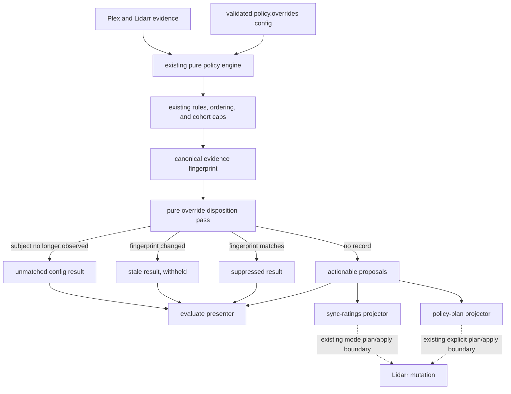

# Technical Research: Policy Decision Overrides

## Executive Summary

Issue #313 should ship as a configuration-backed, suppression-only v1. An override records an
operator dispute against one existing proposal key and one evidence fingerprint; it may withhold
that proposal, but it must never manufacture a proposal from a skip, change `before`/`after`, bypass
an identity or signal gate, write a plan artifact, or call Plex/Lidarr mutation APIs. This resolves
"override" as the durable record and `action: suppress` as its only safe effect.

Apply dispositions once in the policy engine after the existing rule caps. Active and stale
matching proposals are removed from the actionable `report.proposals` collection and retained as
full, separately reported override results. Because both `policy plan` and `sync-ratings` consume
that collection, they inherit the suppression without a second filtering implementation. A stale
record fails closed: it withholds the changed proposal until the operator reviews and replaces its
fingerprint or removes the record.

## Architecture Design



The implementation belongs at the pure decision/report boundary, not in individual rules and not
in either mutation-oriented consumer:

1. Existing rules evaluate unchanged and apply their existing evidence-strength caps.
2. Every emitted proposal and skip receives a deterministic evidence fingerprint.
3. A pure disposition pass matches validated `policy.overrides` entries to current decisions.
4. Active and stale matching proposals are withheld from the final actionable proposal list. The
   cap is **not refilled** from `cohort-cap-exceeded` skips; doing so would change rule ranking and
   cap semantics, which is a non-goal.
5. The report carries every configured record as `suppressed`, `stale`, `unmatched`, or
   `not-evaluated`, so configuration is never silently ignored.
6. Existing policy-plan and sync-ratings projectors receive only actionable proposals. No override
   module imports a client, adapter, plan writer, producer, or apply action.

`policy evaluate` remains observational. Reading `.rfmedia.yaml` is pre-existing behavior; the
feature adds no config writer, local database, command that mutates override state, or automatic
"accept" operation.

## Safe v1 Semantics

### Suppress, do not force

The only action is `suppress`:

- A matching proposal plus matching fingerprint becomes `suppressed` and is non-actionable.
- A matching proposal with a different fingerprint becomes `stale` and is also non-actionable.
- A matching subject that now emits a skip becomes `stale`; the original skip remains visible and
  nothing actionable is created.
- A record whose rule was not run is `not-evaluated`, not stale.
- A record whose selected, successfully run rule produced no matching subject is `unmatched`.

Do not add `force`, `allow`, `propose`, `replace`, or an operator-supplied `after` value. A
`PolicySkip` intentionally lacks a mutation handoff and desired state; turning one into a proposal
would bypass safety gates and change rule semantics. Suppressing an already non-actionable skip is
also unnecessary; v1 override keys therefore target proposal-key grammar only.

### Stable key versus rotating evidence

Keep the shipped proposal key exactly as-is:

- `<ruleId>:artist:<positive Lidarr id>`
- `<ruleId>:plex:<Plex rating key>`

Keys remain stable across ordering, naming, threshold, rating, and play-count changes. They are
instance-local identities, not globally portable primary keys: a Lidarr delete/re-add may allocate a
new numeric id, and a Plex library rebuild may allocate a new rating key. Such a record becomes
`unmatched`; it must never attach to a merely similar artist.

The fingerprint is the rotating review pin. Compute
`sha256:<64 lowercase hex>` over canonical JSON with recursively sorted object keys and preserved
array order. Prefix the material with a fingerprint schema (`rfmedia.lidarr-policy-evidence.v1`)
and include:

- decision `key`, `ruleId`, and decision/skip `code`;
- `subject.kind`, `plexId`, `artistId` or null, and `artistMbid`;
- authoritative/reconciliation identity category and reason;
- proposal `before`, `after`, checks, and observations; or skip checks;
- the handoff producer, but not its display-only argv.

Exclude `evaluatedAt`, subject display name, summaries/details, and presentation text. A rating,
play count, sample size, threshold bound, join grade, identity, current Lidarr state, desired state,
or decision code change rotates the fingerprint; wording and timestamp changes do not. Including
both platform ids and MBID makes accidental id reuse stale rather than active. The fingerprint is a
change detector, not authorization or a secret.

### Staleness and failure behavior

Disposition status precedence is exact:

1. exact proposal key + exact fingerprint: `suppressed`;
2. exact proposal key + different fingerprint: `stale`;
3. same rule/subject anchor now represented only by skip rows: `stale`;
4. rule deselected, disabled, or blocked before subject evaluation: `not-evaluated`;
5. rule ran but no subject anchor was emitted: `unmatched`.

Stale proposals are withheld rather than allowed through. This is the safe behavior for
`sync-ratings --mode apply`: evidence changing underneath a recorded dispute must prompt review,
not silently reactivate a mutation. `--fail-on proposals` should also exit 1 for any stale result,
while active suppressions and unmatched/not-evaluated records alone do not fail the gate.

## Data Models

No database table or migration is needed. Add the following conceptual contracts to the existing
type modules (names may be adjusted to local conventions, but fields and semantics should not):

```ts
export type PolicyDecisionEvidenceFingerprint = `sha256:${string}`;

export interface PolicyOverrideConfigOptions {
  readonly action: "suppress";
  readonly evidenceFingerprint: PolicyDecisionEvidenceFingerprint;
  readonly reason: string;
}

export interface PolicyConfigOptions {
  readonly plexLibrary?: string;
  readonly rules?: PolicyRulesConfigOptions;
  readonly overrides?: Readonly<Record<PolicyDecisionKey, PolicyOverrideConfigOptions>>;
}

export type PolicyOverrideStatus = "suppressed" | "stale" | "unmatched" | "not-evaluated";

export interface PolicyOverrideResult {
  readonly key: PolicyDecisionKey;
  readonly action: "suppress";
  readonly status: PolicyOverrideStatus;
  readonly reason: string;
  readonly expectedEvidenceFingerprint: PolicyDecisionEvidenceFingerprint;
  readonly currentEvidenceFingerprint: PolicyDecisionEvidenceFingerprint | null;
  readonly currentDecision: PolicyProposal | PolicySkip | null;
  readonly detail: string;
}
```

Add `evidenceFingerprint` to `PolicyProposal` and `PolicySkip`. Add to
`PolicyEvaluationReport`:

```ts
readonly overrides: readonly PolicyOverrideResult[];
```

Extend the summary with `suppressed`, `staleOverrides`, `unmatchedOverrides`, and
`notEvaluatedOverrides`; retain `proposed` as the actionable count and `skipped` as the ordinary
rule-skip count. Recompute per-rule `proposedCount` after dispositions so no report count disagrees
with `report.proposals`.

This materially changes the evaluation contract and actionable proposal semantics. Bump
`POLICY_EVALUATION_SCHEMA` to `rfmedia.lidarr-consumption-policy.v2` and
`POLICY_ENGINE_VERSION` to `2`; do not reuse the v1 label for the new shape. The policy-plan and
sync-ratings envelopes may retain their own versions because their outer shapes and lifecycle
semantics are unchanged, but their fixtures must accept the nested policy v2 report.

## Configuration Contract

Use `.rfmedia.yaml`, not a local store:

```yaml
policy:
  overrides:
    "stale-monitoring-cleanup:artist:233":
      action: suppress
      evidenceFingerprint: "sha256:0123456789abcdef0123456789abcdef0123456789abcdef0123456789abcdef"
      reason: "Compilation listening is not represented by the artist-name play join"
```

Configuration is the better v1 fit because it is reviewable, diffable, backup-friendly, usable in
automation, and already reaches all three policy consumers through `getLoadedPolicyConfig()`. A
store would require a write command, ownership/permissions, migration and recovery semantics, and
config/store precedence, none of which adds value to the acceptance criteria.

Validation must be strict and fail before evaluation:

- add `overrides` to `POLICY_CONFIG_KEYS`;
- require a plain object with at most 500 entries;
- reject `__proto__`, `prototype`, and `constructor` and keys longer than 256 characters;
- accept only registered proposal-key prefixes and exact artist/plex proposal-key shape; artist ids
  must be positive safe integers and the Plex id segment must be non-empty;
- require exact entry keys `action`, `evidenceFingerprint`, and `reason`;
- require literal `action: suppress`;
- require fingerprint pattern `^sha256:[0-9a-f]{64}$`;
- require a trimmed, non-empty reason of at most 500 characters;
- preserve zero defaults: the validator returns only supplied entries and never writes config.

Object-map form is preferred to an array because duplicate YAML keys fail/overwrite at parse time
and lookup is naturally by stable key. Tests must still construct malformed objects explicitly to
prove prototype-like keys and duplicate-normalized identities cannot pass validation.

## Report, Presenter, and Consumer Contracts

Human proposal rows and `--explain` should show the evidence fingerprint. Add an `Overrides`
section with key, status, expected/current fingerprints (shortened only in table view), reason, and
detail; `--explain <key>` should include the disposition when the key is configured. Stale and
unmatched entries must be visible without `--verbose`.

JSON/YAML emit the full `overrides` array. CSV adds
`decision.evidenceFingerprint` and an `override` row type with fixed columns for key, status,
reason, expected fingerprint, current fingerprint, and detail. Never overload an ordinary `skip`
code with operator disposition; rule skips and override state are different domains.

`policy plan` and `sync-ratings` require no second suppression algorithm. Their projectors already
consume `evaluation.proposals`; withholding at the engine boundary makes bypass impossible. In
review/recommend modes they retain the nested override results. In sealing/apply modes, stale
matching proposals are already absent, guaranteeing no mutation. Presenters should say
"withheld by stale override" rather than a generic "no changes" when that is the reason a cohort is
empty.

No command option is added. Therefore `LIDARR_POLICY_EVALUATE_OPTION_LONGS`,
`LIDARR_POLICY_PLAN_OPTION_LONGS`, `LIDARR_SYNC_RATINGS_OPTION_LONGS`, and Bash/Zsh/Fish templates
must remain byte-for-byte unchanged. Run the completion parity suite as an audit; changing a
template would be an implementation error.

## System Constraints

- **Performance:** One map lookup and one SHA-256 of a small decision object per emitted decision;
  no new provider calls and no second full-library pass. Enforce the 500-entry config bound.
- **Determinism:** Canonicalize recursively; never hash raw `JSON.stringify` of arbitrary config
  order. Decision arrays retain evaluation order.
- **Security:** Reasons are untrusted terminal text and must pass existing terminal-safe rendering.
  Fingerprints contain no credentials. Do not include URLs with credentials, tokens, or raw config.
- **Compatibility:** Keep policy types free of value imports. The crypto implementation belongs in
  `lib/bridge`, not `types`. Keep singular `artistId` keys so the structural
  `lidarr-editor-body-owner` gate remains unreachable.
- **Scalability:** Config lookup is O(overrides + decisions); index decisions and subject anchors
  rather than scanning for every override.
- **No-mutation boundary:** `policy-evaluate.ts` still imports no plan writer and calls no mutation
  method. The new fingerprint/disposition modules are pure and must not be added to any Lidarr
  mutation-owner allowlist.

## Codebase Changes

### Create

- `packages/rfmedia-cli/src/lib/bridge/policy-decision-fingerprint.ts` — canonical material,
  recursive key ordering, SHA-256 formatting, and decision fingerprint helpers.
- `packages/rfmedia-cli/src/lib/bridge/policy-overrides.ts` — pure indexed matching, status
  classification, actionable filtering, and frozen result construction.
- `packages/rfmedia-cli/src/lib/bridge/policy-overrides.test.ts` — focused disposition, staleness,
  ordering, and immutability contracts.

### Modify

- `packages/rfmedia-cli/src/types/config.ts` — config entry and `policy.overrides` types.
- `packages/rfmedia-cli/src/types/lidarr-policy.ts` — fingerprint, override result, v2 report, summary,
  status, and exit-gate contracts; retain zero value imports.
- `packages/rfmedia-cli/src/lib/config.ts` — strict dynamic-map validation and exact paths such as
  `policy.overrides.<decisionKey>.evidenceFingerprint`.
- `packages/rfmedia-cli/src/lib/bridge/policy-rule-support.ts` — attach fingerprints in the sole
  proposal/seed/skip factories; do not duplicate this in rules.
- `packages/rfmedia-cli/src/lib/bridge/policy-engine.ts` — run the disposition pass after existing
  caps/refusal attribution, rebuild counts/status, and return frozen override results.
- `packages/rfmedia-cli/src/commands/lidarr-policy-presenter.ts` — human explain/table and machine
  CSV projection for fingerprints and override results.
- `packages/rfmedia-cli/src/lib/bridge/policy-engine.test.ts` — integration pins for caps, rule
  counts, `--fail-on`, and complete report accounting.
- `packages/rfmedia-cli/src/lib/config.test.ts` — valid retention plus malformed key/action/hash,
  unknown field, prototype-like key, bounds, and exact property-path rejection.
- `packages/rfmedia-cli/src/commands/lidarr-policy.test.ts` — human, JSON/YAML, CSV, explain, and
  stale exit behavior.
- `packages/rfmedia-cli/src/lib/bridge/policy-plan.test.ts` and
  `packages/rfmedia-cli/src/lib/bridge/rating-sync.test.ts` — prove suppressed/stale proposals never
  enter producer cohorts.
- `packages/rfmedia-cli/src/actions/lidarr/policy-plan.test.ts` and
  `packages/rfmedia-cli/src/actions/lidarr/sync-ratings.test.ts` — one boundary test each proving no
  producer/apply dependency is called for withheld-only reports.
- `packages/rfmedia-cli/scripts/check-direct-plex-imports.test.mjs` — only if needed to pin the new
  pure modules outside mutation owners; no allowlist expansion.
- `packages/rfmedia-cli/docs/features/lidarr-consumption-policy.md` and
  `packages/rfmedia-cli/README.md` — config schema, copy-fingerprint workflow, statuses, cap behavior,
  stale recovery, and effects on plan/sync.
- `rfmedia.example.yaml` — add a commented disabled example only if this repository's existing
  example policy block is maintained there; do not add generated-config defaults.

No change is needed in rule files, Lidarr plan schemas, plan producers, apply dispatch, history,
claims, scheduler tiers, client interfaces, adapters, databases, or shell completion templates.

## Minimal Critical Tests

1. **Key stability and fingerprint rotation:** reordered library input and renamed display text keep
   the same key/fingerprint; rating, plays, threshold, identity, `before`, or `after` changes keep
   the key and rotate the fingerprint.
2. **Active suppression:** exact key/hash removes one proposal, preserves the full decision under a
   `suppressed` result, recomputes rule/report counts, and does not refill the cohort cap.
3. **Stale fail-closed behavior:** an evidence change yields `stale`, withholds the proposal, prints
   both hashes, and trips `--fail-on proposals`.
4. **Outcome change:** a formerly proposed subject that now skips is `stale`; the real rule skip
   remains visible and no proposal is synthesized.
5. **Not observed versus unmatched:** deselected/disabled/blocked rules report `not-evaluated`; a
   successfully run rule with no matching subject reports `unmatched`.
6. **Mutation boundary:** withheld-only results cause zero policy-plan producer calls and zero
   sync-ratings producer/apply calls in every mode.
7. **Validation:** retain a valid map verbatim; reject malformed decision keys, non-literal actions,
   malformed hashes, blank/oversized reasons, unknown entry keys, unsafe object keys, and >500
   entries with exact dotted paths.
8. **Presentation:** human output includes stale entries without verbose; JSON/YAML preserve the
   full v2 result; CSV uses explicit override rows; `--explain` shows fingerprint and disposition.
9. **Architecture/completions:** direct-import ownership gate stays green, policy types retain zero
   value imports, and Bash/Zsh/Fish parity passes with no option/template diff.

Avoid filler tests for Node's crypto implementation, every display color, or every unchanged rule.
The contracts above are the failure modes that could silently re-enable a disputed mutation.

## Technical Decisions

| Decision                     | Rejected alternative                     | Rationale                                                                                     |
| ---------------------------- | ---------------------------------------- | --------------------------------------------------------------------------------------------- |
| `.rfmedia.yaml` dynamic map  | Local SQLite/JSON store                  | Reviewable and already shared by all consumers; no new writer or precedence rules             |
| Suppression-only action      | Force a skipped verdict into a proposal  | A skip has no safe desired state/handoff; forcing bypasses rule safety and violates non-goals |
| Stable key + evidence hash   | Content-addressed decision key           | Operators can re-find the same subject while evidence drift remains explicit                  |
| Stale proposals are withheld | Treat stale override as inactive         | Prevents a disputed action from silently becoming eligible for `sync-ratings --mode apply`    |
| Apply after existing caps    | Re-run/refill cap after suppression      | Preserves rule semantics and evidence ranking; avoids hidden new candidates                   |
| Central engine disposition   | Filters in evaluate/plan/sync presenters | One authoritative actionable collection prevents consumer bypass                              |
| Explicit override results    | Reuse policy skip codes                  | Separates rule truth from operator judgment and keeps explanations honest                     |
| Evaluation schema v2         | Add fields under v1                      | Actionable proposal semantics changed; machine consumers deserve an explicit version boundary |

## Open Questions

- Confirm whether an override record should be portable across canonical Plex/Lidarr origin changes.
  The recommended fingerprint omits origins and binds through ids plus MBID; add origins only if
  environment-local behavior is preferred over config portability.
- Confirm the maximum override count (recommended 500) and reason length (recommended 500) as public
  validation bounds.
- Decide whether plan/sync human presenters need a dedicated stale-refusal row in addition to the
  nested evaluation override section. This is presentation-only; the central withholding contract
  already guarantees no producer or apply mutation.

## Relevant Documentation

- `packages/rfmedia-cli/docs/features/lidarr-consumption-policy.md` — shipped key formats,
  explanations, evidence hazards, and review/apply boundary.
- `packages/rfmedia-cli/docs/plans/issue-209-policy-engine/design.md` §2.5, §7, §8, §15 — original
  exclusion and child-issue rationale.
- `docs/plans/issue-311-policy-plan/research-technical.md` — total proposal projection and unchanged
  producer boundary.
- `packages/rfmedia-cli/README.md` sections “Lidarr Consumption Policy,” “Lidarr Policy Plan,” and
  “Lidarr Ratings Sync” — operator-facing command contracts.
