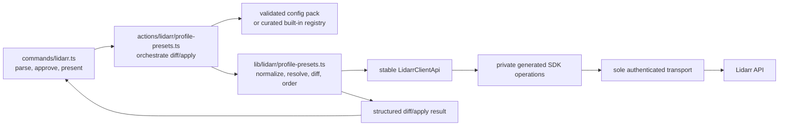

# Technical Research — Lidarr Quality Presets

## Executive Summary

Issue #213 should add a small declarative convergence workflow under
`rfmedia lidarr presets`, backed by curated built-in packs and optional packs in the existing
`lidarr` config section. The workflow should expose `list`, `diff`, and `apply`; `diff` and
`apply --dry-run` are read-only, while real apply requires `--yes` or an interactive confirmation.
The first release should be additive and non-destructive: create missing custom formats and quality
profiles, update same-name resources and the singleton naming configuration, but never delete or
rename resources that are not in the selected pack.

This should not be forced into the current `rfmedia.lidarr-plan.v2` artifact. That schema is an
exact-key, non-empty, numeric artist/album target model with operation-specific history, admission,
deferred replay, and presenter assumptions. Global configuration resources have dependency ordering
and server-assigned IDs: custom formats must exist before their IDs can be sealed into quality
profile score entries. Extending v2 would either break its exhaustive contracts or require a new
artifact family and a large apply-engine refactor disproportionate to the issue. The dedicated
workflow must still preserve the important safety properties: fresh reads, deterministic diff,
explicit approval, no writes in dry-run, narrow facade methods, no hot retry of mutations,
post-write verification, structured partial failure, and idempotent reruns.

The committed OpenAPI snapshot already includes every required operation. Generated modules remain
private: only `src/lib/lidarr/client.ts` imports generated operations and wire types, and only
`src/lib/lidarr/transport.ts` owns authenticated Fetch. No OpenAPI refresh or generated-code edit is
needed unless contract tests reveal the committed snapshot is stale.

## Architecture Design



Dependency direction remains:

```text
command -> action -> pure preset/diff engine -> stable Lidarr facade
        -> private generated SDK -> sole authenticated transport -> Lidarr
```

The action resolves the selected pack, opens one fresh `local-only` client with stale serving
disabled, and reads:

1. the quality-profile schema and current quality profiles;
2. the custom-format schema and current custom formats; and
3. the singleton naming configuration.

The pure engine normalizes names, resolves symbolic quality/custom-format references to live IDs,
and returns a deterministic, name-sorted change set. Real apply uses dependency order:

```text
custom formats -> refresh custom formats -> quality profiles -> naming configuration
```

Every mutation is followed by a fresh targeted or complete-list read and an exact managed-field
comparison. A failure stops later dependency stages, returns `partial` when an earlier change was
verified, and leaves the instance in a rerunnable convergent state. No rollback is attempted:
reversing a quality profile or naming update without a separately reviewed before-state can be more
damaging than the partial result.

### Curated pack registry

Keep built-ins as frozen data in `src/lib/lidarr/profile-presets.ts`, not separate executable files.
Expose at least three intent-oriented packs:

- `balanced`: accepts common lossless and high-quality lossy sources, allows upgrades, and uses a
  readable Artist/Album/Track naming layout;
- `lossless`: admits lossless qualities only, upgrades to the best available lossless cutoff, and
  preserves codec/quality context in names; and
- `space-saver`: prefers a bounded high-quality lossy tier, disables upgrade churn above its cutoff,
  and uses compact but reversible naming.

Each pack must carry a human description and an `assumptions` array rendered by `list`, `diff`, and
confirmation. Assumptions must state required stock quality names, expected Lidarr generation, disk
space/acquisition implications, and that changing naming configuration does not rename existing
files by itself. If the target instance lacks or ambiguously exposes a required quality or custom
format implementation, fail closed with the missing semantic name; never substitute a numeric ID
from another instance.

## Data Models and Contracts

### Configuration schema

Add an optional, backward-compatible section under the existing `lidarr` object:

```yaml
lidarr:
  profilePresets:
    default: balanced
    packs:
      studio:
        description: Studio-oriented lossless policy
        assumptions:
          - Requires Lidarr custom format support
        customFormats:
          - name: Studio Release
            includeWhenRenaming: true
            specifications:
              - name: Studio
                implementation: ReleaseTypeSpecification
                negate: false
                required: true
                fields:
                  value: studio
        qualityProfiles:
          - name: Studio Lossless
            upgradeAllowed: true
            cutoff: FLAC
            allowedQualities: [FLAC]
            minFormatScore: 0
            cutoffFormatScore: 100
            formatScores:
              Studio Release: 100
        naming:
          renameTracks: true
          replaceIllegalCharacters: true
          standardTrackFormat: "{Album Title} ({Release Year})/{track:00} - {Track Title}"
          multiDiscTrackFormat: "{Album Title} ({Release Year})/{Medium Format} {medium:00}/{track:00} - {Track Title}"
          artistFolderFormat: "{Artist Name}"
```

Recommended generated-independent contracts:

```ts
interface LidarrProfilePresetPack {
  readonly name: string;
  readonly description: string;
  readonly assumptions: readonly string[];
  readonly customFormats: readonly LidarrPresetCustomFormat[];
  readonly qualityProfiles: readonly LidarrPresetQualityProfile[];
  readonly naming?: LidarrPresetNamingPatch;
}

interface LidarrPresetCustomFormat {
  readonly name: string;
  readonly includeWhenRenaming: boolean;
  readonly specifications: readonly {
    readonly name: string;
    readonly implementation: string;
    readonly negate: boolean;
    readonly required: boolean;
    readonly fields: Readonly<Record<string, string | number | boolean>>;
  }[];
}

interface LidarrPresetQualityProfile {
  readonly name: string;
  readonly upgradeAllowed: boolean;
  readonly cutoff: string;
  readonly allowedQualities: readonly string[];
  readonly minFormatScore: number;
  readonly cutoffFormatScore: number;
  readonly formatScores: Readonly<Record<string, number>>;
}

interface LidarrPresetNamingPatch {
  readonly renameTracks?: boolean;
  readonly replaceIllegalCharacters?: boolean;
  readonly colonReplacementFormat?: number;
  readonly standardTrackFormat?: string;
  readonly multiDiscTrackFormat?: string;
  readonly artistFolderFormat?: string;
}
```

Unknown nested keys should be rejected for this section, unlike the current resilience section,
which intentionally drops unknown knobs. Bounds should be explicit: non-empty terminal-safe names,
unique case-folded names, at most 100 resources/specifications/fields per pack, strings at most
2,048 characters, safe integers for scores, and no prototype-sensitive field keys. A config pack
must not shadow a built-in name; users choose a distinct name so built-in behavior remains stable.
Existing configs without `profilePresets` validate unchanged.

### Stable domain projections

The current `LidarrProfile { id, name }` is intentionally too narrow for definition management.
Add generated-independent, frozen domain types for:

- quality-profile schema items and current definitions, including recursive quality groups,
  allowed flags, cutoff, minimum/cutoff format scores, and custom-format scores;
- custom-format definitions and specification schemas, including implementation name and safe field
  values;
- the supported naming configuration fields; and
- narrow create/update inputs that make server-owned IDs optional for create and required for
  update.

Projectors in `src/lib/lidarr/types.ts` must reject a malformed whole response, duplicated positive
IDs, unsafe labels, unbounded recursion/arrays, non-finite scores, or unsupported field-value shapes.
Generated DTOs and broad `Field.value: unknown` must not cross the facade.

For writes, the facade owns the generated wire translation. Quality profile bodies are constructed
from the live quality-profile schema, preserving server-required group structure and replacing only
the allowed/cutoff/score policy. Custom format fields are constructed only after the desired
implementation and field names resolve uniquely against the live custom-format schema. Naming uses
a confined GET, merge-managed-fields, PUT round trip so fields omitted by a preset remain unchanged.

### Diff and apply result

Use one result model for human and machine output:

```ts
type LidarrPresetResourceKind = "custom-format" | "quality-profile" | "naming";
type LidarrPresetChangeAction = "create" | "update" | "unchanged";

interface LidarrPresetChange {
  readonly key: string; // e.g. custom-format:Studio Release, naming:1
  readonly resource: LidarrPresetResourceKind;
  readonly name: string;
  readonly action: LidarrPresetChangeAction;
  readonly changedFields: readonly string[];
  readonly before?: Readonly<Record<string, unknown>>;
  readonly after: Readonly<Record<string, unknown>>;
}

interface LidarrPresetDiffResult {
  readonly preset: { readonly name: string; readonly description: string };
  readonly assumptions: readonly string[];
  readonly summary: {
    readonly create: number;
    readonly update: number;
    readonly unchanged: number;
  };
  readonly changes: readonly LidarrPresetChange[];
}

interface LidarrPresetApplyResult extends LidarrPresetDiffResult {
  readonly dryRun: boolean;
  readonly status: "checked" | "completed" | "partial" | "failed";
  readonly entries: readonly {
    readonly key: string;
    readonly outcome: "created" | "updated" | "satisfied" | "would-apply" | "failed";
    readonly errorCode?: string;
    readonly message?: string;
  }[];
  readonly execution: LidarrExecutionMetadata;
}
```

Canonical comparison ignores server-assigned IDs and response-only documentation, orders resources
and map keys deterministically, normalizes specification and quality collections by stable semantic
name, and compares only fields managed by the pack. This prevents perpetual diffs caused by Lidarr
reordering arrays or adding response fields.

## API Design

### CLI surface

```bash
rfmedia lidarr presets list
rfmedia lidarr presets diff [--preset <name>]
rfmedia lidarr presets apply [--preset <name>] [--dry-run] [--yes]
```

`--preset` falls back to `lidarr.profilePresets.default`; absence of both is a usage error listing
available built-in and config pack names. `list` is local-only and needs no Lidarr credentials.
`diff` and `apply` accept the existing `--lidarr-url`, `--lidarr-api-key`, and output options.
`apply --dry-run` must execute the same fresh resolution and diff as real apply but perform zero
POST/PUT/DELETE requests and no history/database writes.

Real apply requires `--yes` in non-interactive or machine-output mode. In an interactive terminal,
render the full summary, assumptions, and changed fields before calling the existing confirmation
helper. `--yes` is approval, not permission to delete: the first release performs no deletes, so no
new destructive authorization flag is needed.

Machine envelopes should be stable:

```json
{ "command": "lidarr-presets-list", "result": {} }
{ "command": "lidarr-presets-diff", "result": {} }
{ "command": "lidarr-presets-apply", "result": {} }
```

JSON/YAML emit the complete result. CSV emits one row per resource change/result with scalar
summary fields repeated; nested before/after values are JSON strings, matching the existing Lidarr
mutation presenter convention. Human tables go to stderr and machine payloads to stdout.

### Generated endpoints and facade methods

The pinned snapshot `packages/rfmedia-cli/openapi/lidarr-v1.json` contains:

| Capability       | Generated operation(s)                                                             | Facade behavior                                                             |
| ---------------- | ---------------------------------------------------------------------------------- | --------------------------------------------------------------------------- |
| Custom formats   | `get/post/putApiV1Customformat[ById]`, `getApiV1CustomformatSchema`                | List/project definitions and schema; create/update one definition           |
| Quality profiles | `get/post/putApiV1Qualityprofile[ById]`, `getApiV1QualityprofileSchema`            | List/project definitions and schema; create/update one profile              |
| Naming           | `getApiV1ConfigNaming`, `putApiV1ConfigNamingById`, `getApiV1ConfigNamingExamples` | Read singleton; merge/update managed fields; preflight naming example query |

Do not use handwritten endpoint strings, import generated modules from actions, or expose generated
types through public barrels. Preserve the OpenAPI quirk that PUT path IDs are string-typed by
converting inside the facade only.

Suggested `LidarrClientApi` methods are narrow:

```ts
listCustomFormats(signal?): Promise<readonly LidarrCustomFormat[]>;
getCustomFormatSchema(signal?): Promise<readonly LidarrCustomFormatSpecificationSchema[]>;
createCustomFormat(input, signal?): Promise<LidarrCustomFormat>;
updateCustomFormat(id, input, signal?): Promise<LidarrCustomFormat>;
getQualityProfileSchema(signal?): Promise<LidarrQualityProfileSchema>;
listQualityProfileDefinitions(signal?): Promise<readonly LidarrQualityProfileDefinition[]>;
createQualityProfile(input, signal?): Promise<LidarrQualityProfileDefinition>;
updateQualityProfile(id, input, signal?): Promise<LidarrQualityProfileDefinition>;
getNamingConfig(signal?): Promise<LidarrNamingConfig>;
validateNamingConfig(input, signal?): Promise<void>;
updateNamingConfig(id, patch, signal?): Promise<LidarrNamingConfig>;
```

Keep the existing `listQualityProfiles(): LidarrProfile[]` unchanged for artist selection. A
separate rich method avoids widening a public return shape relied on by issue #199 tests and mocks.

### Error handling

- Config/preset shape errors use `ConfigError` with an exact nested property path.
- Unknown, duplicate, or ambiguous semantic names use `LidarrPlanValidationError` (or a dedicated
  preset validation subtype if machine codes require it) before any write.
- Generated response problems remain `LidarrValidationError` with `invalid-response`; HTTP,
  authentication, authorization, rate-limit, timeout, and unreachable failures retain the existing
  taxonomy and command failure envelope.
- Read methods may join the explicit resilience retry allowlist. Create/update methods must not:
  especially POST create can have an unknown dispatch outcome.
- After a failed create, perform one fresh list read. If exactly one same-name resource exists and
  managed fields match, classify it `satisfied`; if it differs, return a partial/failed result and
  require rerun. Never blindly POST again in the same invocation.
- Any non-2xx naming-example response blocks apply before writes. Because the OpenAPI response is
  `unknown`, success is evidence of server acceptance; its response body should not enter domain
  output.
- Set `process.exitCode = 1` for `partial` or `failed`; preserve structured machine output.

## System Constraints

- Node.js 22 and NodeNext `.js` import specifiers remain required.
- Generated Lidarr modules are private behind `client.ts`; the architecture gate enforces this,
  forbids handwritten `/api/v1/` literals, and permits exactly one handwritten Fetch site in
  `transport.ts`.
- Transport limits, redirect rejection, origin-bound API keys, cancellation, and secret redaction
  must remain unchanged.
- Custom-format specification fields are runtime-extensible and broad in OpenAPI. Desired config
  must resolve against the live schema rather than hard-code numeric IDs or pass arbitrary unknown
  values through.
- Quality item and custom-format IDs are instance-local. Packs use semantic names; live IDs are
  resolved per run and never persisted in example config.
- Naming configuration is a singleton resource but PUT requires its ID and full wire body. Use a
  confined read/merge/write in the facade to preserve fields unknown to the preset.
- Do not apply the artist mutation `maxBatch` cap to unpaged configuration reads. Use separate
  resource/schema bounds (recommended 1,000 response resources and 100 desired pack resources).
- No create/update mutation is hot-retried. Apply is sequential across dependency stages; limited
  concurrency within a stage is unnecessary for the expected small pack size.
- First release owns only named resources present in the selected pack and never deletes unmanaged
  custom formats or profiles. This is the primary backwards-compatibility and data-loss boundary.
- Curated pack changes are user-visible desired-state changes. Once shipped, modify a built-in only
  through an intentional changelog entry; a pack version field may be added later if evolution
  proves necessary.
- Existing v1/v2 plan artifacts, checksums, history, deferred queue, `lidarr apply`, artist profile
  assignment, and mutation presenter remain byte-for-byte compatible.

## Codebase Changes

- `packages/rfmedia-cli/src/commands/lidarr.ts`: register `presets` after `lookup` and before `plan`,
  parse leaf options, lazy-load the action, enforce approval, and route human/machine presentation.
  A small `commands/lidarr-profile-presets.ts` extraction is preferable if `lidarr.ts` would grow
  materially.
- `packages/rfmedia-cli/src/commands/lidarr.test.ts`: lock the new hierarchy, options, action
  forwarding, output envelopes, confirmation behavior, dry-run zero-write delegation, and failure
  exit codes.
- `packages/rfmedia-cli/src/actions/lidarr/profile-presets.ts` and
  `profile-presets.test.ts`: resolve config/built-in packs, schedule fresh diff/apply, enforce
  action-level dry-run/approval, order stages, verify writes, and return partial results.
- `packages/rfmedia-cli/src/actions/lidarr/index.ts`: export action entrypoints and result/options
  types.
- `packages/rfmedia-cli/src/lib/lidarr/profile-presets.ts` and
  `profile-presets.test.ts`: frozen built-in registry, strict normalization, live semantic
  resolution, canonical comparison, deterministic diff, and naming helper validation.
- `packages/rfmedia-cli/src/types/lidarr.ts`: add generated-independent definition, schema, naming,
  preset input, diff, and apply contracts without widening `LidarrProfile`.
- `packages/rfmedia-cli/src/lib/lidarr/types.ts` and `types.test.ts`: add bounded unknown-to-domain
  projectors/copy helpers for rich quality profiles, custom formats/schema, and naming.
- `packages/rfmedia-cli/src/lib/lidarr/client.ts` and `client.test.ts`: import only the required
  generated operations/types, add narrow facade reads/writes, preserve raw fields in confined
  update round trips, and verify error/cancellation/ID handling.
- `packages/rfmedia-cli/src/lib/lidarr/generated-contract.test.ts`: assert the required generated
  operations, HTTP methods/paths, request envelopes, and NodeNext exports remain in the committed
  snapshot. Do not edit generated source manually.
- `packages/rfmedia-cli/src/lib/lidarr/resilience.ts` and `resilience.test.ts`: wrap every new facade
  method; explicitly allowlist only reads for in-place retry and keep all creates/updates no-retry.
- `packages/rfmedia-cli/src/types/config.ts`, `src/lib/config.ts`, and `src/lib/config.test.ts`: add
  `lidarr.profilePresets`, exact nested validation, bounds, duplicate checks, and backward-compatible
  absence behavior.
- `rfmedia.example.yaml`: document selecting a built-in and defining one compact custom pack
  without credentials or instance-local IDs.
- `packages/rfmedia-cli/scripts/check-direct-plex-imports.mjs` and
  `check-direct-plex-imports.test.mjs`: add new facade mutation names to a preset-mutation ownership
  rule whose only callers are `profile-presets.ts` and the resilience decorator.
- `packages/rfmedia-cli/src/lib/shell-completions/bash.ts`,
  `zsh.ts`, and `fish.ts`: add the `presets` group, `list|diff|apply` leaves, `--preset` values,
  connection flags, and apply safety flags.
- `packages/rfmedia-cli/src/lib/shell-completions/templates.spec.ts`: update exact Bash/Zsh/Fish
  hierarchy and option parity, and retain the static-completion/no-client-construction assertion.
- `packages/rfmedia-cli/docs/features/lidarr-quality-presets.md`: document built-ins, assumptions,
  config, deterministic diff, apply/dry-run, no-delete scope, partial recovery, and examples.
- `packages/rfmedia-cli/docs/features/lidarr-plan-apply.md`: clarify that artist/album mutations use
  sealed plan/apply while global preset convergence uses its dedicated diff/apply review boundary.

No change is recommended to `src/types/lidarr-plan.ts`,
`src/lib/lidarr/plan-engine.ts`, `src/lib/lidarr/plan-validation.ts`,
`src/lib/lidarr/plan-operation-definitions.ts`,
`src/actions/lidarr/apply*.ts`, or `src/commands/lidarr-mutation-presenter.ts`.
Their exact exhaustive contracts are the reason to keep this global-resource workflow separate.

## Technical Decisions

1. **Dedicated preset diff/apply, not plan schema v2 extension.** The existing plan engine assumes a
   non-empty array of stable numeric artist/album entries and computes per-entry idempotency/history.
   Configuration resources are name-resolved and custom formats receive IDs before quality profiles
   can reference them. A dedicated workflow is smaller and keeps old artifacts valid. Alternative:
   introduce `rfmedia.lidarr-config-plan.v1`; defer until offline review artifacts or durable resume
   are explicitly required.
2. **Name-based desired state, ID-based transport.** Config remains portable across Lidarr
   instances; the action resolves exact case-folded names to live IDs. Alternative: accept numeric
   IDs in config; rejected because built-ins and shared config would silently target the wrong
   resource on another instance.
3. **Create/update only.** Omit deletes and renames from v1. Alternative: exact synchronization;
   rejected because deleting a quality profile may affect existing artists and deleting a custom
   format may alter unrelated profiles.
4. **Managed-field comparison.** Compare only fields represented by the pack, after semantic
   normalization. Alternative: compare raw generated responses; rejected because response-only
   IDs, descriptions, defaults, and ordering would create perpetual drift.
5. **Sequential dependency stages with post-write verification.** This is easy to reason about and
   makes partial recovery a rerun. Alternative: parallel bulk requests; rejected because packs are
   small and profile/custom-format ID dependencies dominate.
6. **No rollback.** Return exact partial results and converge on rerun. Alternative: restore all
   captured before-state; rejected because rollback can fail, server-assigned IDs cannot be
   restored exactly after create, and later user changes could be overwritten.
7. **Rich profile method separate from existing `listQualityProfiles`.** Preserves issue #199's
   narrow contract and mocks. Alternative: widen `LidarrProfile`; rejected as unnecessary coupling.
8. **Server-backed naming preflight plus local structural checks.** The naming examples endpoint is
   the closest authoritative token validator in the pinned API, while local checks catch empty,
   unsafe, or unbalanced templates early. Alternative: maintain a complete local token grammar;
   rejected because Lidarr token vocabulary changes by version.
9. **All three completion templates change.** `presets` adds a new command hierarchy and value-taking
   options, so Bash, Zsh, Fish, and their exact parity tests are mandatory.

## Open Questions

1. What exact quality names, cutoff, custom-format implementations, scores, and naming tokens should
   define the three curated packs? These are product policy and must be validated against a
   supported Lidarr fixture before freezing the registry.
2. What minimum Lidarr version should be supported? Custom formats arrived later than the baseline
   quality/naming APIs; decide whether an unsupported instance rejects the whole pack or permits a
   quality/naming-only pack with no custom formats.
3. Should a custom config pack be allowed to extend a built-in by name, or must it be fully
   self-contained? Fully self-contained is recommended initially to keep validation and upgrades
   predictable.
4. Should `diff` emit a canonical state checksum that real apply can require with
   `--expected-diff-checksum` for non-interactive review? It is useful for CI but is not required by
   the issue; adding it later is backward compatible.
5. Does the target Lidarr version accept partial quality-profile and naming PUT bodies, or require
   full resources in practice? The facade should use GET/merge/PUT regardless, but integration
   fixtures should confirm the response and validation behavior.
6. What is the exact shape returned by `GET /config/naming/examples` on supported versions? The
   OpenAPI snapshot declares `unknown`; v1 should treat HTTP success/failure as validation evidence
   and avoid promising example output until a fixture is pinned.
