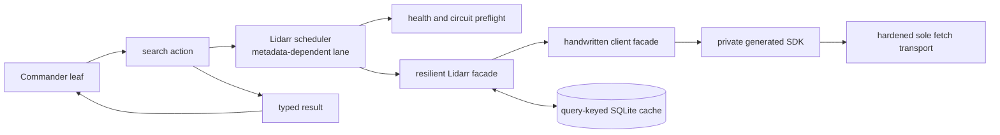

# Technical Research: Lidarr Search and Lookup

## Executive Summary

Issue #222 should add three read-only, metadata-dependent leaves: `lidarr search <term>`,
`lidarr lookup artist <term>`, and `lidarr lookup album <term>`. All three use the private generated
Lidarr client through the handwritten facade, execute in the existing `metadata-dependent`
scheduler lane, cache the complete projected result set before paging, and degrade only to the
persistent SQLite cache under explicit `--allow-stale` consent. Direct MusicBrainz or other
provider access is out of scope because it would require a new authenticated fetch owner, rate
limiter, and provider taxonomy; that remains a separate provider/discovery feature.

## Command and Option Contract

```text
rfmedia lidarr search <term>
rfmedia lidarr lookup artist <term>
rfmedia lidarr lookup album <term>

Shared leaf options:
  --limit <n>             default 50; integer 1..200
  --offset <n>            default 0; non-negative safe integer
  --allow-stale           explicit consent to query-cache fallback
  --lidarr-url <url>      existing connection override
  --lidarr-api-key <key>  existing secret override
```

- `search` maps to Lidarr's heterogeneous `/api/v1/search` result.
- `lookup artist` maps to `/api/v1/artist/lookup`.
- `lookup album` maps to `/api/v1/album/lookup`.
- The positional term is trimmed, 1..256 Unicode code points, and must contain no C0/C1, bidi, or
  terminal control characters. The generated endpoints make `term` optional, but the CLI must not.
- Keep paging options identical across leaves. Do not add `--page`: all three upstream endpoints
  return unpaged arrays.
- The root `--output json|yaml|csv|text|table` contract remains unchanged. Human output goes to
  stderr; machine output goes only to stdout.
- Register the new namespace/leaves in Bash, Zsh, and Fish completions and extend the existing
  cross-shell parity tests.

## Architecture Design



### Boundaries

| Layer                      | Responsibility                                                              |
| -------------------------- | --------------------------------------------------------------------------- |
| `commands/lidarr.ts`       | Argument validation, lazy action import, human/machine rendering, exit code |
| `actions/lidarr/search.ts` | Select mode, schedule one idempotent task, page projected candidates        |
| `lib/lidarr/search.ts`     | Pure term normalization, cache discriminator, dedupe, paging, projections   |
| `lib/lidarr/client.ts`     | Invoke generated endpoint functions and enforce strict domain projection    |
| `lib/lidarr/resilience.ts` | Per-attempt gates, circuit state, query-cache write/fallback, warning       |
| `lib/lidarr/scheduler.ts`  | Lane admission, one batch preflight, retry ownership, execution metadata    |
| `lib/lidarr/transport.ts`  | Sole authenticated fetch owner; redirects, timeout, body limits, redaction  |

Generated files remain private: commands, actions, public types, and `lib/lidarr/search.ts` must not
import from `lib/lidarr/generated/**`, spell `/api/v1/` paths, own credentials, or call `fetch`.
Only `client.ts` imports `getApiV1Search`, `getApiV1ArtistLookup`, and
`getApiV1AlbumLookup`.

## Data Models

```ts
type LidarrSearchMode = "search" | "artist" | "album";

interface LidarrSearchQuery {
  readonly mode: LidarrSearchMode;
  readonly term: string;
  readonly signal?: AbortSignal;
}

type LidarrSearchCandidate =
  | {
      readonly kind: "artist";
      readonly foreignId: string;
      readonly lidarrId?: number;
      readonly name: string;
      readonly disambiguation?: string;
      readonly artistType?: string;
      readonly status?: string;
      readonly genres: readonly string[];
    }
  | {
      readonly kind: "album";
      readonly foreignId: string;
      readonly lidarrId?: number;
      readonly title: string;
      readonly artistName: string;
      readonly artistForeignId?: string;
      readonly releaseDate?: string;
      readonly albumType?: string;
      readonly secondaryTypes: readonly string[];
    };

interface LidarrSearchActionOptions {
  readonly mode: LidarrSearchMode;
  readonly term: string;
  readonly limit?: number;
  readonly offset?: number;
  readonly allowStale?: boolean;
  readonly lidarrUrl?: string;
  readonly lidarrApiKey?: string;
}

interface LidarrSearchActionResult {
  readonly query: { readonly mode: LidarrSearchMode; readonly term: string };
  readonly items: readonly (LidarrSearchCandidate & { readonly rank: number })[];
  readonly page: {
    readonly offset: number;
    readonly limit: number;
    readonly returned: number;
    readonly total: number;
    readonly hasMore: boolean;
  };
  readonly source: {
    readonly type: "lidarr" | "stale-cache";
    readonly degraded: boolean;
    readonly fetchedAt?: string;
    readonly ageSeconds?: number;
  };
  readonly execution: LidarrExecutionSuccessMetadata;
}
```

Lookup records are candidates, not installed-library entities. Their Lidarr numeric IDs and
profile/monitoring fields can be absent, so do not reuse `LidarrArtist` or `LidarrAlbum`, whose
required fields describe local library rows. Projectors must bound strings/arrays, strip terminal
controls for display fields, freeze copies, reject duplicate or ambiguous discriminators, and
reject a malformed collection as `invalid-response` rather than silently dropping records.

## Endpoint Mapping

| Mode     | Generated call                              | Wire response      | Projection                          |
| -------- | ------------------------------------------- | ------------------ | ----------------------------------- |
| `search` | `getApiV1Search({ query: { term } })`       | `SearchResource[]` | Artist or album discriminated union |
| `artist` | `getApiV1ArtistLookup({ query: { term } })` | `ArtistResource[]` | Artist candidates                   |
| `album`  | `getApiV1AlbumLookup({ query: { term } })`  | `AlbumResource[]`  | Album candidates                    |

For generic search, exactly one of `artist` or `album` must yield a valid candidate. An empty array
is a successful empty result. Preserve upstream order because it is Lidarr's relevance ranking;
dedupe by `kind + foreignId`, retaining the first occurrence.

## Cache and Fallback State Machine

Cache the full validated/deduplicated pre-page array so different offsets reuse the same snapshot.
Keys are credential-free: canonical Lidarr origin, category
`search|artist-lookup|album-lookup`, and a discriminator derived from
`mode + NUL + normalizedTerm`. Normalize by trimming and Unicode NFC only; do not lowercase because
that would assume undocumented server equivalence.

```text
validate term/options
  -> metadata scheduler preflight
     -> circuit open or health reports provider unavailable
        -> --allow-stale? -> query cache -> hit: degraded success
                                     \-> miss: original typed failure
     -> live endpoint call
        -> success -> validate/dedupe -> write-through cache -> page -> success
        -> eligible failure (metadata unavailable, Lidarr unreachable, timeout)
           -> --allow-stale? -> query cache -> hit: degraded success
                                        \-> miss: original typed failure
        -> other failure -> fail without fallback
```

- Reuse configured `cacheTtlSeconds` and `cacheStaleMaxAgeSeconds`; `0` disables cache.
- `--allow-stale` is required for every cache serve, including a still-fresh row reached after a
  live failure. No hidden cache-first behavior.
- Cache read/write failure warns and preserves the live result or original failure.
- The resilience layer remains the sole degraded-serve warning emitter and invokes
  `onStaleServe`; the command must not duplicate it.
- Expand `LidarrCacheCategory` and resilience method metadata to carry a discriminator. Do not
  overload the existing whole-list `artists` cache row.
- No network provider fallback ships in #222. Keep `MetadataFallbackSource` ordered and additive,
  but a direct provider requires separate fetch ownership, throttling, mapping, and provenance.

## Scheduler and Resilience Composition

Export `TIER = "metadata-dependent"` from the action. The scheduler owns retries, so resolve the
resilient client with `{ tier: TIER, allowStale, retryAttemptsOverride: 0, onStaleServe }`, submit
an idempotent `runSingle`, and supply the mandatory typed preflight.

The current resolver returns only a decorated client while
`createLidarrSchedulerPreflight` needs the raw facade plus origin-scoped breakers. Add a narrow
`resolveRequiredLidarrExecutionContext(overrides, resilience)` library resolver returning:

```ts
interface LidarrExecutionContext {
  readonly client: LidarrClientApi;
  readonly preflight: LidarrSchedulerPreflight;
}
```

It must create the raw facade once, use the canonical credential-free origin, construct persisted
`lidarr` and `metadata` breakers from the existing resolved resilience policy, wrap the facade, and
build the scheduler preflight from the raw facade and those breakers. Keep
`resolveRequiredLidarrClient` as a compatibility wrapper returning `.client`. This avoids a fake
preflight, duplicate health calls, or exposing circuit/database concerns to actions.

Metadata-provider failures are not retried in place. `429`, hinted `503`, timeout, and unreachable
handling remain scheduler policy; validation/configuration/auth/not-found/invalid-response fail
immediately. Do not infer metadata-provider failure from an arbitrary lookup `500`; only the health
detector and metadata-circuit rejection may construct that classification.

## Deterministic Machine Output

JSON/YAML use a new explicitly versioned envelope:

```json
{
  "schemaVersion": 1,
  "command": "lidarr-search",
  "result": {
    "query": { "mode": "search", "term": "Massive Attack" },
    "items": [],
    "page": { "offset": 0, "limit": 50, "returned": 0, "total": 0, "hasMore": false },
    "source": { "type": "lidarr", "degraded": false },
    "execution": {
      "taskId": "lidarr-search",
      "operation": "lidarr search",
      "lane": "metadata-dependent",
      "outcome": "succeeded",
      "attempts": 1
    }
  }
}
```

Use command discriminators `lidarr-search`, `lidarr-lookup-artist`, and
`lidarr-lookup-album`. Property order, item order, dedupe, and paging must be deterministic. CSV
emits one flat row per candidate with schema/command/query/page/source/execution columns and the
kind-specific fields; formula neutralization remains delegated to `formatOutput`. Define a stable
empty-result CSV projection rather than passing deeply nested objects to the shared serializer.
Failures reuse the existing Lidarr failure envelope and add no raw query, URL, body, or API key.

## Human Output

Render a title containing mode and safely truncated term, then a ranked table. Artist columns:
`Rank`, `Artist`, `Type`, `Disambiguation`, `MBID`; album columns: `Rank`, `Album`, `Artist`,
`Release`, `Type`, `MBID`. Generic search includes `Kind`. Footer:
`Showing <returned> of <total> (offset <offset>)`, followed by the existing execution summary.
For no matches, print `No Lidarr <mode> results for "<term>"`. A degraded result adds a concise
cache provenance line; never print the API key or credential-bearing URL.

## File Map

| File                                                               | Change                                                                  |
| ------------------------------------------------------------------ | ----------------------------------------------------------------------- |
| `src/commands/lidarr.ts`                                           | Register tree, parse options, render text/JSON/YAML/CSV, reuse failures |
| `src/actions/lidarr/search.ts`                                     | Metadata-lane action, execution context, paging/provenance              |
| `src/actions/lidarr/index.ts`                                      | Export action types/function                                            |
| `src/lib/lidarr/search.ts`                                         | Pure validation, projection helpers, dedupe, cache key, pagination      |
| `src/lib/lidarr/client.ts`                                         | Add three facade methods and generated calls                            |
| `src/lib/lidarr/types.ts`                                          | Strict lookup/search wire projectors                                    |
| `src/lib/lidarr/index.ts`                                          | Add execution-context/preflight resolver                                |
| `src/lib/lidarr/resilience.ts`                                     | Allowlist methods; query-keyed write-through/stale fallback             |
| `src/lib/lidarr/metadata-cache.ts`                                 | Add search categories; retain sole cache CRUD ownership                 |
| `src/types/lidarr.ts`                                              | Public candidate/query types, independent of generated DTOs             |
| `src/commands/lidarr.test.ts`                                      | Tree/options/output/failure/redaction tests                             |
| `src/actions/lidarr/search.test.ts`                                | Action scheduling, paging, fallback metadata                            |
| `src/lib/lidarr/{client,search,resilience,metadata-cache}.test.ts` | Boundary/state tests                                                    |
| `src/lib/shell-completions/{bash,zsh,fish}.ts`                     | New namespace/leaves/options                                            |
| `src/lib/shell-completions/templates.spec.ts`                      | Exact three-shell parity                                                |

## Test Strategy and Constraints

- Client: exact generated function/query selection, abort forwarding, empty arrays, malformed and
  oversized projections, candidates without local IDs, no generated type leakage.
- Search library: Unicode/control validation, stable dedupe/ranking, 50 default/200 cap,
  offset-past-end, has-more arithmetic, immutable outputs.
- Action: exact metadata lane, mandatory preflight, scheduler-only retry, explicit stale consent,
  full-set caching before paging, provenance and execution metadata.
- Resilience/cache: discriminator isolation by origin/mode/term, eligible-error matrix, stale
  ceiling, no cache on validation/auth/rate-limit failures, DB failures do not mask primary result.
- Command: lazy import, all three leaves, stdout/stderr separation, versioned envelopes, stable CSV,
  empty/degraded output, redaction, `process.exitCode = 1`.
- Architecture: generated-import/path/fetch-owner gates; codegen drift check; shell completion
  parity; typecheck, focused Vitest, package build, and full rfmedia suite.

No database migration is required if the existing cache table accepts category strings and
discriminators without a CHECK constraint. Existing commands and envelopes remain unchanged; only
the new envelopes start at `schemaVersion: 1`. Generated code is not hand-edited and the pinned
snapshot/codegen workflow remains authoritative.

## Open Decisions

1. Confirm whether the execution-context resolver should be generalized now or named specifically
   for metadata-dependent reads; the general typed resolver is recommended to prevent #223
   repeating breaker construction.
2. Confirm CSV empty-result convention with the shared serializer; choose and snapshot one stable
   representation before release.
3. Decide whether query text may be persisted verbatim. A deterministic SHA-256 discriminator is
   preferable if local search history should not appear in cache keys.

## Relevant References

- [GitHub issue #222](https://github.com/yandy-r/rfmedia-apps/issues/222)
- `packages/rfmedia-cli/src/lib/lidarr/client.ts`
- `packages/rfmedia-cli/src/lib/lidarr/resilience.ts`
- `packages/rfmedia-cli/src/lib/lidarr/scheduler.ts`
- `packages/rfmedia-cli/src/lib/lidarr/metadata-cache.ts`
- `packages/rfmedia-cli/docs/features/lidarr-execution-lanes.md`
- `packages/rfmedia-cli/docs/features/lidarr-generated-client.md`
- `docs/plans/lidarr-metadata-resilience/design.md`
