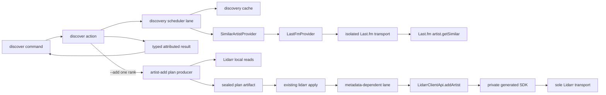

# Technical Research: Lidarr Similar-Artist Discovery

## Executive Summary

Issue #203 should introduce `rfmedia lidarr discover --artist "Name"` as a direct, Last.fm-backed
read path that does not require a Lidarr connection. The recommendation request belongs in the
already-shipped `discovery` scheduler lane, behind a provider interface and a single isolated
Last.fm Fetch owner. The command must always expose source attribution, validate and cache a strict
provider-independent projection, and remain read-only unless the user explicitly selects one
current result for an add handoff.

The repository has moved materially beyond the issue's original 3–5-file estimate. Lidarr search
and lookup now use a private generated SDK, a handwritten facade, a sole authenticated transport,
strict domain projections, query-keyed cache fallback, classified scheduler metadata, and
Bash/Zsh/Fish completion parity. Lidarr writes now use sealed plan/apply artifacts with explicit
approval, live-state revalidation, non-retrying mutation dispatch, durable per-target history, and
resume semantics. Discovery must integrate with those contracts rather than adding Fetch to an
action or issuing a direct `POST` from `discover.ts`.

The recommended add contract is intentionally narrow:

```text
# Read-only; Last.fm configuration only
rfmedia lidarr discover --artist "Radiohead"

# Select exactly one result and seal an artist-add plan; still no mutation
rfmedia lidarr discover --artist "Radiohead" --add 3 \
  --root-folder "/music" \
  --quality-profile "1" \
  --metadata-profile "1" \
  --plan-file "./radiohead-discovery-add.json"

# Existing explicit mutation gate
rfmedia lidarr apply ./radiohead-discovery-add.json
```

`--add <rank>` selects exactly one candidate from the live-or-fresh result set in the same
invocation and creates an `artist-add` plan. It does not mean "add every recommendation" and does
not bypass `lidarr apply`. The plan fixes conservative v1 intent (`monitored=false`,
`monitorNewItems=none`, `searchForMissingAlbums=false`) while #205 remains responsible for
multi-candidate quarantine, thresholds, diversity, and loop controls, and #206 remains responsible
for configurable add defaults and post-add normalization.

## Architecture Design

### Current Repository Boundaries

The relevant shipped architecture is:

```text
Commander command
  -> framework-independent action
    -> Lidarr scheduler lane
      -> handwritten LidarrClientApi facade
        -> private generated SDK operation
          -> src/lib/lidarr/transport.ts (sole Lidarr Fetch owner)
            -> Lidarr
```

The repository enforces these properties:

- `packages/rfmedia-cli/src/lib/lidarr/client.ts` is the only production module allowed to import
  private generated Lidarr operations and writable DTOs.
- `packages/rfmedia-cli/src/lib/lidarr/transport.ts` is the only production owner of Lidarr Fetch,
  origin binding, API-key injection, redirect rejection, timeouts, and bounded bodies.
- Actions, commands, and public types cannot import `lib/lidarr/generated/**`, spell handwritten
  Lidarr API paths, or construct broad generated editor bodies.
- `packages/rfmedia-cli/src/lib/lidarr/scheduler.ts` already defines an isolated `discovery` lane
  with defaults of concurrency 4, operation budget 100, two additional retries, and a 30-second
  retry-delay cap.
- Current query results use strict immutable projections, SHA-256 cache discriminators, atomic
  malformed-response rejection, scheduler-owned retries, abort propagation, and stable provider,
  cache, and execution metadata.
- All reviewed Lidarr writes pass through the sealed plan/apply lifecycle. The operation registry
  owns validation, live-state projection, execution, verification, and deferral eligibility.

### Proposed Component Model



The provider boundary is independent of Lidarr:

| Layer                         | Responsibility                                                                            |
| ----------------------------- | ----------------------------------------------------------------------------------------- |
| `commands/lidarr-discover.ts` | Parse options, enforce option dependencies, render text/machine output, redact failures   |
| `actions/lidarr/discover.ts`  | Schedule discovery, coordinate cache, shape results, optionally invoke the plan producer  |
| `lib/discovery/types.ts`      | Provider-neutral query, recommendation, attribution, cache, and error contracts           |
| `lib/discovery/lastfm.ts`     | Fixed-origin Last.fm request construction, pacing, bounded parsing, Last.fm error mapping |
| `lib/discovery/cache.ts`      | Versioned, privacy-preserving cache identity and strict cache revalidation                |
| `lib/lidarr/client.ts`        | Narrow generated-backed root-folder reads and artist-add request/response boundary        |
| `lib/lidarr/plan-*`           | `artist-add` plan validation, preflight, execution, verification, history, and resume     |

No discovery module imports the Lidarr generated tree. No Lidarr module sends a Last.fm request.
Only the action composes the independent discovery result with an optional Lidarr plan producer.

### Read-Only Data Flow

1. The command validates the seed, limit, minimum match, and option combinations before importing
   the action. Invalid input initializes no database, provider, or Lidarr client.
2. The action resolves a Last.fm provider using `discovery.lastfm.apiKey` or the explicit
   `--lastfm-api-key` override. It does not resolve Lidarr credentials.
3. The action computes a cache discriminator from the projection version, provider, NFC-normalized
   seed, `autocorrect`, and requested upstream limit. Cleartext seed and API key never enter the
   cache key.
4. One idempotent task runs in the `discovery` lane.
5. A fresh exact cache hit returns without a network request. A miss calls
   `artist.getSimilar` through the isolated Last.fm transport.
6. The provider validates the complete response atomically, preserves Last.fm relevance order,
   removes the seed, deduplicates candidates, assigns rank, and writes the full projection before
   applying local `--min-match`.
7. After provider retries are exhausted, `--allow-stale` may serve a strictly revalidated exact
   cache row inside the configured stale ceiling. Cancellation, invalid input/response, and
   credential failures never fall back.
8. The action returns the result, provider/cache provenance, mandatory attribution, and scheduler
   execution metadata. The command renders human output to stderr or deterministic machine output
   to stdout.

### Explicit Add Handoff

`--add <rank>` is an add-plan selector, not an immediate mutation switch.

1. Discovery completes first and produces the exact currently displayed ranked set.
2. The selected rank must exist, must not identify the seed, and must resolve to a MusicBrainz
   artist ID. A Last.fm MBID is used directly when valid; otherwise the existing Lidarr artist
   lookup facade may resolve the candidate name, but it must return one unique exact-name match.
   Zero or ambiguous matches fail closed.
3. Add planning then requires Lidarr URL/API key, an exact root-folder reference, quality-profile
   reference, metadata-profile reference, and `--plan-file`.
4. Fresh Lidarr local reads resolve those references and check the full artist library by canonical
   MusicBrainz ID. An already-present artist is reported as `satisfied`; no plan or write is
   produced.
5. The plan seals recommendation provenance, durable artist identity, exact add settings, target
   Lidarr origin, expected absence, desired state, and checksum. It contains no Last.fm or Lidarr
   API key.
6. The existing `lidarr apply` command performs the mutation approval. Machine output and non-TTY
   execution require `--yes`; dry-run remains mutation-free.
7. Apply rechecks absence and all referenced resources immediately before dispatch. It submits one
   non-idempotent task to the `metadata-dependent` lane with the normal health/circuit preflight.
8. The private facade invokes the already-generated artist-create operation with a newly
   constructed narrow writable body. The generated tree is not edited manually.
9. Apply verifies the authoritative result by MusicBrainz ID and desired settings. A timeout or
   connection loss after possible dispatch triggers read-back reconciliation, never an automatic
   second POST.
10. Per-target history records `satisfied`, `succeeded`, `failed-before-dispatch`, or `uncertain`.
    Resume may retry only a proven pre-dispatch failure. An uncertain result blocks automatic
    replay until a fresh read proves absent or present.

This design makes the optional add path real while preserving the repository rule that mutation is
reviewed separately from discovery. It also avoids consuming the bulk-policy scope assigned to
issues #205 and #206.

## Data Models

### Provider-Neutral Discovery Contracts

```ts
type DiscoveryProviderId = "lastfm";

interface SimilarArtistQuery {
  readonly artist: string;
  readonly limit: number;
  readonly autocorrect: boolean;
  readonly signal?: AbortSignal;
}

interface SimilarArtistCandidateInput {
  readonly name: string;
  readonly musicBrainzId?: string;
  readonly match: number; // finite 0..1
  readonly url: string; // validated Last.fm catalogue URL
}

interface SimilarArtistCandidate extends SimilarArtistCandidateInput {
  readonly rank: number;
  readonly candidateKey: string;
  readonly addable: boolean;
  readonly addBlockedReason?: "identity-unresolved";
}

interface DiscoveryAttribution {
  readonly provider: "lastfm";
  readonly displayName: "Last.fm";
  readonly method: "artist.getSimilar";
  readonly siteUrl: "https://www.last.fm/";
  readonly termsUrl: "https://www.last.fm/api/tos";
}

interface SimilarArtistProviderResult {
  readonly requestedArtist: string;
  readonly resolvedArtist: string;
  readonly autocorrected: boolean;
  readonly candidates: readonly SimilarArtistCandidateInput[];
  readonly attribution: DiscoveryAttribution;
}

interface SimilarArtistProvider {
  readonly id: DiscoveryProviderId;
  getSimilar(query: SimilarArtistQuery): Promise<SimilarArtistProviderResult>;
}
```

`candidateKey` is a display/selection identity, not a database identity:

- `mbid:<lowercase UUID>` when Last.fm supplies a valid MBID;
- otherwise `lastfm-name:<SHA-256(NFC normalized name)>`.

Only an MBID-backed candidate, or a candidate uniquely resolved through Lidarr lookup during plan
creation, can enter an add plan. Names and Last.fm URLs must never become mutation identity.

### Action and Output Contracts

```ts
interface LidarrDiscoverActionOptions {
  readonly artist: string;
  readonly limit?: number;
  readonly minMatch?: number;
  readonly autocorrect?: boolean;
  readonly allowStale?: boolean;
  readonly lastfmApiKey?: string;
  readonly signal?: AbortSignal;
  readonly addRank?: number;
  readonly rootFolder?: string;
  readonly qualityProfile?: string;
  readonly metadataProfile?: string;
  readonly planFile?: string;
  readonly lidarrUrl?: string;
  readonly lidarrApiKey?: string;
}

interface LidarrDiscoverActionResult {
  readonly query: {
    readonly artist: string;
    readonly limit: number;
    readonly minMatch: number;
    readonly autocorrect: boolean;
  };
  readonly seed: {
    readonly requestedName: string;
    readonly resolvedName: string;
    readonly autocorrected: boolean;
  };
  readonly results: readonly SimilarArtistCandidate[];
  readonly total: number;
  readonly returned: number;
  readonly provider: {
    readonly requested: "lastfm";
    readonly used: "lastfm" | "sqlite-cache";
    readonly degraded: boolean;
    readonly fallbackReason?: string;
  };
  readonly attribution: DiscoveryAttribution;
  readonly cacheStatus?: {
    readonly source: "fresh-cache" | "stale-cache";
    readonly fetchedAt: string;
    readonly ageSeconds: number;
  };
  readonly execution: LidarrExecutionSuccessMetadata;
  readonly addHandoff?:
    | {
        readonly status: "plan-created";
        readonly selectedRank: number;
        readonly candidateKey: string;
        readonly planId: string;
        readonly planChecksum: string;
        readonly planPath: string;
        readonly nextCommand: string;
      }
    | {
        readonly status: "already-present";
        readonly selectedRank: number;
        readonly candidateKey: string;
        readonly lidarrId: number;
      };
}
```

`results` preserve provider relevance order after seed removal and first-win deduplication.
`minMatch` filters locally without renumbering the provider's raw position only if a separate
`providerRank` is exposed; otherwise rank must be assigned after all displayed filtering so
`--add <rank>` always refers to the visible table. The simpler v1 decision is to assign display
rank after filtering and use it consistently in text, JSON, YAML, and CSV.

### Artist-Add Plan Contracts

```ts
interface LidarrArtistAddOperation {
  readonly kind: "artist-add";
  readonly rootFolder: LidarrPlanResourceReference;
  readonly qualityProfile: LidarrPlanResourceReference;
  readonly metadataProfile: LidarrPlanResourceReference;
  readonly monitored: false;
  readonly monitorNewItems: "none";
  readonly searchForMissingAlbums: false;
}

interface LidarrArtistAddPlanEntry {
  readonly id: string;
  readonly artistName: string;
  readonly foreignArtistId: string;
  readonly before: { readonly exists: false };
  readonly after: {
    readonly exists: true;
    readonly monitored: false;
    readonly monitorNewItems: "none";
    readonly rootFolder: LidarrPlanResourceReference;
    readonly qualityProfile: LidarrPlanResourceReference;
    readonly metadataProfile: LidarrPlanResourceReference;
  };
  readonly provenance: {
    readonly source: "lastfm";
    readonly method: "artist.getSimilar";
    readonly seedArtist: string;
    readonly match: number;
    readonly candidateUrl: string;
    readonly discoveredAt: string;
  };
  readonly idempotencyKey: string;
}

interface LidarrArtistAddInput {
  readonly artistName: string;
  readonly foreignArtistId: string;
  readonly rootFolderPath: string;
  readonly qualityProfileId: number;
  readonly metadataProfileId: number;
  readonly monitored: false;
  readonly monitorNewItems: "none";
  readonly searchForMissingAlbums: false;
}
```

The plan operation is non-destructive but may cause metadata work, so its review risk should be
`medium`, `destructive=false`, with cascade text explicitly stating that the artist is added
unmonitored and no missing-album search is requested. The plan schema can remain
`rfmedia.lidarr-plan.v2` if the existing exact operation allowlist is extended atomically; older
binaries will reject the unknown kind, which is the desired fail-closed behavior.

### Strict Last.fm Wire Projection

The Last.fm JSON response is untrusted and must not cross the provider boundary. Accept only:

- an object containing `similarartists`;
- a bounded artist array no larger than the requested maximum and an absolute hard cap of 100;
- non-empty NFC-normalized, control-free names of at most 512 Unicode code points and 2 KiB UTF-8;
- `match` as a numeric string or number that parses to a finite value in `[0, 1]`;
- an empty MBID as absence or a valid UUID as a canonical lowercase MBID; and
- a bounded HTTP(S) Last.fm catalogue URL with no embedded credentials or control characters.

Reject the complete response as `invalid-response` if any retained record is malformed. Do not
silently emit a partial recommendation set. Ignore images and `streamable`; they are not needed by
the command and add licensing, URL, and output surface.

## API Design

### CLI Contract

```text
rfmedia lidarr discover --artist <name> [options]

Discovery:
  --artist <name>             Required seed artist
  --limit <n>                 Results requested from Last.fm; default 20, range 1..100
  --min-match <score>         Local inclusive threshold; default 0, range 0..1
  --autocorrect               Allow Last.fm to correct the seed; default false
  --allow-stale               Permit an exact stale cache result after eligible failure
  --lastfm-api-key <key>      Override discovery.lastfm.apiKey

Single-candidate add-plan handoff:
  --add <rank>                Select one visible result and create an artist-add plan
  --root-folder <reference>   Exact Lidarr root-folder path or positive ID
  --quality-profile <ref>     Exact existing profile name or positive ID
  --metadata-profile <ref>    Exact existing profile name or positive ID
  --plan-file <path>          Required sealed plan output path
  --lidarr-url <url>          Existing Lidarr connection override
  --lidarr-api-key <key>      Existing Lidarr secret override
```

Option rules:

- `--artist` is required and normalized before I/O.
- `--add` accepts one positive display rank, not a list or boolean.
- The five add-plan inputs are invalid without `--add` and all are required with it.
- `--allow-stale` may produce read-only output, but `--add` must not create a plan from stale data.
  The user must obtain a fresh recommendation set before sealing mutation intent.
- `--autocorrect` is recorded in output and provenance. Without it, corrected provider identity is
  not silently accepted.
- No `--yes` or `--dry-run` flag belongs on `discover`; discovery plus plan creation is read-only.
  The existing apply command owns both approval and dry-run.
- Machine-output add planning is safe because it does not mutate. Actual apply keeps the existing
  `--yes` requirement.

### Human Output

Human output goes to stderr and contains:

- requested and resolved seed name, including an autocorrect marker;
- rank, artist, similarity percentage, MusicBrainz ID or `-`, and addability;
- provider/cache/degradation summary;
- mandatory `Data source: Last.fm (artist.getSimilar)` attribution and a Last.fm link;
- execution lane and attempts; and
- when requested, the plan ID/checksum/path and exact next apply command.

The attribution line is not optional decoration. Last.fm's API terms require credit and links when
Last.fm data is used. Every machine candidate also retains its Last.fm catalogue URL.

### Machine Output

JSON and YAML use:

```json
{
  "command": "lidarr-discover",
  "result": {
    "query": {},
    "seed": {},
    "results": [],
    "provider": {},
    "attribution": {},
    "execution": {},
    "addHandoff": {}
  }
}
```

CSV uses a fixed summary-plus-candidate schema similar to `lidarr-search.ts`:

- one `summary` row for query, seed, provider, attribution, cache, execution, and add handoff;
- one ordered `candidate` row per visible result; and
- stable columns for rank, candidate key, name, MBID, match, URL, addable, and block reason.

Diagnostics and progress never contaminate stdout. Sensitive option values must be passed to the
shared Lidarr failure redactor, and Last.fm request URLs must never appear in an exception because
the API key is a query parameter.

### Last.fm Request Contract

The provider sends one HTTPS GET to the fixed origin `https://ws.audioscrobbler.com` and fixed
method path `/2.0/`, with:

```text
method=artist.getSimilar
artist=<normalized seed>
api_key=<opaque configured key>
format=json
limit=<validated limit>
autocorrect=0|1
```

The origin and method are code constants, not user-configurable values. This prevents an API key
from being redirected or sent to an arbitrary origin. Redirect mode is `error`; request and
response bodies are bounded; error bodies are drained only to a small cap and never surfaced raw.
The method requires an API key but no Last.fm user session.

Official Last.fm method behavior:

- `artist` is required unless an MBID is provided;
- `limit` and `autocorrect` are supported;
- `match` is a similarity value from 0 to 1;
- API errors include invalid key, service offline, temporary error, suspended key, and rate limit;
  and
- successful data must be attributed under the API terms.

Relevant official documentation:

- [artist.getSimilar](https://www.last.fm/api/show/artist.getSimilar)
- [Last.fm API authentication](https://www.last.fm/api/authentication)
- [Last.fm API terms](https://www.last.fm/api/tos)

### Provider Error Mapping

Introduce a discovery-specific subclass that still satisfies the scheduler's current
`LidarrError` shape. Add `discovery-provider-unavailable` to the stable error-code union rather
than misclassifying Last.fm as `lidarr-unreachable` or `metadata-provider-unavailable`.

| Failure                             | Code                             | Retryable | Stale eligible |
| ----------------------------------- | -------------------------------- | --------- | -------------- |
| DNS/connect/TLS failure             | `discovery-provider-unavailable` | yes       | yes            |
| Last.fm error 11 or 16 / HTTP 5xx   | `discovery-provider-unavailable` | yes       | yes            |
| Request deadline                    | `timeout`                        | yes       | yes            |
| Last.fm error 29 / HTTP 429         | `rate-limited`                   | yes       | no             |
| Missing/invalid API key or error 10 | `configuration`                  | no        | no             |
| Suspended key / error 26            | `authorization`                  | no        | no             |
| Invalid seed / error 6 or 7         | `validation`                     | no        | no             |
| Malformed/oversized payload         | `invalid-response`               | no        | no             |
| Caller abort                        | scheduler `aborted`              | no        | no             |

Scheduler retry logic should admit `discovery-provider-unavailable` only in the `discovery` lane.
The existing Lidarr and metadata circuit scopes must not be fed by Last.fm failures. A persisted
provider-specific discovery circuit is useful later, but adding it is not required for one request
per command in #203; retries, pacing, and exact-cache fallback provide the initial resilience
contract.

### Lidarr Facade API

The add handoff needs narrow facade additions:

```ts
interface LidarrRootFolder {
  readonly id: number;
  readonly path: string;
  readonly accessible: boolean;
  readonly freeSpace?: number;
}

interface LidarrClientApi {
  listRootFolders(signal?: AbortSignal): Promise<readonly LidarrRootFolder[]>;
  addArtist(input: LidarrArtistAddInput, signal?: AbortSignal): Promise<LidarrArtist>;
}
```

Only `client.ts` imports the generated root-folder and artist-create operations/types. The facade
constructs a fresh minimal writable body; it never copies an artist lookup response wholesale.
The generated SDK already contains these operations in the committed snapshot, but the offline
generator's required-operation, required-envelope, and required-endpoint lists do not currently
assert them. Extend those assertions and tests; do not hand-edit generated files or refresh the
OpenAPI snapshot merely to consume operations already present.

## System Constraints

### Configuration and Secrets

Discovery configuration should be top-level because read-only discovery is independent of Lidarr:

```yaml
discovery:
  provider: lastfm
  cacheTtlSeconds: 86400
  cacheStaleMaxAgeSeconds: 604800
  lastfm:
    apiKey: "{{ LASTFM_API_KEY }}"
    timeoutMs: 15000
    minRequestIntervalMs: 250

lidarr:
  baseUrl: "{{ LIDARR_URL }}"
  apiKey: "{{ LIDARR_API_KEY }}"
```

Rules:

- `provider` initially accepts only `lastfm`, but the type is an explicit provider ID so
  ListenBrainz can be added without changing action contracts.
- `apiKey` is required only when `discover` is executed. It remains compatible with the existing
  dotenvx and 1Password template-reexecution flow.
- No Last.fm shared secret or user session is needed for `artist.getSimilar`.
- The API key must never be logged, cached, persisted in a plan, included in execution metadata, or
  retained on a public connection object.
- Do not expose a configurable Last.fm base URL. A credential-bearing query parameter plus a
  configurable host would create a credential-exfiltration primitive.
- Validate unknown discovery keys consistently with current config policy and add focused config
  tests for type/range errors and template resolution.

### Cache Policy

The existing `lidarr_metadata_cache` schema already provides origin/category/discriminator/payload/
timestamp storage and can be reused without a migration:

- origin: fixed credential-free Last.fm API origin;
- category: extend `LidarrCacheCategory` with `discovery`;
- discriminator:
  `v1:lastfm:artist.getSimilar:<sha256(seed + NUL + autocorrect + NUL + limit)>`; and
- payload: strict provider-neutral projection plus attribution, never the API key or raw response.

Fresh cache is consulted before Last.fm to reduce quota use. Stale data is consulted only after an
eligible live failure and explicit `--allow-stale`. Cache read/write/database failure is
non-authoritative: preserve a successful live result or the original provider failure. Cached
values must be strictly revalidated and copied before use. The selected `--add` candidate may come
only from `used=lastfm` or `fresh-cache`, never `stale-cache`.

Reusing the table is pragmatic but requires updating comments that currently describe every origin
as a Lidarr origin. If maintainers prefer semantic isolation, a new `discovery_cache` table is the
alternative; it adds a schema migration and duplicate CRUD without improving the key/value
contract.

### Rate Limits and Retry Ownership

Last.fm does not publish a stable numeric request quota on the method page. The repository research
estimated roughly five requests per second, so treat that only as a planning estimate, not an API
guarantee.

- Pace provider dispatches with a process-wide minimum interval, default 250 ms (four per second).
- Validate `minRequestIntervalMs` in a conservative range such as 200–60,000 ms.
- The discovery scheduler remains the sole retry owner.
- Retry only idempotent GET work and honor HTTP `Retry-After` when present and within the lane cap.
- Last.fm error 29 has no guaranteed retry delay; use scheduler bounded exponential backoff.
- The limiter must be abort-aware and must not consume capacity after cancellation.
- The scheduler's concurrency bulkhead is not a cross-process rate limiter. Persisted global quota
  coordination is unnecessary for #203's one-request workflow but must be revisited before #205
  adds deep or multi-seed discovery.

### Cancellation and Resource Bounds

- One caller signal flows through queue admission, pacing delay, provider timeout composition,
  Fetch, bounded body read, stale-fallback decision, and optional Lidarr plan reads.
- Caller abort remains `aborted`, not `timeout`.
- Provider timeout must remove listeners and timers in `finally`.
- Default response cap: 1 MiB; error-body drain cap: 4 KiB.
- Default result limit: 20; maximum: 100.
- Seed: 1–256 Unicode code points, at most 1 KiB UTF-8, NFC normalized, no C0/C1 or bidi controls.
- Plan paths and candidate labels reuse existing terminal-control and bounded-path validation.
- Do not store images or raw Last.fm payloads.

### Compatibility

- The command is additive; existing `status`, `list`, `wanted`, `health`, `search`, `lookup`,
  `albums`, `audit`, `presets`, `plan`, and `apply` contracts remain unchanged.
- Read-only discovery works without Lidarr configuration. Supplying only Last.fm credentials must
  not trigger `resolveRequiredLidarrClient`.
- The new error code is additive in machine output but requires exhaustive updates in scheduler,
  resilience, circuit-state validation, tests, and failure hints.
- Existing cache rows remain valid because the new category and discriminator are disjoint.
- Existing plan readers fail closed on the new exact operation kind until upgraded.
- Node 22, ESM/NodeNext `.js` imports, current formatter stream discipline, and no new runtime
  dependency are preserved.
- Generated Lidarr files remain replace-only. Consuming existing generated operations requires
  wrapper/assertion changes, not hand edits.
- Bash, Zsh, and Fish completion templates plus parity tests are part of the command change.

### Security and Licensing

- Query-string API-key redaction is mandatory at every error boundary.
- Fixed HTTPS origin, rejected redirects, bounded bodies, strict JSON parsing, no raw error echo,
  and no configurable transport host are required.
- Candidate names and URLs are untrusted terminal data; strip/reject controls before rendering.
- Cache discriminators hash seed names to avoid leaking user queries through database keys.
- Plan artifacts contain candidate attribution and URLs but no provider credentials.
- Last.fm attribution and links must remain present in all human and machine output. Review the API
  terms before release, especially non-commercial-use and data-storage conditions; this is a
  product/legal gate, not a code-only assumption.

## Codebase Changes

The issue's affected-file list is no longer current. Likely implementation changes are:

### New Production Files

- `packages/rfmedia-cli/src/commands/lidarr-discover.ts`: command factory, option dependency
  validation, attributed presenter, CSV projection, and failure integration.
- `packages/rfmedia-cli/src/actions/lidarr/discover.ts`: scheduled discovery orchestration,
  cache-first/fallback behavior, result shaping, and add-plan handoff.
- `packages/rfmedia-cli/src/actions/lidarr/plan-artist-add.ts`: resolve exact identities/resources,
  prove absence, and create the sealed artist-add plan.
- `packages/rfmedia-cli/src/lib/discovery/types.ts`: provider-neutral contracts.
- `packages/rfmedia-cli/src/lib/discovery/errors.ts`: classified provider failure.
- `packages/rfmedia-cli/src/lib/discovery/lastfm.ts`: fixed-origin sole Last.fm Fetch owner,
  pacing, timeout, body cap, error mapping, and strict projection.
- `packages/rfmedia-cli/src/lib/discovery/cache.ts`: discriminator, fresh lookup, stale fallback,
  cache revalidation, and attribution-safe payload.
- `packages/rfmedia-cli/src/types/discovery.ts`: command/action/add-handoff public projections if
  these types need package-level export; otherwise keep provider internals under `lib/discovery`.

### Existing Production Files

- `packages/rfmedia-cli/src/commands/lidarr.ts`: register the discover command and reuse shared
  failure/execution helpers.
- `packages/rfmedia-cli/src/actions/lidarr/index.ts`: export discover and artist-add plan actions.
- `packages/rfmedia-cli/src/types/config.ts`: add strict top-level discovery configuration.
- `packages/rfmedia-cli/src/types/index.ts`: export public discovery config/result types.
- `packages/rfmedia-cli/src/lib/config.ts`: validate provider, secret, timeout, pacing, and cache
  ranges.
- `packages/rfmedia-cli/src/lib/lidarr/errors.ts`: add the discovery-provider code to the exhaustive
  taxonomy.
- `packages/rfmedia-cli/src/lib/lidarr/scheduler.ts`: retry the new code only for idempotent
  discovery-lane work.
- `packages/rfmedia-cli/src/lib/lidarr/resilience.ts`: exhaustively classify the new code as no
  Lidarr/metadata circuit input and avoid accidental Lidarr stale behavior.
- `packages/rfmedia-cli/src/lib/lidarr/circuit-breaker.ts`: accept the additive code in persisted
  state validation without introducing a discovery scope.
- `packages/rfmedia-cli/src/lib/lidarr/metadata-cache.ts`: add the discovery category and generalize
  origin comments.
- `packages/rfmedia-cli/src/lib/lidarr/client.ts`: add narrow root-folder read and artist-create
  methods through generated operations.
- `packages/rfmedia-cli/src/lib/lidarr/types.ts`: strictly project root-folder and add response
  fields.
- `packages/rfmedia-cli/src/types/lidarr.ts`: add generated-independent root-folder/add input types.
- `packages/rfmedia-cli/src/types/lidarr-plan.ts`: add the artist-add operation, entry, summary, and
  result shapes.
- `packages/rfmedia-cli/src/lib/lidarr/plan-engine.ts`: exact schema/checksum validation for the new
  operation and foreign-ID target.
- `packages/rfmedia-cli/src/lib/lidarr/plan-operation-definitions.ts`: add non-deferable
  `artist-add` behavior and operation-owned scheduler tier.
- `packages/rfmedia-cli/src/actions/lidarr/apply*.ts`: dispatch operation-owned lanes, provide the
  metadata preflight, reconcile ambiguous POST outcomes, and preserve history/resume guarantees.
- `packages/rfmedia-cli/scripts/check-direct-plex-imports.mjs`: register exactly one Last.fm Fetch
  owner and add artist-add mutation ownership.
- `packages/rfmedia-cli/scripts/generate-lidarr-client.mjs`: require the already-present artist
  create/root-folder operations, request envelopes, and endpoints.
- `packages/rfmedia-cli/src/lib/shell-completions/bash.ts`,
  `packages/rfmedia-cli/src/lib/shell-completions/zsh.ts`, and
  `packages/rfmedia-cli/src/lib/shell-completions/fish.ts`: complete the new leaf and all options.
- `rfmedia.example.yaml`: document Last.fm templates and policy defaults.

### Tests

- Provider tests: fixed origin, encoded query, redirect rejection, API-key redaction, Last.fm
  logical errors, HTTP errors, timeout versus abort, response/body bounds, atomic projection,
  correction, deduplication, and pacing.
- Cache tests: key privacy/isolation, fresh hit, stale consent, expiry, corruption, disabled cache,
  empty results, and non-authoritative database failures.
- Action tests: no Lidarr resolution on read-only use, discovery lane/task metadata, scheduler
  retries, cancellation, attribution, filtering/ranking, and stale add prohibition.
- Command tests: option dependencies, human and JSON/YAML/CSV parity, stdout/stderr discipline,
  secret redaction, visible-rank selection, and plan handoff.
- Facade/generated contract tests: exact artist POST body, root-folder projection, two-origin/API-key
  isolation, signal forwarding, generated envelope non-escape, and no generated tree edits.
- Plan/apply tests: expected absence, already-present satisfaction, resource drift, non-idempotent
  metadata-lane dispatch, post-dispatch reconciliation, uncertain outcome, history failure, resume,
  checksum/origin binding, and API-key exclusion.
- Architecture tests: only the new Last.fm module may call Fetch; action/command imports cannot
  reach generated Lidarr modules; only registered operation owners may call `addArtist`.
- Config tests: missing key at use time, templates, invalid ranges/types, and no configured provider
  host.
- Completion tests: discover leaf and option parity across Bash, Zsh, and Fish.

### Documentation and Release Files

- `packages/rfmedia-cli/docs/features/lidarr-discovery.md`: command, attribution, configuration,
  cache/fallback, add-plan/apply, and limitations.
- `packages/rfmedia-cli/docs/features/lidarr-plan-apply.md`: artist-add operation and recovery.
- `packages/rfmedia-cli/docs/features/lidarr-execution-lanes.md`: live discovery consumer and
  discovery-provider retry behavior.
- `packages/rfmedia-cli/docs/features/lidarr-generated-client.md`: artist-create/root-folder
  generated contract.
- `packages/rfmedia-cli/README.md`: command discovery and examples.
- `packages/rfmedia-cli/CHANGELOG.md`: additive command/config/plan operation.
- `ROADMAP.md` and `docs/roadmap-archive.md`: move #203 only after implementation ships; keep #205,
  #206, and #219 open.

## Technical Decisions

1. **Last.fm is the only live v1 provider.** Keep an interface for future ListenBrainz support, but
   do not implement multi-provider fallback speculatively.
2. **Discovery is independent of Lidarr.** Read-only use requires no Lidarr URL, API key, health
   probe, generated SDK, or metadata-provider circuit.
3. **Direct Last.fm transport gets one isolated Fetch owner.** It does not reuse the authenticated
   Lidarr transport because origins, credential placement, wire schema, and error semantics differ.
4. **The existing discovery scheduler lane is mandatory.** Do not create a provider-local parallel
   executor or let the Last.fm client own retries.
5. **Fresh cache is cache-first; stale cache is failure-only and opt-in.** This reduces provider
   traffic without silently substituting stale recommendations.
6. **Provider provenance is first-class data.** Attribution is present in text, JSON, YAML, and CSV,
   not added only to documentation.
7. **Preserve provider relevance order.** Do not invent a new ranking formula in #203. Apply
   `minMatch`, seed removal, first-win deduplication, then visible one-based rank.
8. **No name-only mutation identity.** Add plans use a MusicBrainz UUID. Ambiguous name lookup fails.
9. **`--add` selects exactly one visible result.** Multi-add, deep traversal, quarantine, diversity,
   loop prevention, and adjustable blast-radius controls remain #205.
10. **`--add` creates a plan; it never POSTs.** Actual mutation remains a separately named,
    separately approved `lidarr apply` step.
11. **V1 add settings are fixed and conservative.** Unmonitored, monitor-none, and search-disabled
    values are sealed in the plan. Configurable defaults and post-add policy remain #206.
12. **Artist creation is non-idempotent and non-deferable initially.** Never retry a potentially
    dispatched POST. Read-back reconciliation decides satisfied/succeeded/uncertain state.
13. **Generated Lidarr files are not edited.** Add required-operation assertions and consume the
    operations already in the pinned snapshot through `client.ts`.
14. **Reuse the existing cache table.** Add a disjoint discovery category and provider-origin key;
    avoid a schema migration unless maintainers require nomenclature isolation.
15. **No new runtime dependency.** Node 22 Fetch, AbortController, crypto, current SQLite, Commander,
    and shared formatters cover the feature.

### Rejected Alternatives

- **Call Last.fm from `actions/lidarr/discover.ts`:** violates authenticated/network ownership
  checks and couples orchestration to one provider.
- **Route discovery through Lidarr search:** Lidarr has no similar-artist endpoint and reintroduces
  the metadata dependency the discovery layer is intended to avoid.
- **Treat Last.fm failures as Lidarr metadata failures:** corrupts circuit ownership and machine
  diagnostics.
- **Make `--add` a boolean that adds all displayed candidates:** creates an uncontrolled growth
  path before #205's guardrails.
- **Immediate interactive POST from discover:** bypasses sealed plan review, machine/non-TTY
  approval, durable history, and resume semantics.
- **Automatically retry artist POST:** risks duplicate or ambiguous creation after a lost response.
- **Store raw Last.fm responses/images:** increases cache size, licensing surface, and untrusted data
  without serving the command contract.
- **Expose a configurable provider URL:** risks exfiltrating the query-string API key.
- **Refresh or hand-edit the generated client:** unnecessary; the pinned generated SDK already
  contains the required operations.

## Open Questions

1. **Last.fm terms approval:** Has project ownership accepted the current Last.fm non-commercial,
   attribution, linking, and data-storage terms for this distribution? This should be resolved
   before implementation merges.
2. **Cache nomenclature:** Is extending `lidarr_metadata_cache` with provider-origin discovery rows
   acceptable, or should the team pay the migration/duplicate-CRUD cost for `discovery_cache`?
3. **Name-only candidates:** Should v1 attempt one exact Lidarr lookup to resolve a missing Last.fm
   MBID, or mark all MBID-less results non-addable? The recommended behavior is unique exact lookup
   with fail-closed ambiguity.
4. **Profile reference syntax:** Existing artist plan commands accept exact numeric-or-name
   references. Root folders should follow the same pattern, but paths containing numeric-only text
   need an explicit `id:`/`path:` prefix if ambiguity is possible.
5. **Plan schema version:** The recommended additive v2 operation allowlist preserves current
   artifact framing. If maintainers consider a new target identity (`foreignArtistId` instead of
   local numeric ID) a schema-family change, increment to v3 and keep v1/v2 readers unchanged.
6. **Cross-process pacing:** One command makes one Last.fm call, so process-local pacing is
   sufficient for #203. Before multi-seed/deep discovery lands, decide whether SQLite-backed
   cross-process quota coordination is required.
7. **Attribution presentation:** Confirm whether a plain text link satisfies the project's Last.fm
   API-account/brand obligations or whether packaged logo/button assets are required for any web or
   MCP presentation added later.
