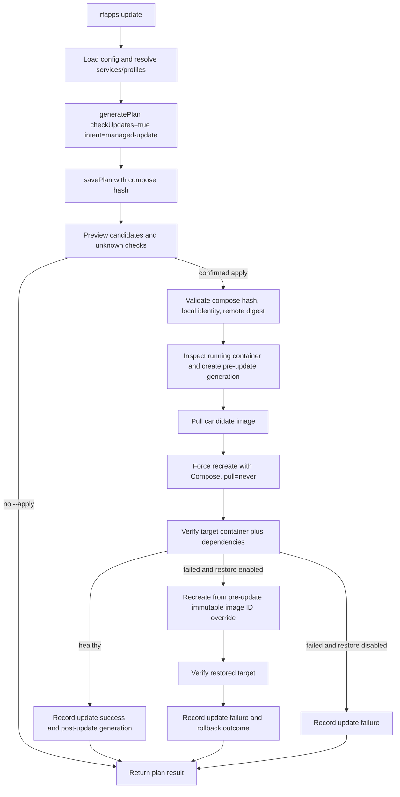

# Managed Update Lifecycle: Technical Research

## Executive Summary

Issue #148 should be implemented as a thin `rfapps update` orchestration layer over the existing
plan, Docker, generation, and health modules. It should not create a second deployment engine.
The workflow is:

1. Generate and save an update-intent `DeploymentPlan` with the existing
   `generatePlan({ checkUpdates: true })` path.
2. Select only services whose registry check conclusively reports a different remote digest.
3. Before pulling, inspect each running container and append a generation containing both its
   human-readable image reference and immutable Docker image ID.
4. Revalidate the compose hash, local image identity, and remote digest immediately before apply.
5. Pull and force-recreate selected services using the existing Docker execution helpers.
6. Verify the updated target containers themselves, as well as their dependencies.
7. If verification fails, recreate the failed service from the pre-update generation's immutable
   image ID through a temporary Compose override, then verify the restored service.
8. Record the update and any restore as ordinary deployment-history entries and emit one structured
   result containing the plan, per-service phases, and generation numbers.

Two existing behaviors make a direct call to `executeApply()` unsafe for this feature:

- `plan --check-updates` annotates `image.updateAvailable`, but a mutable tag with a new registry
  digest remains `changeType: "unchanged"`. `executeApply()` therefore reports no changes and does
  not pull or recreate it.
- Generations currently store only `image_tag`. After a mutable tag is pulled, that tag points at
  the new image. `executeRollback()` also invokes Compose with the current compose file rather than
  an image override, so it cannot guarantee restoration of the old image. Automatic recovery must
  pin the pre-update container's immutable `ContainerInspect.Image` value.

The first release should update services sequentially. This makes the restore boundary one service,
keeps reports deterministic, and avoids defining group-wide rollback semantics. Existing parallel
execution can be added later without changing the persisted contracts.

## Architecture Design

### Components and responsibilities

- `actions/update.ts` owns CLI interaction, plan display, confirmation, output formatting, and exit
  status. It delegates all lifecycle work.
- `lib/managed-update.ts` owns the state machine and returns data; it does not print or set
  `process.exitCode`.
- `lib/plan-generator.ts` remains the only detector. It produces update-intent plans and records
  conclusive/unknown registry outcomes without changing ordinary compose-diff semantics.
- `lib/docker.ts` remains the Docker boundary. It gains immutable image inspection and a recreate
  helper that accepts a temporary image override.
- `lib/health.ts` gains target-service readiness evaluation. Dependency readiness alone is not a
  valid update health gate because a service with no dependencies currently passes without checking
  its own container.
- `lib/generations.ts` remains the immutable restore-point store. Generations gain nullable image
  identity fields so old databases remain readable.
- `lib/state-storage.ts` records `update` outcomes and creates the post-update generation through the
  existing successful-deploy path. A pre-update generation is created explicitly before mutation.
- Existing `apply.ts`, `deploy.ts`, and `rollback.ts` should consume shared lower-level helpers where
  useful, but `update` must not call their CLI actions because those functions print, prompt, and set
  global exit state.



### Per-service state machine

`detected -> validated -> snapshotted -> pulled -> recreated -> verified`

Failures before `pulled` are non-mutating and do not trigger restore. Failures at `pulled`,
`recreated`, or `verified` trigger restore when enabled. Restore has its own
`restoring -> restored | restore_failed` terminal states. The runner continues to the next service
after a successfully restored failure, but the command still returns an operational-error exit code.
A restore failure stops the run immediately because the platform is no longer in a known state.

## Data Models

### Plan extensions

Extend `types/plan.ts` additively so existing saved plans remain loadable:

```typescript
export type PlanIntent = "deployment" | "managed-update";

export type ImageUpdateStatus = "update-available" | "up-to-date" | "local-missing" | "unknown";

export interface ImageDiff extends ConfigDiff<string> {
  updateStatus?: ImageUpdateStatus;
  updateAvailable?: boolean; // retained for saved-plan and MCP compatibility
  localDigest?: string;
  remoteDigest?: string;
  updateError?: string;
}

export interface DeploymentPlan {
  schemaVersion?: 1;
  intent?: PlanIntent; // absent means "deployment" for old plans
  // existing fields unchanged
}
```

`generatePlan()` sets `intent: "managed-update"` only when invoked by the update workflow; ordinary
`plan --check-updates` remains a deployment plan. `updateAvailable` is derived from
`updateStatus === "update-available"`. An unavailable registry/local digest is `unknown` or
`local-missing`, never silently `up-to-date`, and is excluded from apply candidates.

A managed-update plan is applyable only when every selected candidate has non-empty
`image.desired`, `localDigest`, and `remoteDigest`. At apply time the compose hash must still match,
the currently running image's digest/ID must still represent the planned local state, and a fresh
registry query must equal the planned `remoteDigest`. A moving registry tag makes the plan stale and
requires regeneration; `--force` must not bypass this check.

### Generation and deployment identity

Schema version 3 adds nullable columns:

```sql
ALTER TABLE deployments ADD COLUMN image_id TEXT;
ALTER TABLE deployments ADD COLUMN image_digest TEXT;
ALTER TABLE generations ADD COLUMN image_id TEXT;
ALTER TABLE generations ADD COLUMN image_digest TEXT;
```

Corresponding fields are added to `StateEntry`, `StateEntryInput`, `StateEntryRow`,
`GenerationEntry`, `GenerationInput`, and `GenerationRow`:

```typescript
imageId?: string;     // immutable Docker image ID from ContainerInspect.Image
imageDigest?: string; // registry/repository digest when known
```

`DeploymentAction` and `GenerationAction` gain `"update"`; `GENERATION_ACTIONS` includes it. Values
are validated at the TypeScript boundary. New image identity fields are nullable because migrations
cannot reconstruct a historical image that may no longer exist locally. Automatic restore requires
`imageId`; legacy generations remain listable and manually restorable under the existing best-effort
behavior.

No new update-runs table is needed. The saved plan ID links update and restore deployment rows, the
generation table holds restore points, and the command result provides the run-level report. This
keeps state a recoverable cache instead of turning it into a mandatory workflow database.

### Runtime results

Add `types/update.ts`:

```typescript
export type ManagedUpdatePhase =
  | "detected"
  | "skipped"
  | "validated"
  | "snapshotted"
  | "pulled"
  | "recreated"
  | "verified"
  | "failed"
  | "restoring"
  | "restored"
  | "restore-failed";

export interface ManagedUpdateServiceResult {
  service: string;
  image: string;
  localDigest?: string;
  remoteDigest?: string;
  previousImageId?: string;
  runningImageId?: string;
  beforeGeneration?: number;
  afterGeneration?: number;
  restoreGeneration?: number;
  phase: ManagedUpdatePhase;
  updated: boolean;
  verified: boolean;
  restoreAttempted: boolean;
  restored: boolean;
  error?: string;
  restoreError?: string;
}

export interface ManagedUpdateResult {
  planId: string;
  planPath: string;
  applied: boolean;
  restoreOnFailure: boolean;
  success: boolean;
  detected: number;
  updated: number;
  restored: number;
  failed: number;
  services: ManagedUpdateServiceResult[];
}
```

Machine formats emit this object once, after all cleanup and state recording. Text output prints the
same per-service facts, including generation numbers and whether failure recovery succeeded.

## CLI/API Design

### Command

```text
rfapps update [plan-file]
  -s, --service <name>
  --services <names>
  -g, --group <name>
  --no-sidecars
  --apply
  -o, --out <path>
  --force                     # compose-hash warning only; never digest revalidation
  --restore-on-failure        # default true
  --no-restore-on-failure
  --wait-for-ready
  --no-wait-for-ready
  --health-timeout <seconds>
  -f, --compose <path>
  -e, --env-file <path>
  -p, --profile <name>
```

- With no `plan-file`, the command detects updates, saves a managed-update plan, and previews it.
- With `--apply`, the just-created plan is applied after one explicit confirmation unless global
  `--yes` is set.
- With `plan-file`, the command previews that saved plan; `--apply` applies it. Targeting and compose
  flags are rejected with a plan file so the reviewed scope cannot change at execution time.
- No update candidates is a successful no-op. Unknown registry checks are warnings in text and
  explicit skipped service results in machine output.
- `--dry-run` performs detection and validation but does not create a generation, pull, recreate, or
  restore.
- `--no-restore-on-failure` is an explicit expert escape hatch; the default is safe restoration.
- Parallel flags are deliberately absent in the first release.

### Internal API

`lib/managed-update.ts` exports pure orchestration entry points:

```typescript
generateManagedUpdatePlan(options, envTool): Promise<DeploymentPlan>;
applyManagedUpdatePlan(plan, options): Promise<ManagedUpdateResult>;
```

The apply options carry resolved config, profiles, health polling settings, restore policy, database
connection (optional when state is disabled), and environment-tool execution config. Dependency
injection of Docker/state functions should be limited to tests; production code uses module imports.

`lib/health.ts` adds a target-aware function such as:

```typescript
waitForServiceReadiness(options): Promise<ServiceVerificationSummary>;
```

For each target it requires container state `running`; Docker health must be `healthy` when a
healthcheck exists, `starting` is pending, and `unhealthy` is failed. A service with no Docker
healthcheck may pass on running state. Existing dependency readiness is evaluated in the same poll
and included as evidence. Missing telemetry is an update verification failure, not a success with a
warning, because automatic restore needs a decisive gate.

`lib/docker.ts` adds helpers to inspect service image identity and recreate with an image override.
The override is written under a restrictive temporary directory, contains only:

```yaml
services:
  <service>:
    image: sha256:<immutable-image-id>
```

Compose is invoked with the original file followed by this override, `up -d --force-recreate
--pull never <service>`. The temporary directory is removed in `finally`. Volumes, databases,
environment, networks, and the checked-in compose file are never changed.

### Errors and exit behavior

- Usage/invalid option/invalid plan intent: exit 2 through `InvalidArgumentError` or
  `PlanValidationError`.
- Docker, registry, health, state, update, or restore failure: exit 1.
- Successful detection, successful apply, and no-op: exit 0.
- A service that failed update but was restored is still exit 1; recovery does not make the update
  successful.
- Restore failure is surfaced distinctly as `restore-failed` and stops later updates.
- State disabled/unavailable: detection still works, but `--apply` fails before mutation unless
  `--no-restore-on-failure` was explicitly supplied. This preserves state-as-cache behavior while
  preventing a false recovery promise.

## System Constraints

- Compose files remain the desired configuration; the update workflow never rewrites image tags.
- Generations restore container images/configuration only. Volumes and application databases are
  explicitly outside scope.
- Mutable tags require immutable local image IDs for restoration. A tag or remote digest alone is
  insufficient once the tag has moved or the registry is unavailable.
- Locally built services have no registry update lifecycle and must be reported as skipped.
- Registry checks are network-dependent and can be rate-limited or auth-dependent. Unknown is a
  first-class result and must not be treated as no update.
- Multi-platform manifests can expose a manifest-list digest that differs from the pulled platform
  manifest. Detection must compare like-for-like resolved digests; add fixtures for both manifest
  list and single-manifest responses before relying on current `manifest inspect --verbose` parsing.
- Secrets tools must wrap every Compose/registry call consistently. Temporary overrides contain no
  environment values or secrets.
- Confirmation is never printed or requested in JSON/YAML/CSV mode; mutation in non-interactive mode
  requires global `--yes`.
- Compose-hash and digest revalidation close the time-of-check/time-of-use gap between preview and
  apply.
- All database writes that pair a deployment with its generation remain transactional. Pre-update
  snapshot creation must complete before any pull.
- Image cleanup is out of scope. The old image must remain present until verification or restoration
  completes; no prune is run by this workflow.

## Exact Codebase Changes

1. `packages/rfapps-cli/src/commands/update.ts` (new): register `update [plan-file]`, options, help,
   incompatibility checks, and action delegation. Prefer this dedicated command module over adding
   another large inline block to `cli.ts`.
2. `packages/rfapps-cli/src/actions/update.ts` (new): resolve config/targets, call plan generation or
   loading, render preview, confirm apply, format `ManagedUpdateResult`, and map result to exit code.
3. `packages/rfapps-cli/src/lib/managed-update.ts` (new): implement candidate selection,
   revalidation, sequential per-service lifecycle, state recording, and restore-on-failure state
   machine.
4. `packages/rfapps-cli/src/types/update.ts` (new): define options, per-service phase/result, aggregate
   result, and verification contracts; export them from `types/index.ts`.
5. `packages/rfapps-cli/src/types/plan.ts`: add plan intent/schema marker and discriminated registry
   status/error fields while retaining optional legacy fields.
6. `packages/rfapps-cli/src/lib/plan-generator.ts`: accept plan intent, preserve ordinary change types,
   and map conclusive/unknown image checks into the extended image diff.
7. `packages/rfapps-cli/src/lib/docker.ts`: make image-update results discriminated; correctly resolve
   platform digests; add service image-identity inspection and multi-file Compose recreate support.
8. `packages/rfapps-cli/src/lib/health.ts` and `types/health.ts`: add target-container verification and
   combine it with dependency readiness in one polling summary. Keep the existing dependency API
   compatible.
9. `packages/rfapps-cli/src/types/state.ts`, `lib/state-storage.ts`, `lib/generations.ts`, and
   `lib/state-queries.ts`: add `update`, `imageId`, and `imageDigest`; map new columns; allow explicit
   pre-update generation capture; link update/restore deployment records with the update plan ID.
10. `packages/rfapps-cli/src/lib/schema.sql` and `lib/migrations.ts`: bump to schema 3, add four nullable
    image-identity columns transactionally, and update the CLI-version map. No historical backfill.
11. `packages/rfapps-cli/src/actions/apply.ts`: reject `intent: "managed-update"` with guidance to use
    `rfapps update <plan-file> --apply`, preventing the current unchanged-service no-op.
12. `packages/rfapps-cli/src/actions/rollback.ts`: move image-pinned recreation into a reusable library
    helper and use it for generations with `imageId`; retain explicit warnings for legacy rows.
13. `packages/rfapps-cli/src/lib/index.ts`, `src/types/index.ts`, and `src/cli.ts`: export new APIs and
    register `registerUpdateCommand(program)`.
14. `packages/rfapps-cli/src/actions/completion.ts` and `completion.spec.ts`: add `update` and all
    options to Bash, Zsh, and Fish output.
15. `packages/rfapps-cli/README.md`: document preview-by-default behavior, confirmation, restore scope,
    mutable-tag safety, machine result fields, and examples.
16. Tests:
    - `lib/managed-update.spec.ts` (new): no-op, unknown checks, stale local/remote digest, snapshot
      before pull, success, pull/recreate/health failures, restore success/failure, stop-after-restore
      failure, state-disabled policy, and cleanup.
    - `actions/update.spec.ts` (new): option parsing handoff, prompt behavior, machine output, dry run,
      saved-plan restrictions, and exit codes.
    - Extend `plan-generator.spec.ts`, `plan-storage.spec.ts`, and `docker.spec.ts` for intent,
      compatibility, errors, mutable tags, and multi-platform digest fixtures.
    - Extend `health.spec.ts` for target services with zero dependencies, starting/unhealthy/no
      healthcheck states, missing telemetry, and combined dependency failures.
    - Extend `generations.spec.ts`, `state-storage.spec.ts`, `migrations.spec.ts`, `db.spec.ts`, and
      `rollback.spec.ts` for schema 3, image IDs/digests, update generations, pinned overrides, and
      legacy rows.
    - Add CLI help/completion assertions for the new command.

## Technical Decisions

### One command versus composing existing CLI actions

- **Option:** Have users run `plan --check-updates`, `apply`, `health`, and `rollback` manually.
- **Option:** `update.ts` calls the existing CLI action functions.
- **Recommendation:** Add one action backed by library-level primitives.
- **Rationale:** The lifecycle needs one confirmation, one result, pre-mutation snapshot ordering, and
  automatic cleanup. Existing actions own terminal output and process state and cannot be safely
  composed. Reusing their underlying libraries preserves behavior without duplicating CLI concerns.

### Update plans versus changing `ChangeType`

- **Option:** Convert digest-only updates to `changeType: "recreate"` globally.
- **Option:** Preserve compose diffs and mark the plan as managed-update intent.
- **Recommendation:** Preserve `ChangeType`; use plan intent plus `updateStatus` for selection.
- **Rationale:** A registry change is not a compose configuration drift. Globally changing it would
  alter ordinary `apply` semantics and make old plan consumers ambiguous.

### Restore reference

- **Option:** Store only the tag.
- **Option:** Store a repository digest.
- **Option:** Store tag, digest, and local immutable image ID.
- **Recommendation:** Store all three when available and restore by image ID.
- **Rationale:** The tag is readable, the digest is useful for audit/revalidation, and the local image
  ID is the only reference guaranteed to select the exact pre-update image without a registry pull.

### Restore execution

- **Option:** Retag the old image to the mutable compose tag.
- **Option:** Rewrite the compose file.
- **Option:** Apply a temporary Compose override pinned to the old image ID.
- **Recommendation:** Temporary override.
- **Rationale:** It is scoped, reversible, does not mutate user configuration or local tag meaning,
  works with existing service configuration, and can enforce `--pull never`.

### Verification policy

- **Option:** Reuse dependency readiness unchanged.
- **Option:** Check only that a container name appears in `docker compose ps`.
- **Recommendation:** Poll target state/health and dependency readiness together.
- **Rationale:** Current dependency readiness returns ready for a leaf service without examining the
  target. Running-state alone also ignores an explicit unhealthy Docker healthcheck.

### Multi-service failure scope

- **Option:** Update all services in parallel and restore the full batch on any failure.
- **Option:** Process one service at a time and restore only the failing service.
- **Recommendation:** Sequential per-service lifecycle for v1.
- **Rationale:** It yields an exact generation/report per service, bounds blast radius, and avoids
  unclear rollback ordering. The existing dependency graph can later order or parallelize independent
  service units.

### Persistence scope

- **Option:** Add update-run and update-service tables.
- **Option:** Extend deployments/generations and keep the aggregate report ephemeral.
- **Recommendation:** Extend existing tables only.
- **Rationale:** Existing plan IDs, deployment rows, and generations already provide the required
  durable facts. Additional tables would duplicate state before history/query requirements exist.

## Open Questions

1. Should v1 stop after the first update failure even when restore succeeds, or continue remaining
   services while returning exit 1? This design recommends continue after successful restore.
2. Should state-disabled users be allowed to apply only with explicit `--no-restore-on-failure`, or
   should managed apply always require state? This design recommends the explicit opt-out.
3. For sidecars, should detection include sidecar images automatically but report each as its own
   generation, or recreate sidecars only as companions? The existing resolver expands them; reporting
   each changed image separately is the least surprising behavior.
4. Does the supported Docker/registry matrix return comparable digests for multi-platform images?
   Fixture and live integration coverage must settle the exact resolution algorithm before release.
5. Should a restored service leave the newly pulled image cached for investigation or optionally
   remove it? This design leaves it cached and keeps cleanup out of scope.
6. Should a successful update automatically delete its saved plan? Existing plans are retained, so
   this design retains update plans for audit and applies the normal 50-plan cleanup policy.
