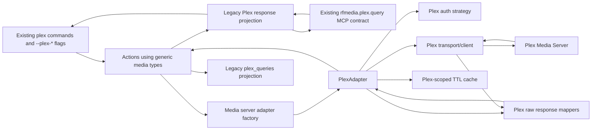

# Plex Adapter Refactor: Technical Research

## Executive Summary

Issue #119 is not complete on `origin/master`, even though issue #117 established a
`MediaServerAdapter` and migrated actions away from direct `lib/plex.ts` imports. The current
adapter is a forwarding shell: `types/media-server.ts` imports `PlexTrack`, `PlexQueryOptions`,
`PlexPlaylist`, `PlexCollection`, and `DbPlexQueryResult`; `PlexAdapter` delegates every operation
back to a 2,800-line `lib/plex.ts`; and action code still imports Plex entity types, Plex filter
types, Plex pagination, Plex rating conversion, and Plex metadata codes. The factory and action
helpers also resolve Plex config directly. A second adapter would therefore have to mimic Plex's
`ratingKey`, 0-10 rating scale, machine identifier, query shapes, and filter encoding instead of
implementing a server-neutral contract.

The refactor should finish the boundary in four layers:

1. Define server-neutral music entities, queries, pagination, feature descriptors, and normalized
   ratings in `types/media-server.ts`. Adapter consumers use `id` and normalized 0-1 ratings, never
   Plex `ratingKey`, metadata type codes, machine identifiers, or 0-10 values.
2. Make `PlexAdapter` the only public entry point to Plex HTTP behavior. Plex transport,
   authentication, cache keys/invalidation, raw response types, response mapping, URL construction,
   and native rating conversion live in private modules under `lib/adapters/plex/` and are imported
   only by `plex-adapter.ts`.
3. Move reusable filter and pagination behavior to provider-neutral modules. Keep the existing
   `plex`, `plexFilters`, `--plex-*`, JSON/MCP response fields, saved-query tables, and exported
   Plex-named action types as compatibility projections at the CLI/persistence edges.
4. Enforce the boundary with import checks and adapter contract tests. Tests must mock the adapter
   or its injected transport, not `lib/plex.ts` functions.

No database migration is required. The existing `plex_queries` and `plex_query_results` schema is a
user-visible compatibility artifact for `plex query list` and `plex copy query-results`; generic
entities can be mapped to and from those rows at the persistence edge. Likewise, no shell command,
option, or completion candidate needs to change. Bash, Zsh, and Fish templates should be verified
unchanged by their parity test rather than churned merely because internals were renamed.

Plex JWT migration should be handled as an authentication strategy seam, not by guessing an
undocumented refresh protocol. The current `plex.token` and `--plex-token` inputs continue to
produce `X-Plex-Token` authentication, but the transport receives credentials from an internal
`PlexAuthStrategy`. A bearer/JWT strategy can be added behind the same transport when the exact
Plex issuance and refresh contract is confirmed. All credentials move from query strings to
headers, all 401 responses become typed authentication errors, and no token, JWT, or authorization
header is ever logged or used in a cache key.

## Architecture Design

### Target boundary



The dependency rule is one-way:

```text
commands / MCP / actions
        -> generic MediaServerAdapter contract
        -> PlexAdapter
        -> private Plex auth, HTTP, cache, wire types, and mappers
```

Generic types and actions must not import from `types/plex.ts`, `lib/plex.ts`, `lib/plex-cache.ts`,
or `lib/adapters/plex/**`. Compatibility presenters and the legacy saved-query repository may use
Plex-named external field names, but they receive generic entities and must not call Plex APIs.

### Components

- `types/media-server.ts` owns the stable domain contract: media kinds, library/item/playlist/
  collection entities, normalized rating values, query options/results, operation results,
  capability methods, feature descriptors, and typed adapter errors.
- `types/media-filters.ts` owns the reusable filter AST currently named `PlexSmartFilter`. Its
  fields are already music-domain concepts (artist, album, title, genre, style, mood, year, play
  count, and ratings). The existing `plexFilters` config key remains an alias into this AST.
- `lib/media-filter-evaluator.ts` owns provider-neutral decomposition and client-side evaluation.
  It asks the adapter which filter operations can be pushed down and evaluates the residual AST on
  normalized entities. Plex query-parameter encoding is not in this module.
- `lib/pagination.ts` owns the existing defensive offset calculation. It operates on generic page
  metadata and does not mention Plex.
- `lib/adapters/index.ts` owns adapter selection and mode semantics. It consumes a normalized
  connection descriptor from a config resolver; it does not import Plex URL validation or Plex
  config types.
- `lib/adapters/plex-adapter.ts` implements the full contract. It composes private Plex modules,
  performs native/generic conversion, hides machine-identifier lookup inside collection writes,
  and owns feature declarations.
- `lib/adapters/plex/auth.ts` applies credentials to requests. The initial production strategy is
  `X-Plex-Token`; a bearer/JWT strategy can implement the same interface without changing actions.
- `lib/adapters/plex/client.ts` is the only Plex HTTP boundary. It constructs relative endpoints,
  adds common headers and timeouts, classifies HTTP/network failures, and returns validated raw
  payloads. It never returns `Response` objects to actions.
- `lib/adapters/plex/cache.ts` owns the per-process TTL cache. The cache is constructed per adapter
  instance (or explicitly injected), keys are server-scoped and credential-free, and write methods
  invalidate the appropriate library/playlist/collection entries.
- `lib/adapters/plex/mappers.ts` translates raw Plex payloads and numeric metadata codes into
  generic entities. It is also the only place that maps `ratingKey -> id` and native 0-10 ratings
  to normalized 0-1 values.
- `lib/adapters/plex/types.ts` contains private Plex config, endpoint payload, metadata-code, and
  credential types. These types are not re-exported from the package type index.
- `lib/plex-compat.ts` (if needed during the single PR) contains pure compatibility projections for
  legacy JSON/MCP and saved-query fields. It performs no network requests and should be named as a
  compatibility edge, not as the API client.

### Request data flow

1. Commander keeps parsing the existing `rfmedia plex ...` commands and existing `--plex-url` /
   `--plex-token` overrides.
2. The adapter factory resolves those legacy inputs plus `config.plex` into a private Plex
   connection descriptor. Required mode throws a typed configuration error; optional scan mode
   returns `undefined` and logs the existing warning semantics.
3. An action builds a generic query or operation. Ratings supplied as stars by the CLI are
   normalized before crossing the adapter boundary.
4. `PlexAdapter` validates the requested capability and translates the generic request to Plex
   endpoint input. Filter pushdown uses the adapter's declared filter support; residual filters are
   evaluated using generic entities.
5. The client obtains headers from `PlexAuthStrategy`, checks the Plex-scoped cache for eligible
   reads, performs the timed request, and maps failures to `MediaServerError`.
6. Raw payloads are validated and mapped to generic entities. Plex metadata type codes,
   `ratingKey`, `X-Plex-Container-*`, machine identifiers, and native rating values do not escape.
7. Actions perform copy, playlist, collection, scan, or sync orchestration using generic entities.
8. At user-facing Plex compatibility edges, generic entities are projected back to the established
   JSON/MCP/saved-query names and 0-10 `userRating` values. Text output remains byte-compatible in
   meaning because it continues to display 0-5 stars.

### Residual leaks found in the current code

- `types/media-server.ts` imports eleven Plex/DB types and exposes Plex query/result shapes directly.
- `MediaServerCollectionCapability.addItems()` requires a Plex machine identifier and rating keys.
- `MediaServerLibraryCapability.machineIdentifier()` exposes a Plex implementation detail.
- `MediaServerQueryCapability.trackFilePaths()` mixes server access with local filesystem checks
  and accepts `DbPlexQueryResult`.
- `PlexAdapter` contains no HTTP, auth, cache, parsing, or error logic; all methods call functions in
  `lib/plex.ts`.
- `lib/adapters/index.ts` and `action-helpers.ts` import Plex config, validation, path extraction,
  and loaded Plex state.
- `plex-query.ts`, `plex-playlist.ts`, `plex-collection.ts`, `plex-sync.ts`, `playlist.ts`, and
  `plex-copy.ts` still consume Plex entity and filter types.
- `plex-playlist.ts`, `plex-collection.ts`, and `plex-sync.ts` import Plex-named pagination or filter
  helpers and duplicate small adapter forwarding functions.
- `plex-sync.ts` explicitly calls `normalizedToPlex()` / `plexToNormalized()` and writes native
  Plex ratings through the generic metadata capability.
- `commands/plex.ts` and the MCP schemas depend on `ratingKey` and `userRating`. These are deliberate
  compatibility surfaces and need projection, not silent schema changes.
- `scripts/check-direct-plex-imports.mjs` only catches the exact string `../lib/plex.js` in thirteen
  named actions. It permits Plex type, cache, filter, pagination, adapter-internal, command, and MCP
  leaks.

## Data Models/type contracts

### Generic media entities

The generic contract should use structural domain types. A normalized rating is either `null`
(unrated) or a finite number in the closed interval 0-1. Runtime validation occurs at adapter
mapping and metadata-write entry points; a TypeScript alias alone cannot enforce the range.

```typescript
export type MediaServerType = "plex";
export type MediaKind = "track" | "album" | "artist";
export type NormalizedMediaRating = number;

export interface MediaEntityBase {
  id: string;
  kind: MediaKind;
  title: string;
  rating: NormalizedMediaRating | null;
  year?: number;
  genres?: readonly string[];
  styles?: readonly string[];
  moods?: readonly string[];
}

export interface MediaTrack extends MediaEntityBase {
  kind: "track";
  artist: string;
  album: string;
  playCount: number;
  durationMs: number;
  filePath: string;
}

export interface MediaAlbum extends MediaEntityBase {
  kind: "album";
  artist: string;
  trackCount: number;
  artworkPath?: string;
}

export interface MediaArtist extends MediaEntityBase {
  kind: "artist";
  albumCount: number;
  artworkPath?: string;
}

export type MediaItem = MediaTrack | MediaAlbum | MediaArtist;
```

Use a discriminated union rather than optional fields on one broad record. This retains exhaustive
handling in query, collection, formatter, and persistence code and prevents a track-only `filePath`
from being assumed on albums or artists.

### Queries and pages

The current filter fields are not inherently Plex-specific, but Plex parameter encoding is. Keep
the established 0-5 star inputs at the command compatibility layer and convert them to normalized
ratings before creating a generic request.

```typescript
export interface MediaQueryOptions {
  library: string;
  kind: MediaKind;
  filter?: MediaFilterExpression;
  limit?: number;
  offset?: number;
}

export interface MediaPage<T extends MediaItem> {
  readonly items: readonly T[];
  total: number;
  offset: number;
  returned: number;
  hasMore: boolean;
}

export interface MediaServerQueryCapability {
  tracks(options: MediaQueryOptions & { kind: "track" }): Promise<MediaPage<MediaTrack>>;
  albums(options: MediaQueryOptions & { kind: "album" }): Promise<MediaPage<MediaAlbum>>;
  artists(options: MediaQueryOptions & { kind: "artist" }): Promise<MediaPage<MediaArtist>>;
  albumTracks(albumId: string): Promise<readonly MediaTrack[]>;
}
```

`pageItemCount` becomes required generic `returned`; the Plex mapper derives it from the raw page
before any residual client-side filtering. The shared offset helper advances by `returned` and
fails closed if a server claims `hasMore` with no forward progress.

### Playlists, collections, scans, and metadata

```typescript
export interface MediaPlaylist {
  id: string;
  title: string;
  smart: boolean;
  itemCount: number;
  durationMs: number;
  createdAt?: number;
  updatedAt?: number;
}

export interface MediaCollection {
  id: string;
  title: string;
  kind: MediaKind;
  itemCount: number;
  smart: boolean;
}

export interface MediaServerPlaylistCapability {
  list(): Promise<readonly MediaPlaylist[]>;
  byName(name: string): Promise<MediaPlaylist>;
  delete(id: string): Promise<void>;
  tracks(id: string): Promise<readonly MediaTrack[]>;
  create(name: string, options?: { smart?: boolean }): Promise<MediaPlaylist>;
  addTracks(id: string, trackIds: readonly string[]): Promise<void>;
}

export interface MediaServerCollectionCapability {
  list(libraryId: string): Promise<readonly MediaCollection[]>;
  get(id: string): Promise<MediaCollection>;
  byName(libraryId: string, name: string): Promise<MediaCollection>;
  items(id: string): Promise<readonly MediaItem[]>;
  create(libraryId: string, input: { title: string; kind: MediaKind }): Promise<MediaCollection>;
  addItems(id: string, itemIds: readonly string[]): Promise<void>;
  delete(id: string): Promise<void>;
}

export interface MediaServerMetadataCapability {
  updateTrackRating(trackId: string, rating: NormalizedMediaRating | null): Promise<MediaServerRatingUpdateResult>;
}
```

`PlexAdapter.collection.addItems()` obtains/caches the machine identifier and constructs the Plex
server URI internally. The library capability no longer exposes `machineIdentifier()`. Local file
existence checks are not a media-server capability; a generic `extractMediaFilePaths()` helper
accepts `readonly { filePath: string }[]` (plus legacy DB rows through a small persistence mapper)
and remains in the filesystem/action layer.

Scan and rating-update result objects retain current success/message/status semantics to avoid
changing action control flow. Query and CRUD operations continue to throw typed errors.

### Capabilities and provider features

Coarse method flags remain useful, but provider-specific behavior needs explicit descriptors:

```typescript
export interface MediaServerFeatures {
  ratings: {
    readable: boolean;
    writable: boolean;
    normalized: true;
    nativeScale: { min: number; max: number; step: number };
  };
  smartPlaylists: boolean;
  smartCollections: boolean;
  sonicAnalysis: "available" | "unavailable" | "server-dependent";
  filterPushdown: ReadonlySet<MediaFilterOperator>;
}

export interface MediaServerAdapter {
  readonly type: MediaServerType;
  readonly capabilities: MediaServerCapabilities;
  readonly features: MediaServerFeatures;
  // grouped capabilities
}
```

For Plex, the native rating descriptor is `{ min: 0, max: 10, step: 1 }`, while every method still
accepts/returns normalized values. Sonic Analysis is `server-dependent` because availability can
depend on server/library/Plex Pass state and the current code has no Sonic endpoint. Do not claim
an executable Sonic capability until an operation exists; consumers can display or gate a future
feature without hard-coding `adapter.type === "plex"`.

### Plex-private types and compatibility projections

Raw `MediaContainer`, metadata type codes `8 | 9 | 10`, Plex library mappings, connection config,
cache categories, auth credentials, and raw playlist/collection records belong in
`lib/adapters/plex/types.ts`. They must not be exported through `types/index.ts`.

Existing public/internal imports of names such as `PlexQueryOptions`, `PlexQueryResult`,
`PlexTrack`, `PlexPlaylist`, and `PlexCollection` should migrate to generic types. To avoid a
breaking package-type change in the same release, `types/plex.ts` may retain deprecated aliases and
the Plex command's action-option/result types. Runtime actions must not consume those aliases;
only the legacy command/MCP/persistence projections do. A later semver-major release can remove the
aliases after downstream usage is measured.

The existing SQLite schema remains unchanged:

- `rating_key` continues to store the Plex item ID.
- `user_rating` continues to store Plex's native 0-10 value.
- `media_type` continues to store `track | album | artist`.
- table and function names such as `plex_queries`, `DbPlexQueryResult`, and `getPlexQueryResults`
  remain for compatibility.

Projection functions explicitly convert `id <-> rating_key` and normalized `rating <->
user_rating`. This avoids a migration and prevents an accidental change in saved-query or machine
output semantics.

## API Design/interface contracts and errors

### Adapter construction

The factory should receive a normalized, discriminated connection request and delegate
provider-specific parsing to a registered builder:

```typescript
export interface MediaServerAdapterOverrides {
  server?: MediaServerType;
  plexUrl?: string; // compatibility input
  plexToken?: string; // compatibility input
  plexLibrary?: string; // compatibility input
  plexScan?: boolean; // compatibility input
  plexPerSource?: boolean;
}

interface AdapterRegistration {
  type: MediaServerType;
  resolve(options: CreateMediaServerAdapterOptions): AdapterResolution;
  create(connection: AdapterConnection): MediaServerAdapter;
}
```

The public override names remain unchanged because they are CLI compatibility inputs. Plex config
resolution and validation move into the Plex registration, so the generic factory has no import of
`PlexConfig`, `isValidPlexUrl()`, or `getLoadedPlexConfig()`. Optional mode retains the established
scan gating and warning. Required mode retains the established missing/invalid credential failure,
but throws a typed error whose user formatter preserves the current actionable text.

### Authentication and JWT migration seam

```typescript
interface PlexAuthStrategy {
  readonly kind: "x-plex-token" | "bearer";
  apply(headers: Headers): Promise<void>;
  handleUnauthorized?(response: Response): Promise<"retry" | "fail">;
}
```

- Existing `plex.token` / `--plex-token` instantiate `X-Plex-Token` auth and keep working without
  config changes.
- Authentication is sent as a request header, not a query parameter. This reduces token exposure
  in debug logs, exception URLs, proxies, and cache keys while remaining supported by Plex.
- A future/pre-issued JWT can use `Authorization: Bearer ...` through the same strategy. Automatic
  JWT acquisition/refresh is not implemented until Plex's actual issuer, audience, refresh, and
  expiry behavior is specified and test fixtures exist.
- A 401 may trigger at most one strategy-controlled refresh/retry. The legacy token strategy never
  retries. Repeated 401s fail as `authentication` and cannot loop.
- Auth material is never included in `MediaServerError`, debug messages, response projections,
  cache keys, or test snapshots.

If acceptance requires user-configurable bearer credentials now, add an optional `plex.auth`
object while retaining `plex.token` as the default compatibility path. Do not add a new CLI flag in
this issue unless a concrete JWT workflow is known; avoiding speculative flags also means shell
completion templates remain unchanged.

### Transport contract

The Plex client should expose typed endpoint methods or one private request primitive whose path is
always relative to the configured base URL. It owns timeout and response parsing:

```typescript
interface PlexRequestOptions {
  method?: "GET" | "POST" | "PUT" | "DELETE";
  query?: Readonly<Record<string, string | number | boolean | undefined>>;
  headers?: Readonly<Record<string, string>>;
  signal?: AbortSignal;
}

interface PlexTransport {
  request<T>(path: string, options?: PlexRequestOptions): Promise<T>;
}
```

All query parameters are assembled through `URL` / `URLSearchParams`. Item IDs, collection IDs,
playlist IDs, library IDs, and scan paths are encoded at their correct path/query position. Common
headers include JSON accept plus authentication. The existing 30-second timeout remains the
default and is composed with a caller signal. The current 100 ms request pacing remains private to
Plex; cache hits skip it. Do not add broad automatic retries for mutations.

### Error model

```typescript
export type MediaServerErrorCode =
  | "configuration"
  | "authentication"
  | "authorization"
  | "not-found"
  | "unsupported"
  | "rate-limited"
  | "timeout"
  | "network"
  | "invalid-response"
  | "request-failed";

export class MediaServerError extends Error {
  readonly code: MediaServerErrorCode;
  readonly serverType: MediaServerType;
  readonly operation: string;
  readonly statusCode?: number;
  readonly retryable: boolean;
  override readonly cause?: unknown;
}
```

Mapping rules:

- Missing/invalid config: `configuration`, not retryable.
- HTTP 401: `authentication`, not retryable unless an auth strategy successfully refreshes once.
- HTTP 403: `authorization`, not retryable.
- HTTP 404: `not-found`, not retryable.
- HTTP 429: `rate-limited`, retryable metadata may be true, but this issue need not automatically
  replay mutations.
- Timeout/abort: distinguish caller cancellation from transport timeout; timeout is retryable for
  reads, caller cancellation is propagated.
- Non-JSON or structurally invalid payload: `invalid-response` with no raw response body in the
  user message.
- Other HTTP/network failures: `request-failed` / `network` with status and operation context.

The error formatter may preserve familiar Plex wording at the CLI edge (for example, “check your
Plex token”) while actions and future adapters branch on codes, never substrings. Scan and rating
update methods may catch a `MediaServerError` and return the existing result object to preserve
their established non-throwing contract; all other methods throw.

### Cache contract

The cache remains Plex-specific and per process. Its public API is private to the adapter:

```typescript
interface PlexCache {
  get<T>(category: PlexCacheCategory, discriminator?: string): T | undefined;
  set<T>(category: PlexCacheCategory, value: T, discriminator?: string): void;
  invalidate(category: PlexCacheCategory): void;
  clear(): void;
}
```

Keys include normalized base URL, category, and non-secret discriminator. They never include token,
JWT, authorization header, or full request URL. Reads cache libraries, playlists, collections, and
machine identifier with the configured TTL. Playlist/collection writes invalidate their category;
rating writes invalidate affected query/item entries if those reads are cached. Cache enablement
and TTL are captured when constructing the adapter instead of consulting global loaded config on
every get/set. Tests use an injected clock and isolated cache instance, eliminating global cache
cross-talk.

## System Constraints

- Node.js 22+, ESM `.js` imports, TypeScript strictness, Commander 14, and Vitest remain unchanged.
- There is no network SDK dependency. Native `fetch`, `URL`, `Headers`, `AbortSignal`, and runtime
  payload guards are sufficient.
- The user-facing command tree remains `rfmedia plex query|copy|playlist|collection|sync`; no alias
  is removed or renamed.
- Existing config keys (`plex`, `plexFilters`, `plex.token`, cache, library mappings, scan defaults)
  and all `--plex-*` flags remain accepted with the same precedence.
- Existing text behavior, JSON field names, MCP tool name/schema, exit behavior, and 0-10
  `userRating` representation remain compatible. Internal normalized ratings must be projected back
  at these edges.
- Saved Plex queries remain readable without a schema migration. Do not rename/drop tables or
  reinterpret existing `user_rating` values.
- Plex-specific config and compatibility surfaces are allowed to say Plex. The architectural rule
  applies to domain/action dependencies and provider internals, not to intentionally Plex-branded
  UX.
- The adapter must not expose native machine IDs, metadata codes, rating keys, raw endpoint URLs,
  response container shapes, token placement, or cache implementation.
- Collection URI construction and machine-ID lookup remain atomic adapter behavior. Actions pass
  item IDs only.
- Ratings crossing the generic boundary are normalized 0-1 or `null`; the Plex adapter alone owns
  conversion to/from 0-10. Invalid, NaN, or out-of-range values fail before a network request.
- `filePath` is server-returned data but existence/allowed-root validation is a local action concern.
  The adapter must not import filesystem helpers.
- Current Plex local/private URLs are legitimate self-hosting targets. Retain format validation for
  CLI/config inputs; do not silently apply the existing public-only SSRF helper to ordinary local
  CLI use. MCP/network-exposed callers may continue enforcing their stricter boundary separately.
- Read caching cannot change pagination totals, result ordering, or residual filter behavior.
- Mutation methods are not retried automatically because duplicate playlist/collection writes can
  be non-idempotent.
- A feature descriptor reports support; it does not authorize an action to call a method whose
  coarse capability is false.
- Graphify output is absent in this worktree, so the implementation must run `graphify update .`
  after code changes as required by repository guidance and verify the generated graph without
  treating generated-file dirtiness as a blocker.

## Exact Codebase Changes

### Create

- `packages/rfmedia-cli/src/types/media-filters.ts` — provider-neutral filter AST and guards,
  retaining compatibility aliases from `types/plex-filters.ts`.
- `packages/rfmedia-cli/src/lib/media-filter-evaluator.ts` — generic filter decomposition and
  residual evaluation over normalized media entities.
- `packages/rfmedia-cli/src/lib/pagination.ts` — provider-neutral forward-progress calculation.
- `packages/rfmedia-cli/src/lib/media-file-paths.ts` — local extraction/existence validation for
  records with a `filePath`; no adapter or Plex imports.
- `packages/rfmedia-cli/src/lib/adapters/plex/auth.ts` — `X-Plex-Token` strategy and bearer/JWT
  strategy seam with redaction-safe behavior.
- `packages/rfmedia-cli/src/lib/adapters/plex/client.ts` — authenticated Plex HTTP transport,
  timeout handling, response validation, and error mapping.
- `packages/rfmedia-cli/src/lib/adapters/plex/cache.ts` — isolated TTL cache with injected clock,
  server-scoped secret-free keys, and category invalidation.
- `packages/rfmedia-cli/src/lib/adapters/plex/mappers.ts` — raw Plex-to-generic entity conversion,
  metadata-code mapping, and normalized rating conversion.
- `packages/rfmedia-cli/src/lib/adapters/plex/types.ts` — private Plex config, auth, endpoint,
  response, and metadata-code types.
- `packages/rfmedia-cli/src/lib/adapters/plex/client.test.ts` — headers, token redaction, timeout,
  status/error mapping, encoding, malformed payload, and single auth-retry tests.
- `packages/rfmedia-cli/src/lib/adapters/plex/cache.test.ts` — TTL, disabled mode, per-server scope,
  credential-free keys, invalidation, and isolated-instance tests.
- `packages/rfmedia-cli/src/lib/adapters/plex/mappers.test.ts` — every entity mapping, missing fields,
  unknown metadata codes, and rating round-trip tests.

### Modify

- `packages/rfmedia-cli/src/types/media-server.ts` — remove all Plex/DB imports; add generic entities,
  pages, normalized ratings, feature descriptors, error codes, and corrected capability signatures.
- `packages/rfmedia-cli/src/types/plex.ts` — retain only Plex command/action compatibility types and
  deprecated aliases; remove runtime domain ownership and raw API shapes.
- `packages/rfmedia-cli/src/types/plex-filters.ts` — become compatibility aliases/re-exports for
  `media-filters.ts`; no implementation should import it.
- `packages/rfmedia-cli/src/types/index.ts` — export generic contracts and compatibility aliases
  deliberately; do not export adapter-private Plex wire types.
- `packages/rfmedia-cli/src/lib/adapters/plex-adapter.ts` — replace forwarding calls with the full
  adapter implementation composed from private auth/client/cache/mappers; hide native IDs/scales.
- `packages/rfmedia-cli/src/lib/adapters/index.ts` — introduce provider registration/config
  resolution, remove direct `lib/plex.ts` imports, and preserve required/optional mode semantics.
- `packages/rfmedia-cli/src/lib/adapters/action-helpers.ts` — remove Plex config, DB, entity, and
  `lib/plex.ts` imports; delegate factory resolution and generic local path extraction only.
- `packages/rfmedia-cli/src/lib/adapters/plex-adapter.test.ts` — assert the generic contract,
  feature descriptors, hidden machine-ID behavior, normalized ratings, config precedence, and
  required/optional factory behavior using injected transport rather than mocked `plex.ts` exports.
- `packages/rfmedia-cli/src/actions/plex-query.ts` — use generic queries/entities/pages and generic
  filter evaluator; map to legacy saved-query/result contracts only at persistence/return edges.
- `packages/rfmedia-cli/src/actions/plex-copy.ts` — consume generic tracks/path helper while keeping
  public Plex copy option/result names and saved-query compatibility.
- `packages/rfmedia-cli/src/actions/plex-playlist.ts` — remove local adapter forwarding wrappers and
  Plex entity/filter/pagination imports; call generic capabilities directly.
- `packages/rfmedia-cli/src/actions/plex-collection.ts` — remove metadata-code and machine-ID logic;
  pass generic kinds and item IDs to the adapter.
- `packages/rfmedia-cli/src/actions/plex-sync.ts` — remove Plex rating conversions; compare and write
  normalized ratings through the adapter.
- `packages/rfmedia-cli/src/actions/playlist.ts` — use `MediaTrack` / `MediaPlaylist`; retain the
  `--plex-playlist` compatibility option and user messages.
- `packages/rfmedia-cli/src/actions/*-adapter.mock.ts` and
  `packages/rfmedia-cli/src/actions/test-helpers/media-server-*.ts` — build generic fixtures/mocks
  with `id`, `rating`, feature descriptors, and corrected collection signatures.
- Corresponding action tests (`plex-query.test.ts`, `plex-copy.test.ts`, `plex-playlist.test.ts`,
  `plex-collection.test.ts`, `plex-sync.test.ts`, `playlist-adapter.test.ts`, and `playlist.test.ts`)
  — prove actions depend only on the adapter and preserve established outward results.
- `packages/rfmedia-cli/src/commands/plex.ts` — format generic internal results through an explicit
  Plex compatibility presenter; preserve command names, options, messages, and machine fields.
- `packages/rfmedia-cli/src/commands/plex.test.ts` — lock CLI compatibility, especially option
  parsing, 0-5 display, and 0-10 JSON values.
- `packages/rfmedia-cli/src/mcp/schema.ts`, `mcp/adapters.ts`, and their tests — keep the existing
  `rfmedia.plex.query` schema and field names while adapting generic action results explicitly.
- `packages/rfmedia-cli/src/lib/config.ts`, `types/config.ts`, and config tests — keep existing Plex
  config valid, move provider construction behind the factory, and add only an optional auth block
  if concrete JWT/bearer acceptance is required.
- `packages/rfmedia-cli/scripts/check-direct-plex-imports.mjs` — scan all action, command, MCP,
  generic type, and generic helper files; reject imports from old Plex API/cache/filter/pagination
  modules or adapter-private Plex modules, with a narrow compatibility allowlist.
- `packages/rfmedia-cli/package.json` and root package scripts if applicable — run the boundary
  checker in the normal rfmedia validation/CI path rather than as an undocumented manual command.
- `packages/rfmedia-cli/docs/features/media-server-adapter.md` — document the completed boundary,
  normalized rating contract, feature descriptors, auth/cache ownership, import rules, and test
  pattern.
- `packages/rfmedia-cli/docs/features/plex-configuration.md` and
  `packages/rfmedia-cli/docs/features/plex-api-caching.md` — document header-based auth, legacy
  config compatibility, cache scope/invalidation, and JWT seam without claiming unsupported refresh.
- `packages/rfmedia-cli/README.md` — retain existing commands and add the implementation boundary
  reference; no migration steps should be needed for users.
- `ROADMAP.md` — mark #119 complete in Sprint 3 and the medium-priority backlog, state that it
  unblocks #193/#194/#197, and add the final PR link after the PR exists.

### Delete after all callers migrate

- `packages/rfmedia-cli/src/lib/plex.ts` — its HTTP/query/playlist/collection/scan logic moves under
  the adapter; retaining it would preserve the bypass path issue #119 is intended to remove.
- `packages/rfmedia-cli/src/lib/plex-cache.ts` — replaced by adapter-owned cache.
- `packages/rfmedia-cli/src/lib/plex-filter-evaluator.ts` — replaced by generic filter evaluator
  plus Plex pushdown inside the adapter.
- `packages/rfmedia-cli/src/lib/plex-pagination.ts` — replaced by generic pagination helper.
- Their old unit tests — migrate coverage to adapter client/cache/mapper and generic helper tests;
  do not simply drop behavioral cases.

No changes are required to `lib/schema.sql` or migration code. No Bash/Zsh/Fish candidate changes
are required because this design adds no command, subcommand, or flag. Run
`src/lib/shell-completions/templates.spec.ts` and inspect all three generated templates as explicit
completion evidence. If implementation chooses to expose a new auth flag despite the recommendation
above, then all three templates and the parity test become mandatory changes.

## Technical Decisions with alternatives/rationale

| Decision                                                    | Alternative                                                   | Rationale                                                                                                                                                                              |
| ----------------------------------------------------------- | ------------------------------------------------------------- | -------------------------------------------------------------------------------------------------------------------------------------------------------------------------------------- |
| Generic entities use `id` and normalized 0-1 ratings        | Keep `ratingKey` and 0-10 values in `MediaServerAdapter`      | The current names/scales force every future adapter to imitate Plex. Normalization already exists in the file-rating subsystem and makes sync provider-independent.                    |
| Split private Plex implementation under `adapters/plex/`    | Put another 2,800 lines directly in `plex-adapter.ts`         | The adapter remains the only public boundary while auth, transport, cache, mapping, and wire types stay independently testable and cohesively private.                                 |
| Delete `lib/plex.ts` after migration                        | Keep it as a permanent compatibility facade                   | It is not a documented user API, and a callable facade remains an architectural bypass. Compatibility belongs at CLI/MCP/DB projections, not at the network layer.                     |
| Preserve Plex-branded commands/config/output                | Rename to `server`/`media` immediately                        | Issue #119 explicitly forbids user-facing breakage. Provider-neutral internals can coexist with established Plex UX until a multi-server command design is approved.                   |
| Keep legacy saved-query schema                              | Rename tables/columns to generic names                        | A migration adds risk without improving the runtime boundary. Explicit projections isolate legacy storage now; a future multi-provider persistence design can version it deliberately. |
| Hide machine identifier inside collection writes            | Keep it on the library capability                             | Machine identifiers and Plex server URIs are protocol mechanics, not media-domain concepts. The adapter has all information needed to construct them.                                  |
| Move file existence checks out of the adapter               | Keep `trackFilePaths()` in query capability                   | Filesystem validation is local orchestration and also applies to saved rows. Removing it keeps adapters focused on remote server behavior.                                             |
| Normalize filter AST/evaluator but keep `plexFilters` alias | Leave all filter types Plex-named                             | The filter language is largely provider-neutral; only endpoint pushdown encoding is Plex-specific. The config key must remain for compatibility.                                       |
| Header-based token auth                                     | Keep `X-Plex-Token` in every URL                              | Headers reduce secret leakage into URLs/logs/cache keys and centralize auth for later bearer/JWT support.                                                                              |
| Add an auth strategy seam without inventing refresh         | Implement guessed JWT login/refresh now                       | The issue provides no issuer, refresh endpoint, or credential lifecycle. A correct seam plus typed 401 behavior is migration-ready; speculative auth can lock in an unsafe contract.   |
| Typed adapter errors                                        | Continue matching Plex error strings                          | Error codes support future providers and reliable action behavior while formatters can retain familiar Plex-specific guidance.                                                         |
| Per-adapter cache instance with captured config             | Continue global cache reading global config on each operation | Instance ownership prevents cross-test/server contamination, makes TTL deterministic, and ensures credentials never affect identity.                                                   |
| Expand automated boundary enforcement                       | Keep the current thirteen-file regex                          | The current checker misses the actual remaining leaks. Whole-layer import rules prevent regression and make completion measurable.                                                     |
| No shell completion edits                                   | Mechanically touch all three templates                        | Internal refactoring changes no completion candidate. The correct evidence is the existing cross-shell template test; template churn would be misleading.                              |
| No database schema change                                   | Generalize persistence as part of #119                        | The requested boundary can be completed with projections. A new server adapter can drive a separately designed storage version when real requirements exist.                           |

## Open Questions

1. Does issue #119 require an immediately user-configurable bearer/JWT credential, or only a safe
   migration seam? If immediate support is required, the Plex issuer, acquisition endpoint,
   audience, expiry, refresh flow, and revocation behavior must be confirmed before implementation;
   this is a suitable child issue if the contract cannot be verified within #119.
2. Is `types/index.ts` treated as a semver-stable programmatic API for external TypeScript users?
   If yes, keep deprecated Plex aliases for at least one release and add compile-only compatibility
   tests. If no, aliases can be reduced more aggressively while runtime CLI/MCP compatibility is
   still preserved.
3. Should Sonic Analysis be merely described as `server-dependent`, or should #119 add a real probe
   and operation? The current repository has no Sonic endpoint or user workflow. A probe without a
   consumer provides little value and may require Plex Pass fixtures, so an executable feature is
   better as a focused child issue.
4. Should future multi-server config use the issue #117 proposal `server: { type, ... }` or continue
   provider-specific top-level sections? #119 should not introduce a second config source without
   #118's concrete OpenSubsonic requirements; the factory registration seam is enough now.
5. Are the `plex_queries` tables intended to store results from future providers? If yes, a later
   schema version needs a `server_type` and generic item ID/rating representation. Reinterpreting
   existing rows in #119 would be unsafe and is not required to complete the adapter boundary.
6. Does machine JSON compatibility include undocumented TypeScript export names as well as emitted
   field values? The implementation and review should explicitly snapshot current CLI and MCP
   output before refactoring so the answer is evidence-based.
7. Should the repository boundary check permit `commands/plex.ts` to import deprecated Plex aliases,
   or should all compatibility mapping be isolated in one presenter module? A single presenter is
   architecturally cleaner and produces a narrower, auditable allowlist.
8. The worktree currently has no `graphify-out/graph.json`. Should the implementation generate a new
   graph in this branch, or is graph output intentionally excluded from this worktree? Repository
   guidance requires `graphify update .` after code modifications, so this should be resolved before
   final staging rather than silently skipped.
