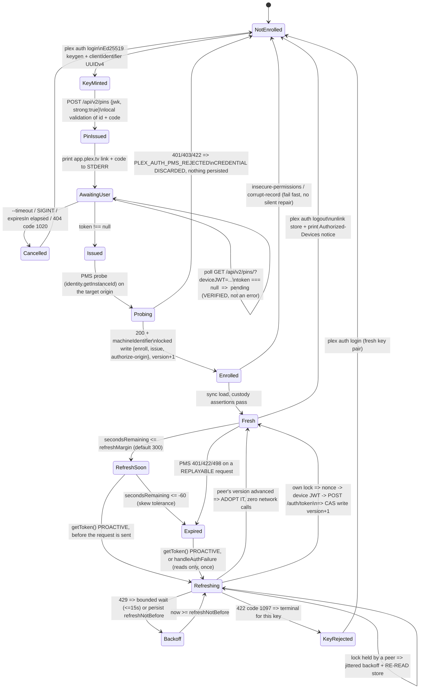

# Design — Plex JWT enrollment and refresh lifecycle (#251)

**Status:** authoritative design, ready for decomposition.
**Base:** `security` candidate (3/3 judge verdicts), with every `mustGraft` item incorporated and every `fatalFlaw` resolved.
**Worktree:** `/home/yandy/Projects/github.com/yandy-r/rfmedia-apps/.claude/worktrees/rfmedia-apps-plex-jwt-251`
All paths are relative to `packages/rfmedia-cli/` unless stated otherwise.

---

## 1. Thesis

The hard problems in #251 are not protocol nuance. They are **two `rfmedia` processes racing on one credential file**, **a secret escaping into a string**, and **a wire format we have never observed being wrong in the field with no way to tell**. This design attacks all three structurally.

- **Custody by construction.** The Ed25519 private key and the JWT live in a single atomically-replaced, version-stamped, owner-only document, guarded by the repo's already-hardened `link()`-based inter-process lock. Refresh is single-flight _across processes_: a process that loses the lock re-reads and adopts the winner's credential instead of burning one of the ten nonces available per five minutes.
- **Origin binding by construction, not by re-implementation.** Both the static and the rotating provider terminate in the **same** `getPlexConnectionToken()` call. #119's SEC-001 guard cannot evaporate through a new door, because there is still only one door.
- **Protocol honesty by quarantine.** Every unverified Plex wire detail — the token-endpoint success field name, the absence of a lifetime field, the pin-exchange nonce question, HTTP 498, duplicate-thumbprint behaviour — lives in one IO-free module, `plex/jwt-wire.ts`, annotated with the 2026-07-28 probe date and per-item `U1..U5` markers. A protocol correction is a one-file diff plus one fixture. When a guess turns out wrong, the error carries the **response key names** (never values, bounded and charset-filtered) so a maintainer can fix it from a bug report.
- **Deliberate non-changes.** `getToken()` still returns `Promise<string>`; the PMS header set stays exactly `{Accept, X-Plex-Token}`; `buildRequestUrl`'s `serializedValue === token` leak guard at `client.ts:160` is untouched. Those three restraints eliminate the highest-severity regressions available in this change.

Enrollment is the means to that end and lives behind its own single-`fetch` boundary module that never sees the PMS credential and never puts a server-supplied byte into a message or a terminal.

---

## 2. Scope decision

### Verified vs. provisional (stated plainly, up front)

| Item                                                                                                                                   | Status                                                                 | Evidence                                                                                         |
| -------------------------------------------------------------------------------------------------------------------------------------- | ---------------------------------------------------------------------- | ------------------------------------------------------------------------------------------------ |
| `POST clients.plex.tv/api/v2/pins` with `{jwk, strong:true}` → `201 {id, code, expiresIn, authToken:null, …}`                          | **VERIFIED** (live, 2026-07-28)                                        | Real Ed25519 JWK accepted; `strong:true` → 25-char code, `expiresIn:1800`                        |
| `GET /api/v2/pins/<id>?deviceJWT=…`; `authToken === null` means _not yet claimed_, not an error                                        | **VERIFIED** (live)                                                    | `404 code 1020` for unknown pin                                                                  |
| `GET /api/v2/auth/nonce` → `200 {"nonce":"<uuidv4>"}`; missing client id → `422 code 1008`                                             | **VERIFIED** (live)                                                    |                                                                                                  |
| Rate limit: `x-ratelimit-limit: 10`, `x-ratelimit-period: 300`, `retry-after: 287`, **IP-scoped**                                      | **VERIFIED** (live, limiter actually tripped)                          | Budget shared across distinct `X-Plex-Client-Identifier` values                                  |
| Two coexisting error envelopes: `{"errors":[{code,message,status}]}` and `{"error":"…"}`                                               | **VERIFIED** (live)                                                    |                                                                                                  |
| JWTs travel in `X-Plex-Token`, not `Authorization: Bearer`                                                                             | **VERIFIED** (doc, explicit, with a `:32400/library/sections` example) |                                                                                                  |
| Node ≥22 `node:crypto` Ed25519 emits RFC 8037 §3.1 raw 64-byte signatures; RFC 7638 thumbprint reproduces the RFC's own worked example | **VERIFIED** (executed on v22.22.2 and v25.9.0)                        |                                                                                                  |
| **U1** — success body of `POST /api/v2/auth/token`. Doc says `auth_token`; sibling pins endpoint uses `authToken`. One is a typo.      | **UNVERIFIED — never observed**                                        | Requires a claimed JWK + a real account                                                          |
| **U2** — whether a lifetime/`expires_in` field is returned at all                                                                      | **UNVERIFIED — never observed**                                        | Doc states "7 days" in prose only                                                                |
| **U3** — whether the pin-exchange `deviceJWT` requires a `nonce` claim                                                                 | **UNVERIFIED**                                                         | A 200 against an unclaimed PIN proves nothing                                                    |
| **U4** — HTTP 498                                                                                                                      | **UNVERIFIED — never emitted by any reachable path**                   | Every auth failure observed was 401 or 422                                                       |
| **U5** — duplicate-thumbprint / key-rotation behaviour                                                                                 | **UNVERIFIED**                                                         | Identical JWK accepted `201` three times; `422 "Thumbprint Already Taken"` fires somewhere later |
| **U6** — whether a plex.tv-issued JWT is accepted by a PMS                                                                             | **UNVERIFIED — the doc contradicts itself on the same page**           | Resolved at runtime by probe (see below), never guessed                                          |
| Server-side device revocation endpoint                                                                                                 | **DOES NOT EXIST** in any documented client-callable form              | Only the plex.tv Authorized Devices UI                                                           |

**No invented endpoint path appears anywhere in this design.** Every path is one of the six live-probed URLs above.

### In scope

1. PIN + JWK enrollment (Option 1) — `rfmedia plex auth login`.
2. Per-install stable `clientIdentifier` (random UUIDv4, persisted), replacing the hardcoded `PLEX_CLIENT_IDENTIFIER = "rfmedia-cli"` at `plex-adapter.ts:17`.
3. Ed25519 keygen, RFC 7638 `kid`, compact-JWS EdDSA signing, `node:crypto` only.
4. Owner-only, atomically-replaced, version-stamped credential store with an inter-process lock.
5. **Verify-before-persist:** probe the configured PMS origin with the new credential and refuse to record it as usable if the probe rejects it. This is how **U6** is answered — empirically, per install.
6. `PlexJwtTokenProvider`: proactive expiry refresh, in-process + cross-process single-flight, bounded reactive `handleAuthFailure`, cancellation.
7. `Retry-After`: parsed on both paths; bounded wait ≤15 s, cooperative persisted backoff above that.
8. Explicit `replayable` discriminator replacing the GET heuristic for the three scan triggers.
9. `plex auth {login,status,refresh,logout}` + all three completion templates.
10. `plex.auth` config block, precedence resolver, migration/rollback docs, ROADMAP update.

### Out of scope — each deferral gets a durable artifact

| Deferred                                                                                                                                                    | Reason                                                                                                                                                                                           | Artifact                                                                                                                                                                                                                                           |
| ----------------------------------------------------------------------------------------------------------------------------------------------------------- | ------------------------------------------------------------------------------------------------------------------------------------------------------------------------------------------------ | -------------------------------------------------------------------------------------------------------------------------------------------------------------------------------------------------------------------------------------------------- |
| **Server-side revocation**                                                                                                                                  | No client-callable endpoint exists (verified).                                                                                                                                                   | `revokeDevice?()` **declared and deliberately unimplemented** on `PlexAccountProtocol`; `serverSideRevocation: "manual"` in the logout JSON envelope; ADR entry; follow-up issue _"Plex device revocation endpoint (blocked: no documented API)"_. |
| **Enrollment Option 2** (`POST /api/v2/auth/jwk` with a legacy token)                                                                                       | Plex documents _"Your legacy token will expire after this process."_ That destroys the rollback credential and makes migration one-way.                                                          | `registerJwkWithLegacyToken?()` declared and unimplemented; ADR entry _"rejected: one-way; use Option 1 fresh PIN"_.                                                                                                                               |
| **Per-server `accessToken` exchange via `GET /api/v2/resources`**                                                                                           | Only needed if **U6** turns out false. The probe tells us empirically, per install.                                                                                                              | Named optional protocol member `exchangeServerAccessToken?()`; the probe's failure error names it as the known remedy; follow-up issue.                                                                                                            |
| **RS256**                                                                                                                                                   | No RSA JWK example published; untested.                                                                                                                                                          | `jwt.ts` throws `TypeError` on any `alg !== "EdDSA"`. `jose` adoption trip-wires written into `jwt.ts`'s header JSDoc.                                                                                                                             |
| **`Authorization: Bearer`**                                                                                                                                 | Docs are explicit that JWTs use `X-Plex-Token`.                                                                                                                                                  | Not modelled.                                                                                                                                                                                                                                      |
| **MCP enrollment arguments**                                                                                                                                | MCP tools accept arguments from an untrusted caller; an enrollment argument would let an MCP client drive credential issuance. `mcp/schema.spec.ts:196` freezes the schema with exact `toEqual`. | Documented non-goal. No MCP change at all.                                                                                                                                                                                                         |
| **Migrating the remaining copies of `PRIVATE_FILE_MODE`/`PRIVATE_DIRECTORY_MODE`** in `plan.ts:67-68`, `lidarr/plan-engine.ts:189-190`, `filesystem.ts:533` | Refactoring `plan.ts` (1642 lines, home of the package's only `.snap`) inside a credential PR is unjustified risk.                                                                               | `secure-store.ts` is designated the canonical home; follow-up `chore` issue lists the three remaining sites. **`plan.ts` and `filesystem.ts` are explicitly out of bounds for this PR.**                                                           |
| **Splitting `plex/types.ts`** (669 lines, already over the soft cap)                                                                                        | This change makes it _smaller_, not larger (the credential WeakMap moves out). A full split is separate work.                                                                                    | Follow-up `refactor` issue.                                                                                                                                                                                                                        |

### Acceptance-criteria map

| #   | Criterion                                                                                                            | Verdict                                                  | Justification                                                                                                                                                                                                                                                    |
| --- | -------------------------------------------------------------------------------------------------------------------- | -------------------------------------------------------- | ---------------------------------------------------------------------------------------------------------------------------------------------------------------------------------------------------------------------------------------------------------------- |
| 1   | Enroll without copying a browser token                                                                               | **Satisfied**                                            | Live-verified PIN+JWK flow. Default path, no experimental flag.                                                                                                                                                                                                  |
| 2   | Stable client identity + Ed25519 key, owner-only perms                                                               | **Satisfied**                                            | Per-install UUIDv4 `clientIdentifier`, separate from `kid` (RFC 7638 thumbprint) so key rotation does not change device identity. Dir `0o700`, file `0o600`, `O_NOFOLLOW`, post-`rename` `chmod`. Proven by T4.                                                  |
| 3   | Deterministic tests for acquisition, 7-day expiry, nonce refresh, revocation, skew, cancellation, atomic replacement | **Satisfied for 6/7; revocation structurally-satisfied** | All six are injected-clock / injected-fetch / `tmpdir()` testable. **Revocation has no endpoint**; modelled and tested as _local destruction of the root of authority_ — after `logout` no further JWT can be minted for that key. Never faked as a server call. |
| 4   | One single-flight refresh; cannot overwrite newer state                                                              | **Satisfied**                                            | Three independent mechanisms: in-process promise latch, `link()` cross-process lock, inode + monotonic-version CAS. T3.                                                                                                                                          |
| 5   | Reads retry ≤1 after refresh; mutations never replayed                                                               | **Satisfied and strengthened**                           | Existing three-layer fence preserved; the GET-transported scan triggers gain `replayable: false`, and the advisory `retryable` flag moves in lockstep. T6.                                                                                                       |
| 6   | Auth + rate-limit statuses → typed, actionable, secret-free errors                                                   | **Satisfied**                                            | §7: frozen message table, dual envelope normalization, hybrid bounded/cooperative `Retry-After`.                                                                                                                                                                 |
| 7   | Legacy `plex.token` / `--plex-token` compatible + documented migration/rollback                                      | **Satisfied**                                            | `auth.test.ts` and the static cases in `client.test.ts` stay **byte-identical** — their continued green _is_ the proof. Enrollment never uses Option 2, so the legacy token is never destroyed.                                                                  |
| 8   | Secrets absent from URLs, logs, errors, caches, plans, snapshots, diagnostics                                        | **Satisfied, mostly by construction**                    | WeakMaps, frozen error table, no secret-valued flag, `getToken()` return type unchanged, `ExcludedFromPlan` compile-time fence. T5.                                                                                                                              |
| 9   | Config/command/docs/Bash+Zsh+Fish completion tests for every user-facing addition                                    | **Satisfied**                                            | §8, §9.                                                                                                                                                                                                                                                          |
| 10  | Typecheck, build, focused/full tests, architecture, security regression pass                                         | **Satisfied**                                            | §12.                                                                                                                                                                                                                                                             |

---

## 3. Module map

### New files

| File                                         | Responsibility                                                                                                                                                                                                                                                                                                                                                                                | ~Lines | `fetch`?    |
| -------------------------------------------- | --------------------------------------------------------------------------------------------------------------------------------------------------------------------------------------------------------------------------------------------------------------------------------------------------------------------------------------------------------------------------------------------- | ------ | ----------- |
| `src/lib/secure-store.ts`                    | Extracted hardened FS primitives: `SecureStoreError` + code union, `prepareSafeParent`, `assertSafeParentUnchanged`, `assertOpenedFileIdentity`, `syncDirectory`, `readBoundedPrivateFileSync`, `createPrivateFileAtomically`, `replacePrivateFileAtomically`, `acquireExclusiveLock`. Subject-parameterized messages. Extracted from `lidarr/profile-preset-persistence.ts:146-240,745-948`. | 250    | no          |
| `src/lib/http/retry-after.ts`                | `parseRetryAfter` **moved** from `lidarr/errors.ts:251`; that module re-exports it. One parser, two consumers.                                                                                                                                                                                                                                                                                | 30     | no          |
| `src/lib/adapters/plex/credential-cell.ts`   | The single origin-bound credential box. `createStaticPlexCredentialCell`, `createRotatingPlexCredentialCell`, `readPlexCredentialCell`, `rotatePlexCredentialCell`. Owns `validateOpaqueCredential` (**moved** from `auth.ts:26-34`). Secrets in a module-private `WeakMap`.                                                                                                                  | 130    | no          |
| `src/lib/adapters/plex/jwt.ts`               | `generatePlexClientKeyPair`, `exportPublicJwk`, `jwkThumbprint` (RFC 7638), `signCompactJws` (EdDSA, `sign(null, …)`). `node:crypto` only. Header JSDoc carries the two `jose` adoption trip-wires.                                                                                                                                                                                           | 150    | no          |
| `src/lib/adapters/plex/jwt-wire.ts`          | **THE QUARANTINE.** Endpoint path constants, request-body builders, tolerant response readers, dual error-envelope normalization, `PlexJwtWireError` with bounded `observedKeys`. Every `U1..U6` annotated inline with the 2026-07-28 probe date. **Pure — no `fetch`, no IO, no clock.**                                                                                                     | 220    | no          |
| `src/lib/adapters/plex/enrollment-client.ts` | **The sole new `FETCH_OWNERS` entry.** Dumb bounded transport to a module-constant origin (`https://clients.plex.tv`). Exactly one `fetch(` in a private `#send`. Bounded body, `redirect:"error"`, abort composition, `Retry-After` wait. Delegates _all_ wire knowledge to `jwt-wire.ts`. Never receives the PMS credential.                                                                | 200    | **yes (1)** |
| `src/lib/adapters/plex/credential-store.ts`  | Store schema + wire guards, sync TOCTOU-safe load, locked async CAS save, origin allowlist. Secrets stripped into a module `WeakMap` keyed by the returned handle at parse time.                                                                                                                                                                                                              | 330    | no          |
| `src/lib/adapters/plex/jwt-provider.ts`      | `PlexJwtTokenProvider`: proactive freshness check, in-process single-flight, cross-process lock coordination, bounded reactive `handleAuthFailure`, cancellation, `PlexAuthError → MediaServerError` mapping.                                                                                                                                                                                 | 260    | no          |
| `src/lib/adapters/plex/enrollment.ts`        | Use-cases: `enrollPlexClient`, `readPlexAuthStatus`, `refreshPlexCredential`, `forgetPlexEnrollment`. Composes store + enrollment client + jwt + the PMS probe.                                                                                                                                                                                                                               | 220    | no          |
| `src/lib/adapters/plex/http.ts`              | Primitives **moved out of** `client.ts` so both HTTP owners share one copy: `BodyLimitError`, `readBoundedBody`, `composeAbortSignals`, `isAborted`, `callerAbortReason`, hardened `sanitizeMessage`.                                                                                                                                                                                         | 180    | no          |
| `src/actions/plex-auth.ts`                   | Framework-agnostic action layer for the four verbs. Validates `--timeout` / `--device-name` / `--plex-url` **inside** the handler. Builds JSON envelopes.                                                                                                                                                                                                                                     | 260    | no          |
| `src/commands/plex-auth.ts`                  | Commander group + four leaves. Kept out of `commands/plex.ts` (2545 lines, already over cap).                                                                                                                                                                                                                                                                                                 | 220    | no          |
| `docs/internal/plex-jwt-deferrals.md`        | ADR recording the five deferrals with their follow-up issue numbers. Committed as `docs(internal): …`.                                                                                                                                                                                                                                                                                        | —      | —           |

### Changed files

| File                                          | Anchors                                                                                                     | Change                                                                                                                                                                                                                                                                                                                                                                                               | Δ           |
| --------------------------------------------- | ----------------------------------------------------------------------------------------------------------- | ---------------------------------------------------------------------------------------------------------------------------------------------------------------------------------------------------------------------------------------------------------------------------------------------------------------------------------------------------------------------------------------------------- | ----------- |
| `plex/types.ts` (669)                         | 82-87, 145-157, 167-179                                                                                     | `credentialBindings` becomes `WeakMap<PlexConnectionSettings, PlexCredentialCell>`; `getPlexConnectionToken` keeps its **exact exported signature and both error message literals** and delegates the second origin check to `readPlexCredentialCell`. Additive `createPlexRotatingConnectionSettings`. `PlexRequestInput` gains `replayable?: boolean`. `types.test.ts` stays green **unmodified**. | −10         |
| `plex/auth.ts` (78)                           | 13, 21, 26-34, 61-64, 69, 74-77                                                                             | Widen the seam with optional `{ signal }`. `validateOpaqueCredential` moves to `credential-cell.ts` (re-exported for compatibility). `StaticPlexTokenProvider` behaviour byte-identical. #251 JSDoc pointer at :69 becomes a pointer to `jwt-provider.ts`.                                                                                                                                           | +10         |
| `plex/client.ts` (495)                        | 76-89, 169-235, 337, 356-366, 407-435                                                                       | Move primitives to `http.ts`; pass `{signal}` to the provider; **selective** `#getToken` catch; read `retry-after` in `#handleNonSuccess`; honour `attempt.replayable` at **both** the retry gate (:419-424) **and** the advisory `retryable` flag (:433). **Line 387 header object and `buildRequestUrl` are untouched.**                                                                           | 495 → ~420  |
| `plex/query-library.ts`                       | 3 scan-trigger sites (`/library/sections/{id}/refresh`, `/library/sections/all/refresh`, path-scan variant) | Mark `replayable: false`.                                                                                                                                                                                                                                                                                                                                                                            | +3          |
| `plex-adapter.ts` (140)                       | **17**, 61-68, 94-105                                                                                       | Delete `PLEX_CLIENT_IDENTIFIER`; `token: string` → `credential: PlexAdapterCredential`; provider selection; **plus the public enrollment façade** (this file is the sole `PRIVATE_PLEX_COMPOSER`).                                                                                                                                                                                                   | 140 → ~235  |
| `adapters/index.ts` (182)                     | 26-32, 66-100, 109-120                                                                                      | Precedence resolver; new `ambiguous-credential` / `not-enrolled` reasons; sync store load. **The cross-origin guard block at 81-87 keeps its exact condition and message.** All four pinned message literals at 26-32 unchanged.                                                                                                                                                                     | +65         |
| `lidarr/profile-preset-persistence.ts` (1003) | 132-240, 745-948                                                                                            | Delegate to `secure-store.ts`; map `SecureStoreErrorCode → LidarrPresetPersistenceErrorCode` 1:1. **Verified safe:** `profile-preset-persistence.test.ts` contains **0** occurrences of `message` and **10** `code:` assertions.                                                                                                                                                                     | 1003 → ~780 |
| `lidarr/errors.ts`                            | 251                                                                                                         | Re-export `parseRetryAfter` from `../http/retry-after.js`. Zero behaviour change.                                                                                                                                                                                                                                                                                                                    | ±5          |
| `src/lib/config.ts`                           | **141-149**, 1097-1234, 4140                                                                                | Add `privatekey`, `jwt`, `nonce`, **`pincode`**, `credential`, `devicejwt` to `SENSITIVE_FIELD_NAMES`. Add a **mandatory** `plex.auth` branch to `validatePlexConfigOptions`. Add a commented `auth` block to `buildConfigTemplate`.                                                                                                                                                                 | +50         |
| `src/types/config.ts`                         | 252-281                                                                                                     | `PlexConfigOptions.auth?: PlexAuthConfigOptions`.                                                                                                                                                                                                                                                                                                                                                    | +14         |
| `src/lib/plan.ts`                             | **355 only**                                                                                                | `FORBIDDEN_KEYS` += `plexJwt`, `plexCredential`, `privateKey`. **No other change to this file.**                                                                                                                                                                                                                                                                                                     | +3          |
| `src/types/media-server.ts`                   | 283-291, 299+                                                                                               | Optional `retryAfterSeconds` on `MediaServerErrorOptions` / `MediaServerError`.                                                                                                                                                                                                                                                                                                                      | +5          |
| `src/actions/lidarr/audit-plex.ts`            | 22, 100-111                                                                                                 | Readiness gate must recognize the enrolled source, or it reports `plex-not-configured` for a working server.                                                                                                                                                                                                                                                                                         | +12         |
| `src/commands/plex.ts` (2545)                 | 2541-2545                                                                                                   | One import + `plexCommand.addCommand(plexAuthCommand)`. **2 lines.**                                                                                                                                                                                                                                                                                                                                 | +2          |
| `shell-completions/{bash,zsh,fish}.ts`        | §8                                                                                                          | Auth group, four leaves, options; plus the bash `subcmd` clobber fix.                                                                                                                                                                                                                                                                                                                                | +130        |
| `scripts/check-direct-plex-imports.mjs`       | **123-127**                                                                                                 | One line: register `src/lib/adapters/plex/enrollment-client.ts` with `{ countRule: "plex-enrollment-fetch-owner-count", alwaysRequired: false }`.                                                                                                                                                                                                                                                    | +1          |
| `/ROADMAP.md` (repo root)                     | 37-40, 68, 173, 253                                                                                         | §9.                                                                                                                                                                                                                                                                                                                                                                                                  | ~6          |

**Architecture-gate blast radius: one `FETCH_OWNERS` line.** `PRIVATE_PLEX_COMPOSER` is a bare string compared with `!==` at `check-direct-plex-imports.mjs:577` — it is **not** widened, so `check-direct-plex-imports.test.mjs` needs **no** change (it runs under `pretypecheck` and would otherwise block the build).

**File-cap check.** Nothing new exceeds 330. `client.ts` shrinks by ~75. `types.ts` shrinks by ~10. `profile-preset-persistence.ts` shrinks by ~220. `plex-adapter.ts` ends at ~235. `commands/plex.ts` grows by 2.

---

## 4. Contracts

```ts
// ── src/lib/adapters/plex/credential-cell.ts ────────────────────────────────

/**
 * Origin-bound credential box. The credential is never a property of this
 * object; it lives in a module-private `WeakMap` keyed by the cell.
 */
export interface PlexCredentialCell {
  readonly origin: string;
  readonly rotatable: boolean;
}

/** Creates an immutable cell for a caller-supplied legacy token or JWT. */
export function createStaticPlexCredentialCell(origin: string, token: string): PlexCredentialCell;

/** Creates a cell whose credential may be replaced by {@link rotatePlexCredentialCell}. */
export function createRotatingPlexCredentialCell(origin: string, token: string): PlexCredentialCell;

/**
 * Reads the credential only for its bound origin, validating it on every read.
 *
 * Validation happens on READ, not at cell creation, so `auth.test.ts`'s
 * empty/control-character cases keep rejecting at `getToken()` time.
 *
 * @throws TypeError when `requestOrigin` differs from the bound origin, or when
 *   the credential is empty or contains a control character.
 */
export function readPlexCredentialCell(cell: PlexCredentialCell, requestOrigin: string): string;

/** @throws TypeError for a static cell, a foreign origin, or an invalid credential. */
export function rotatePlexCredentialCell(cell: PlexCredentialCell, requestOrigin: string, nextToken: string): void;

/** Re-exported from `auth.ts` for backward compatibility. */
export function validateOpaqueCredential(token: string): string;
```

```ts
// ── src/lib/adapters/plex/auth.ts (widened seam) ────────────────────────────

/** Cooperative-cancellation context for the credential seam. */
export interface PlexCredentialRequestOptions {
  readonly signal?: AbortSignal;
}

export interface PlexTokenProvider {
  /** Returns the current opaque credential, refreshing proactively if required. */
  getToken(options?: PlexCredentialRequestOptions): Promise<string>;
  /** Decides whether a failed REPLAYABLE request may be retried once. */
  handleAuthFailure?(status: number, options?: PlexCredentialRequestOptions): Promise<PlexAuthFailureAction>;
}
```

> `getToken()` deliberately still returns `Promise<string>`. Plex JWTs travel in the same `X-Plex-Token` header (verified), so a scheme-discriminated credential buys nothing and would break `buildRequestUrl`'s `serializedValue === token` leak guard at `client.ts:160` — the single highest-risk regression available in this change. `status` stays the first positional parameter so `auth.test.ts:69-78`'s `expectTypeOf(...).toEqualTypeOf<"fail">()` compiles unmodified. Inline test fixtures such as `client.test.ts:373-376` (`{ getToken: async () => "old-token" }`) remain assignable.

```ts
// ── src/lib/adapters/plex/jwt.ts ────────────────────────────────────────────
//
// jose ADOPTION TRIP-WIRES (written here so the next reader of this file sees
// them):
//   (a) If scope ever grows to VERIFYING a Plex-issued JWT, or to consuming a
//       JWKS endpoint, adopt `jose` immediately. Do not hand-roll verification.
//   (b) If more than one algorithm or key type becomes necessary, adopt `jose`.
// Today rfmedia only ever SIGNS a token it created, with one algorithm, one
// curve, one serialization. `node:crypto` Ed25519 emits the RFC 8037 s.3.1
// 64-byte raw signature by construction (verified on Node 22.22.2 and 25.9.0).

export interface PlexEd25519PublicJwk {
  readonly kty: "OKP";
  readonly crv: "Ed25519";
  readonly x: string;
}

export interface PlexClientKeyPair {
  /** RFC 7638 thumbprint, 43 chars base64url. Non-secret. Changes on rotation. */
  readonly kid: string;
  readonly publicJwk: PlexEd25519PublicJwk;
  readonly privateKeyPkcs8Pem: string;
}

export function generatePlexClientKeyPair(): Promise<PlexClientKeyPair>;
export function jwkThumbprint(jwk: PlexEd25519PublicJwk): string;

/** @throws TypeError when `alg !== "EdDSA"`. */
export function signCompactJws(input: {
  readonly protectedHeader: { readonly kid: string; readonly alg: "EdDSA"; readonly typ: "JWT" };
  readonly payload: Readonly<Record<string, unknown>>;
  readonly privateKeyPkcs8Pem: string;
}): string;
```

```ts
// ── src/lib/adapters/plex/jwt-wire.ts — THE QUARANTINE ──────────────────────
/**
 * PLEX ACCOUNT WIRE ADAPTER — CONTAINS UNVERIFIED PROTOCOL DETAIL.
 *
 * Probe date: 2026-07-28, against clients.plex.tv.
 *
 * VERIFIED: pins create/read, nonce endpoint + shape, X-Plex-Token transport,
 *   both error envelopes, 429 headers (limit 10 / period 300, IP-scoped).
 * UNVERIFIED:
 *   U1 success body of POST /api/v2/auth/token — doc says `auth_token`, the
 *      sibling pins endpoint says `authToken`. NEVER OBSERVED. Read tolerantly.
 *   U2 whether ANY lifetime field is returned. NEVER OBSERVED. See
 *      PLEX_JWT_ASSUMED_LIFETIME_SECONDS.
 *   U3 whether the pin-exchange deviceJWT requires a `nonce` claim. The doc
 *      lists a nonce only for the REFRESH assertion. We omit it (see s.13 D6).
 *   U4 HTTP 498 — documented, never emitted by any reachable path.
 *   U5 duplicate-thumbprint / key-rotation behaviour — unknown.
 *   U6 whether a plex.tv JWT is accepted by a PMS — answered per install by a
 *      runtime probe in `enrollment.ts`, never assumed here.
 *
 * A protocol correction is a diff to THIS FILE plus one fixture in
 * `jwt-wire.test.ts`. No HTTP, clock, or filesystem code lives here.
 */

/** Verified endpoint paths. Every one was live-probed on the date above. */
export const PLEX_ACCOUNT_ORIGIN = "https://clients.plex.tv";
export const PLEX_PINS_PATH = "/api/v2/pins";
export const PLEX_NONCE_PATH = "/api/v2/auth/nonce";
export const PLEX_TOKEN_PATH = "/api/v2/auth/token";
/** Documented but deliberately unused — see s.2 (destroys the legacy token). */
export const PLEX_JWK_PATH = "/api/v2/auth/jwk";

/**
 * Deliberately shorter than the documented 7-day maximum. U2 records that no
 * lifetime field was ever observed, so 7 days is an assumption with zero margin.
 * Over-refreshing costs one bounded request; under-refreshing costs a failed
 * mutation.
 */
export const PLEX_JWT_ASSUMED_LIFETIME_SECONDS = 6 * 24 * 60 * 60;

/** Documented nonce validity window. Verified as a 5-minute rate-limit period. */
export const PLEX_NONCE_MAX_AGE_SECONDS = 300;

export interface PlexTokenGrant {
  readonly token: string;
  readonly lifetimeSeconds: number;
  /** True when `lifetimeSeconds` was assumed rather than server-declared (U2). */
  readonly lifetimeAssumed: boolean;
}

export interface PlexPinRecord {
  readonly pinId: number;
  /** Server-formatted. Validated only as bounded, whitespace-free printable ASCII. */
  readonly code: string;
  readonly expiresInSeconds: number;
}

export type PlexPinClaim = { readonly kind: "pending" } | { readonly kind: "claimed"; readonly token: string };

/** Normalized form of BOTH observed plex.tv error envelopes. */
export interface PlexWireFailure {
  readonly httpStatus: number;
  /** Numeric `code` when present and a safe integer. The `message` is NEVER read. */
  readonly code?: number;
}

export interface PlexAccountWire {
  readonly probeDate: "2026-07-28";
  createPinBody(input: {
    readonly publicJwk: PlexEd25519PublicJwk;
    readonly strong: true;
  }): Readonly<Record<string, unknown>>;
  readPinRecord(body: unknown): PlexPinRecord;
  buildAuthorizationUrl(input: {
    readonly clientIdentifier: string;
    readonly code: string;
    readonly deviceName: string;
  }): string;
  readPinClaim(body: unknown): PlexPinClaim;
  readNonce(body: unknown): string;
  buildPinExchangeClaims(input: PlexAssertionInput): Readonly<Record<string, unknown>>;
  buildRefreshClaims(input: PlexAssertionInput & { readonly nonce: string }): Readonly<Record<string, unknown>>;
  createTokenBody(deviceJwt: string): Readonly<Record<string, unknown>>;
  readTokenGrant(body: unknown): PlexTokenGrant;
  normalizeFailure(httpStatus: number, body: unknown): PlexWireFailure;
}

export type PlexJwtWireErrorCode =
  | "unrecognized-pin-record"
  | "unrecognized-pin-claim"
  | "unrecognized-nonce"
  | "unrecognized-token-grant";

/**
 * Thrown when a 2xx response does not match this build's wire mapping.
 *
 * `observedKeys` carries response key NAMES only — never values. Each name is
 * truncated to 32 chars, filtered to `[A-Za-z0-9_.-]`, and the list is capped at
 * 12 entries. It never enters `message`; it is surfaced only in the `--output
 * json` `diagnostics` field and under `--debug`.
 */
export class PlexJwtWireError extends Error {
  override readonly name = "PlexJwtWireError";
  readonly code: PlexJwtWireErrorCode;
  readonly observedKeys: readonly string[];
  readonly observedKeysTruncated: boolean;
}
```

```ts
// ── src/lib/adapters/plex/enrollment-client.ts ──────────────────────────────

/**
 * The account protocol surface. Optional members are DECLARED AND DELIBERATELY
 * UNIMPLEMENTED so the deferral is visible to the compiler, not only in prose.
 */
export interface PlexAccountProtocol {
  createPin(i: {
    publicJwk: PlexEd25519PublicJwk;
    clientIdentifier: string;
    deviceName: string;
    signal?: AbortSignal;
  }): Promise<PlexPinRecord>;

  readPin(i: {
    pinId: number;
    deviceJwt: string;
    clientIdentifier: string;
    signal?: AbortSignal;
  }): Promise<PlexPinClaim>;

  createNonce(i: { clientIdentifier: string; signal?: AbortSignal }): Promise<PlexNonceIssue>;

  exchangeDeviceAssertion(i: {
    deviceJwt: string;
    clientIdentifier: string;
    signal?: AbortSignal;
  }): Promise<PlexTokenGrant>;

  /** DEFERRED: Plex documents that this destroys the caller's legacy token. */
  registerJwkWithLegacyToken?(i: {
    clientIdentifier: string;
    legacyToken: string;
    publicJwk: PlexEd25519PublicJwk;
    signal?: AbortSignal;
  }): Promise<void>;

  /** DEFERRED: no client-callable revocation endpoint is documented. */
  revokeDevice?(i: { clientIdentifier: string; signal?: AbortSignal }): Promise<void>;

  /** DEFERRED: only needed if the PMS probe proves U6 false. */
  exchangeServerAccessToken?(i: {
    accountToken: string;
    machineIdentifier: string;
    signal?: AbortSignal;
  }): Promise<string>;
}

export interface PlexNonceIssue {
  readonly nonce: string;
  /**
   * From the response's TLS-authenticated HTTP `Date` header, falling back to
   * the local clock. Transport metadata, not a JWT claim.
   */
  readonly receivedAtEpochSeconds: number;
}
```

```ts
// ── src/lib/adapters/plex/credential-store.ts ───────────────────────────────

export const PLEX_AUTH_STORE_SCHEMA = 1 as const;

export type PlexCredentialState =
  | { readonly kind: "absent" }
  | { readonly kind: "fresh"; readonly expiresAtEpochSeconds: number; readonly secondsRemaining: number }
  | { readonly kind: "refresh-soon"; readonly expiresAtEpochSeconds: number; readonly secondsRemaining: number }
  | { readonly kind: "expired"; readonly expiresAtEpochSeconds: number; readonly secondsRemaining: number };

export interface PlexAuthorizedOrigin {
  readonly origin: string;
  /** PMS `machineIdentifier` observed by the enrollment probe. Detects an origin swap. */
  readonly machineIdentifier: string;
  readonly authorizedAtEpochSeconds: number;
  readonly lastVerifiedAtEpochSeconds: number;
}

/**
 * Secret-free projection of the store. The Ed25519 private key and the JWT live
 * in a module-private `WeakMap` keyed by this handle — never as enumerable
 * properties, and the raw document is never embedded.
 */
export interface PlexAuthStoreHandle {
  readonly path: string;
  /** Monotonic compare-and-swap discriminator. */
  readonly version: number;
  readonly clientIdentifier: string;
  readonly deviceName: string;
  readonly kid: string;
  readonly credentialState: PlexCredentialState;
  /** True when the credential's lifetime was assumed rather than declared (U2). */
  readonly lifetimeAssumed: boolean;
  /** Cooperative, cross-process rate-limit backoff. */
  readonly refreshNotBeforeEpochSeconds: number;
  readonly authorizedOrigins: readonly PlexAuthorizedOrigin[];
  /** For `plex auth status`. */
  readonly fileMode: number;
}

export interface PlexAuthStoreDependencies {
  readonly storePath?: string;
  /** Epoch milliseconds. Injected for deterministic tests. */
  readonly now?: () => number;
  readonly hostname?: () => string;
  readonly pid?: number;
  readonly isProcessAlive?: (pid: number) => boolean;
}

/**
 * Synchronous, TOCTOU-safe load used at adapter construction.
 *
 * `createMediaServerAdapter` is synchronous with ~25 production call sites;
 * making it async is out of scope. Reads at most 8 KiB with `O_NOFOLLOW` and
 * re-asserts `{dev, ino}` after the read.
 */
export function loadPlexAuthStoreSync(deps?: PlexAuthStoreDependencies): PlexAuthStoreHandle | undefined;

/** Cheap existence probe used to preserve the legacy `missing` ordering. See s.9. */
export function plexAuthStoreExistsSync(deps?: PlexAuthStoreDependencies): boolean;

/** @throws PlexAuthError("PLEX_AUTH_ORIGIN_NOT_AUTHORIZED") for an unlisted origin. */
export function readStoredCredential(handle: PlexAuthStoreHandle, origin: string): string;
export function readStoredSigningKey(handle: PlexAuthStoreHandle): string;

export type PlexStoreMutation =
  | {
      readonly kind: "enroll";
      readonly clientIdentifier: string;
      readonly deviceName: string;
      readonly kid: string;
      readonly privateKeyPkcs8Pem: string;
    }
  | {
      readonly kind: "issue";
      readonly credential: string;
      readonly issuedAtEpochSeconds: number;
      readonly lifetimeSeconds: number;
      readonly lifetimeAssumed: boolean;
    }
  | { readonly kind: "authorize-origin"; readonly origin: string; readonly machineIdentifier: string }
  | { readonly kind: "back-off"; readonly notBeforeEpochSeconds: number }
  | { readonly kind: "forget-origin"; readonly origin: string }
  | { readonly kind: "destroy" };

/**
 * Runs `mutate` under the exclusive inter-process lock with an inode + version
 * compare-and-swap. `mutate` receives the state RE-READ under the lock, so a
 * peer that refreshed between our first read and lock acquisition is observed.
 */
export function withPlexAuthStoreLock<T>(
  deps: PlexAuthStoreDependencies,
  budget: { readonly deadlineEpochMs: number; readonly signal?: AbortSignal },
  mutate: (current: PlexAuthStoreHandle | undefined) => Promise<{
    readonly mutations: readonly PlexStoreMutation[];
    readonly result: T;
  }>,
): Promise<T>;
```

```ts
// ── errors (src/lib/adapters/plex/errors.ts, colocated in jwt-provider.ts) ──

export type PlexAuthErrorCode =
  | "PLEX_AUTH_NOT_ENROLLED"
  | "PLEX_AUTH_ORIGIN_NOT_AUTHORIZED"
  | "PLEX_AUTH_STORE_UNSAFE_PATH"
  | "PLEX_AUTH_STORE_PERMISSIONS"
  | "PLEX_AUTH_STORE_CORRUPT"
  | "PLEX_AUTH_STORE_VERSION_CONFLICT"
  | "PLEX_AUTH_REFRESH_BUSY"
  | "PLEX_AUTH_RATE_LIMITED"
  | "PLEX_AUTH_ENROLLMENT_EXPIRED"
  | "PLEX_AUTH_KEY_REJECTED"
  | "PLEX_AUTH_UNREACHABLE"
  | "PLEX_AUTH_CANCELLED"
  | "PLEX_AUTH_PMS_REJECTED"
  | "PLEX_AUTH_INVALID_RESPONSE"
  | "PLEX_AUTH_CLOCK_SKEW";

/**
 * Messages come from a FROZEN table. Server-supplied `message` text is never
 * read, so terminal/bidi injection from plex.tv is impossible by construction
 * rather than by sanitization.
 */
const PLEX_AUTH_MESSAGES: Readonly<Record<PlexAuthErrorCode, string>> = Object.freeze({
  /* … */
});

export class PlexAuthError extends Error {
  override readonly name = "PlexAuthError";
  readonly code: PlexAuthErrorCode;
  /** Fixed local literal naming the next command to run. */
  readonly remediation: string;
  readonly retryAfterSeconds?: number;
  /** Locally constructed filesystem path only. */
  readonly path?: string;
  /** Bounded, charset-filtered response key NAMES. Never rendered in `message`. */
  readonly observedKeys?: readonly string[];
}
```

```ts
// ── src/lib/adapters/plex-adapter.ts ────────────────────────────────────────

/** How one adapter instance obtains its bearer credential. */
export type PlexAdapterCredential =
  | { readonly kind: "static"; readonly token: string }
  | { readonly kind: "enrolled"; readonly store: PlexAuthStoreHandle };

export interface PlexAdapterConfiguration {
  readonly origin: string;
  readonly credential: PlexAdapterCredential; // replaces `token: string`
  readonly clientIdentifier: string; // replaces the L17 constant
  readonly libraryName?: string;
  readonly libraries?: readonly PlexLibraryMapping[];
  readonly pageSize?: number;
  readonly cache?: PlexCacheConfig;
}
```

```ts
// ── src/lib/adapters/index.ts ───────────────────────────────────────────────

type PlexConnectionResolution =
  | { readonly ok: true; readonly configuration: PlexAdapterConfiguration }
  | {
      readonly ok: false;
      readonly reason:
        | "missing"
        | "invalid-url"
        | "cross-origin-override" // message literal unchanged
        | "ambiguous-credential" // mode "jwt" AND plex.token both set
        | "not-enrolled"; // mode "jwt" with no enrollment for this origin
    };
```

```ts
// ── src/types/config.ts ─────────────────────────────────────────────────────

/** Plex credential-source policy (issue #251). All fields optional. */
export interface PlexAuthConfigOptions {
  /** `"static"` (default) preserves today's behaviour exactly. `"jwt"` opts in and never falls back. */
  mode?: "static" | "jwt";
  /** Credential-store path override. Tilde-expanded. A path, never a secret. */
  storePath?: string;
  /** Device label shown in plex.tv Authorized Devices. Non-secret. Defaults to the hostname. */
  deviceName?: string;
  /** Proactive refresh margin in seconds (default 300, min 60, max 86_400). */
  refreshMarginSeconds?: number;
}
```

---

## 5. Credential lifecycle

**Store path resolution.** `RFMEDIA_PLEX_AUTH_DIR` (test/ops seam, mirroring `RFMEDIA_PLAN_DIR` at `plan.ts:121`) → `plex.auth.storePath` → `~/.config/rfmedia/plex-auth/store.json`. XDG-only; no legacy `~/.rfmedia` fallback, matching the newest convention (`getDefaultPlanDir`).

**One document, one lock, one version.** Key material and credential live in the _same_ file. Two files means a cross-file consistency window (key rotated, credential stale) that no single atomic operation can close.

**The credential is account-scoped; `authorizedOrigins` is an allowlist, not a per-origin copy.** Consequences: (a) the secret exists exactly once on disk; (b) one refresh serves every enrolled origin, which matters against a budget of 10 nonces per 300 s IP-scoped; (c) using the credential against a new origin requires explicit consent (`plex auth login --plex-url …`), so opportunistic cross-origin send is impossible.



### Stage detail

1. **Enrollment.** `POST https://clients.plex.tv/api/v2/pins` with `X-Plex-Client-Identifier` (a freshly generated UUIDv4), `X-Plex-Product: rfmedia-cli`, `X-Plex-Device-Name: <--device-name | hostname()>`, body `{jwk, strong: true}`. The 25-char code and `https://app.plex.tv/auth#?clientID=…&code=…` link go to **stderr** — never stdout, never a log file, never a JSON envelope. Both strings are length-bounded (code ≤ 64 chars, link ≤ 512) and bidi-stripped before printing.
2. **Poll.** `GET /api/v2/pins/<id>?deviceJWT=<assertion>` at 1 s, bounded by `min(expiresIn, --timeout)`. `authToken === null` is _pending_, not an error (verified). `404 code 1020` ends the poll with `PLEX_AUTH_ENROLLMENT_EXPIRED`. The caller's `AbortSignal` threads the whole way; the poll interval is a cancellable sleep, never a busy loop. **Nothing is written to disk until a token exists.**
3. **Probe (this is how U6 is answered).** Compose a throwaway `PlexClient` for the configured PMS origin with the new credential and call `getInstanceId()`. On 401/403/422 the credential is **discarded**, nothing is recorded as usable, and the error names the deferred `/api/v2/resources` per-server-token seam as the known remedy. On 200 the returned `machineIdentifier` is persisted so a later DNS/URL swap that points the same origin string at a different server is detectable.
4. **Storage.** Single locked CAS write of `{enroll, issue, authorize-origin}`, `version → 1`.
5. **Load.** Walk every parent component with `lstat`; reject non-directory, symlink, foreign owner, `(mode & 0o022) !== 0`. `openSync(path, O_RDONLY | O_NOFOLLOW)`; `fstatSync`; reject `(mode & 0o077) !== 0` with the literal `chmod 600 <path>` remedy; bounded 8 KiB read; re-`lstat` and compare `{dev, ino}`. **No silent repair.**
6. **Use.** `getToken({signal})` computes freshness from `expiresAtEpochSeconds` against the injected clock with a 60 s skew tolerance; at `≤ refreshMarginSeconds` (default 300) it refreshes **before** returning. This is why a mutation-heavy session never needs a replay decision.
7. **Expiry is time-based, never claim-based.** `expiresAt = issuedAt + lifetimeSeconds`. `issuedAt` comes from the token response's **TLS-authenticated HTTP `Date` header** (falling back to the local clock) — transport metadata, not a JWT claim, so the "never decode unverified claims" rule holds while expiry arithmetic stays resistant to a skewed local clock. `lifetimeSeconds` is server-declared when present, otherwise `PLEX_JWT_ASSUMED_LIFETIME_SECONDS` (6 days) with `lifetimeAssumed: true` surfaced in `plex auth status`.
8. **Clock skew warns; it never fails.** `detectClockSkew(response.headers.get("date"))` on any successful response; beyond ±300 s, `logWarn` once per process. Second, stronger signal: if a refresh _succeeds_ and the new credential immediately reads as expired, emit `PLEX_AUTH_CLOCK_SKEW` — _"local clock appears off by ~N seconds; check NTP"_ — never _"token expired"_, which would send the user into an infinite re-enrollment loop.
9. **Nonce hygiene.** Fetched, used within one signing operation, never persisted, discarded immediately. If `now - receivedAt > PLEX_NONCE_MAX_AGE_SECONDS` (300), **re-fetch rather than sign** — a lock wait or a slow probe can straddle that window.
10. **Revocation.** `plex auth logout` takes the lock, `unlink`s the store, `fsync`s the directory, and prints `https://app.plex.tv/desktop/#!/settings/devices` with the device name. Documented plainly as local-only. `keyDestroyed` in the envelope refers to file removal; `serverSideRevocation: "manual"` names the gap in the machine contract.

> **Note on `timingSafeEqual`.** The crypto research suggested constant-time comparison for a "nonce echo". This protocol has no nonce echo: the nonce is a claim we _sign_, never a value the server returns for us to compare. Adding `timingSafeEqual` here would be dead code. Stated explicitly so a reviewer does not read the omission as an oversight.

---

## 6. Concurrency & atomicity

Two concurrent `rfmedia` processes are routine: `copy … --plex-scan` alongside `plex playlist sync`, or `queue run --workers=2`. All primitives are reused from `secure-store.ts`, extracted verbatim from the already-hardened `lidarr/profile-preset-persistence.ts`. **No new locking scheme is invented.**

**Layer 1 — in-process single-flight.** `jwt-provider.ts` holds a module-private `Map<storePath, Promise<string>>`. N concurrent `getToken()` calls on expired state await one promise, cleared in `finally`. This sits _above_ the file lock, so a process never contends with itself.

**Layer 2 — inter-process lock.** Sibling temp in the store directory (never `os.tmpdir()` — `link`/`rename` across filesystems fails `EXDEV`):

```
open(tmp, O_WRONLY|O_CREAT|O_EXCL|O_NOFOLLOW, 0o600)
handle.chmod(0o600)              // MANDATORY: mode is IGNORED on an existing file,
                                 // and a restrictive umask (0277) yields 0400
write {host, pid, createdAt, ownershipToken: uuidv4, storeDigest}
fsync; fstat; close
link(tmp, lockPath)              // atomic exclusive create; EEXIST => a peer holds it
re-assert {dev,ino} on lockPath; unlink(tmp); fsync(dir)
```

`EEXIST` handling: read the record; if `host === hostname()` and `process.kill(pid, 0)` fails, steal **exactly once**; otherwise jittered backoff `min(50·2ⁿ + rand(0,50), 2000) ms` up to the budget deadline, then `PLEX_AUTH_REFRESH_BUSY`. **Cross-host records are never stolen.** `release()` re-reads and unlinks only if `ownershipToken` still matches.

**Layer 3 — compare-and-swap write, under the lock.** Even though the lock is advisory, the write is CAS-guarded on two independent axes:

```
open(tmp, O_WRONLY|O_CREAT|O_EXCL|O_NOFOLLOW, 0o600); chmod; write; fsync; fstat; close
assertOpenedFileIdentity(storePath, identityCapturedUnderTheLock)   // syscall axis
require onDisk.version === snapshot.version                          // content axis
rename(tmp, storePath)   // same dir => no EXDEV; the temp inode's 0600 replaces the target's
re-assert identity; fsync(dir)
```

Inode CAS alone cannot detect an in-place same-inode rewrite by a non-conforming writer; the version counter alone cannot detect a replaced file. Both are required.

**The sequence that makes this worth doing:**

| t   | Process A (`copy --plex-scan`)                     | Process B (`plex playlist sync`)                                       |
| --- | -------------------------------------------------- | ---------------------------------------------------------------------- |
| 0   | sync load: `version=7`, `expired`                  | sync load: `version=7`, `expired`                                      |
| 1   | `link()` → **wins**                                | `link()` → `EEXIST`                                                    |
| 2   | **re-reads the store under the lock** — still `v7` | reads lock record; same host, `pid` alive ⇒ jittered backoff           |
| 3   | `GET /auth/nonce` → sign → `POST /auth/token`      | after each backoff, **re-read the store**; still `v7` ⇒ retry `link()` |
| 4   | CAS write `v8`, `fsync`, release lock              | —                                                                      |
| 5   | returns the new credential                         | re-read sees `v8`, `fresh` ⇒ **adopts it, zero network calls**         |

Row 5 is the point: a naive design burns two of the ten nonces and can lock the user out for five minutes; this one burns one.

**Stale-write rejection.** A process holding a `v7` snapshot that finally acquires the lock at +30 s finds the inode changed (`assertOpenedFileIdentity` throws) _and_ `7 ≤ 8`. It reloads, and if the peer's record is fresh it adopts it; only if the reload is _also_ stale does it surface `PLEX_AUTH_STORE_VERSION_CONFLICT`.

**Refresh-token single-use hazard.** The lock is acquired **before** the nonce request, not just before the write — the network call itself is serialized across processes, so if Plex ever invalidates a credential on refresh, two processes cannot kill each other's.

**Rate-limit persistence needs no extra lock.** The refresh path **already holds the lock** when it issues the nonce/token calls. A 429 is therefore persisted (`back-off` mutation) under the lock we are already holding — no second acquisition, no contention path, no best-effort no-op. This is what makes the cooperative-backoff claim true rather than aspirational, and T7 asserts it from a second provider.

**Cancellation.** The caller's `AbortSignal` reaches `getToken({signal})` and threads to the enrollment client's `fetch` **and** to the lock-wait deadline. An aborted refresh releases the lock in `finally` and throws `PLEX_AUTH_CANCELLED`. Refresh budget = `min(callerDeadline, --timeout, 60 s)`.

**Documented limitation.** `link()` semantics over NFS/SMB can lie. The store must live on a local filesystem; `plex auth status` reports the path so the user can see it. The version CAS still prevents a lost update even if the lock is bypassed.

---

## 7. Error taxonomy

### plex.tv (enrollment / refresh)

Both envelopes are normalized at the boundary in `jwt-wire.ts`: `{"errors":[{code,message,status}]}` and `{"error":"Please sign in."}`. **Only the numeric `code` (validated as a safe integer) is used for discrimination. The `message` is never read, never stored, never rendered.**

| HTTP                   | Code     | Typed result                                                   | Message (frozen table)                                                                                                                                                                                                                                                                                                                                                                           |
| ---------------------- | -------- | -------------------------------------------------------------- | ------------------------------------------------------------------------------------------------------------------------------------------------------------------------------------------------------------------------------------------------------------------------------------------------------------------------------------------------------------------------------------------------ |
| 400                    | —        | `PLEX_AUTH_INVALID_RESPONSE`                                   | "Plex rejected the enrollment request format." → upgrade/report                                                                                                                                                                                                                                                                                                                                  |
| 401                    | 1001     | `PLEX_AUTH_KEY_REJECTED`                                       | "Plex did not recognize this client." → `rfmedia plex auth login`                                                                                                                                                                                                                                                                                                                                |
| 403                    | —        | `PLEX_AUTH_KEY_REJECTED`                                       | as above                                                                                                                                                                                                                                                                                                                                                                                         |
| 404                    | 1020     | `PLEX_AUTH_ENROLLMENT_EXPIRED`                                 | "The authorization code expired." → run `login` again                                                                                                                                                                                                                                                                                                                                            |
| 422                    | 1008     | `PLEX_AUTH_INVALID_RESPONSE`                                   | "Plex rejected the request (missing required field)." → an rfmedia bug                                                                                                                                                                                                                                                                                                                           |
| 422                    | **1097** | **`PLEX_AUTH_NOT_ENROLLED`** _or_ **`PLEX_AUTH_KEY_REJECTED`** | `1097` provably covers _both_ "Not enough or too many segments" and "JWK not found". **Disambiguated from locally-known state, never from server text:** if no successful token exchange has ever been recorded in this store, the JWK was never registered ⇒ `NOT_ENROLLED` ("authorization was never completed; run `rfmedia plex auth login`"). Otherwise ⇒ `KEY_REJECTED` (refresh failure). |
| 429                    | 1003     | `PLEX_AUTH_RATE_LIMITED` + `retryAfterSeconds`                 | see the hybrid policy below                                                                                                                                                                                                                                                                                                                                                                      |
| 498                    | —        | `PLEX_AUTH_KEY_REJECTED`                                       | Mapped, but **nothing depends on receiving it** (U4). Proactive expiry is the primary path; 401/422 (both observed) drive reactive recovery.                                                                                                                                                                                                                                                     |
| 2xx, unrecognized body | —        | `PLEX_AUTH_INVALID_RESPONSE` + `observedKeys`                  | "Plex returned an unrecognized response; this build's wire mapping may be out of date." **Never infer success from status 200** — a `200 {}` nonce response was actually observed once.                                                                                                                                                                                                          |
| network                | —        | `PLEX_AUTH_UNREACHABLE`                                        | retryable                                                                                                                                                                                                                                                                                                                                                                                        |

### `Retry-After` — hybrid policy (satisfies both readings of AC-6)

`PLEX_RETRY_AFTER_WAIT_CAP_SECONDS = 15` (matching the Lidarr precedent documented at `config.ts:297`), `PLEX_REFRESH_BACKOFF_CAP_SECONDS = 900`.

- **plex.tv 429 with `Retry-After ≤ 15`:** one **bounded, cancellable** wait and one retry, inside the enrollment client's attempt loop. This is a literal bounded `Retry-After` wait.
- **plex.tv 429 with `Retry-After > 15`, or a second 429 after the wait:** persist `refreshNotBeforeEpochSeconds = now + min(retryAfter, 900)` under the already-held lock, then throw `PLEX_AUTH_RATE_LIMITED` with `retryAfterSeconds`. Every concurrent and subsequent process backs off cooperatively **with zero network calls**. Blocking a CLI for the measured 287 s would be worse than failing with an actionable number, and a per-process `setTimeout` would multiply under `queue run --workers=2` against an IP-scoped budget.
- **PMS 429:** `parseRetryAfter(response.headers.get("retry-after"))` — the **first** response-header read in `client.ts` — attaches `retryAfterSeconds` to the thrown `MediaServerError`. **The transport never sleeps**; its 2-attempt loop exists for auth recovery only.

### PMS (`plex/client.ts`) — classification unchanged, three additions

`statusClassification` (`client.ts:246-284`) keeps its exact code/description mapping. In `#handleNonSuccess` (407-435):

```ts
const retryAfterSeconds = parseRetryAfter(response.headers.get("retry-after"));

if (
  attempt.replayable && // was: attempt.isRead
  attempt.allowAuthRetry &&
  isAuthenticationStatus(response.status) &&
  (await this.#tokenProvider.handleAuthFailure?.(response.status, {
    signal: attempt.callerSignal,
  })) === "retry"
) {
  return { kind: "retry" };
}

throw mediaServerError(
  attempt.input.operation,
  classified.code,
  `${classified.description} (HTTP ${response.status})`,
  {
    statusCode: response.status,
    retryable: classified.retryable && attempt.replayable, // was: attempt.isRead
    retryAfterSeconds,
  },
);
```

`attempt.replayable` defaults to `method === "GET"` and is explicitly `false` for the three scan triggers in `query-library.ts`. Because both the retry gate **and** the advisory `retryable` flag move in lockstep, no outer layer sees a scan trigger advertised as retryable. `client.test.ts:399-427`'s POST/PUT/DELETE cases stay **byte-identical**.

### `#getToken` becomes selective (required — the blanket catch destroys actionability)

```ts
async #getToken(operation: string, signal: AbortSignal | undefined): Promise<string> {
  try {
    return await this.#tokenProvider.getToken({ signal });
  } catch (error: unknown) {
    if (error instanceof MediaServerError) throw error;   // typed + pre-redacted
    throw mediaServerError(operation, "configuration",
      "Plex credential is unavailable or invalid");
  }
}
```

The provider maps `PlexAuthError → MediaServerError` itself and **never attaches `cause`**, so `client.test.ts:163` (a provider throwing a plain `Error` still collapses to the fixed message with `cause === undefined`) stays green byte-identical, while `"Plex client is not enrolled for http://…; run: rfmedia plex auth login"` reaches the user.

### Local failures

`PLEX_AUTH_STORE_UNSAFE_PATH` (symlink / foreign owner / world-writable parent), `PLEX_AUTH_STORE_PERMISSIONS` (`chmod 600 <path>`), `PLEX_AUTH_STORE_CORRUPT` (**never echoes file contents**), `PLEX_AUTH_STORE_VERSION_CONFLICT`, `PLEX_AUTH_REFRESH_BUSY`, `PLEX_AUTH_ORIGIN_NOT_AUTHORIZED`, `PLEX_AUTH_PMS_REJECTED`, `PLEX_AUTH_CANCELLED`, `PLEX_AUTH_CLOCK_SKEW`. Each carries a fixed literal `remediation` naming the exact next command.

### Redaction — defense in depth only

The primary guarantee is that wire text never enters a message. Belt-and-braces changes to `sanitizeMessage` (moving to `plex/http.ts`):

- Signature becomes `sanitizeMessage(value: unknown, secrets: Iterable<string>)`. **This is load-bearing:** after `rotatePlexCredentialCell` replaces the bound credential, the previous JWT is a live in-memory secret that the current single-token exact-substring stage knows nothing about.
- Replace `\b…\b` with `[\w-]*` boundaries so `refresh_token=` and `auth_token=` match (`\btoken\b` does **not** match `refresh_token` — underscore is `\w`).
- Add `pincode|code|secret|signature|assertion|refresh|devicejwt` to the key alternation.
- Add `\p{Bidi_Control}` stripping (parity with `redact-error-message.ts` and `types.ts:335`).
- Redaction stays **before** truncation; `[REDACTED]` stays the literal marker so `client.test.ts`'s positive assertions hold.

At the command layer, failures use the modern lidarr envelope (`commands/lidarr.ts:325 reportLidarrFailure`) with `redactErrorMessage(error, sensitiveValues)` — **not** `plex.ts`'s bare `logError`, which emits no machine failure envelope and no redaction.

---

## 8. CLI surface + completions

```
rfmedia plex auth login    [--plex-url <url>] [--device-name <name>] [--timeout <seconds>] [-y|--yes]
rfmedia plex auth status   [--plex-url <url>]
rfmedia plex auth refresh  [--plex-url <url>] [--timeout <seconds>] [--force]
rfmedia plex auth logout   [--plex-url <url>] [-y|--yes]
```

- **No secret-valued flag exists on this group.** No `--plex-token`, no `--plex-jwt`, no `--plex-pin`, no `--plex-refresh-token`. `--plex-token` in `ps` and `~/.zsh_history` is a known existing exposure (SEC-011); repeating it with private-key-backed material would be strictly worse. Every new flag is a _reference_ (URL, name, seconds), never a value.
- `--plex-url` on all four: credentials are origin-bound, so every verb must be able to name the origin.
- `-y, --yes` on the two destructive verbs only (matching `plex collection delete` at `plex.ts:2392`).
- **`--force` on `refresh` means "rotate now even though the credential is fresh". It does not and cannot bypass a server-imposed rate limit.** When `refreshNotBefore` is in the future, `refresh --force` reports the remaining wait and exits 1 with `PLEX_AUTH_RATE_LIMITED`. The help text says exactly that: _"Rotate now even if the credential is fresh (does not bypass Plex rate limits)."_
- `--device-name` on `login` only; default `hostname()`. `clientIdentifier` is **not** user-settable.
- No `--json` leaf flag — the global `--json`/`--output` is reconciled in `cli.ts`'s `preAction`.
- No browser-opening dependency. Print the link to **stderr**; the user clicks it.
- **All validation lives inside the action's `try`, never in an `argParser`.** `plex.ts:48,59,72,98` all throw `InvalidArgumentError` from parsers, which Commander routes through `Command.error()` → `process.exit(1)` _before_ `.action()` runs — bypassing the failure envelope, redaction, and testability. `--timeout 0`, `--timeout abc`, and `--plex-url ""` (an unset CI var) must all fail through the action.
- **Interactivity.** Copy `assertInteractiveApplyApproval` (`lidarr-mutation-presenter.ts:975`): when `isMachineFormat(format) || !isInteractive()`, `login`-over-an-existing-enrollment and `logout` require `--yes` or throw `MissingRequiredArgumentError`. `login` itself is **not** TTY-dependent — it prints the link to stderr and polls, so it works headlessly under `--output json`. Poll progress is a throttled `console.error` countdown gated on `isInteractive() && !isMachineFormat(format)`; nothing in machine mode. Prompts already bind `output: process.stderr` (`lib/prompt.ts`), so stdout stays clean for `formatOutput`.
- **JWT enrollment is labelled provisional in help text and docs**, naming U1 specifically: `login`'s help footer reads _"The JWT token endpoint's success response has not been observed against a live account; report `PLEX_AUTH_INVALID_RESPONSE` with `--debug` if enrollment fails."_

### JSON envelopes (stdout, via `formatOutput`)

```jsonc
{ "command": "plex-auth-login",
  "result": { "origin": "http://localhost:32400", "clientIdentifier": "…", "kid": "…",
              "deviceName": "workstation", "machineIdentifier": "…",
              "authorizedAtEpochSeconds": 0, "expiresAtEpochSeconds": 0,
              "lifetimeAssumed": true, "replacedExistingEnrollment": false } }

{ "command": "plex-auth-status",
  "result": { "enrolled": true, "credentialSource": "stored",
              "clientIdentifier": "…", "kid": "…",
              "storePath": "…", "storeMode": "600", "storeOwnerOnly": true,
              "credential": { "state": "fresh", "expiresAtEpochSeconds": 0,
                              "secondsRemaining": 0, "lifetimeAssumed": true },
              "refreshNotBeforeEpochSeconds": 0,
              "clockSkewSeconds": 0,
              "origins": [{ "origin": "…", "machineIdentifier": "…",
                            "authorizedAtEpochSeconds": 0, "lastVerifiedAtEpochSeconds": 0 }] } }

{ "command": "plex-auth-refresh",
  "result": { "refreshed": true, "reason": "expiring-soon", "singleFlightLeader": true,
              "expiresAtEpochSeconds": 0, "lifetimeAssumed": true, "retryAfterSeconds": null } }

{ "command": "plex-auth-logout",
  "result": { "removedOrigins": ["…"], "keyDestroyed": true,
              "serverSideRevocation": "manual",
              "authorizedDevicesUrl": "https://app.plex.tv/desktop/#!/settings/devices" } }

{ "command": "plex-auth-login",
  "error": { "message": "Plex returned an unrecognized response; this build's wire mapping may be out of date.",
             "code": "PLEX_AUTH_INVALID_RESPONSE",
             "diagnostics": { "observedKeys": ["id", "product", "authToken"],
                              "observedKeysTruncated": false } } }
```

**No envelope ever contains the credential, private key, PIN code, nonce, or device assertion.** `kid` is a public thumbprint; `clientIdentifier` is deliberately non-secret and already exposed by `toPlexConnectionLogContext`. `observedKeys` appears only in the `diagnostics` object (and in text mode only under `--debug`), bounded to 12 entries × 32 chars, filtered to `[A-Za-z0-9_.-]`.

### bash — `src/lib/shell-completions/bash.ts`

1. **L88** → `local plex_subcommands="query copy playlist collection sync auth"` (append **last** — the spec asserts exact, order-sensitive array equality).
2. New vars beside the L88-114 block:

   ```
   local plex_auth_subcommands="login status refresh logout"
   local plex_auth_login_opts="--plex-url --device-name --timeout -y --yes"
   local plex_auth_status_opts="--plex-url"
   local plex_auth_refresh_opts="--plex-url --timeout --force"
   local plex_auth_logout_opts="--plex-url -y --yes"
   ```

3. **L203** — add `auth` to the second-level detector alternation.
4. **L266-274** — add `|login|refresh|logout` to the plex sub-sub detector (`status` is already present).
5. **L745-897** — add `elif [[ "$subcmd" == "auth" ]]; then …`, modelled on the `sync)` branch at L834-865 (four flag-only leaves), **omitting** its `_filedir -d` fallbacks.
6. **L349** — add `--device-name` to the "takes a string argument, no completion" `case "$prev"` arm.
7. **Required pre-existing fix.** L208 is `elif [[ "$cmd" == "plex" ]]; then subcmd="${words[i]}"` — **unguarded**, unlike the lidarr arm at L209. Because `status` is in the alternation, `rfmedia plex auth status --<TAB>` would clobber `subcmd=auth` with `subcmd=status`. Add `&& -z "$subcmd"`. This also repairs the already-broken `plex query list`, `plex playlist list`, and `plex collection list|show|add|create`.

### zsh — `src/lib/shell-completions/zsh.ts`

1. **L897-905** — append `'auth:Manage Plex account authorization'` to `plex_subcmds`.
2. New `auth)` arm in `case $line[1]`, modelled on `sync)` at L1346-1360. The array **must** be named `auth_subcmds` — `templates.spec.ts` derives `${command}_subcmds` mechanically.
3. Leaf `_arguments` blocks in the `collection delete` shape (L1348-1356), dropping the trailing positional, `${globalOpts}` last:

   ```zsh
   login)
     _arguments \
       '--plex-url[Plex server URL (overrides config)]:url:' \
       '--device-name[Device label shown in your Plex account]:name:' \
       '--timeout[Authorization timeout in seconds]:seconds:(60 120 300 900)' \
       '(-y --yes)'{-y,--yes}'[Skip confirmation prompt]' \
       ${globalOpts}
   ```

### fish — `src/lib/shell-completions/fish.ts`

1. `__fish_rfmedia_plex_auth_needs_subcommand` (`-eq 3`, `cmd[3] = auth`), copying L706-716; plus four `-ge 4` leaf predicates named exactly `__fish_rfmedia_plex_auth_{login,status,refresh,logout}_active` (pattern at L765-775). The predicate names are asserted by the spec.
2. **L777-781** — `complete -c rfmedia -n "__fish_rfmedia_plex_needs_subcommand" -a "auth" -d "Manage Plex account authorization"`, appended last to preserve tree order.
3. Leaf option lines in the L913-916 style; `-r` on `--device-name`, `-xa "60 120 300 900"` on `--timeout`, `-s y -l yes` for the pair.

### Completion tests — **updated, plus exactly one added**

- `templates.spec.ts:33-40` → `plex: [..., "auth"]` **and** a new `auth: ["login","status","refresh","logout"]` key. L471 asserts exact, order-sensitive array equality across all three shells simultaneously.
- `templates.spec.ts:486` ("generates static Plex completions without adapter construction or network access", which stubs `fetch` and spies on the three adapter factories) means auth completions must be **100% static**: no dynamic candidate helper, no config read, no store read, no shell-out to `plex auth status`.
- **One new case**, in the `templates.spec.ts:1404` style: a typed-option lock covering all three shells' auth leaf flags in a single test. Highest value-per-test in the completion layer.
- `src/commands/plex.test.ts:413` → hierarchy gains `"auth"` plus a leaf assertion. Note `expect(help).not.toContain("jwt")` at L461 is scoped to `plex query run`'s help, so auth help may mention JWT freely.

---

## 9. Config & migration

### New config (config-only; no MCP argument, no queue field, no `CopyOptions` field)

```yaml
plex:
  url: "http://localhost:32400"
  token: "{{ PLEX_TOKEN }}" # unchanged, still works
  auth:
    mode: jwt # "static" (default) | "jwt"
    storePath: ~/.config/rfmedia/plex-auth/store.json # optional
    deviceName: "workstation" # optional
    refreshMarginSeconds: 300 # optional
```

`validatePlexConfigOptions` (`config.ts:1097`) **must** gain a `plex.auth` branch. **Verified:** `grep -c pageSize src/lib/config.ts` returns **0** while `src/types/config.ts:266` declares it — `pageSize` is a shipped, silently-dropped field. Adding the type without the validator branch reproduces that fail-silent bug exactly.

`SENSITIVE_FIELD_NAMES` (`config.ts:141-149`) gains `privatekey`, `jwt`, `nonce`, **`pincode`**, `credential`, `devicejwt`. **Not bare `pin`** — verified: `isSensitiveFieldName` (`config.ts:151-157`) does `lowerKey.includes(sensitiveKey.toLowerCase())`, so `"pin"` matches `"mapping"`, `"pinned"`, `"spinner"`, `"shipping"`. And `validatePlexConfigOptions` never calls `rejectUnknownConfigKeys`, so arbitrary user-supplied `plex.*` keys survive into `redactSensitiveFields`. The same reasoning excludes a bare `"key"` (matches `keyword`). The store field is named `pinCode` accordingly.

`{{ VAR }}` templating needs no work — `injectSecrets` runs on raw text at `config.ts:4025`, before parsing. No new secret-bearing config field is introduced.

### Precedence — resolved once, producing exactly one provider

| #   | Source                              | Behaviour                                                                                                                                                                                                                     |
| --- | ----------------------------------- | ----------------------------------------------------------------------------------------------------------------------------------------------------------------------------------------------------------------------------- |
| 1   | `--plex-token`                      | Wins unconditionally. Explicit beats implicit, and it is the **only** escape hatch that unlocks a cross-origin `--plex-url` — demoting it makes the guard unusable.                                                           |
| 2   | `plex.auth.mode: "jwt"`             | Enrolled credential **for the resolved origin**. Not enrolled ⇒ `not-enrolled`, **never falls back**. A per-request "try JWT, on 401 try static" chain is a credential-downgrade oracle that replays under a second identity. |
| 3   | `plex.token` (incl. `{{ VAR }}`)    | Ranking the store above a deliberately-set token is a silent credential swap, and would let a revoked stored credential shadow a working static one.                                                                          |
| 4   | Enrolled credential (opportunistic) | Only when neither 1 nor 3 exists. Shadows nothing; satisfies AC-1 with zero config edits. Origin-keyed, so it can never be picked up for an unauthorized origin.                                                              |
| 5   | —                                   | `MISSING_PLEX_CONNECTION_MESSAGE`, **byte-identical** (asserted at `plex-adapter.test.ts:373`).                                                                                                                               |

**Conflict is reported, not resolved.** `mode: "jwt"` **and** `plex.token` both set ⇒ new reason `ambiguous-credential`, thrown at **use** time. Deliberately **not** a `ConfigError`: `loadConfig` warns and falls through to the **next search path** on `ConfigError` (`config.ts:4063-4066`), which could silently select a different config file with different credentials.

### The cross-origin guard is preserved exactly — and the widened gate is stated honestly

The guard block at `adapters/index.ts:81-87` keeps its **exact condition** (`overrides?.plexUrl !== undefined && overrides.plexToken === undefined`, a _presence_ test on the **raw CLI override object**) and its **exact message**. It is a presence test on raw overrides, so it fires identically whether the credential would have come from config or from the store. **A stored credential does not unlock an origin change.** This is the standing `MEMORY.md` lesson and is pinned by `plex-adapter.test.ts:425` and `mcp/adapters.spec.ts:672`; `src/mcp/adapters.ts:294-295,385-386,490-491` forwards `plexUrl` verbatim from untrusted MCP tool arguments, so relaxing it would hand an untrusted caller the ability to redirect the enrolled credential.

What **does** change is the _token-presence gate_ at L72-74, and the design says so plainly rather than claiming "untouched". New order:

```ts
const staticToken = overrides?.plexToken ?? loadedConfig.token;

// Preserves the legacy ordering exactly: with no store file on disk, behaviour
// is byte-identical to today for every existing user and every existing test.
if (!rawUrl || (staticToken === undefined && !plexAuthStoreExistsSync(storeDeps))) {
  return { ok: false, reason: "missing" };
}

const origin = normalizePlexOrigin(rawUrl);
if (origin === undefined) return { ok: false, reason: "invalid-url" };

// UNCHANGED condition and message.
if (overrides?.plexUrl !== undefined && overrides.plexToken === undefined) {
  const configuredOrigin = loadedConfig.url === undefined ? undefined : normalizePlexOrigin(loadedConfig.url);
  if (configuredOrigin !== origin) return { ok: false, reason: "cross-origin-override" };
}

// Only now is a credential chosen, origin-scoped.
```

The only observable difference: a user who **has** a store file and supplies a malformed URL with no token now gets `invalid-url` instead of `missing` — strictly more accurate, and unreachable for any existing user or test (no store file exists).

**Synchronous store load.** `createMediaServerAdapter` at `src/lib/adapters/index.ts:129` is **verified synchronous** (`): MediaServerAdapter | undefined`) with ~25 production call sites across `src/actions/*` and `src/mcp/adapters.ts`. Making it async is out of scope. `loadPlexAuthStoreSync` performs one TOCTOU-safe ≤8 KiB read, only on precedence branches 2 and 4. This makes "enrolled for this origin" a **construction-time** fact — fail fast, no lazy mid-copy surprise.

**Test hermeticity requirement.** Because the resolver now touches the filesystem, `plex-adapter.test.ts` (and any test exercising the resolver with no token) **must** set `RFMEDIA_PLEX_AUTH_DIR` to a `tmpdir()` in `beforeEach` so a developer's real store is never read. This is a mandatory implementation note, not optional hygiene.

### Backward compatibility

- `plex.token` and all 15 `--plex-token` registrations behave identically. `StaticPlexTokenProvider` keeps returning `"fail"`.
- `plex/auth.test.ts` and the static-provider cases in `client.test.ts` are **not edited**. Their continued green **is** the AC-7 proof. Critically, `validateOpaqueCredential` moves but is still applied **on read**, so `auth.test.ts`'s empty/control-character cases keep rejecting at `getToken()` time (verified: `createProvider(token)` builds the connection with the bad token, and the rejection is asserted on `provider.getToken()`).
- Nothing credential-shaped is added to `CopyOptions` (the `ExcludedFromPlan` / `UnclassifiedCopyOptionKeys extends never` fence at `plan.ts:873-880` would fail the **build**) or to `SerializableCopyOptions` (`types/queue.ts:55`, `JSON.stringify`d into SQLite at `queue-db.ts:63` — `plexToken` is declared there but never populated today, a latent at-rest channel we must not activate).
- MCP schemas untouched (`mcp/schema.spec.ts:196` freezes `plexQuery.input.jsonSchema` with exact `toEqual`).
- `src/actions/lidarr/audit-plex.ts:100-111` must learn about the enrolled source, or a fully-migrated user gets a false `plex-not-configured` for a working server.

### Migration (forward — every step independently reversible)

1. `rfmedia plex auth login` — writes only `~/.config/rfmedia/plex-auth/store.json`. **Nothing enters the config file or the repo.**
2. `rfmedia plex auth status` — confirm origin, expiry, store mode. Never the credential.
3. Verify with an existing read: `rfmedia plex query list`.
4. Opt in: add `plex.auth.mode: jwt`.
5. **Only then** remove `plex.token`.

**We route users through Option 1 (fresh PIN), never Option 2** (`POST /api/v2/auth/jwk`), because Plex documents _"Your legacy token will expire after this process."_ The config change is reversible; a destroyed token is not. The legacy token survives as a live rollback credential throughout.

### Rollback

Set `plex.auth.mode: static` (or delete the block), restore `plex.token` / `{{ PLEX_TOKEN }}`. **User-touched files: `.rfmedia.yaml`, one key.** No DB schema change, no rewritten history/tracking/queue rows — the strongest argument for a dedicated store file rather than `tracking.db`. `rfmedia plex auth logout` destroys local material when done.

`rfmedia init --merge` is safe: `loadExistingConfigRaw` (`config.ts:4417`) parses **without** `injectSecrets`, so `token: "{{ PLEX_TOKEN }}"` survives verbatim, and `deepMergeObjects` gives existing values precedence.

### ROADMAP.md (repo root) — required updates

1. **Line ~7** `**Last updated:**` → the merge date.
2. **Lines 37-40** (Current focus) — remove `#251` from the "can run in parallel" list once merged, and add a sentence: _"Plex JWT enrollment and refresh (#251) has shipped, completing the #119 adapter-auth follow-up; per-server token exchange, server-side revocation, and enrollment Option 2 are recorded as deferrals in `docs/internal/plex-jwt-deferrals.md`."_
3. **Line 68** (Parallel — rfmedia domain, Sprint table row 1) — remove the `#251` row and renumber `#42` / `#125` to orders 1 and 2; update the block's **Exit criteria** to drop "JWT lifecycle works end-to-end".
4. **Line 173** (medium/future backlog table) — remove the `#251` row.
5. **Line 253** (Cross-cutting themes, "Adapter boundaries") — change the rfmedia cell to `shipped (#119, #251); [#218](…)` and the Notes cell to _"Manager abstraction remains"_.
6. **Line ~11** `**Open issues:**` — decrement the rfmedia count.
7. Add the new follow-up issue numbers (revocation, per-server token exchange, `secure-store` migration of the remaining three sites, `plex/types.ts` split) to the appropriate backlog table.
8. Add the shipped entry to `docs/roadmap-archive.md` per existing convention.

---

## 10. Test plan — the critical set only

**Seven new test files, four existing files updated.** Every test is deterministic: injected `fetch`, injected clock, the existing `scheduleTimeout`/`cancelTimeout` seams in `PlexClientDependencies`, and `tmpdir()`. **No new mocking infrastructure.** Repo conventions followed: `describe("… security", …)` naming (`client.test.ts:43`), positive `toContain("[REDACTED]")`, negative `expect(inspect(error)).not.toContain(secret)`, structural `expect(Reflect.ownKeys(x)).toEqual([])`.

| #      | File                                                                       | Invariant proved                                                                                                                                                                                                                                                                                                                                                                                                                                                                                                                                | Why the code is untrustworthy without it                                                                                                                                                                                                                                                                                                                                                                                                                                                                                       |
| ------ | -------------------------------------------------------------------------- | ----------------------------------------------------------------------------------------------------------------------------------------------------------------------------------------------------------------------------------------------------------------------------------------------------------------------------------------------------------------------------------------------------------------------------------------------------------------------------------------------------------------------------------------------- | ------------------------------------------------------------------------------------------------------------------------------------------------------------------------------------------------------------------------------------------------------------------------------------------------------------------------------------------------------------------------------------------------------------------------------------------------------------------------------------------------------------------------------ |
| **T1** | extends `src/lib/adapters/plex-adapter.test.ts`                            | Table-driven over all six precedence branches (`cli-token`, `jwt`-enrolled, `jwt`-not-enrolled, `config-token`, opportunistic, missing) plus `ambiguous-credential`; and `--plex-url <other-origin>` **with a store credential present** still resolves to `cross-origin-override`.                                                                                                                                                                                                                                                             | The guard is a _presence_ test on `overrides.plexToken`. Adding a credential source that does not flow through `overrides` is exactly the shape that silently disables it, and this is the repo's standing recorded regression (`MEMORY.md`). `src/mcp/adapters.ts` forwards `plexUrl` from untrusted callers. Pure function, table-driven — the cheapest high-value test in the change. **Must set `RFMEDIA_PLEX_AUTH_DIR` to a tmpdir.**                                                                                     |
| **T2** | `src/lib/adapters/plex/credential-cell.test.ts`                            | A rotated cell released for a foreign origin throws **before any fetch**; a static cell refuses rotation; rotation validates the new credential; `inspect(error)` and `JSON.stringify(cell)` contain neither the old nor the new credential.                                                                                                                                                                                                                                                                                                    | `StaticPlexTokenProvider` gets its origin guard for free from `getPlexConnectionToken` (`auth.ts:62`). This design keeps that call for **both** providers, so the guard cannot evaporate — but the _rotation_ path is new code that mutates the bound value, and `types.test.ts` proves nothing about it. This is #119's CRITICAL SEC-001 re-entering through the only remaining door.                                                                                                                                         |
| **T3** | `src/lib/adapters/plex/jwt-provider.test.ts`                               | (a) `Promise.all` of three reads that all 401 → exactly **one** refresh fetch, all three observe the same new credential. (b) Two store handles over one temp file: B writes `v8`; A, holding `v7`'s inode+version, is rejected with `PLEX_AUTH_STORE_VERSION_CONFLICT` and the file still holds `v8`. (c) A loser whose peer's write lands mid-wait **adopts it with zero refresh fetches**. (d) Two clock-boundary cases folded in: `-30 s → refresh-soon`, `-90 s → expired`.                                                                | Every existing Plex test is single-request; concurrency is entirely unproven. This is the classic silent-lockout failure — non-reproducible by hand, routine under `queue run --workers=2`, catastrophic against a measured 10-per-300 s IP-scoped budget. Both halves are literal AC-4 text, and (c) is the _whole reason_ the cross-process design exists.                                                                                                                                                                   |
| **T4** | `src/lib/adapters/plex/credential-store.test.ts`                           | Dir `0o700`, file `0o600`; a symlinked store path refused with `PLEX_AUTH_STORE_UNSAFE_PATH`; a `chmod(parent, 0o777)` refused; replacing a pre-existing `0o644` store yields `0o600`; atomic replace changes the inode; a `0o640` store is refused at load with the `chmod 600` remedy.                                                                                                                                                                                                                                                        | Mode and symlink bugs are **100% silent** — the feature works perfectly while leaking the root of identity to every local user and every backup agent. Measured: `writeFile(p, d, {mode: 0o600})` on an **existing** file silently keeps the old mode, so "we passed `{mode}`" is not evidence. `grep -rn "chmod\|0o600"` returns **zero** production matches reachable from Plex code. Directly required by AC-2. Kept cheap by asserting the store _routes through_ `secure-store.ts` rather than reimplementing its checks. |
| **T5** | `src/lib/adapters/plex/jwt-provider.test.ts` (`describe("… security", …)`) | Five distinctive sentinels (PKCS8 PEM body, JWT, PIN code, nonce, device assertion) driven through enroll → issue → expire → refresh → fail, each asserted absent from `String(url)`, `inspect(error)`, `JSON.stringify(provider)`, `JSON.stringify(adapter)`, `JSON.stringify(toPlexConnectionLogContext(conn))`, every recorded cache key, and the `plex auth status` JSON envelope. Plus: after rotation, the **previous** JWT is still redacted.                                                                                            | Verified gaps: `sanitizeMessage`'s `\b` does **not** match `refresh_token=`; its key list lacks `pin`, `code`, `secret`, `signature`, `assertion`; only the _live_ attempt token is exact-removed; `SENSITIVE_QUERY_KEY_PATTERN` covers none of them. The existing single-token tests pass while all five leak. One parameterized test converts five silent gaps into five hard failures.                                                                                                                                      |
| **T6** | extends `src/lib/adapters/plex/client.test.ts`                             | A GET marked `replayable: false` gets exactly one fetch, never consults `handleAuthFailure`, and is thrown with `retryable: false`; a normal GET still retries at most once with the rotated credential. **The existing POST/PUT/DELETE `it.each` cases stay byte-identical.**                                                                                                                                                                                                                                                                  | The existing fence proves the _verb heuristic_, not _intent_. The three `/library/sections/…/refresh` scan triggers travel as GET and are auto-replayable today. The test also fences the shape of the discriminator that replaces the heuristic, and that the advisory `retryable` flag moved in lockstep (missing that would leave scan triggers advertised as retryable to any outer layer).                                                                                                                                |
| **T7** | `src/lib/adapters/plex/jwt-wire.test.ts`                                   | `readTokenGrant` accepts **both** `{auth_token}` and `{authToken}`; a body with neither throws `PlexJwtWireError` whose `observedKeys` contains the key **names** and whose `message` **and** `observedKeys` contain none of the values; `observedKeys` is capped at 12 entries and charset-filtered; `PLEX_JWT_ASSUMED_LIFETIME_SECONDS` is applied with `lifetimeAssumed: true` when no lifetime field is present; a `200 {}` nonce body throws rather than returning success; both error envelopes normalize without throwing on each other. | **U1 is the most likely real-world failure of this feature** — the success body has never been observed, and the doc's `auth_token` disagrees with the sibling endpoint's `authToken`. Without this test the failure mode is a silent `undefined` credential or an unredacted body dump. This file is the entire reason the wire can be corrected in one diff, and it is the only place `observedKeys`' bounding is enforced.                                                                                                  |

### Existing tests updated deliberately (behaviour changed)

- `src/lib/adapters/plex-adapter.test.ts` — construction sites `token` → `credential`; `RFMEDIA_PLEX_AUTH_DIR` tmpdir in `beforeEach`.
- `src/lib/shell-completions/templates.spec.ts:33-40, 471` — command tree gains `auth` + the `auth` leaf key; **one** new typed-option lock case.
- `src/commands/plex.test.ts:413` — hierarchy gains `"auth"` plus a leaf assertion.
- `src/lib/config.test.ts` — `plex.auth` round-trips through `validatePlexConfigOptions`; the `mode: "jwt"` + `plex.token` combination is retained (the conflict is raised at use time, asserted in T1, not at load time).

### Must stay green **unmodified** — their non-modification is the AC-7 proof

- `src/lib/adapters/plex/auth.test.ts` (all of it — frozen provider, `Reflect.ownKeys === []`, `JSON.stringify === "{}"`, `"fail"` for `[401,403,422,429,498]` with the type-level assertion, control-character rejection at `getToken()`).
- `src/lib/adapters/plex/types.test.ts` (origin binding, non-canonical origins, token absent from reflection).
- `src/lib/adapters/plex/client.test.ts:70-73` (exact header key list `["Accept","X-Plex-Token"]`), `:163` (`cause === undefined`), `:372-397`, `:399-427`.
- `src/lib/lidarr/profile-preset-persistence.test.ts` — **verified: 0 occurrences of `message`, 10 `code:` assertions.** If any assertion needs editing, **abort the `secure-store.ts` extraction** and ship it as a Plex-only module with a follow-up issue.
- `src/mcp/schema.spec.ts` and `src/mcp/adapters.spec.ts`.

### Deliberately **not** written (per the user's constraint)

- Exhaustive clock-skew arithmetic — two boundary cases live inside T3.
- Per-status mapping tests for every plex.tv code — the mapping is a frozen table; testing it tests `Object.freeze`.
- RS256, JWKS, or verification tests — none of that code exists.
- Any new test for the legacy static path — see the "unmodified" list above.
- Runtime plan/queue serialization tests — the `UnclassifiedCopyOptionKeys extends never` fence at `plan.ts:877` fails the **build**, which is strictly stronger than a test.
- A `secure-store.ts` test file — the extraction is proven by `profile-preset-persistence.test.ts` passing unmodified plus T4.

### Enforced by construction vs. by test

| Invariant                                                                 | Mechanism                                                                                             |
| ------------------------------------------------------------------------- | ----------------------------------------------------------------------------------------------------- |
| Credential absent from reflection / spread / `JSON.stringify` / `inspect` | **Construction** — module-private `WeakMap`s, `Object.freeze`, private `#fields`                      |
| Transport query-leak guard keeps working                                  | **Construction** — `getToken()` still returns `string`; `buildRequestUrl` untouched                   |
| PMS header set unchanged                                                  | **Construction** — `client.ts:387` untouched; `X-Plex-Client-Identifier` goes only to plex.tv         |
| Origin guard cannot evaporate on the JWT path                             | **Construction** — both providers end in the same `getPlexConnectionToken` call                       |
| Server text never reaches an error or a terminal                          | **Construction** — frozen `code → message` table; wire `message` never read                           |
| Owner-only modes                                                          | **Construction** — `O_CREAT\|O_EXCL\|O_WRONLY\|O_NOFOLLOW` + `fchmod` + post-`rename` identity assert |
| Stale write cannot land                                                   | **Construction** — inode CAS (syscall) + version CAS (content), independent                           |
| One process refreshes at a time                                           | **Construction** — `link()` exclusive create                                                          |
| No secret in `ps` / shell history                                         | **Construction** — no secret-valued flag exists                                                       |
| Nonce never persisted                                                     | **Construction** — function-local `const`, absent from every `PlexStoreMutation` variant              |
| Credential-bearing key in a plan artifact                                 | **Construction (compile-time)** — `ExcludedFromPlan` fence at `plan.ts:877`                           |
| Only one `fetch` outside the PMS client                                   | **Construction (CI + build)** — `FETCH_OWNERS` count rule                                             |
| Everything else                                                           | **Test** — T1–T7                                                                                      |

---

## 11. Risks & unknowns (ranked)

| #   | Risk                                                                                                                                           | Severity                                     | Containment                                                                                                                                                                                                                                                                                                                                                                                                                                                                                                                                          |
| --- | ---------------------------------------------------------------------------------------------------------------------------------------------- | -------------------------------------------- | ---------------------------------------------------------------------------------------------------------------------------------------------------------------------------------------------------------------------------------------------------------------------------------------------------------------------------------------------------------------------------------------------------------------------------------------------------------------------------------------------------------------------------------------------------- |
| 1   | **U6 — PMS may not accept a plex.tv-issued JWT.** The doc contradicts itself on the same page. Never tested with real credentials.             | **Critical** — the feature is inert if false | `login` **probes the PMS origin and refuses to persist the credential as usable if the probe fails** (`PLEX_AUTH_PMS_REJECTED`). A broken assumption surfaces at enrollment, never mid-copy. `exchangeServerAccessToken?()` (`/api/v2/resources`) is a declared, documented, unimplemented protocol member named in the failure message. **A design that hard-codes either answer is a coin flip.**                                                                                                                                                  |
| 2   | **U1/U2 — the token-endpoint success body was never observed.** `auth_token` vs `authToken`; no lifetime field confirmed.                      | High                                         | Entire mapping lives in `jwt-wire.ts`. Tolerant reader accepts both casings; a body with neither throws with **bounded `observedKeys`** so the field is diagnosable from a bug report. Lifetime defaults to a conservative 6 days with `lifetimeAssumed: true` surfaced in `status`. T7 fences all of it. A correction is one file + one fixture.                                                                                                                                                                                                    |
| 3   | **Refactoring `profile-preset-persistence.ts` (1003 lines, hardened, shipped) into `secure-store.ts`.**                                        | High                                         | **Verified**: its test asserts `code` values and `stat().mode` only — **0** message assertions, 10 `code:` assertions — so subject-templated messages are safe. `SecureStoreErrorCode → LidarrPresetPersistenceErrorCode` maps 1:1. Landed as a **preceding standalone commit** whose sole acceptance criterion is that the lidarr suite passes **unmodified**. **Abort criterion:** if any assertion needs editing, ship `secure-store.ts` as a Plex-only module and file a follow-up. `plan.ts` and `filesystem.ts` are out of bounds for this PR. |
| 4   | **Nonce budget is 10 / 300 s, IP-scoped**, shared across client identifiers (so shared NAT or CI can be limited by someone else).              | High                                         | In-process latch + cross-process lock acquired _before_ the nonce request + loser-adopts-winner + bounded wait ≤15 s + persisted cooperative backoff. Steady state is **one nonce per install per six days**. T3 + T7.                                                                                                                                                                                                                                                                                                                               |
| 5   | **Concurrent processes destroy each other's credential.**                                                                                      | High                                         | `link()` lock with host-scoped pid-liveness stale detection + inode/version CAS + stale-loser adoption. T3.                                                                                                                                                                                                                                                                                                                                                                                                                                          |
| 6   | **Ed25519 private key leaks via mode / symlink / backup.**                                                                                     | High, silent                                 | `secure-store.ts` (component-walk `lstat`, `O_NOFOLLOW`, post-`rename` `chmod`, dir `fsync`), load-time custody refusal with no silent repair, secrets off-object in a WeakMap. T4 + T5.                                                                                                                                                                                                                                                                                                                                                             |
| 7   | **Redaction gaps make enrollment secrets reachable**, especially the _previous_ JWT after rotation.                                            | Medium-High                                  | `sanitizeMessage(value, secrets: Iterable<string>)`; frozen message table as the primary guarantee. T5 asserts post-rotation redaction explicitly.                                                                                                                                                                                                                                                                                                                                                                                                   |
| 8   | **`plex.auth` silently dropped** because `validatePlexConfigOptions` has no branch.                                                            | Medium, silent                               | Mandatory validator branch (the shipped `pageSize` bug, verified). T1 + the config test.                                                                                                                                                                                                                                                                                                                                                                                                                                                             |
| 9   | **U4 — 498 never observed.**                                                                                                                   | Medium                                       | Mapped, but correctness never depends on it: proactive expiry refreshes _before_ the request, and 401/422 (both observed) drive reactive recovery, bounded at 2 attempts.                                                                                                                                                                                                                                                                                                                                                                            |
| 10  | **No revocation endpoint.** AC-3's revocation criterion has nothing to call.                                                                   | Medium                                       | `revokeDevice?()` declared and absent; `serverSideRevocation: "manual"` in the JSON contract; local destruction + printed Authorized-Devices URL; ADR + follow-up issue. **Not faked.**                                                                                                                                                                                                                                                                                                                                                              |
| 11  | **U5 — duplicate-thumbprint / key-rotation behaviour unknown.** The same JWK was accepted `201` three times.                                   | Medium                                       | Every `login` mints a **fresh** key pair (new `kid`, same `clientIdentifier`); rotation is never attempted in place. `422/1097` maps to an actionable re-enroll with a "remove the old device at plex.tv" remedy.                                                                                                                                                                                                                                                                                                                                    |
| 12  | **Client-identifier change is observable at plex.tv.** Moving off the shared `"rfmedia-cli"` constant makes an install look like a new device. | Low                                          | Only affects _enrolled_ installs. Legacy static-token users are entirely unaffected: `X-Plex-Client-Identifier` is **never** added to PMS requests, and `client.ts:387` is untouched. Documented in the migration section.                                                                                                                                                                                                                                                                                                                           |
| 13  | **`link()` on NFS/SMB can lie.**                                                                                                               | Low                                          | Documented as "the store must live on a local filesystem"; `status` reports the path; the version CAS prevents a lost update even if the lock is bypassed.                                                                                                                                                                                                                                                                                                                                                                                           |
| 14  | **Registering a second `FETCH_OWNERS` entry** permanently weakens the "one authenticated Plex fetch" invariant.                                | Low                                          | Structurally narrow: origin is a module constant (never caller-supplied), the module never receives the PMS credential, and it holds exactly one `fetch(` enforced by its own count rule — matching the Lidarr/Last.fm precedent. Reusing `PlexClient` was considered and rejected: it is origin-bound (`buildRequestUrl` rejects anything outside `connection.origin`), its header set is test-fenced, and step 1 has no token to send. Note `FETCH_CALL_PATTERN` is **textual** — a `fetch(` in a comment or string trips the gate.                |
| 15  | **In-process plugins** (`lib/plugin-loader.ts`) load arbitrary user ESM into this process.                                                     | —                                            | **Explicitly out of the threat model.** Same-UID code is trusted for confidentiality. The `WeakMap` defends against accidental serialization and logging, which is the observed failure mode.                                                                                                                                                                                                                                                                                                                                                        |
| 16  | **bash completion regression** from the unguarded `subcmd` assignment at `bash.ts:208`.                                                        | Low                                          | Fixed as part of this change; also repairs four already-broken completions.                                                                                                                                                                                                                                                                                                                                                                                                                                                                          |

---

## 12. Verification commands

`env -u FORCE_COLOR` is **mandatory** — the agent shell sets it, which fails two `rf-common` logger tests and blocks the pre-push hook (`MEMORY.md`).

From `packages/rfmedia-cli/`:

```bash
# Architecture gates FIRST — a FETCH_OWNERS violation blocks typecheck AND build,
# not just CI (check:architecture runs under both pretypecheck and prebuild).
npm run check:architecture
npm run test:architecture

# Types (package + benchmarks)
npm run typecheck

# Focused, cheapest signal first
env -u FORCE_COLOR npx vitest run \
  src/lib/adapters/plex/jwt.test.ts \
  src/lib/adapters/plex/jwt-wire.test.ts \
  src/lib/adapters/plex/credential-cell.test.ts \
  src/lib/adapters/plex/credential-store.test.ts \
  src/lib/adapters/plex/jwt-provider.test.ts \
  src/lib/adapters/plex/auth.test.ts \
  src/lib/adapters/plex/client.test.ts \
  src/lib/adapters/plex/types.test.ts \
  src/lib/adapters/plex-adapter.test.ts

# Must pass UNMODIFIED — the secure-store extraction abort criterion
env -u FORCE_COLOR npx vitest run src/lib/lidarr/profile-preset-persistence.test.ts

# Surface + config + MCP
env -u FORCE_COLOR npx vitest run \
  src/lib/shell-completions/templates.spec.ts \
  src/commands/plex.test.ts \
  src/commands/plex-auth.test.ts \
  src/actions/plex-auth.test.ts \
  src/lib/config.test.ts \
  src/lib/plan.test.ts \
  src/mcp/schema.spec.ts \
  src/mcp/adapters.spec.ts

# Full package suite
env -u FORCE_COLOR npm run test:run
```

From the repo root:

```bash
npm run build:rfmedia                 # prebuild => codegen:lidarr:check + check:architecture
npm run build:all
env -u FORCE_COLOR npm run test:run
npm run format
npm run lint:md
graphify update .                     # from the MAIN checkout, after the change lands
```

**Green means:** zero architecture violations; `tsc --noEmit` clean in all three packages; the seven new suites pass; `auth.test.ts`, `types.test.ts`, `client.test.ts:70-73/163/372-427`, and the lidarr persistence suite pass with **zero source edits to those files**; `templates.spec.ts:471` and `plex.test.ts:413` pass with the intended `auth` additions and nothing else.

**Manual verification no automated test can replace** (record verbatim in the PR's `## Testing` section — this is the only way U1/U6 get answered):

```bash
npm run rfmedia -- plex auth login --plex-url http://localhost:32400 --device-name ci-check
stat -c '%a %U' ~/.config/rfmedia/plex-auth ~/.config/rfmedia/plex-auth/store.json   # expect 700 / 600, owner = you
npm run rfmedia -- plex auth status --output json | jq       # assert no credential/key/pin/nonce
npm run rfmedia -- plex query list                           # proves the credential works against the PMS (U6)
npm run rfmedia -- plex auth refresh --force --output json | jq
grep -RE "BEGIN PRIVATE KEY|eyJ" ~/.config/rfmedia/plans ~/.rfmedia/history 2>/dev/null   # expect no matches
npm run rfmedia -- plex auth logout -y
```

---

## 13. Decisions log

| #       | Contested choice                                     | Options                                                                                                         | Decision & why                                                                                                                                                                                                                                                                                                                                                                                                                                                                                                                                |
| ------- | ---------------------------------------------------- | --------------------------------------------------------------------------------------------------------------- | --------------------------------------------------------------------------------------------------------------------------------------------------------------------------------------------------------------------------------------------------------------------------------------------------------------------------------------------------------------------------------------------------------------------------------------------------------------------------------------------------------------------------------------------- |
| **D1**  | Adapter construction is synchronous                  | (a) make `createMediaServerAdapter` async; (b) sync store load; (c) injected sync predicate                     | **(b) `loadPlexAuthStoreSync`.** Verified: `index.ts:129` returns `MediaServerAdapter \| undefined` with ~25 call sites across `src/actions/*` and `src/mcp/adapters.ts`. (a) is an unbudgeted repo-wide breaking change. (c) never says who reads disk. A bounded 8 KiB TOCTOU-safe sync read on two of five precedence branches is the honest cost.                                                                                                                                                                                         |
| **D2**  | Where the origin guard lives for the JWT path        | (a) re-implement in `readStoredCredential`; (b) rebind in the provider; (c) make the existing binding rotatable | **(c).** `credentialBindings`' _value_ becomes a `PlexCredentialCell`; `getPlexConnectionToken`'s signature and both error literals are unchanged, so **both** providers terminate at the same guard and `types.test.ts` stays green unmodified. A guard you re-implement and then test is strictly weaker than one that cannot evaporate.                                                                                                                                                                                                    |
| **D3**  | Cross-origin guard with a stored credential          | (a) allow if enrolled for that origin; (b) keep the raw-override presence test                                  | **(b), unchanged condition and message.** `src/mcp/adapters.ts` forwards `plexUrl` verbatim from untrusted MCP tool arguments; (a) would let an untrusted caller redirect the enrolled credential to any origin the user ever enrolled. Pinned by `plex-adapter.test.ts:425` and `mcp/adapters.spec.ts:672`. The _token-presence gate_ widens (documented in §9 with the exact ordering-preservation trick); the _guard_ does not.                                                                                                            |
| **D4**  | `getToken()` return type                             | (a) discriminated `{scheme, value}`; (b) keep `Promise<string>`                                                 | **(b).** JWTs use the same `X-Plex-Token` header (verified doc, explicit). Changing it would require rewriting `buildRequestUrl`'s `serializedValue === token` leak guard at `client.ts:160` for zero functional gain — the single highest-risk regression available.                                                                                                                                                                                                                                                                         |
| **D5**  | `X-Plex-Client-Identifier` on PMS requests           | (a) add it; (b) send it only to plex.tv                                                                         | **(b).** Enrollment targets a separate origin with a separate client. (a) breaks the exact-header fence at `client.test.ts:70-73`, changes on-wire behaviour for every existing static-token user who changed nothing, and may register legacy installs as new devices at plex.tv. No acceptance criterion requires it. `client.ts:387` stays frozen.                                                                                                                                                                                         |
| **D6**  | Nonce on the **pin-exchange** assertion (U3)         | (a) include it as "harmless superset"; (b) omit it                                                              | **(b), omit.** The doc lists a nonce only for the _refresh_ assertion, and the observed 200 was against an unclaimed PIN — it proves nothing. Including it spends one of ten nonces per 300 s and creates a real failure window: a nonce lives 300 s while a `strong:true` PIN lives 1800 s, so a user who takes six minutes in the browser fails for a reason we invented. If a live claim proves it required, that is one field in `jwt-wire.ts`.                                                                                           |
| **D7**  | `secure-store.ts` extraction scope                   | (a) lidarr + `plan.ts` + `filesystem.ts`; (b) lidarr only; (c) none (fifth copy)                                | **(b), lidarr only.** (a) touches `plan.ts` (1642 lines, home of the package's only `.snap`) inside a credential PR. (c) violates CLAUDE.md's DRY rule for _key-material_ persistence. (b) is verified safe (0 message assertions in the lidarr test) with a written abort criterion, and the remaining three sites get a follow-up `chore` issue.                                                                                                                                                                                            |
| **D8**  | Composer exemption                                   | (a) add a second `PRIVATE_PLEX_AUTH_COMPOSER`; (b) façade in `plex-adapter.ts`                                  | **(b).** Verified: `PRIVATE_PLEX_COMPOSER` is a bare string compared with `!==` at line 577. (a) requires widening the string to a Set **and** updating `check-direct-plex-imports.test.mjs` in the same commit (it runs under `pretypecheck`, so it blocks `typecheck` and `build`). (b) keeps the gate diff at exactly one `FETCH_OWNERS` line. `plex-adapter.ts` ends at ~235 lines, well under cap.                                                                                                                                       |
| **D9**  | `Retry-After` policy (AC-6 wording)                  | (a) always sleep; (b) never sleep, persist a refusal window; (c) hybrid                                         | **(c) hybrid.** (a) multiplies under `queue run --workers=2` against an IP-scoped budget and can hang a CLI for 287 s. (b) is better engineering but a reviewer reading AC-6's _"bounded `Retry-After` handling"_ literally will read it as requiring a bounded wait. (c) satisfies both: one cancellable wait when `Retry-After ≤ 15` (the Lidarr precedent at `config.ts:297`), persisted cooperative backoff above that. The persist happens under the lock the refresh path **already holds**, so there is no contention path to specify. |
| **D10** | `--force` semantics vs. the persisted backoff        | (a) `--force` bypasses it; (b) it does not, and the help text says so                                           | **(b).** A client-side flag cannot bypass a server-imposed IP-scoped limit; pretending otherwise would make the flag's documented meaning false. Help text: _"Rotate now even if the credential is fresh (does not bypass Plex rate limits)."_ `refresh --force` under an active window reports the remaining wait and exits 1.                                                                                                                                                                                                               |
| **D11** | Assumed credential lifetime (U2)                     | (a) `604_800` (documented 7 days); (b) 6 days + `lifetimeAssumed`                                               | **(b).** No lifetime field was ever observed, so 7 days is an assumption with **zero** margin. Over-refreshing costs one bounded request; under-refreshing costs a failed mutation. `lifetimeAssumed: true` is surfaced in `plex auth status` and the JSON envelope so the assumption is visible, not laundered.                                                                                                                                                                                                                              |
| **D12** | Diagnostics for an unrecognized 2xx body (U1)        | (a) frozen message only; (b) `observedKeys` with names                                                          | **(b), bounded.** (a) yields `PLEX_AUTH_INVALID_RESPONSE` with zero diagnostic — exactly the "silently doesn't work and you can't tell why" outcome, and U1 is the _most likely_ real-world failure. (b) with hard bounds resolves the injection objection: names only, ≤12 entries, ≤32 chars each, filtered to `[A-Za-z0-9_.-]`, **never in `message`**, surfaced only in the JSON `diagnostics` field and under `--debug`.                                                                                                                 |
| **D13** | 422 code 1097                                        | (a) one mapping; (b) disambiguate from local state                                                              | **(b).** The numeric code provably covers both "Not enough or too many segments" and "JWK not found", and the server `message` must never be read. Local state answers it losslessly: no successful token exchange ever recorded ⇒ the JWK was never registered ⇒ _"authorization was never completed; run `rfmedia plex auth login`"_. Otherwise ⇒ refresh failure. Preserves the never-read-server-text invariant while returning the actionable half.                                                                                      |
| **D14** | PIN code validation                                  | (a) `/^[A-Z0-9]{4}$\|^[A-Za-z0-9]{25}$/`; (b) bounded printable ASCII                                           | **(b).** The charset was observed in exactly one probe run and is documented nowhere. A strict regex converts a benign Plex change into a hard enrollment failure. Validate: non-empty, ≤64 chars, no whitespace, printable ASCII. The server is the authority on its own code format. The same bound applies to the link URL before printing.                                                                                                                                                                                                |
| **D15** | `SENSITIVE_FIELD_NAMES` entry                        | (a) `"pin"`; (b) `"pincode"`                                                                                    | **(b).** Verified: `isSensitiveFieldName` (`config.ts:151-157`) does `lowerKey.includes(...)`, so `"pin"` matches `"mapping"`, `"pinned"`, `"spinner"`, `"shipping"`. `validatePlexConfigOptions` never calls `rejectUnknownConfigKeys`, so arbitrary user `plex.*` keys reach `redactSensitiveFields`. Field named `pinCode`. The same reasoning excludes a bare `"key"`.                                                                                                                                                                    |
| **D16** | JWT enrollment on the default path or behind `--jwt` | (a) opt-in experimental flag; (b) default                                                                       | **(b), default.** AC-2 requires Ed25519 key persistence and AC-3 requires deterministic tests for JWT acquisition and nonce refresh; behind an experimental flag both are met only on an opt-in path, which answers a narrower question than #251 asks. Honesty is preserved by the U-annotated quarantine, the runtime PMS probe, `observedKeys`, and provisional help text — not by hiding the feature.                                                                                                                                     |
| **D17** | `jose` dependency                                    | (a) adopt; (b) `node:crypto`                                                                                    | **(b).** rfmedia only ever _signs_ a token it created — one algorithm, one curve, one serialization, no hash choice (OpenSSL _rejects_ a digest argument on Ed25519), deterministic signatures, native base64url. Every bug class `jose` prevents lives in the **verification** path, which will not exist. Verified on Node 22.22.2 and 25.9.0, including the RFC 7638 §3.1 known-answer. Two adoption trip-wires are written into `jwt.ts`'s header JSDoc so the next reader sees them.                                                     |
| **D18** | Wire knowledge location                              | (a) inside `enrollment-client.ts`; (b) a separate `jwt-wire.ts`                                                 | **(b).** (a) puts protocol corrections in the same file as the architecture-gated `fetch` and its exactly-one-fetch count rule. (b) makes a correction a one-file diff plus one fixture, in a module with no HTTP, clock, or filesystem code.                                                                                                                                                                                                                                                                                                 |
| **D19** | `issuedAt` source                                    | (a) local clock; (b) HTTP `Date` header                                                                         | **(b), with local fallback.** It is TLS-authenticated transport metadata, not a JWT claim, so it satisfies "never decode unverified claims" while making expiry arithmetic resistant to a skewed local clock. Also the skew-detection source.                                                                                                                                                                                                                                                                                                 |
| **D20** | Store granularity                                    | (a) one file per origin; (b) one account-scoped document with an origin allowlist                               | **(b).** The secret exists exactly once on disk; one refresh serves every enrolled origin (critical against 10 nonces / 300 s); and using the credential against a new origin requires explicit consent, so opportunistic cross-origin send is impossible. A `machineIdentifier` per origin detects a same-string origin that now points at a different server.                                                                                                                                                                               |
| **D21** | `constructor` freezing of `PlexAuthError`            | —                                                                                                               | Frozen, with `observedKeys` as a `readonly string[]` set before freeze. Mirrors the repo's strongest idiom (`auth.test.ts:58-67`). Deliberately **not** `Object.freeze` on `PlexJwtWireError` before `observedKeys` is populated — construction order matters and must be stated in the implementation.                                                                                                                                                                                                                                       |

---

## 14. Open questions for the human

Only four, each with a costly wrong guess.

1. **Do we ship `plex auth` as a public command surface at all?** #251's _Affected Files_ section marks `src/commands/plex.ts` and the three completion templates as _"only if an explicit auth workflow is approved"_. This design assumes **yes** (four leaves + one new command module + all three templates + a `templates.spec.ts` tree change). If the answer is no, §8 and the completion work drop entirely and enrollment becomes config-plus-a-hidden-path — a materially different, and much smaller, PR. **Answer needed before decomposition.**

2. **Do you have a live Plex account we may enroll during PR verification?** U1 (`auth_token` vs `authToken`) and U6 (does a plex.tv JWT work against your PMS?) **cannot** be closed by any automated test. The design degrades safely either way — the runtime probe refuses to persist a credential the PMS rejects, and the wire reader accepts both casings — but shipping without one live end-to-end run means the first user _is_ the test. If yes, the §12 manual block is the acceptance gate. If no, say so and the PR must state plainly in `## Testing` that enrollment has never been exercised against a real account.

3. **AC-6's "bounded `Retry-After` handling" — is the hybrid acceptable?** We wait at most 15 s in-process and otherwise persist a cooperative cross-process refusal window rather than sleeping for the measured 287 s. This is a deliberate deviation from "always sleep", chosen because the budget is IP-scoped and shared across processes. It should be **acknowledged on the issue** rather than decided unilaterally in a design doc. If you want a literal always-wait, say so and D9 flips (at the cost of a CLI that can hang for ~5 minutes under `queue run --workers=2`).

4. **Is a fifth-copy-avoidance refactor of `lidarr/profile-preset-persistence.ts` acceptable inside a credential PR?** It shrinks a 1003-line security-critical shipped module by ~220 lines. The abort criterion is written and verified (its test has zero message assertions), and it lands as a preceding standalone commit. But it is the only part of this change that touches code unrelated to Plex. If you would rather it not, say so and `secure-store.ts` ships as a Plex-only module with a follow-up issue — at the cost of a knowingly-duplicated set of key-material persistence primitives.

---

## 15. Resolved decisions (orchestrator, 2026-07-28)

The four §14 questions were resolved with documented defaults rather than blocking. Each is
restated on the PR so the repo owner can overrule cheaply.

| Q                                                     | Decision                                                                                                                                                                    | Rationale                                                                                                                                                                                                                                                                                                                                                                                                                                                                    |
| ----------------------------------------------------- | --------------------------------------------------------------------------------------------------------------------------------------------------------------------------- | ---------------------------------------------------------------------------------------------------------------------------------------------------------------------------------------------------------------------------------------------------------------------------------------------------------------------------------------------------------------------------------------------------------------------------------------------------------------------------- |
| Q1 — ship `plex auth` public surface?                 | **YES.** Four leaves (`login`, `status`, `refresh`, `logout`), a new `src/commands/plex-auth.ts`, and all three completion templates.                                       | AC-1 requires enrollment "without manually copying a browser token". That is unachievable without a user-invocable command. The issue's "only if an explicit auth workflow is approved" is satisfied by AC-1 itself.                                                                                                                                                                                                                                                         |
| Q2 — live Plex enrollment during verification?        | **NO.** U1 and U6 stay open.                                                                                                                                                | Enrolling would register a real device against the owner's Plex account — an outward-facing, account-mutating action that was not requested. The PR's `## Testing` section states plainly that enrollment has never been exercised end-to-end against a real account, and names U1/U6 as the residual risk. Containment is unchanged: the tolerant wire reader accepts both `auth_token` and `authToken`, and `login` refuses to persist a credential its PMS probe rejects. |
| Q3 — hybrid `Retry-After`?                            | **ACCEPT the hybrid.** Bounded in-process wait ≤15 s; above that, persist a cooperative cross-process refusal window.                                                       | The budget is IP-scoped (measured: 10 nonces / 300 s, `retry-after: 287`). A literal always-sleep turns `queue run --workers=2` into a ~5-minute hang. Acknowledged on the issue rather than silently chosen.                                                                                                                                                                                                                                                                |
| Q4 — refactor `lidarr/profile-preset-persistence.ts`? | **NO.** `src/lib/secure-store.ts` ships as a new shared module consumed **only** by the Plex credential store. `profile-preset-persistence.ts` is **untouched** in this PR. | Minimal blast radius wins inside a credential PR: that module is 1003 lines of already-hardened, shipped, security-critical code. The duplication is temporary and tracked by a follow-up issue. `secure-store.ts` is still authored as a general-purpose module so the later migration is a delete-and-delegate, not a rewrite.                                                                                                                                             |

### Consequent changes to the plan of record

- §3 "Changed files": **remove** the `lidarr/profile-preset-persistence.ts` row entirely (Δ 0).
- §10 "Must stay green unmodified": `profile-preset-persistence.test.ts` still must pass unmodified —
  now trivially, because its source is untouched.
- §11 Risk 3 is **eliminated**, not merely contained.
- Follow-up issues to file as children of #251:
  1. Plex device revocation endpoint — blocked, no documented client-callable API.
  2. Per-server `accessToken` exchange via `GET /api/v2/resources` — implement only if U6 proves false.
  3. Migrate `lidarr/profile-preset-persistence.ts` onto `src/lib/secure-store.ts` — removes the
     knowingly-duplicated key-material persistence primitives.
