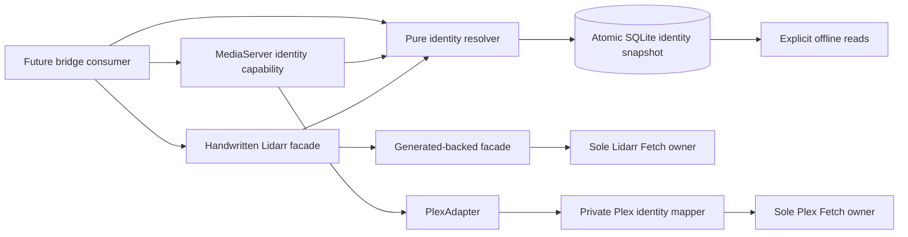

# Technical Research: Plex–Lidarr Identity Mapping

## Executive Summary

Issue #207 should establish a provider-neutral identity boundary, a pure deterministic resolver, and
an atomic SQLite snapshot cache. MusicBrainz IDs are authoritative; conservative name matching is
allowed only when MBID evidence is absent, unique, above a high threshold, and separated from the
runner-up. Unmatched and ambiguous results are normal typed outcomes, not guessed joins.

This issue is the identity/cache foundation for #208–#209 and #221. It must not implement
reconciliation, policy actions, ratings sync, or activate the reserved `lidarr audit
plex-alignment` evaluator. No new command is necessary in #207, so Bash, Zsh, and Fish completion
templates should remain unchanged and their parity suite should prove that explicitly.

**Scope decision:** ship artist identity mapping first. The public/cache discriminators may reserve
`"album"` so the schema does not churn, but #207's resolver accepts only `"artist"` and returns a
typed `unsupported-identity` failure for album resolution. This follows the research report's
artist-level common denominator and avoids asserting that Plex album `mbid://` values are
MusicBrainz release-group IDs without an empirical fixture. Album drill-down belongs with #208
after that equivalence is proven. Likewise, #207 requires no public command: it is invoked as a
library foundation by the first operator-facing consumer in #208.

## Existing Boundaries and Constraints

- [`src/types/media-server.ts`](../../../packages/rfmedia-cli/src/types/media-server.ts) is the
  public provider-neutral Plex boundary. Actions must not import private modules under
  `lib/adapters/plex/**`.
- [`src/lib/adapters/plex/types.ts`](../../../packages/rfmedia-cli/src/lib/adapters/plex/types.ts)
  currently consumes no `Guid` field. `PlexWireArtist` and `PlexWireAlbum` therefore cannot expose
  MusicBrainz evidence.
- [`src/lib/adapters/plex/query-library.ts`](../../../packages/rfmedia-cli/src/lib/adapters/plex/query-library.ts)
  already has the authenticated bulk-query path and a cached Plex `machineIdentifier`, but the
  latter is deliberately private.
- [`src/types/lidarr.ts`](../../../packages/rfmedia-cli/src/types/lidarr.ts) already carries required
  `LidarrArtist.foreignArtistId` and optional `LidarrAlbum.foreignAlbumId`. The comments identify
  them as MusicBrainz artist and release-group IDs.
- [`src/lib/lidarr/client.ts`](../../../packages/rfmedia-cli/src/lib/lidarr/client.ts) already
  exposes `listArtists()` and parent-scoped `listAlbums()`. Bridge code must use that facade, never
  generated DTOs or handwritten `/api/v1/` paths.
- [`src/lib/fuzzy-match.ts`](../../../packages/rfmedia-cli/src/lib/fuzzy-match.ts) supplies
  Levenshtein similarity, but its permissive defaults and video-title normalization are not safe
  identity policy. Reuse the installed algorithm, not its default threshold.
- [`src/lib/schema.sql`](../../../packages/rfmedia-cli/src/lib/schema.sql) is schema v10. Database
  initialization executes idempotent `CREATE` statements before sequential migration.
- [`src/lib/lidarr/metadata-cache.ts`](../../../packages/rfmedia-cli/src/lib/lidarr/metadata-cache.ts)
  is a query-response cache keyed only by Lidarr origin/category/discriminator. It cannot represent
  two-provider entity catalogs, ambiguity evidence, or a coherent cross-system snapshot.
- [`src/commands/lidarr-mutation-presenter.ts`](../../../packages/rfmedia-cli/src/commands/lidarr-mutation-presenter.ts)
  owns human review and applies the established non-interactive rule: machine/non-TTY mutation
  requires `--yes`; prompts go to stderr.
- [`src/types/lidarr-audit.ts`](../../../packages/rfmedia-cli/src/types/lidarr-audit.ts) and the audit
  engine intentionally reserve `plex-alignment` with
  `identity-mapping-unavailable`. #207 must not turn that placeholder into #208 reconciliation.
- [`scripts/check-direct-plex-imports.mjs`](../../../packages/rfmedia-cli/scripts/check-direct-plex-imports.mjs)
  enforces private Plex imports, generated Lidarr privacy, handwritten endpoint bans, and sole Fetch
  ownership. No bridge module may receive an exemption.

## Architecture Design



Separate three responsibilities:

1. **Evidence acquisition**: a new generic media-server identity capability requests Plex GUIDs and
   returns bounded provider-neutral identity records. Lidarr remains behind `LidarrClientApi`.
2. **Resolution**: `lib/bridge/mapping.ts` is pure. It validates/canonicalizes MBIDs, ranks name
   candidates, classifies outcomes, and computes review evidence without I/O or global config.
3. **Persistence**: `lib/bridge/cache.ts` is the sole owner of the new SQLite tables. It writes one
   complete artist or album snapshot transactionally and reads only complete snapshots.

Do not put Plex transport calls in `lib/bridge`, add a direct MusicBrainz client, reuse the generic
Lidarr metadata-response cache, or put prompt I/O in the resolver.

## Provider-Neutral Identity Capability

Add an additive capability to `MediaServerAdapter` rather than widening normal Plex query results
or permitting bridge imports from private Plex code:

```ts
export type MediaIdentityKind = "artist" | "album";

export interface MediaExternalId {
  readonly namespace: string; // "mbid" for consumed Plex mbid:// GUIDs
  readonly value: string; // opaque here; bridge validates semantic UUID form
}

export interface MediaIdentityEntity {
  readonly id: string;
  readonly kind: MediaIdentityKind;
  readonly title: string;
  readonly artist?: string;
  readonly year?: number;
  readonly trackCount?: number;
  readonly externalIds: readonly MediaExternalId[];
}

export interface MediaIdentityPage {
  readonly items: readonly MediaIdentityEntity[];
  readonly total: number;
  readonly offset: number;
  readonly returned: number;
  readonly hasMore: boolean;
}

export interface MediaServerIdentityCapability {
  /** Stable opaque provider-instance key, not a credential. */
  instanceId(): Promise<string>;
  entities(options: {
    readonly library: string;
    readonly kind: MediaIdentityKind;
    readonly limit?: number;
    readonly offset?: number;
    readonly signal?: AbortSignal;
  }): Promise<MediaIdentityPage>;
}
```

`PlexAdapter` should implement this through a private `plex/identity.ts` family. It may reuse the
existing private library lookup and machine-identifier callback by dependency injection; the public
capability exposes the identifier only as an opaque server-scoping key. The bulk query uses the
existing section `/all` machinery with the Plex option that requests GUID data. Normal query
results and existing CLI/MCP envelopes stay unchanged.

Private wire validation should consume a bounded `Guid?: readonly { id: string }[]`, reject control
characters/oversized values, and recognize only the empirically verified `mbid://<uuid>` form.
Unknown GUID namespaces are ignored, not persisted wholesale. A Plex entity with multiple distinct
valid MBIDs is ambiguous evidence and must not be silently reduced to the first value.

The album GUID semantic is a required fixture decision: Lidarr's `foreignAlbumId` is a MusicBrainz
**release-group** ID. The implementation must prove that the Plex Music agent's album GUID is the
same namespace before enabling album MBID joins. If it is a release ID instead, persist it as
unusable external evidence and use conservative album-name/artist context; never relabel it as a
release-group ID.

## Data Models

Create `src/types/bridge.ts`, independent of Plex and generated Lidarr types. The multi-kind types
reserve the stable future shape; the #207 resolver itself supports artists only:

```ts
export type BridgeEntityKind = "artist" | "album";
export type BridgeProvider = "plex" | "lidarr";
export type BridgeMatchMethod = "mbid" | "normalized-name" | "fuzzy-name";
export type BridgeMatchOutcome = "matched" | "ambiguous" | "unmatched" | "invalid";

export interface BridgeIdentityEntity {
  readonly provider: BridgeProvider;
  readonly kind: BridgeEntityKind;
  readonly id: string;
  readonly title: string;
  readonly normalizedTitle: string;
  readonly mbid?: string;
  readonly parentMbid?: string;
  readonly trackCount?: number;
}

export interface BridgeMatchCandidate {
  readonly lidarrId: string;
  readonly title: string;
  readonly method: BridgeMatchMethod;
  readonly score: number;
}

export interface BridgeIdentityMapping {
  readonly plexId: string;
  readonly lidarrId?: string;
  readonly outcome: BridgeMatchOutcome;
  readonly method?: BridgeMatchMethod;
  readonly confidence?: number;
  readonly runnerUpConfidence?: number;
  readonly candidates: readonly BridgeMatchCandidate[]; // bounded, deterministic
  readonly reason:
    | "unique-mbid"
    | "duplicate-mbid"
    | "unique-normalized-name"
    | "unique-fuzzy-name"
    | "conflicting-mbid"
    | "insufficient-confidence"
    | "insufficient-margin"
    | "no-candidate"
    | "invalid-identity";
}

export interface BridgeIdentitySnapshot {
  readonly schemaVersion: 1;
  readonly resolverVersion: 1;
  readonly plexOrigin: string;
  readonly plexInstanceId: string;
  readonly lidarrOrigin: string;
  readonly kind: BridgeEntityKind;
  readonly capturedAt: string;
  readonly entities: readonly BridgeIdentityEntity[];
  readonly mappings: readonly BridgeIdentityMapping[];
  readonly provenance: {
    readonly source: "live" | "sqlite-cache";
    readonly offline: boolean;
    readonly ageSeconds?: number;
  };
}
```

All returned collections and records should be fresh frozen projections. IDs are opaque strings in
the bridge contract; the Lidarr adapter converts positive numeric IDs to canonical decimal strings
at the boundary. Candidate lists should be capped (recommended: five), sorted by descending score,
then normalized title, then provider ID.

## Matching Policy

Resolution is deterministic and ordered:

1. Validate canonical UUID syntax and lowercase all accepted MBIDs. A non-empty malformed Lidarr
   MBID is an `invalid` outcome/source-data error, not permission to fuzzy match.
2. Index Lidarr entities by MBID and normalized name.
3. If Plex has exactly one MBID:
   - one Lidarr entity with that MBID is an authoritative `mbid` match at confidence `1`;
   - multiple Lidarr rows with it are `ambiguous` (`duplicate-mbid`);
   - a fuzzy/name candidate carrying a different MBID is forbidden
     (`conflicting-mbid`);
   - no matching Lidarr MBID remains unmatched unless candidate entities lack MBID evidence.
4. A unique normalized-name match is accepted only when there is no contradictory MBID.
5. Fuzzy matching is the last fallback. Recommended defaults are minimum score `0.92`, minimum
   winner margin `0.08`, and exact-only matching for normalized names shorter than four characters.
   The thresholds are explicit resolver options so tests and future policy can version them; do not
   reuse `findClosestMatch`'s `0.4` default.
6. Below-threshold, tied, or low-margin results are `ambiguous`/`unmatched`, never first-candidate
   wins.

Bridge-specific normalization should be local and versioned:

- Unicode NFKD, remove combining marks, Unicode lowercase;
- translate `&` to a separated `and` token;
- replace punctuation/separators with spaces, collapse whitespace, trim;
- compare both the full form and a leading-article variant (`the`, `a`, `an`) without making the
  article-stripped form the persisted canonical identity.

Do not change `normalizeForMatch()` globally: link-video/copy/delete suggestion behavior already
depends on it. Use the installed `fastest-levenshtein` implementation behind the bridge scorer.

When #208 later enables albums, score title only within an already resolved artist (or require
matching `parentMbid`). Include year as supporting/tiebreak evidence, not an identity key. Never
compare every Plex album to every Lidarr album globally. These are future compatibility constraints,
not album implementation work in #207.

## SQLite Data Model and Migration

Use dedicated normalized tables, not `lidarr_metadata_cache`. The cache must retain both provider
catalogs so issue #208 can later derive Plex-only/Lidarr-only sets without another network request,
while issue #207 itself exposes no reconciliation report.

```sql
-- Version 11: Plex–Lidarr identity snapshots (#207)
CREATE TABLE IF NOT EXISTS bridge_identity_snapshots (
  id INTEGER PRIMARY KEY AUTOINCREMENT,
  plex_origin TEXT NOT NULL,
  plex_instance_id TEXT NOT NULL,
  lidarr_origin TEXT NOT NULL,
  entity_kind TEXT NOT NULL,
  resolver_version INTEGER NOT NULL,
  captured_at TEXT NOT NULL,
  UNIQUE(plex_origin, lidarr_origin, entity_kind)
);

CREATE TABLE IF NOT EXISTS bridge_identity_entities (
  id INTEGER PRIMARY KEY AUTOINCREMENT,
  snapshot_id INTEGER NOT NULL,
  provider TEXT NOT NULL,
  provider_entity_id TEXT NOT NULL,
  title TEXT NOT NULL,
  normalized_title TEXT NOT NULL,
  mbid TEXT,
  parent_mbid TEXT,
  track_count INTEGER,
  FOREIGN KEY (snapshot_id) REFERENCES bridge_identity_snapshots(id) ON DELETE CASCADE,
  UNIQUE(snapshot_id, provider, provider_entity_id)
);

CREATE TABLE IF NOT EXISTS bridge_identity_mappings (
  id INTEGER PRIMARY KEY AUTOINCREMENT,
  snapshot_id INTEGER NOT NULL,
  plex_entity_id TEXT NOT NULL,
  lidarr_entity_id TEXT,
  outcome TEXT NOT NULL,
  method TEXT,
  confidence REAL,
  runner_up_confidence REAL,
  reason TEXT NOT NULL,
  candidates_json TEXT NOT NULL,
  FOREIGN KEY (snapshot_id) REFERENCES bridge_identity_snapshots(id) ON DELETE CASCADE,
  UNIQUE(snapshot_id, plex_entity_id)
);

CREATE INDEX IF NOT EXISTS idx_bridge_identity_entities_mbid
  ON bridge_identity_entities(snapshot_id, provider, mbid);
CREATE INDEX IF NOT EXISTS idx_bridge_identity_entities_name
  ON bridge_identity_entities(snapshot_id, provider, normalized_title);
CREATE INDEX IF NOT EXISTS idx_bridge_identity_mappings_outcome
  ON bridge_identity_mappings(snapshot_id, outcome);
CREATE INDEX IF NOT EXISTS idx_bridge_identity_mappings_lidarr
  ON bridge_identity_mappings(snapshot_id, lidarr_entity_id);
```

The snapshot `UNIQUE` key intentionally holds one current cache generation per configured
Plex-origin/Lidarr-origin/entity-kind scope. Refresh in one SQLite transaction:

1. resolve and fully validate the live snapshot in memory;
2. delete the previous header for the same scope (foreign-key cascade removes children);
3. insert the new header, entities, and mappings;
4. commit.

WAL readers observe either the old complete generation or the new complete generation, never a
partially refreshed catalog. A failed fetch, resolver failure, or write rolls back and leaves the
old snapshot available for explicit offline use.

Bump `CURRENT_SCHEMA_VERSION`, `SUPPORTED_READ_ONLY_SCHEMA_VERSION`, and `schema.sql` to 11. Add a
v10→v11 migration block and migration tests that preserve existing rows, create all three tables
and four indexes, enforce cascade/uniqueness, and reject newer/malformed schema metadata as before.
Update version assertions throughout `db.test.ts`; do not weaken the exact read-only version gate.

`candidates_json` is bounded explanatory evidence, not an arbitrary payload channel. Cache reads
must parse it as `unknown`, validate exact keys/types/ranges/count, and fail closed on corruption.
Never persist tokens, API keys, raw response bodies, full request URLs, or unbounded GUID arrays.

## Cache Lifecycle and Offline Semantics

- Live mode is network-first. It may return only after the new identity snapshot is durably
  committed; a cache-write failure means the durable contract failed.
- Offline mode is explicit (`offline: true` at the library API, later `--offline` in #208). It must
  not construct clients, call health checks, or silently contact either server.
- An online source failure does not silently become cached success. A caller must explicitly choose
  offline/stale behavior, matching existing `--allow-stale` policy.
- Offline lookup keys by canonical Plex and Lidarr origins plus entity kind, then reports the stored
  Plex instance ID and age. Cache rows do not expire automatically; explicit offline consent plus
  visible age is more useful for identity than the one-day metadata-response ceiling.
- On live refresh, compare the returned opaque Plex instance ID with the cached value. A changed
  server replaces the snapshot only after successful full resolution and is never merged with the
  old catalog.
- Empty live catalogs are valid snapshots only when both provider reads completed successfully.
  Transport failure must never be projected as an empty library.
- Expose explicit `read`, `replace`, and `purge` functions. Avoid module-global connections; accept
  `DbConnection` or a lazy provider consistent with existing SQLite layers.

## Expansion-Ratio Contract

Identity resolution must not itself prompt or mutate. It should provide the review evidence future
track-signal consumers need:

```ts
export interface BridgeExpansionImpact {
  readonly signaledTracks: number;
  readonly targetAlbums: number;
  readonly knownTargetTracks: number;
  readonly albumsWithUnknownTrackCount: number;
  /** knownTargetTracks / signaledTracks, absent when the denominator is zero. */
  readonly knownExpansionRatio?: number;
  /** Always true for a non-empty album-level action derived from track signals. */
  readonly requiresConfirmation: boolean;
}
```

Add a pure formatter that produces, for example:

```text
3 signaled Plex tracks map to 2 Lidarr album actions covering 24 known tracks
(8.0x expansion). Proceed?
```

If any target album lacks a track count, print `at least <known>` plus the unknown-album count and
never manufacture a ratio. Count distinct Plex track IDs and distinct Lidarr album IDs before
calculating.

Issue #207 should ship the typed calculation/formatting contract and tests, but there is no
mutation consumer to prompt from yet. Issues #209/#221 must call it from their command presenter before apply,
send the prompt to stderr, and require `--yes` for machine/non-TTY execution exactly like current
Lidarr apply. It must also be embedded in future sealed plans so apply cannot recompute a different
scope. Adding an unused Commander leaf or activating reconciliation merely to display a prompt
would exceed #207.

## Error Taxonomy

Use a bridge-specific typed error only for failures of the identity layer:

```ts
type BridgeIdentityErrorCode =
  | "configuration"
  | "invalid-source-identity"
  | "unsupported-identity"
  | "cache-miss"
  | "cache-corrupt"
  | "cache-write-failed";
```

- `unmatched`, duplicate MBID, tied fuzzy candidates, and insufficient confidence are typed mapping
  outcomes and appear in snapshots; they are not thrown exceptions.
- Preserve/sanitize `MediaServerError` and `LidarrError` at acquisition boundaries so retryability
  and source remain visible. Do not flatten them into “no matches.”
- Malformed Plex GUID arrays, malformed required Lidarr artist MBIDs, non-finite scores, duplicate
  provider entity IDs, impossible mapping references, or corrupt cache JSON fail closed.
- Errors and logs contain credential-free canonical origins at most. They never include tokens,
  API keys, headers, raw bodies, or user-controlled terminal controls.

## Concrete File Map

| File                                         | Change                                                                             |
| -------------------------------------------- | ---------------------------------------------------------------------------------- |
| `src/types/bridge.ts`                        | Public identity, mapping, snapshot, error, and expansion contracts                 |
| `src/types/media-server.ts`                  | Add generic identity capability and feature flag                                   |
| `src/types/index.ts`                         | Export bridge and new generic identity types                                       |
| `src/lib/adapters/plex/types.ts`             | Bounded GUID wire types/guards                                                     |
| `src/lib/adapters/plex/identity.ts`          | New private bulk identity endpoint family and GUID mapping                         |
| `src/lib/adapters/plex/identity.test.ts`     | Wire parsing, pagination, instance ID, malformed response tests                    |
| `src/lib/adapters/plex-adapter.ts`           | Compose the new capability from existing private dependencies                      |
| `src/lib/adapters/plex-adapter.test.ts`      | Contract/features and no-credential-leak tests                                     |
| `src/lib/bridge/mapping.ts`                  | Pure MBID-first resolver, normalizer, fuzzy policy, expansion calculation          |
| `src/lib/bridge/mapping.test.ts`             | Resolution matrix, ambiguity, deterministic ranking, expansion tests               |
| `src/lib/bridge/cache.ts`                    | Sole CRUD/transaction owner for identity snapshots                                 |
| `src/lib/bridge/cache.test.ts`               | Atomic replacement, corruption, scope isolation, offline provenance                |
| `src/lib/schema.sql`                         | Schema v11 tables and indexes                                                      |
| `src/lib/migrations.ts`                      | v10→v11 migration                                                                  |
| `src/lib/db.ts`                              | Raise exact supported read-only schema version                                     |
| `src/types/db.ts`                            | Row projections for the three new tables                                           |
| `src/lib/db.test.ts`                         | Migration/version/index/FK preservation tests                                      |
| `scripts/check-direct-plex-imports.test.mjs` | Prove bridge code cannot import private Plex/generated Lidarr or own Fetch         |
| `ROADMAP.md`                                 | After merge, move only #207 to shipped/archive and make #208 the next Layer 3 item |

`src/lib/lidarr/client.ts` and its generated client need no new endpoint for artist mapping.
Do not add album reads in #207. When album mapping is enabled later, compose existing
`listArtists()` plus parent-scoped `listAlbums()` calls through scheduler/batching patterns. Modify
the facade only if implementation proves a missing stable projection; do not add a generated
endpoint speculatively.

Do not modify audit evaluator files in #207. The reserved audit slot remains skipped until #208 can
turn identity snapshots into an alignment report.

## Testing and Verification

- **Plex boundary**: one/many/unknown GUIDs, malformed/oversized GUID arrays, `includeGuids`
  request, page forward progress, cancellation, stable instance scope, private imports.
- **Lidarr projection**: canonical artist/release-group MBIDs, missing optional album MBID,
  malformed present IDs, duplicate local IDs/MBIDs, albums scoped to resolved artists.
- **Resolver**: MBID priority, no fuzzy override of conflicting MBIDs, Unicode/diacritic/case/
  punctuation/article variants, short-name exact-only rule, threshold/margin boundaries, ties,
  stable ordering, top-five cap, immutable results.
- **Cache**: fresh database, v10 migration with existing data, atomic replacement rollback,
  origin/kind isolation, FK cascades, uniqueness, corrupt timestamp/JSON/foreign references,
  explicit offline miss, snapshot age, changed Plex instance.
- **Expansion**: deduplication, zero denominator, partial/unknown counts, finite ratio, exact prompt
  text, non-empty action requiring confirmation.
- **Architecture**: no new Fetch owner; no direct private Plex/generated Lidarr imports or
  handwritten endpoints; no credentials in cache keys/log fixtures.
- **Compatibility**: existing Plex query/MCP JSON shapes remain unchanged; existing Lidarr public
  types and plan schemas remain unchanged; `plex-alignment` remains reserved; Bash/Zsh/Fish output
  remains byte-identical and completion parity tests pass without template edits.

Run the focused bridge/adapter/database tests, `npm run test:architecture`, Lidarr codegen drift
tests, rfmedia typecheck/build, the full rfmedia suite, root package/architecture suites, lint, and
pre-push hooks. A fresh worktree may require `npm install` and `npm run build:common` before package
tests resolve `@rfmedia/common`.

## Gotchas and Edge Cases

- Plex MBID availability depends on metadata agent and server response options; absence is normal.
- Plex album MBID semantics must be proved as release-group identity before direct Lidarr joining.
- Lidarr may contain duplicate MBIDs; the audit already detects this. Never select the first row.
- Same-name artists, transliterations, collaborations, “Various Artists,” leading articles, and
  very short names make name-only auto-matching unsafe.
- A Plex URL can change while the server stays the same, or the same URL can later serve a
  replacement server. Store both canonical origin and opaque instance ID.
- Local Lidarr numeric IDs are instance-scoped and may change; always persist/revalidate the MBID
  beside them.
- Fuzzy thresholds are resolver-versioned behavior. A policy change must force a live refresh or
  bump `resolverVersion`; it must not reinterpret old cached rows silently.
- SQLite refresh must be one transaction. Row-by-row upserts expose torn mappings to concurrent
  offline readers.
- Mapping cache is not mutation authorization. Future applies still need sealed plans, current-state
  revalidation, expansion review, and explicit approval.

## Alternatives and Decisions

- **Reuse `lidarr_metadata_cache`** — rejected: it cannot coherently scope or explain two-provider
  identity and would mix response-cache TTL semantics with durable identity snapshots.
- **Direct MusicBrainz fallback** — rejected for #207: it adds a fourth network dependency, Fetch
  ownership, a 1 request/second limiter, provider error taxonomy, and release-vs-release-group
  translation. Plex/Lidarr supplied MBIDs plus cached evidence are sufficient for this foundation.
- **Name-only global join** — rejected: duplicate names and album cardinality produce unsafe and
  potentially quadratic behavior.
- **Expose private Plex wire types to bridge code** — rejected: it breaks the adapter architecture
  and the enforced import boundary.
- **Add external IDs to every existing media query result** — rejected: it changes established
  output/cache behavior. A dedicated identity capability is additive and opt-in.
- **Activate `lidarr audit plex-alignment` now** — rejected: identity availability is not
  reconciliation. #208 owns aligned/gap findings and its machine-output contract.
- **Add a new identity CLI command** — rejected unless product scope changes. #207 is a reusable
  foundation; #208 supplies the first operator-facing consumer.

## Relevant Documentation

- [Issue #207](https://github.com/yandy-r/rfmedia-apps/issues/207)
- [Strategic research report](../../../research/rfmedia-lidarr-integration/report.md)
- [Negative-space research gaps](../../../research/rfmedia-lidarr-integration/synthesis/negative-space.md)
- [Layered architecture analysis](../../../research/rfmedia-lidarr-integration/synthesis/crucible-analysis.md)
- [Plex adapter refactor research](../plex-adapter-refactor/research-technical.md)
- [ROADMAP](../../../ROADMAP.md)
