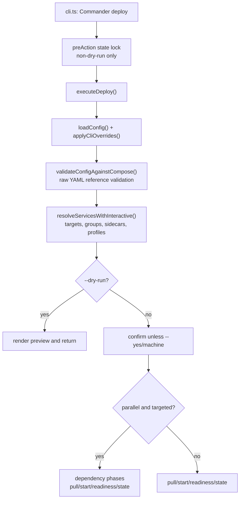
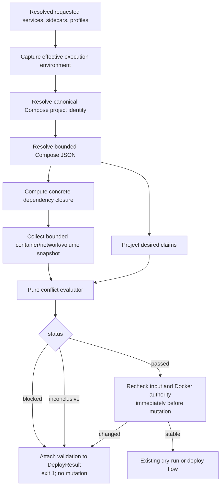

# Architecture Analysis: service-conflict-detection

## Executive Summary

`rfapps deploy --validate-first` should be one opt-in, fail-closed gate in the existing deploy
action, not a new command or a second deployment pipeline. The gate runs after rfapps configuration
validation and effective service/profile resolution, but before the current dry-run return,
confirmation, pull, parallel/sequential split, readiness work, or state database initialization.
It resolves one canonical Compose model, computes the concrete services Compose may start, captures
one bounded snapshot from the same Docker authority, and passes narrow desired/runtime projections
to a pure conflict evaluator.

The current architecture provides most supporting seams, including safe argument-array Docker
execution, Compose JSON resolution, project and daemon identity helpers, deterministic pure-engine
precedents, structured output, and a real-CLI mock-Docker harness. The significant gaps are that
service selection does not compute transitive Compose dependency closure, current Docker readers
are permissive rather than fail-closed, existing Compose/container types omit required resource
fields, and deploy does not yet pin/revalidate its environment and authority between inspection and
mutation.

The implementation should preserve three boundaries:

1. `lib/docker.ts` owns bounded external evidence collection and validation.
2. `lib/conflict-validation.ts` owns pure normalization, comparison, stable IDs/order, inert
   resolutions, and human projection.
3. `actions/deploy.ts` owns orchestration, output, exit behavior, and the no-mutation gate.

No cache, database schema, persisted validation artifact, generic rule framework, or automatic
remediation belongs in this feature.

## Architecture Context

### Existing deploy flow

`executeDeploy()` already has one common prefix above its parallel and sequential branches. The
new preflight belongs in that prefix, immediately after canonical scope resolution and before the
dry-run branch. This placement guarantees the flag behaves identically for dry-run, confirmed,
`--yes`, machine, parallel, and sequential modes.

### Required deploy flow

The preflight result is `conflict-validation.v1` with `passed`, `blocked`, or `inconclusive`.
`blocked` means objective resource conflicts were found. `inconclusive` means required evidence
could not be safely collected or parsed. Both return exit code `1` before mutation.
`--allow-partial` remains irrelevant because partial success requires completed deployment work.

### Scope resolution

`resolveServicesWithInteractive()` currently performs explicit service collection, group expansion,
deduplication, service-name validation, bidirectional sidecar expansion, and profile detection. It
does not add transitive `depends_on` or `network_mode: service:` providers. An empty `services`
array remains an “all” sentinel and is paired only with the default profile.

The preflight therefore needs a second, Compose-aware scope step:

- For targeted deploys, start with the selected/sidecar-expanded set and recursively add
  `depends_on` plus `network_mode: service:` dependencies from the resolved Compose model.
- For untargeted deploys, replace the empty sentinel with the sorted keys of the profile-resolved
  Compose `services` object.
- Validate every referenced dependency exists. A missing dependency or cycle is not an empty scope;
  it makes the preflight inconclusive/operationally failed.
- Recompute effective profiles if newly included dependencies require profiles not already present,
  or establish that Compose has already activated them through the selected profile model.

`buildServiceDependencyGraph()` is reusable for dependency extraction and deterministic phase
ordering, but not for closure: it deliberately filters dependencies to the caller-provided target
set. `computeExecutionPhases()` is also unsuitable as the safety seam because it converts an
unavailable Compose model into a successful “all independent” phase. Add a small pure closure
function beside the graph code or in the conflict engine; do not weaken the existing execution
behavior as an incidental refactor.

### Desired and runtime evidence

Desired state must come from `getComposeConfig()` with the final Compose path, plain env file,
profiles, project name/working directory where applicable, and the same effective environment used
for subsequent Docker operations. Raw YAML from `lib/validation.ts` remains useful only for current
rfapps mapping/reference checks.

The desired projection retains only:

- service published-port claims and Compose project/service identity;
- service mount type/source/target facts;
- top-level effective volume names, external status, drivers, and driver options;
- top-level effective network names and explicit IPAM subnets.

The runtime adapter lists validated IDs and inspects bounded batches of:

- running containers for port bindings, mount identities, and Compose project/service labels;
- Docker networks for effective names, drivers, and IPAM subnet configuration;
- Docker volumes for effective names, drivers, options, and external identity.

Collection must be all-or-inconclusive. Existing helpers that return `undefined`, `[]`, or skip one
malformed JSON line are appropriate for status/best-effort UX but cannot be interpreted as a clean
preflight snapshot.

### Identity and mutation boundary

`cli.ts` acquires the global state lock for non-dry-run deploys before the action runs. That protects
against another rfapps mutation, but not direct Docker clients, and dry-run intentionally remains
lock-free. Reuse the managed/reconciliation identity infrastructure rather than inventing raw
Docker endpoint handling:

- `captureEffectiveEnvironment()` creates one bounded environment without logging values.
- `resolveComposeProjectIdentity()` provides a canonical, symlink-free Compose file, project
  directory, and safe effective project name.
- `dockerAuthorityFingerprintFromEnvironment()` fingerprints the context, endpoint override, and
  daemon identity without exposing them.
- `hashFile()` plus `resolvedServiceConfigFingerprint()` can detect source/resolved-model changes.

Run validation and later Docker calls with the captured environment and `replaceEnv: true`. Before
the first mutating operation, recompute the Compose/authority fingerprints. A mismatch produces a
stable inconclusive result rather than proceeding against different input or a different daemon.
The check remains point-in-time; Docker is still the final allocator.

### Output path

Initialize the existing `DeployResult` envelope before the preflight so every machine path can emit
one document. When requested, add `validation?: ConflictValidationResult`; omit it when the flag is
absent to preserve backward compatibility. Blocked/inconclusive results add a sanitized
`failed` entry named `validation`, set operational exit code `1`, render exactly once, and return.

Text/table use the pure engine's human projection on stderr. JSON/YAML use `formatOutput()` and
contain no ANSI, prompt, progress, or second JSON document on stdout. CSV plus
`--validate-first` is rejected through `InvalidArgumentError` before evidence collection because
the nested multi-party schema has no stable flattening in v1. The validation object has no
timestamp; arrays, IDs, parties, resolutions, warnings, and limitations are sorted copies.

## Critical Files Reference

| File                                                                                          | Architectural role and required change                                                                                                                                                                                            |
| --------------------------------------------------------------------------------------------- | --------------------------------------------------------------------------------------------------------------------------------------------------------------------------------------------------------------------------------- |
| `packages/rfapps-cli/src/cli.ts`                                                              | Registers `--validate-first`, rejects incompatible CLI combinations through the established usage-error pipeline, and already acquires the non-dry-run deploy lock.                                                               |
| `packages/rfapps-cli/src/actions/deploy.ts`                                                   | Single orchestration/convergence point. Parse the flag, create the result envelope early, run preflight above dry-run and both execution branches, revalidate authority before mutation, and preserve the flag-disabled path.     |
| `packages/rfapps-cli/src/actions/deploy.spec.ts`                                              | Action-level proof of gate ordering, all three statuses, machine output, dry-run, `--yes`, `--allow-partial`, and common behavior across sequential/parallel modes.                                                               |
| `packages/rfapps-cli/src/types/validation.ts`                                                 | **Create.** Own `conflict-validation.v1`, discriminated desired/runtime/finding/check/error contracts, stable codes, limitations, and resolution types.                                                                           |
| `packages/rfapps-cli/src/types/options.ts`                                                    | Add `validateFirst` to `DeployOptions`; keep it deploy-specific.                                                                                                                                                                  |
| `packages/rfapps-cli/src/types/results.ts`                                                    | Add optional validation evidence to `DeployResult` without changing unvalidated output.                                                                                                                                           |
| `packages/rfapps-cli/src/types/index.ts`                                                      | Export the versioned validation constants/types through the package's established type barrel.                                                                                                                                    |
| `packages/rfapps-cli/src/lib/conflict-validation.ts`                                          | **Create.** Pure projection/normalization, port/volume/network comparison, CIDR wrapper, stable ID/order, inert suggestions, summary, limitations, and human rendering. No Docker, logger, process, prompt, or filesystem access. |
| `packages/rfapps-cli/src/lib/conflict-validation.spec.ts`                                     | **Create.** Table-driven rule, boundary, deterministic-order, sanitization, and inconclusive tests.                                                                                                                               |
| `packages/rfapps-cli/src/lib/docker.ts`                                                       | Widen Compose/inspect types and add strict bounded readers for container, network, and volume evidence. Preserve argument-array execution, contexts, SSH retry, env tools, byte limits, and validated operands.                   |
| `packages/rfapps-cli/src/lib/docker.spec.ts`                                                  | Assert exact list/inspect argv, IDs and batches, bounds, duplicate/malformed/truncated evidence, pinned environment, and fail-closed behavior.                                                                                    |
| `packages/rfapps-cli/src/lib/dependency-graph.ts`                                             | Reuse dependency extraction but add/host a pure transitive closure seam that does not filter dependencies out and does not fail open.                                                                                             |
| `packages/rfapps-cli/src/lib/dependency-graph.spec.ts`                                        | Cover transitive `depends_on`, `network_mode: service:`, sidecars, untargeted concrete scope, missing references, and cycles.                                                                                                     |
| `packages/rfapps-cli/src/lib/interactive-selection.ts`                                        | Existing first-stage scope resolution. Do not add Docker resource inspection here; its empty “all” sentinel must be concretized after Compose resolution.                                                                         |
| `packages/rfapps-cli/src/lib/validation.ts`                                                   | Existing raw-YAML rfapps reference validation. Keep it separate from runtime conflict detection and its cache.                                                                                                                    |
| `packages/rfapps-cli/src/lib/identity.ts`                                                     | Reuse canonical Compose project identity and Docker authority fingerprints; avoid exposing endpoints or daemon IDs.                                                                                                               |
| `packages/rfapps-cli/src/lib/env-tools.ts`                                                    | Reuse bounded effective-environment capture so validation and mutation execute under one pinned authority.                                                                                                                        |
| `packages/rfapps-cli/src/lib/plan-storage.ts`                                                 | Reuse `hashFile()` only as an ephemeral input fingerprint; do not create a saved validation artifact.                                                                                                                             |
| `packages/rfapps-cli/src/lib/plan-generator.ts`                                               | Reuse `resolvedServiceConfigFingerprint()` for resolved-model identity. Existing port/volume parsers are lossy and are not safety inputs.                                                                                         |
| `packages/rfapps-cli/src/lib/managed-redaction.ts`                                            | Reuse or generalize bounded control/credential redaction before Docker-derived messages cross output boundaries; never emit absolute bind sources.                                                                                |
| `packages/rfapps-cli/src/lib/errors.ts` and `packages/rfapps-cli/src/lib/error-formatters.ts` | Continue typed operational/usage errors for command/evidence failures. Domain conflicts remain structured results, not one exception per finding.                                                                                 |
| `packages/rfapps-cli/src/lib/exit-codes.ts`                                                   | Preserve operational `1`, usage `2`, and post-start partial `3`; preflight never calls partial-success resolution.                                                                                                                |
| `packages/rfapps-cli/src/lib/formatters/index.ts`                                             | Existing one-document JSON/YAML/table dispatch and test capture seam. No second serializer.                                                                                                                                       |
| `packages/rfapps-cli/src/lib/index.ts`                                                        | Export only the public conflict-validation and strict Docker seams after their contracts stabilize. This barrel is a convergence hotspot.                                                                                         |
| `packages/rfapps-cli/src/actions/completion.ts`                                               | Add the flag to Bash/Zsh/Fish and separate deploy from rebuild blocks. Also restore the currently missing deploy `--allow-partial`.                                                                                               |
| `packages/rfapps-cli/src/actions/completion.spec.ts`                                          | Compare every shell's deploy options with Commander rather than token-presence checks.                                                                                                                                            |
| `packages/rfapps-cli/src/testing/mock-docker.ts`                                              | Extend typed fixture builders for Compose resource models and container/network/volume inspect responses.                                                                                                                         |
| `packages/rfapps-cli/src/testing/deploy-scenarios.ts`                                         | Compose reusable preflight pass/block/inconclusive Docker rules without per-test JSON duplication.                                                                                                                                |
| `packages/rfapps-cli/src/testing/cli-harness.ts`                                              | Existing isolated real-CLI subprocess, fake HOME, fake Docker, invocation log, and no-mutation assertions.                                                                                                                        |
| `packages/rfapps-cli/src/cli.deploy.integration.spec.ts`                                      | Prove exact read-before-write order and absence of pull/up/readiness/state DB work on blocked or inconclusive outcomes. Convert current late port-failure coverage into preflight coverage.                                       |
| `packages/rfapps-cli/package.json` and `package-lock.json`                                    | Add reviewed `ipaddr.js` dependency and lockfile evidence; no Docker SDK or host-scanner dependency.                                                                                                                              |
| `docs/features/service-conflict-detection.md`                                                 | **Create.** Document outcomes, objective rules, limits, manual recovery, and point-in-time behavior.                                                                                                                              |
| `packages/rfapps-cli/README.md`, `ROADMAP.md`, and `docs/roadmap-archive.md`                  | Complete user-facing flag/output and shipped-roadmap parity.                                                                                                                                                                      |

## Cross-Cutting Concerns

### Fail-closed evidence

Every external stage needs a stable check code and bounded state:

- Compose resolution/projection;
- effective service closure;
- Docker authority identity;
- container inventory/inspect;
- network inventory/inspect;
- volume inventory/inspect;
- CIDR/resource normalization;
- immediate pre-mutation revalidation.

Timeout, denied access, malformed JSON, duplicate identity, unsafe operand, unsupported required
shape, overflow, partial batch, invalid CIDR, or changed authority/input yields `inconclusive`.
Never convert these conditions to empty arrays or warnings.

### Security and privacy

Resolved Compose JSON can include interpolated secrets; container inspect can include environment,
labels, and host bind paths. Project required fields immediately and keep raw payloads ephemeral.
Do not log the current `getComposeConfig()` raw-output preview on parse failure for this strict path.
Apply allowlisted parsing, count/depth/string/byte bounds, control-character removal, and
credential redaction before any external text reaches stderr or structured output.

Use validated Docker IDs for inspect operands where possible. Preserve `spawn(command, args)` with
no shell, use command-specific capture limits, and avoid copying credentials or endpoint details
into findings. Absolute bind sources may participate in in-memory duplicate-target comparison but
must not appear in normal output.

### Determinism

The daemon, object keys, and concurrent reads do not guarantee stable order. Normalize resource
keys, sort service scope, conflicts, parties, resolutions, checks, warnings, and limitations, and
construct IDs only from canonical facts and sorted party identities. Do not mutate caller arrays
or include timestamps/timings in the versioned validation block.

### Compatibility and exit semantics

Without `--validate-first`, deploy calls, output, prompts, exit codes, readiness behavior, and state
recording remain unchanged. With the flag, `passed` continues to the existing workflow;
`blocked`/`inconclusive` exit `1`; invalid CLI/profile/CSV combinations exit `2`; exit `3` remains
post-start partial success only. `--yes` skips only normal deployment confirmation.

### Profiles, environment, and remote Docker

All Compose and Docker reads must use the final compose path, env file, profiles, env-tool
selection, working directory, project identity, and captured environment. The daemon may be remote;
therefore host paths, listeners, and routes belong to the daemon host and local `ss`, `lsof`,
`/proc`, or filesystem probing cannot be authoritative.

### Concurrency, locking, and TOCTOU

Independent runtime inventory reads may run concurrently only after canonical desired state,
authority, and bounds are established. Preserve deterministic aggregation independent of completion
order. The rfapps state lock is useful but insufficient against direct Docker actors; fingerprint
revalidation is the mutation boundary. Dry-run remains lock-free and never mutates, but still uses
fresh evidence.

### Performance and resource bounds

Use fixed-size inspect batches and represent port/CIDR ranges as intervals rather than expansion.
Set per-stage timeouts, output byte limits, maximum items, maximum field lengths, and duplicate-ID
checks. Fresh evidence is intentionally uncached. Debug may report safe stage names/timings, never
raw topology or secrets.

### Completion and documentation parity

Commander and all three generated shell templates are separate public surfaces. Completion changes
and parity tests are mandatory, including the pre-existing `--allow-partial` omission and
deploy/rebuild option conflation. README, feature documentation, roadmap, and archive updates must
describe the same stable statuses, codes, limits, and inert resolution policy.

## Parallelization Opportunities

The work can proceed in dependency-aware streams after the validation schema and canonical resource
vocabulary are frozen:

| Stream                      | Owned work                                                                 | Dependencies                        | Can run with                                        |
| --------------------------- | -------------------------------------------------------------------------- | ----------------------------------- | --------------------------------------------------- |
| A — contracts               | `types/validation.ts`, option/result/type-barrel changes, schema fixtures  | Feature spec                        | Completion fixture design and documentation outline |
| B — pure engine             | `conflict-validation.ts` and its unit tests, including `ipaddr.js` wrapper | A contracts and dependency decision | Docker adapters and dependency closure              |
| C — Docker evidence         | Strict Compose/container/network/volume readers and `docker.spec.ts`       | A raw projection types              | Pure engine and dependency closure                  |
| D — effective scope         | Dependency closure in `dependency-graph.ts` and focused tests              | Resolved Compose service shape      | Pure engine and Docker adapters                     |
| E — completions             | Bash/Zsh/Fish separation plus Commander parity tests                       | Final option name/help              | B, C, D                                             |
| F — docs                    | Feature doc/README/roadmap drafts                                          | Frozen schema and limitation codes  | B, C, D, E                                          |
| G — deploy convergence      | CLI registration, deploy gate, output/exit mapping, action tests           | A-D complete                        | Completion/docs finalization                        |
| H — subprocess verification | Mock-Docker builders/scenarios and deploy integration tests                | C and G behavior                    | Documentation finalization                          |

Serialize edits to these hotspots:

- `package-lock.json`: one dependency/lockfile owner;
- `lib/docker.ts` and `docker.spec.ts`: one evidence-adapter owner;
- `lib/index.ts` and `types/index.ts`: integrate exports after leaf modules compile;
- `actions/deploy.ts` and `deploy.spec.ts`: one convergence owner;
- `actions/completion.ts` and `completion.spec.ts`: one shell-parity owner.

Do not split the three conflict detectors among agents if they would independently define
normalization, IDs, sorting, or suggestions. Those invariants belong to one pure-engine owner.
Port, volume, and network test-case preparation can be parallel, then merged into the single engine
contract.

Recommended convergence order:

1. contracts and canonical fixtures;
2. pure engine, strict Docker evidence, and dependency closure in parallel;
3. barrel exports and deploy integration;
4. subprocess safety scenarios and completion parity;
5. documentation, full validation gates, dependency audit, and graph refresh.

## Implementation Constraints

- The exact public schema is `conflict-validation.v1` with `passed`, `blocked`, and
  `inconclusive`; do not use older research names such as `conflicts`/`unavailable`.
- The gate must run after static config validation and concrete scope resolution, but before
  dry-run return, confirmation, pull, start, readiness, database initialization, or state writes.
- Effective targeted scope includes groups, sidecars, transitive `depends_on`, and
  `network_mode: service:` dependencies. Untargeted scope must become sorted concrete services.
- Current `computeExecutionPhases()` fail-open fallback cannot be reused for safety decisions.
- Current `getComposeConfig()`/`inspectContainers()` permissive return contracts cannot represent a
  passing strict snapshot without a validated wrapper or hardened variant.
- Desired facts come from resolved Compose JSON, never a second raw-YAML parser.
- Runtime evidence covers Docker-owned running-container bindings, named volumes, and explicit
  Docker network IPAM only. Non-Docker listeners, host-network application sockets, host routes,
  and auto-assigned subnets remain explicit limitations.
- Port comparison preserves protocol, address family, bind address/wildcard semantics, intervals,
  and daemon-assigned versus fixed allocation. TCP and UDP are independent.
- Volume blocking is limited to objective driver/options, external identity/existence, and
  duplicate-target contradictions. Ordinary shared binds/named volumes and mixed read modes pass.
- Network overlap compares canonical IPv4 only with IPv4 and IPv6 only with IPv6. Use the narrow
  reviewed `ipaddr.js` wrapper; do not hand-roll compressed IPv6 parsing.
- Self-reconciliation exclusion requires authoritative Compose project and service labels. Similar
  names or substring matches are insufficient.
- The same effective environment, Compose identity, profiles, and Docker authority must be used for
  validation and mutation, with fingerprints rechecked immediately before the first write.
- Snapshot and parse failures are inconclusive and exit `1`; `--yes` and `--allow-partial` cannot
  bypass the gate.
- Suggestions are inert data/prose. The feature never edits Compose or starts, stops, removes,
  disconnects, creates, or reserves a resource.
- Machine modes emit one document. CSV with validation is a usage error in v1. Human meaning never
  depends only on color or glyphs.
- The validation result is ephemeral, sanitized, bounded, deterministically sorted, and has no
  timestamp. It is not stored in SQLite, plans, history, or generation records.
- The flag-disabled deploy path must remain byte/behavior compatible, including existing parallel,
  sequential, readiness, confirmation, and partial-success behavior.
- Tests must prove no mutating Docker invocation or state DB creation occurs for blocked and
  inconclusive outcomes, not merely assert the returned status.
- Bash, Zsh, and Fish completion option sets must match Commander exactly for deploy.
- Dependency work is limited to `ipaddr.js` plus lockfile review; no Docker SDK, extra YAML parser,
  host scanner, or shell-execution library is introduced.
