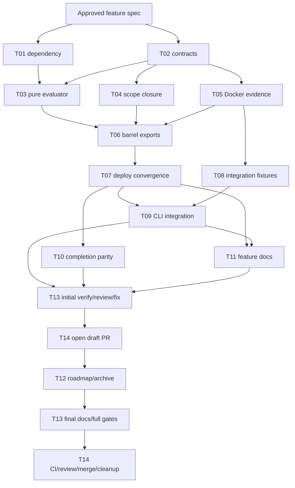

# Task Structure Analysis: service-conflict-detection

## Executive Summary

Implement the feature through five code phases followed by an exclusive verification and delivery
lifecycle. Freeze the public contract first; then develop the pure evaluator, strict Docker
evidence adapter, and effective-scope closure in parallel under non-overlapping file ownership.
Converge those streams once in the deploy action, then finish critical subprocess coverage,
completion parity, user documentation, and roadmap/archive state.

The recommended plan has twelve file-owning tasks. Every implementation task owns one to three
files, and no two concurrently runnable tasks edit the same file. High-conflict files
(`lib/docker.ts`, `actions/deploy.ts`, barrel exports, completion templates, and the root lockfile)
have exactly one owner. Port, volume, and network evaluation remain together because they share
normalization, IDs, ordering, limitations, and resolution semantics.

Testing should be risk-based rather than exhaustive at every layer. Pure tests own the complete
conflict rule matrix; adapter tests own malformed/bounded external evidence; scope tests own
dependency closure; action tests own gate placement and mode/exit behavior; and only a few real-CLI
tests prove the read-before-write boundary. Completion parity is an exact surface contract, not a
token-presence smoke test.

The lifecycle does not end at local green tests. After implementation, run focused and full
repository gates, update the knowledge graph as required, perform an independent code review and
fix loop, commit and push without bypassing hooks, open a template-compliant PR, monitor review
threads and CI to green, merge, verify issue closure and remote state, and clean up the feature
branch/worktree without disturbing unrelated work.

## Recommended Phase Structure

### Phase 0: Contract and dependency foundation

Run two independent tasks in parallel:

- **T01 — CIDR dependency baseline** owns the workspace manifest and root lockfile.
- **T02 — Validation contracts** owns the new validation types and deploy option/result changes.

Exit criteria:

- `ipaddr.js` is the only new production dependency, installed in the rfapps workspace and present
  in the lockfile with no unexpected transitive runtime dependencies.
- `conflict-validation.v1`, `passed`/`blocked`/`inconclusive`, stable finding/check/error codes,
  discriminated resource/party/resolution types, and optional `DeployResult.validation` compile.
- `DeployOptions.validateFirst` is normalized as a required boolean; the validation property is
  optional so no-flag output remains compatible.

Do not edit barrel files yet. Leaf modules can import the contracts directly, and delaying barrels
avoids a merge hotspot while their export surface is still moving.

### Phase 1: Independent core workstreams

After T01/T02, run three tasks concurrently:

- **T03 — Pure conflict evaluator and critical rule tests**.
- **T04 — Effective Compose scope closure and focused tests**.
- **T05 — Strict Compose/Docker evidence adapters and focused tests**.

These tasks have disjoint ownership. They may agree on types from T02 but must not edit each
other's files.

T03 exit criteria:

- Port comparison preserves protocol, family, wildcard/specific binds, intervals, fixed versus
  choice-pool allocation, and authoritative self-owner identity.
- Volume comparison blocks only objective driver/options, missing external identity, and
  same-service duplicate-target contradictions.
- Network comparison uses the narrow `ipaddr.js` wrapper, compares like families, treats adjacent
  ranges as non-overlapping, and ignores `ip_range` as an independent network.
- All result arrays, IDs, limitations, and inert resolutions are deterministic and sanitized.
- Human projection is derived from the same typed result and performs no I/O.

T04 exit criteria:

- Targeted scope includes transitive `depends_on` and `network_mode: service:` dependencies.
- Untargeted empty scope becomes concrete sorted services from the resolved profile-aware model.
- Missing dependencies and cycles are explicit failures, never empty scope.
- The existing phase planner's fail-open behavior is unchanged for legacy deploy execution; the
  new closure helper is a separate safety seam.

T05 exit criteria:

- Canonical Compose types/projectors cover long-form ports, mounts, dependencies, effective
  volumes, and network IPAM without retaining unrelated secret-bearing fields.
- Runtime container, network, and volume readers list validated identities, inspect in bounded
  batches, project only required fields, reject duplicates/malformed/truncated/oversized evidence,
  and return typed failures.
- Container evidence uses actual `NetworkSettings.Ports`, `Mounts`, and Compose
  project/service labels.
- Readers preserve cwd, env file, profiles, pinned environment, active Docker authority,
  environment tool, timeouts, and argument-array execution.
- Existing permissive helpers remain compatible for their current best-effort callers.

### Phase 2: Export convergence and deploy integration

Serialize two tasks:

1. **T06 — Public barrel convergence** exports the settled validation, scope, and strict evidence
   seams.
2. **T07 — CLI/deploy gate convergence** registers the flag and wires the single gate.

T07 is the principal convergence task and should have one owner for `cli.ts`, `deploy.ts`, and
`deploy.spec.ts`. It must:

- reject invalid explicit profiles and the CSV/validation combination through
  `InvalidArgumentError`;
- construct the deploy result envelope before preflight;
- use the final Compose/env/profile/authority inputs;
- compute concrete effective scope;
- run the gate before the dry-run branch, confirmation, pull, parallel/sequential split,
  readiness, database initialization, or state recording;
- attach pass evidence to later dry-run/real results;
- emit blocked/inconclusive evidence once, set exit `1`, and return without mutation;
- keep `--yes` and `--allow-partial` from bypassing the preflight;
- recheck Compose input and Docker authority immediately before the first real mutation; and
- leave every no-flag path behaviorally unchanged.

Critical action tests should cover one pass, one blocked result, one inconclusive result, dry-run,
machine output, `--yes`, `--allow-partial`, authority/input drift, and proof that both
parallel/sequential paths share the same preflight call. Do not repeat the evaluator's full port,
volume, and network matrix here.

### Phase 3: Subprocess safety and completion parity

Run two streams in parallel after T07:

- **T08 — Mock Docker preflight fixtures** adds reusable, typed canonical Compose and projected
  container/network/volume responses.
- **T10 — Deploy completion parity** splits deploy/rebuild templates and exact-tests Commander
  parity.

Then run:

- **T09 — Critical real-CLI scenarios**, which depends on T07 and T08.

Keep subprocess coverage small and decisive:

1. a passing `--validate-first --dry-run --json` emits one deterministic document and no mutation;
2. a runtime port blocker exits `1` before pull/up/readiness/state DB creation;
3. malformed or denied required evidence is `inconclusive`, exits `1`, and performs no mutation;
4. one passing real deploy proves the gate hands off to the existing workflow;
5. existing no-flag D4 late port-failure behavior remains unchanged.

Pure tests already prove volume/network conflict rules, and action tests already prove
parallel/`--yes`/`--allow-partial`; duplicating all combinations in subprocess tests would add
latency without materially increasing confidence.

Completion exit criteria:

- Bash, Zsh, and Fish expose the exact Commander deploy option set.
- `--validate-first`, `--allow-partial`, and `--force-recreate` are deploy-only.
- Rebuild retains only its actual options.
- Tests extract option sets per shell and compare equality, following the existing reconcile
  parity pattern.

### Phase 4: User documentation and roadmap parity

Run:

- **T11 — Feature and README documentation** after the CLI/result behavior stabilizes.
- **T12 — Roadmap and archive update** after implementation and critical integration evidence are
  available and the draft PR has supplied its real number.

Documentation must cover invocation, three statuses, exit codes, JSON/YAML nesting, CSV rejection,
objective conflict rules, manual-only suggestions, Docker-only/point-in-time limits, remote
contexts, security/privacy behavior, and recovery. It must not claim coverage of non-Docker
listeners, host routes, host-network application sockets, or application-level shared-volume
compatibility.

Roadmap work should remove issue #64 from open backlog placement, mark the Sprint 3 item shipped,
and add the archive completion entry using the real shipping date and actual PR link. Defer T12
until the draft PR exists; do not commit placeholder PR numbers.

### Phase 5: Exclusive verification and review

**T13 — Verification and review** is command/review work with no planned source ownership. Its
initial pass runs after T01-T11 have converged, and its final documentation/full-gate pass runs
again after T12:

1. format the touched TypeScript/JSON/Markdown files;
2. run focused specs for conflict validation, Docker adapters, dependency closure, deploy action,
   completion parity, and deploy integration;
3. run `npm run typecheck -w packages/rfapps-cli`;
4. run `npm run test:rfapps`;
5. run `npm run test:coverage:rfapps`;
6. run `npm run build:rfapps`;
7. run `npm run lint:md`;
8. run `npm audit --omit=dev` and the full dependency audit, reviewing reachability and the
   lockfile delta rather than applying a forced upgrade;
9. run `git diff --check`;
10. run `graphify update .` as required by repository instructions, then review generated changes;
11. perform an independent review focused on mutation ordering, fail-closed parsing, secret
    leakage, deterministic output, scope correctness, and flag-disabled compatibility;
12. return each finding to the owner of the implicated file, apply focused fixes, and rerun the
    relevant focused gate plus the final full gates.

If graphify creates or changes generated artifacts, treat them as one serialized tool-owned
closeout output. Do not split those files among parallel implementation tasks.

### Phase 6: Full delivery lifecycle

**T14 — Commit, PR, CI, merge, and cleanup** has no preassigned source files and is split by T12:

1. confirm the final diff contains only issue #64 work and generated artifacts required by the
   repository;
2. commit with the repository's conventional/validation rules and do not bypass hooks;
3. push the feature branch to every remote required by the user's delivery instruction;
4. open a draft PR using `.github/pull_request_template.md`, including exact commands/outcomes and
   `Closes #64`;
5. run T12 with the real PR number, commit/push its two documentation files, rerun Markdown and
   final full gates, then mark the PR ready as appropriate;
6. monitor all required CI on the active head SHA;
7. inspect top-level comments, reviews, and unresolved inline threads; fix actionable feedback with
   the original file owner and resolve threads only after verified fixes;
8. rerun local/full gates for every code change and continue until CI and required reviews are
   green;
9. merge using the requested repository strategy;
10. verify the PR is merged, issue #64 is closed, the remote default branch contains the merge,
    and no unresolved required review thread remains;
11. remove only the issue worktree/feature branch requested by the workflow, preserve unrelated
    worktrees and changes, prune stale refs safely, and align the primary checkout as requested.

## Task Granularity

### File-owning task catalog

| Task | Goal                                          | Owned files                                                                    | Depends on                   | Critical validation                                                                            |
| ---- | --------------------------------------------- | ------------------------------------------------------------------------------ | ---------------------------- | ---------------------------------------------------------------------------------------------- |
| T01  | Add and review `ipaddr.js`                    | `packages/rfapps-cli/package.json`; `package-lock.json`                        | Feature spec                 | Workspace install resolution, lockfile diff, runtime/full audit                                |
| T02  | Define public validation/deploy contracts     | `src/types/validation.ts`; `src/types/options.ts`; `src/types/results.ts`      | Feature spec                 | Typecheck via direct imports; schema/status/code exhaustiveness                                |
| T03  | Implement pure evaluator and human projection | `src/lib/conflict-validation.ts`; `src/lib/conflict-validation.spec.ts`        | T01, T02                     | Critical port/volume/network matrix, deterministic permutations, sanitization                  |
| T04  | Implement effective service closure           | `src/lib/dependency-graph.ts`; `src/lib/dependency-graph.spec.ts`              | T02                          | Transitive dependencies, service network mode, all-scope, missing/cycle failure                |
| T05  | Implement strict desired/runtime evidence     | `src/lib/docker.ts`; `src/lib/docker.spec.ts`                                  | T02                          | Exact read-only argv, batches/bounds, projections, typed failure, pinned options               |
| T06  | Export settled feature seams                  | `src/types/index.ts`; `src/lib/index.ts`                                       | T02-T05                      | Typecheck; no accidental MCP/plan/apply/rebuild API addition                                   |
| T07  | Register and enforce deploy preflight         | `src/cli.ts`; `src/actions/deploy.ts`; `src/actions/deploy.spec.ts`            | T06                          | Gate ordering, statuses, mode/exit/output behavior, zero mutation/state, no-flag compatibility |
| T08  | Add typed preflight fake-Docker fixtures      | `src/testing/mock-docker.ts`; `src/testing/deploy-scenarios.ts`                | T05                          | Fixture payloads match production parser and precise first-match rules                         |
| T09  | Prove critical real-CLI behavior              | `src/cli.deploy.integration.spec.ts`                                           | T07, T08                     | Pass handoff, blocked/inconclusive no mutation/DB, one document, legacy no-flag case           |
| T10  | Restore exact deploy completion parity        | `src/actions/completion.ts`; `src/actions/completion.spec.ts`                  | T07 option shape             | Exact Bash/Zsh/Fish equality with Commander; deploy/rebuild separation                         |
| T11  | Document operator and package contract        | `docs/features/service-conflict-detection.md`; `packages/rfapps-cli/README.md` | T07, T09                     | Markdown lint; examples/status/schema/limits match tests                                       |
| T12  | Mark roadmap/archive completion               | `ROADMAP.md`; `docs/roadmap-archive.md`                                        | T09-T11, T14 draft PR number | Markdown lint; issue removed from open list; no placeholder metadata                           |

Paths in the table are relative to the repository root; `src/...` entries are under
`packages/rfapps-cli/`.

### Granularity rules

- One task owns a behavior and its closest focused test, keeping implementation/test feedback in
  the same change.
- One task owns each hotspot. Never assign `docker.ts`, `deploy.ts`, completion templates, barrel
  files, or the lockfile to two active workers.
- Do not split T03 by conflict kind. Shared normalization, stable IDs, sort order, status
  aggregation, limitation codes, and resolution ordering are one invariant set.
- Do not combine T05 and T07. External evidence parsing and deploy mutation ordering are different
  risks and should be reviewed independently before convergence.
- Do not combine documentation and roadmap state. Documentation may finish before PR metadata is
  known; the roadmap must never use placeholders.
- Keep T13/T14 exclusive and serialized. Review fixes return to original file ownership rather than
  creating overlapping bulk-fix tasks.
- Avoid unrelated hardening. Existing YAML alias limits, shared runner terminate escalation,
  current `ws`/`picomatch` advisories, MCP exposure, plan/apply/rebuild reuse, and automatic
  remediation remain follow-ups unless directly required to make the approved feature safe.

### Critical-test allocation

| Risk                                      | Owning test task | Not duplicated in               |
| ----------------------------------------- | ---------------- | ------------------------------- |
| Port/volume/network rule correctness      | T03              | Action and integration matrices |
| CIDR IPv4/IPv6 boundaries                 | T03              | Docker/action tests             |
| Effective dependency/all scope            | T04              | Full CLI permutations           |
| Malformed, partial, oversized Docker data | T05              | Every subprocess scenario       |
| Gate before every mutation/state call     | T07              | Every detector unit case        |
| Real process/stdout/argv/DB boundary      | T09              | Broad unit suites               |
| Commander versus Bash/Zsh/Fish options    | T10              | Token-presence tests            |
| Operator-facing contract                  | T11              | Snapshotting entire README      |

## Dependency Analysis

### Dependency graph



### Parallel batches

| Batch | Runnable tasks                    | Why safe                                                                                               |
| ----- | --------------------------------- | ------------------------------------------------------------------------------------------------------ |
| A     | T01, T02                          | Manifest/lockfile and type contracts do not overlap                                                    |
| B     | T03, T04, T05                     | Pure engine, dependency graph, and Docker adapter own disjoint files                                   |
| C     | T06                               | Barrels converge completed leaf APIs; serialized hotspot                                               |
| D     | T07, T08                          | Deploy convergence and fake-Docker fixtures are disjoint; T08 depends only on settled adapter commands |
| E     | T09, T10                          | CLI integration and completion parity are disjoint after T07; T09 also needs T08                       |
| F     | T11                               | Finalize behavior documentation after critical integration evidence                                    |
| G     | T13 initial pass                  | Exclusive format/verify/review/fix loop before publication                                             |
| H     | T14 draft PR, then T12            | Obtain the real PR number, then serialize roadmap/archive status                                       |
| I     | T13 final pass, then T14 closeout | Reverify the complete head, monitor/fix CI and reviews, merge, and clean up                            |

T07 may start alongside T08 only after T06. T09 cannot start until both are complete. Documentation
can be outlined earlier, but its owner should not finalize examples or status/limitation codes
until T09 proves the real CLI contract.

### Critical path

The longest correctness and delivery path is:

```text
T02 -> T05 -> T06 -> T07 -> T09 -> T11 -> T13 -> draft PR -> T12
  -> final gates -> CI/review -> merge/cleanup
```

T03 and T04 must also finish before T06 but can hide most of their duration behind T05. T10 must
finish before T12/T13 but can run beside T09.

### Collision and coordination controls

- T02 publishes the exact contract before T03-T05 begin. Later schema changes require notifying
  all three owners; do not make unilateral enum/field changes.
- T05 publishes exact Docker argv and projected payload shapes before T08 creates scenario rules.
- T06 is the only barrel editor. Leaf tasks use direct imports during development.
- T07 is the only deploy/CLI editor. T10 reads the settled option surface but does not edit
  `cli.ts`.
- T08 owns shared fake-Docker builders; T09 consumes them without adding duplicate builders in the
  integration spec.
- T11 owns feature/package docs; T12 owns only living/archive roadmap state.
- Review findings in T13 are grouped by original ownership. If a cross-file contract changes,
  serialize the affected owners and rerun all downstream focused tests.

### External and lifecycle dependencies

- Docker CLI/Compose behavior is mocked for correctness; a local live daemon is optional smoke
  evidence, not the primary test oracle.
- Network access is required only to install/review `ipaddr.js`, push the branch, interact with
  GitHub, and monitor CI/reviews.
- PR creation depends on the repository template and final local gates.
- Merge depends on the active PR head SHA having required green checks and resolved actionable
  review threads.
- Roadmap PR metadata depends on the actual PR number; update it after PR creation if necessary,
  then rerun/push documentation checks before final CI.
- Cleanup depends on confirmed remote merge and issue closure. Never delete the worktree or branch
  merely because local tests passed.

## File-to-Task Mapping

### Created files

| File                                                      | Task | Responsibility                                                                                                                |
| --------------------------------------------------------- | ---- | ----------------------------------------------------------------------------------------------------------------------------- |
| `packages/rfapps-cli/src/types/validation.ts`             | T02  | Versioned statuses, checks, errors, resources, parties, resolutions, findings, summaries, limitations, and snapshot contracts |
| `packages/rfapps-cli/src/lib/conflict-validation.ts`      | T03  | Pure projection/normalization/evaluation, CIDR wrapper, stable ordering/IDs, suggestions, and human projection                |
| `packages/rfapps-cli/src/lib/conflict-validation.spec.ts` | T03  | Critical rule, boundary, negative, determinism, and sanitization tests                                                        |
| `docs/features/service-conflict-detection.md`             | T11  | Operator-facing feature contract, examples, recovery, security, and coverage limits                                           |

### Modified production and contract files

| File                                              | Task | Responsibility                                                                                            |
| ------------------------------------------------- | ---- | --------------------------------------------------------------------------------------------------------- |
| `packages/rfapps-cli/package.json`                | T01  | Add the scoped `ipaddr.js` dependency                                                                     |
| `package-lock.json`                               | T01  | Record reviewed dependency resolution and integrity                                                       |
| `packages/rfapps-cli/src/types/options.ts`        | T02  | Add normalized deploy-only `validateFirst`                                                                |
| `packages/rfapps-cli/src/types/results.ts`        | T02  | Add optional validation evidence to the deploy envelope                                                   |
| `packages/rfapps-cli/src/lib/dependency-graph.ts` | T04  | Add pure fail-closed transitive effective-scope closure without changing legacy phase fallback            |
| `packages/rfapps-cli/src/lib/docker.ts`           | T05  | Accurate canonical Compose projection and bounded strict runtime evidence readers                         |
| `packages/rfapps-cli/src/types/index.ts`          | T06  | Export validation constants/types                                                                         |
| `packages/rfapps-cli/src/lib/index.ts`            | T06  | Export settled evaluator, scope, and evidence seams                                                       |
| `packages/rfapps-cli/src/cli.ts`                  | T07  | Register deploy-only flag, retain state-lock hook and exit help                                           |
| `packages/rfapps-cli/src/actions/deploy.ts`       | T07  | Validate profile/CSV, orchestrate one preflight, output/exit mapping, authority recheck, and pass handoff |
| `packages/rfapps-cli/src/actions/completion.ts`   | T10  | Exact Bash/Zsh/Fish deploy surface and deploy/rebuild separation                                          |

### Modified test and fixture files

| File                                                     | Task | Responsibility                                                                          |
| -------------------------------------------------------- | ---- | --------------------------------------------------------------------------------------- |
| `packages/rfapps-cli/src/lib/dependency-graph.spec.ts`   | T04  | Effective scope closure, missing dependency, and cycle tests                            |
| `packages/rfapps-cli/src/lib/docker.spec.ts`             | T05  | Strict argv/projection/batching/bounds/failure/authority tests                          |
| `packages/rfapps-cli/src/actions/deploy.spec.ts`         | T07  | Gate placement, statuses, modes, exits, mutation/state spies, and no-flag compatibility |
| `packages/rfapps-cli/src/testing/mock-docker.ts`         | T08  | Typed canonical Compose and runtime snapshot output builders                            |
| `packages/rfapps-cli/src/testing/deploy-scenarios.ts`    | T08  | Reusable precisely matched preflight pass/block/inconclusive rule sets                  |
| `packages/rfapps-cli/src/cli.deploy.integration.spec.ts` | T09  | Critical real-process stdout, exit, invocation-order, DB, and compatibility assertions  |
| `packages/rfapps-cli/src/actions/completion.spec.ts`     | T10  | Exact Commander parity for Bash/Zsh/Fish deploy options                                 |

### Modified documentation and roadmap files

| File                            | Task | Responsibility                                                       |
| ------------------------------- | ---- | -------------------------------------------------------------------- |
| `packages/rfapps-cli/README.md` | T11  | Package command reference, structured result, exits, and limitations |
| `ROADMAP.md`                    | T12  | Mark Sprint 3 issue #64 shipped and remove it from open backlog      |
| `docs/roadmap-archive.md`       | T12  | Add issue/PR completion record and concise operator note             |

### Reused without planned modification

| File                                                   | Consumer tasks    | Reused seam                                                                      |
| ------------------------------------------------------ | ----------------- | -------------------------------------------------------------------------------- |
| `packages/rfapps-cli/src/lib/validation.ts`            | T07               | Existing static raw-YAML rfapps mapping/reference validation                     |
| `packages/rfapps-cli/src/lib/interactive-selection.ts` | T07               | Requested/group/interactive/sidecar/profile first-stage resolution               |
| `packages/rfapps-cli/src/lib/identity.ts`              | T05, T07          | Canonical Compose project identity and Docker authority fingerprints             |
| `packages/rfapps-cli/src/lib/env-tools.ts`             | T05, T07          | Bounded effective-environment capture                                            |
| `packages/rfapps-cli/src/lib/managed-redaction.ts`     | T05               | Bounded credential/control redaction precedent                                   |
| `packages/rfapps-cli/src/lib/plan-storage.ts`          | T07               | Ephemeral Compose source fingerprint helper                                      |
| `packages/rfapps-cli/src/lib/plan-generator.ts`        | T07               | Resolved-model fingerprint precedent only; lossy resource parsers are not reused |
| `packages/rfapps-cli/src/lib/errors.ts`                | T07               | Existing usage/operational error classes                                         |
| `packages/rfapps-cli/src/lib/error-formatters.ts`      | T07               | Existing global formatting pipeline                                              |
| `packages/rfapps-cli/src/lib/exit-codes.ts`            | T07               | Stable success/operational/usage/partial exit categories                         |
| `packages/rfapps-cli/src/lib/formatters/index.ts`      | T07, T09          | One-document JSON/YAML/table output and capture seam                             |
| `packages/rfapps-cli/src/testing/cli-harness.ts`       | T09               | Isolated subprocess, fake HOME/PATH, invocation log, and DB paths                |
| `packages/rfapps-cli/src/mcp/schema.ts`                | Verification only | Confirm CLI-only flag does not alter the MCP schema                              |
| `packages/rfapps-cli/src/mcp/adapters.ts`              | Verification only | Confirm optional result evidence does not change no-flag MCP behavior            |

If implementation proves that a reused file must change, stop the affected parallel batch, assign
that file to one existing task owner, update the dependency graph, and notify downstream owners
before editing. Do not silently widen two tasks into overlapping ownership.
