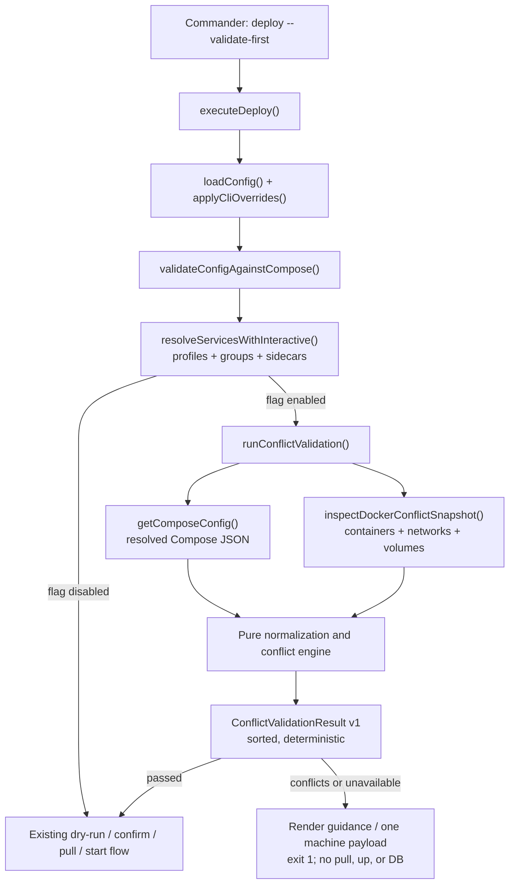

# Service Conflict Detection: Technical Research

## Executive Summary

Issue [#64](https://github.com/yandy-r/rfmedia-apps/issues/64) should be implemented as an
opt-in, read-only validation gate in `rfapps deploy --validate-first`. The gate belongs after
configuration, profile, group, and sidecar resolution, but before dry-run rendering, confirmation,
image pulls, container starts, or deployment-state writes. It should evaluate the fully resolved
Compose model from `docker compose config --format json` against a bounded snapshot of the same
Docker daemon, then either attach a versioned validation result to deploy output or abort with exit
code `1`.

The current `validation.ts` only validates rfapps configuration references against service names
parsed directly from YAML. It must not be used as the source of effective ports, volume names, or
network subnets because that bypasses Compose interpolation, profiles, merge rules, and normalized
long syntax. The existing `getComposeConfig()` and Docker runner are the correct seams, but their
Compose and container types need to be widened and daemon network/volume inspection needs a small,
read-only adapter.

No database or schema migration is needed. Conflict checking is transient preflight evidence and a
failed preflight must not create deployment history.

## Architecture Design



### Data flow and placement

1. Commander parses `--validate-first`; `RawDeployOptions` and `DeployOptions` retain the boolean.
2. Existing configuration-reference validation remains first. It catches invalid rfapps mappings
   without requiring a successful daemon snapshot.
3. Existing target resolution runs next. Conflict scope therefore includes explicit services,
   expanded groups, and sidecars, with the same profile set the deploy will use. An empty service
   array means all active-profile Compose services.
4. When enabled, preflight resolves Compose once with the final compose path, env file, profiles,
   env tool, and working directory. The resolved Compose `name` is the effective project identity.
5. The Docker adapter takes one bounded snapshot of:
   - running container port bindings, mounts, names, and Compose project/service labels;
   - Docker networks and their IPAM subnets;
   - Docker volumes and their driver/options.
6. The pure engine normalizes the desired and observed resources, removes self-collisions, detects
   conflicts, creates remediation guidance, and sorts the result.
7. A passing result is attached to later structured deploy output. A blocking result is rendered
   immediately and returns before the first mutation. `--allow-partial` does not apply because no
   service has succeeded.

The state lock currently treats every non-dry-run deploy as mutating, so validation runs while the
deploy lock is held. That is desirable: it prevents concurrent rfapps mutations during preflight,
although it cannot prevent direct Docker clients from racing the subsequent deploy.

### Conflict rules

#### Ports

- Evaluate only explicit published host ports. An omitted/zero published port is daemon-assigned
  and cannot be predicted.
- A key is protocol, address family, host address, and published port (or each member of a
  published range). TCP and UDP do not conflict.
- IPv4 wildcard (`0.0.0.0` or omitted) overlaps every IPv4 address; IPv6 wildcard (`::`) overlaps
  every IPv6 address. Treat IPv4 and IPv6 as separate families rather than guessing host
  dual-stack behavior.
- Detect desired-versus-desired collisions and desired-versus-running-container collisions.
- Ignore the running container for the same effective Compose project and targeted service:
  Compose may legitimately recreate it with the same binding. Do not ignore non-target siblings
  or similarly named containers from another project.
- `network_mode: host` does not expose the application listen ports in Compose, so no static port
  claim can be inferred. Emit no fabricated finding.

#### Volumes

Generic shared bind paths and named volumes are valid Compose patterns in this repository; multiple
media services intentionally mount the same data tree. Therefore "two services share a source" is
not sufficient evidence of incompatibility.

The first version should report only objective incompatibilities:

- two Compose volume keys resolve to the same effective Docker volume name but declare different
  drivers or driver options;
- a non-external desired named volume already exists on the daemon with incompatible driver or
  driver options;
- one service resolves multiple different sources/types onto the same container target.

Normalize omitted driver to `local` and omitted options to an empty, key-sorted object. For
`external: true`, verify existence but do not impose Compose-owned driver settings. Read-only versus
read-write sharing alone is not a Docker allocation conflict and should not block deployment.

#### Networks

- Evaluate explicit IPv4 and IPv6 CIDRs in top-level `networks.*.ipam.config[].subnet`.
- Detect overlap between different desired effective network names and between a desired network
  and existing daemon networks.
- Exclude the existing daemon network with the same effective name; it is the resource Compose
  intends to reuse. A shared network used by multiple services is represented once.
- Compare only equal address families. CIDRs overlap when their integer ranges intersect.
- A network with no explicit subnet relies on Docker allocation and cannot be predicted; do not
  invent a CIDR.
- Invalid resolved CIDRs make validation `unavailable`/operationally failed rather than silently
  passing. Implement IPv4 and compressed IPv6 parsing locally with `BigInt`, or add a narrowly
  scoped IP parser after dependency review; no current package dependency provides this.

## Data Models

Create `packages/rfapps-cli/src/types/validation.ts` and export it through
`packages/rfapps-cli/src/types/index.ts`.

```ts
export const CONFLICT_VALIDATION_SCHEMA_VERSION = "conflict-validation.v1" as const;

export type ConflictValidationStatus = "passed" | "conflicts" | "unavailable";
export type ConflictKind = "port" | "volume" | "network";
export type ConflictOrigin = "compose" | "runtime";

export interface ConflictParty {
  origin: ConflictOrigin;
  resourceType: "service" | "container" | "volume" | "network";
  name: string;
  project?: string;
  service?: string;
}

export type ConflictResource =
  | {
      kind: "port";
      hostIp: string;
      published: number;
      protocol: "tcp" | "udp" | string;
    }
  | {
      kind: "volume";
      name: string;
      incompatibility: "driver" | "driver-options" | "duplicate-target";
    }
  | {
      kind: "network";
      network: string;
      subnet: string;
      overlaps: string;
    };

export interface ConflictResolution {
  id: string;
  action:
    | "change-compose-port"
    | "stop-or-reconfigure-container"
    | "align-volume-definition"
    | "change-network-subnet"
    | "remove-or-reconfigure-network";
  message: string;
  suggestedValue?: string;
}

export interface ServiceConflict {
  id: string;
  kind: ConflictKind;
  message: string;
  resource: ConflictResource;
  parties: ConflictParty[];
  resolutions: ConflictResolution[];
}

export interface ConflictValidationSummary {
  total: number;
  ports: number;
  volumes: number;
  networks: number;
}

export interface ConflictValidationResult {
  schemaVersion: typeof CONFLICT_VALIDATION_SCHEMA_VERSION;
  status: ConflictValidationStatus;
  scope: {
    services: string[];
    profiles: string[];
    composePath: string;
    project: string;
  };
  summary: ConflictValidationSummary;
  conflicts: ServiceConflict[];
  error?: {
    code: "COMPOSE_CONFIG_UNAVAILABLE" | "DOCKER_SNAPSHOT_UNAVAILABLE" | "INVALID_CIDR";
    message: string;
  };
}
```

Add `validation?: ConflictValidationResult` to `DeployResult` and `validateFirst: boolean` to
`DeployOptions`. There is no persistence model.

Internal raw types should match actual Docker/Compose JSON rather than reusing the lossy
`PortMapping`/`VolumeMapping` plan types:

- Compose service port: string or long syntax with `target`, `published`, `host_ip`, `protocol`,
  and `mode`.
- Compose service volume: string or long syntax with `type`, `source`, `target`, `read_only`, and
  volume/bind options.
- Compose top-level volume: `name`, `external`, `driver`, and `driver_opts`.
- Compose top-level network: `name`, `external`, and nested IPAM configs.
- Runtime container: ID/name, `Config.Labels`, `HostConfig.PortBindings`, and `Mounts`.
- Runtime network: ID/name, driver, and `IPAM.Config[].Subnet`.
- Runtime volume: name, driver, options, and scope.

Conflict IDs and ordering are part of the contract. Construct IDs from normalized resource keys and
sorted party identities, and sort conflicts by `kind`, normalized resource key, then party key.
Sort parties and resolutions too. Do not include a timestamp: repeated checks over identical inputs
must produce identical JSON.

## CLI/API Design

### Command contract

```text
rfapps deploy --validate-first [existing deploy options]
```

- Default is `false`; deploy behavior is unchanged unless opted in.
- `--validate-first --dry-run` performs read-only Compose/daemon inspection and includes validation
  in the dry-run structured payload, but still performs no deploy mutation.
- `--yes` skips the existing deploy confirmation only. It must never suppress or override a
  blocking conflict.
- `--allow-partial` cannot turn a preflight failure into exit `3`; use exit `1`.
- JSON/YAML/table modes never prompt. They emit exactly one deploy payload with `validation`; logs
  and formatted diagnostics remain on stderr under the existing machine-output suppression rules.
- A failed or unavailable validator must not call pull, start, readiness, database initialization,
  or deployment recording.

Example conflict JSON fragment:

```json
{
  "services": [],
  "failed": [
    {
      "name": "validation",
      "code": "SERVICE_CONFLICT",
      "error": "Pre-deploy conflict validation found 1 blocking conflict"
    }
  ],
  "healthy": [],
  "unhealthy": [],
  "started": 0,
  "validation": {
    "schemaVersion": "conflict-validation.v1",
    "status": "conflicts",
    "scope": {
      "services": ["plex"],
      "profiles": ["media"],
      "composePath": "compose.yml",
      "project": "rfmedia-apps"
    },
    "summary": {
      "total": 1,
      "ports": 1,
      "volumes": 0,
      "networks": 0
    },
    "conflicts": [
      {
        "id": "port:tcp:ipv4-any:32400:plex:jellyfin",
        "kind": "port",
        "message": "Host port 32400/tcp conflicts between plex and jellyfin",
        "resource": {
          "kind": "port",
          "hostIp": "0.0.0.0",
          "published": 32400,
          "protocol": "tcp"
        },
        "parties": [],
        "resolutions": [
          {
            "id": "change-port:plex:32401",
            "action": "change-compose-port",
            "message": "Change plex's published port to an available port such as 32401.",
            "suggestedValue": "32401"
          },
          {
            "id": "stop-container:jellyfin",
            "action": "stop-or-reconfigure-container",
            "message": "Stop or reconfigure jellyfin, then run the deploy again."
          }
        ]
      }
    ]
  }
}
```

The real `parties` array must be populated; it is empty above only to keep the example compact.
Suggested ports are advisory: scan upward deterministically within `1..65535` against the captured
claims, but never edit Compose or stop another container automatically.

### Human/interactive output

Text mode prints a compact summary followed by every conflict and numbered remediation options,
matching the issue's requested style. It then aborts. Automatic "resolution" would require editing
Compose or mutating an unrelated container/network, neither of which is authorized by a deploy
preflight. A future interactive `re-check` loop could be added, but v1 should not offer a
"continue despite conflict" path because that defeats `--validate-first`.

## System Constraints

- **Resolved configuration:** Use `getComposeConfig()`, not raw YAML. Pass profiles, final env file,
  and env-tool configuration exactly as deploy does.
- **Same daemon/context:** All Compose and raw Docker inspection calls must share cwd, environment,
  env-tool wrapper, and Docker context.
- **Read only:** Allowed commands are Compose config, `docker ps`, inspect, network list/inspect,
  and volume list/inspect. No stop, rm, network create, Compose edit, or state write.
- **Fail closed:** Compose resolution, daemon inspection, truncated output, malformed JSON, or
  invalid explicit CIDR yields `unavailable` and exit `1`.
- **Bounded work:** Fetch IDs first, cap retained output using `DockerExecOptions`, inspect in
  batches (for example 100 IDs), and reject an excessive resource count with a stable unavailable
  code rather than consuming unbounded memory.
- **Performance:** Compose, container, network, and volume reads can run concurrently after target
  resolution. Pure detection should index ports/volume names and sort CIDR intervals, avoiding
  naive all-container pair comparisons. Normal hosts should require one Compose subprocess plus
  list/inspect batches and complete well before image pull.
- **Race:** Docker exposes no transaction spanning inspection and Compose up. The result is a
  point-in-time best effort. Running it before pull preserves the guarantee that a failed
  validation causes no deploy mutation, at the cost of a wider race if pulling is slow.
- **Security:** Bound all daemon-provided strings in messages, never include mount contents,
  environment values, or raw subprocess stderr in structured output, and never interpolate
  remediation commands for execution.
- **Compatibility:** Preserve existing deploy output fields and make `validation` optional. Do not
  change default deploy behavior or exit categories.
- **Testability:** Keep normalization/detection pure and inject the Compose/snapshot functions into
  the orchestration layer. Unit tests should not need Docker.

## Codebase Changes

### Create

- `packages/rfapps-cli/src/types/validation.ts` — versioned public validation/result contracts and
  internal resolved resource shapes.
- `packages/rfapps-cli/src/lib/conflict-validation.ts` — pure normalizers, IPv4/IPv6 CIDR interval
  logic, conflict detectors, deterministic remediation builder, text formatter, and thin
  dependency-injected orchestration.
- `packages/rfapps-cli/src/lib/conflict-validation.spec.ts` — table-driven unit tests for
  wildcard/IP-family/protocol port rules, target self-exclusion, volume identity compatibility,
  IPv4/IPv6 overlap, invalid CIDRs, stable sorting, and bounded suggestions.

### Modify

- `packages/rfapps-cli/src/lib/docker.ts` — widen `ComposeServiceConfig`/`ComposeConfig`; add
  container labels and mounts; add typed, bounded read-only container/network/volume snapshot
  helpers using `execDocker`.
- `packages/rfapps-cli/src/lib/docker.spec.ts` — cover command construction, batching, malformed
  output, limits, and Docker/env-tool propagation for the new inspection seam.
- `packages/rfapps-cli/src/lib/validation.ts` — retain existing config-reference validation;
  optionally re-export the conflict entry point, but do not expand its raw-YAML cache into a second
  Compose parser.
- `packages/rfapps-cli/src/lib/index.ts` — export conflict validation functions and Docker snapshot
  types/helpers.
- `packages/rfapps-cli/src/types/options.ts` — add `validateFirst` to `DeployOptions`.
- `packages/rfapps-cli/src/types/results.ts` — add optional validation evidence to `DeployResult`.
- `packages/rfapps-cli/src/types/index.ts` — export new validation constants and types.
- `packages/rfapps-cli/src/cli.ts` — register `--validate-first` on deploy and mention conflict
  failure in deploy help.
- `packages/rfapps-cli/src/actions/deploy.ts` — parse the flag, invoke validation at the gate shown
  above, attach output, set operational exit status, and return before any mutation/state write.
- `packages/rfapps-cli/src/actions/deploy.spec.ts` — prove placement and behavior for pass,
  conflicts, unavailable inspection, dry-run, JSON, `--yes`, and `--allow-partial`.
- `packages/rfapps-cli/src/cli.deploy.integration.spec.ts` and
  `packages/rfapps-cli/src/testing/mock-docker.ts` — add realistic Compose config and Docker
  resource inspection responses; assert a detected port/network/volume conflict prevents pull,
  up, readiness, and DB creation.
- `packages/rfapps-cli/src/actions/completion.ts` — add `--validate-first` to Bash, Zsh, and Fish
  deploy completions. Zsh and Fish currently combine deploy and rebuild options; split those blocks
  so the deploy-only flag is not advertised for rebuild. The existing completion also omits
  deploy's `--allow-partial`, which should be included while establishing exact Commander parity.
- `packages/rfapps-cli/src/actions/completion.spec.ts` — derive deploy option names from Commander
  and assert exact Bash/Zsh/Fish parity, rather than checking only token presence.
- `packages/rfapps-cli/README.md` — document the flag, conflict categories, no-mutation guarantee,
  output schema, limitations, and exit behavior.

`packages/rfapps-cli/src/lib/errors.ts` does not need a new public exception if preflight is modeled
as a normal result. Unexpected orchestration failures can continue through `DockerCommandError`;
structured unavailability belongs in `ConflictValidationResult.error`.

## Technical Decisions

- **Resolved Compose JSON over raw YAML:** Effective resources must reflect interpolation, profile
  filtering, extensions, and Compose normalization. The existing YAML parser remains only for
  lightweight service/reference validation.
- **Dedicated conflict module:** `validation.ts` is already a cached config-reference validator.
  Separating the resource engine keeps its pure, typed rules testable and avoids mixing raw and
  resolved models.
- **Opt-in gate:** The issue explicitly introduces `--validate-first`; default deploy performance
  and compatibility remain unchanged.
- **All conflicts block:** Port allocation, objective volume incompatibility, and CIDR overlap are
  errors. There is no silent override and `--yes` is not an override.
- **No automatic remediation:** Editing configuration or stopping/removing resources is a separate
  authorization boundary. The validator supplies deterministic, actionable suggestions only.
- **Project-label self-exclusion:** Names are insufficient because Compose prefixes and explicit
  container names vary. Effective project plus `com.docker.compose.service` labels identify the
  target's own running allocation.
- **Conservative volume rules:** Shared data is common and legal. Only demonstrable Docker resource
  incompatibilities block; application-level write compatibility cannot be inferred safely.
- **One versioned nested result:** Keeping existing `DeployResult` as the envelope minimizes
  consumer breakage while giving automation stable validation evidence.
- **No database:** A preflight result is ephemeral and must not look like a deployment attempt in
  history.

## Open Questions

1. Does product intent define "incompatible services" for shared volumes beyond concrete
   driver/options and duplicate-target conflicts? If concurrent writers should be prohibited, the
   repository needs an explicit compatibility policy or allowlist; inference would flag legitimate
   shared media/data mounts.
2. Should a successful validation result always be included in normal deploy JSON, or only when
   `--validate-first` was supplied? This design includes it only when requested to preserve output
   compatibility.
3. Is an interactive re-check loop required for v1? It can safely re-inspect runtime resources, but
   reloading an edited Compose file also changes the authorized target model and should probably
   require restarting the command.
4. Should host-network services support a user-supplied listen-port annotation? Docker/Compose
   metadata alone cannot determine their application sockets.
5. What hard caps are acceptable for containers, networks, volumes, and expanded published-port
   ranges on large daemons? The implementation should choose documented values and fail closed
   when exceeded.
6. Should IPv6 wildcard versus IPv4 bindings account for host-specific dual-stack socket settings?
   Treating families separately is deterministic and avoids false positives, but can miss a
   platform-dependent collision.
7. The issue describes scope as three to five files, but the current repository contract requires
   CLI, result types, Docker seams, three generated shell templates, unit/integration tests, and
   documentation. Which of those may be deferred without weakening completion parity or the JSON
   contract?

Relevant specifications:

- [Docker Compose ports](https://docs.docker.com/reference/compose-file/services/#ports)
- [Docker Compose volumes](https://docs.docker.com/reference/compose-file/volumes/)
- [Docker Compose networks and IPAM](https://docs.docker.com/reference/compose-file/networks/)
- [Docker container inspect](https://docs.docker.com/reference/cli/docker/inspect/)
- [Docker network inspect](https://docs.docker.com/reference/cli/docker/network/inspect/)
- [Docker volume inspect](https://docs.docker.com/reference/cli/docker/volume/inspect/)
