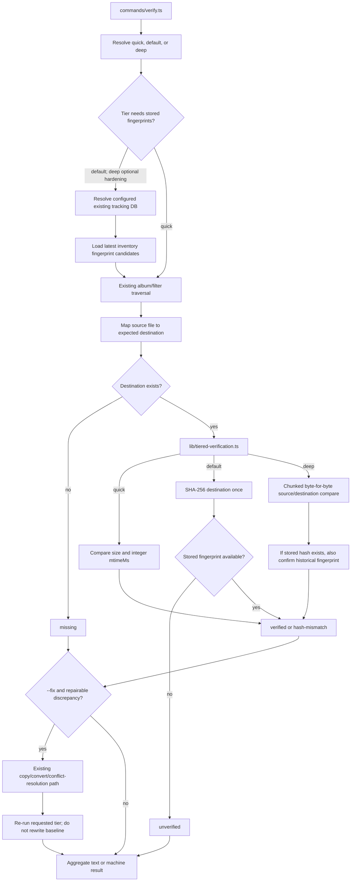

# Tiered Verification: Technical Research

## Executive Summary

Issue #116 should extend the existing `rfmedia verify` command rather than add a parallel command.
The current album and filter actions already own source-to-destination mapping, extra-file detection,
repair, progress, and text summaries. A small shared verifier should provide the tier-specific
per-file check while both actions retain their existing traversal and fix workflows.

The three tiers should have these precise meanings:

| Invocation               | Check                                                                 | Reads                                                                             |
| ------------------------ | --------------------------------------------------------------------- | --------------------------------------------------------------------------------- |
| `rfmedia verify --quick` | Existence plus source/destination size and modification-time metadata | Directory entries and `stat()` only                                               |
| `rfmedia verify`         | Current destination SHA-256 versus the stored final-artifact SHA-256  | Tracking inventory plus one full destination read                                 |
| `rfmedia verify --deep`  | Exact source/destination byte comparison                              | Both files in full; stored fingerprint is an extra hardening check when available |

`--quick` and `--deep` are mutually exclusive; no flag selects the default tier. Existing
`--verify-size` remains a compatibility precheck for one release, but is redundant under default
and deep verification and should be documented as superseded by `--quick` for metadata-only use.

The stored hash is `inventory.content_hash`, introduced by issue #111 and hardened in PR #248. It
describes final destination bytes, including converted output, and is nullable for historical rows.
The default tier must hash the destination only and compare it with that fingerprint. It must not
hash the source as an implicit fallback because that changes both the confidence contract and I/O
cost. A missing database, missing row, or `NULL` fingerprint is `unverified`, not corruption; the
user can rerun the producing copy/sync workflow to establish a baseline or use `--deep` for a
byte-identical artifact.

No schema migration is required. The inventory already has indexes on `source_path` and `dest_path`,
and the operation row carries `convert_key`. Because ranged copies intentionally share one inventory
identity per source-relative artifact, fingerprint lookup first prefers the exact destination and
then reuses the newest fingerprint for the same source, relative path, and conversion variant. This
validates all byte-equivalent ranged copies without expanding issue #116 into a one-row-per-artifact
ledger.

Converted source and destination bytes are intentionally different. Default verification fully
supports conversions because the stored fingerprint is for the converted output. Quick and deep
cannot truthfully perform their promised source/destination metadata or byte equality checks on a
conversion, so they report the artifact as `unverified` with an actionable recommendation to use
the default tier. They must not silently downgrade to a different confidence level or re-run ffmpeg
into a temporary file.

## Architecture Design



### Component boundaries

- `commands/verify.ts` parses tier flags, resolves the configured database path, refuses conflicting
  flags, adds the tier to machine output, and sets exit status from the final aggregate result.
- `actions/verify-album.ts` and `actions/verify-filter.ts` keep traversal, expected-name mapping,
  extra detection, progress, and repair. They call one shared per-file verifier and aggregate its
  typed result instead of embedding size-only branches.
- `lib/tiered-verification.ts` is framework-agnostic. It selects the tier algorithm, classifies a
  file, and never logs, prompts, repairs, opens a database, or sets `process.exitCode`.
- `lib/integrity.ts` remains the byte-reading boundary. It keeps `calculateHash()` and gains an
  abort-aware, fixed-buffer byte comparison. Byte comparison performs an initial size check, reads
  equal offsets until EOF, closes both handles in `finally`, and never loads a whole media file.
- `lib/db.ts` adds read-only inventory lookup APIs. It joins `inventory` to `operations` for
  conversion identity and returns rows ordered newest-first. It does not alter schema version 9.

### Fingerprint resolution

For each source root, load candidate inventory rows once and build in-memory maps. Normalize paths
with `path.resolve()` only for comparison; do not rewrite stored values. Resolve a fingerprint in
this order:

1. Newest row whose normalized `dest_path` equals the expected destination and whose
   `operations.convert_key` matches the requested conversion variant.
2. Newest row with the same normalized `source_path`, `relative_path`, and conversion variant.
   This is the deliberate ranged-copy fallback because those outputs are expected to contain the
   same bytes.
3. Otherwise return `missing`; a matching row with `content_hash IS NULL` returns `unknown`.

Do not select a fingerprint only by filename, hash value, rating, or destination basename. Do not
use a fingerprint from a different conversion format. Rows from completed, partial, or interrupted
operations are usable because inventory is written only after final artifact materialization and
hashing; `copied_at DESC, id DESC` establishes deterministic newest-wins behavior.

Database resolution follows the existing copy/history precedence: explicit
`--tracking-database`, then `resolveUndoDatabasePath(getLoadedConfig())`. Check that the resolved
file exists before `initializeDatabase()` so verification does not create an empty baseline database
merely to report every file unknown. A missing database is a user-level unverified baseline; an
existing database that cannot be opened or migrated is an operational failure.

## Data Models/API Contracts

### Options and results

```typescript
export type VerificationTier = "quick" | "default" | "deep";

export interface VerifyOptions {
  // existing fields unchanged
  tier: VerificationTier;
  trackingDatabase?: string;
}

export type FileVerifyStatus =
  | "present"
  | "missing"
  | "size-mismatch"
  | "metadata-mismatch"
  | "hash-mismatch"
  | "content-mismatch"
  | "unverified";

export interface VerifiedFile {
  // existing fields unchanged
  status: FileVerifyStatus;
  reason?: "mtime" | "fingerprint-missing" | "fingerprint-null" | "conversion-unsupported";
}

export interface VerifyCommandResult {
  // existing fields unchanged
  tier: VerificationTier;
  metadataMismatch: number; // mtime-only; size remains in sizeMismatch for compatibility
  hashMismatch: number;
  contentMismatch: number;
  unverified: number;
}
```

`verified` counts only files that reached the requested confidence. Full expected or actual hashes
must not be included in routine text, JSON, YAML, CSV, debug, or error output. Machine output adds
`tier` and the four new counters while retaining the existing fields. This is an additive contract.

### Shared verifier

```typescript
export interface VerificationFingerprint {
  contentHash: string | null;
  sourcePath: string;
  relativePath: string;
  destPath: string;
  convertKey: ConvertFormat | null;
  copiedAt: number;
}

export interface VerifyFileInput {
  tier: VerificationTier;
  sourcePath: string;
  destinationPath: string;
  converted: boolean;
  fingerprint?: VerificationFingerprint;
  signal?: AbortSignal;
}

export interface VerifyFileOutcome {
  status: Exclude<FileVerifyStatus, "missing">;
  expectedSize?: number;
  actualSize?: number;
  reason?: VerifiedFile["reason"];
}

export async function verifyFileByTier(input: VerifyFileInput): Promise<VerifyFileOutcome>;
```

The actions continue to perform the existence check so their established missing-path and
extra-file behavior stays intact. The verifier contract is:

- Quick: compare `stat.size`; on equality compare `Math.trunc(stat.mtimeMs)`. Size differences use
  the existing `size-mismatch`; mtime-only differences use `metadata-mismatch`.
- Default: require a non-null stored fingerprint, calculate the destination SHA-256 once, and return
  `present` or `hash-mismatch`.
- Deep: for non-converted files, compare bytes. If a stored fingerprint exists, additionally hash
  the destination and require it to match; this catches common-mode hardlink mutation that a
  source/destination comparison alone cannot detect. Absence of a fingerprint does not prevent a
  non-converted deep comparison from passing.
- Converted quick/deep: return `unverified` with `conversion-unsupported`. Default remains the
  supported verification tier for converted output.

### Database read API

```typescript
export interface DbInventoryFingerprint extends DbInventoryEntry {
  convert_key: string | null;
}

export function getInventoryFingerprintCandidates(
  db: DbConnection,
  sourcePaths: readonly string[],
): DbInventoryFingerprint[];
```

The query is parameterized, handles an empty source list without generating invalid SQL, joins
`operations` by `operation_id`, and orders by `copied_at DESC, inventory.id DESC`. Existing
`idx_inventory_source` and `idx_inventory_dest` are sufficient for this release. Do not add a hash
index: verification never searches by hash.

### Repair and exit contract

- `missing`, `size-mismatch`, `metadata-mismatch`, `hash-mismatch`, and `content-mismatch` are
  repairable through the existing conflict-resolution flow when `--fix` is active.
- Repair re-copies or re-converts from the current source, then re-runs the requested tier. It does
  not update, backfill, or replace the stored fingerprint. If the source changed since the baseline,
  default repair can remain a hash mismatch; the user must deliberately run copy/sync to establish
  a new baseline.
- `unverified` is not repairable. Missing or legacy fingerprints are not evidence of damaged bytes,
  and `verify --fix` must not silently bless current content.
- Extra-file handling, `--trash`, `--force`, and conflict strategies remain as implemented.
- Exit 0 requires no remaining missing, extra, mismatch, unverified, or failed entries after repair.
  Exit 1 means a discrepancy, insufficient evidence for the requested tier, or operational failure.
  Usage/conflicting flags continue through the CLI's usage-error path.

## System Constraints

- Node.js 22+, ESM imports with `.js`, Commander 14, synchronous `better-sqlite3`, and the existing
  action/command separation remain mandatory.
- The default tier depends on the issue #111 final-artifact SHA-256 contract: lowercase 64-character
  hex in nullable schema-version-9 `inventory.content_hash`.
- Inventory identity is one row per operation/source/relative path, not one row per ranged output.
  This issue may reuse a byte-equivalent fingerprint but must not redesign the ledger or bump the
  schema.
- Quick verification must do no hashing and must not open SQLite. Its benchmark must demonstrate the
  issue's 10x target against deep verification on representative media-sized files; CI should not
  contain a wall-clock assertion.
- Default reads only destination bytes after baseline resolution. Deep reads source and destination;
  it may read the destination again when an available stored fingerprint is used to detect hardlink
  common-mode drift.
- Verification is read-only unless `--fix` is supplied. Ordinary verification never writes the
  inventory or creates a tracking database.
- Hardlinks are not a special pass condition. Quick naturally compares the same inode metadata;
  default detects changes since the stored snapshot; deep byte equality plus an available stored
  fingerprint provides the strongest available hardlink check.
- Conversions are not byte-equivalent to their source. No tier may label a source/destination byte
  mismatch as corruption merely because `--convert` is active.
- Source/destination mapping and extra detection remain in both existing actions; extracting all
  traversal into a new engine would over-expand this issue.
- Per-file work remains bounded by the existing `workers` setting. Byte and hash helpers must close
  file handles on success, mismatch, cancellation, and error.
- Existing abort/signal behavior is preserved and forwarded into deep reads. A cancellation is a
  failed operation, not a content mismatch.

## Exact Files to Create/Modify

### Create

- `packages/rfmedia-cli/src/lib/tiered-verification.ts` — pure tier selector, fingerprint resolver,
  per-file classification, and aggregation helpers.
- `packages/rfmedia-cli/src/lib/tiered-verification.test.ts` — focused quick/default/deep,
  conversion, hardlink, legacy-null, missing-baseline, and cancellation tests.

### Modify

- `packages/rfmedia-cli/src/commands/verify.ts` — add mutually exclusive `--quick`/`--deep`, add
  `--tracking-database`, build `tier`, emit additive counters, and use final-result exit semantics.
- `packages/rfmedia-cli/src/actions/verify-album.ts` — use shared verifier, resolve source-relative
  fingerprints, aggregate new statuses, and recheck repaired files.
- `packages/rfmedia-cli/src/actions/verify-filter.ts` — mirror the same contracts across flat,
  preserve-structure, and album-filter modes.
- `packages/rfmedia-cli/src/types/options.ts` and `packages/rfmedia-cli/src/types/results.ts` — add
  tier, status, reason, and counter types without removing current fields.
- `packages/rfmedia-cli/src/types/index.ts` — export the new public types.
- `packages/rfmedia-cli/src/lib/db.ts` — add newest-first, conversion-aware fingerprint candidate
  query; no DDL change.
- `packages/rfmedia-cli/src/lib/db.test.ts` — cover exact-destination ordering, ranged fallback data,
  conversion isolation, nullable hashes, empty inputs, and parameter safety.
- `packages/rfmedia-cli/src/lib/integrity.ts` — add abort-aware chunked byte comparison.
- `packages/rfmedia-cli/src/lib/integrity.test.ts` — cover equal bytes, equal-size differences,
  unequal size, empty files, large multi-chunk files, read errors, and cancellation cleanup.
- `packages/rfmedia-cli/src/actions/verify-album.test.ts` and
  `packages/rfmedia-cli/src/actions/verify-filter.test.ts` — action-level aggregation, repair/recheck,
  conversion, hardlink, multiple source, and machine-result regressions.
- `packages/rfmedia-cli/src/cli.test.ts` — CLI defaults, flag conflicts, custom database path, exit
  status, and additive machine output.
- `packages/rfmedia-cli/src/lib/shell-completions/bash.ts`,
  `packages/rfmedia-cli/src/lib/shell-completions/zsh.ts`, and
  `packages/rfmedia-cli/src/lib/shell-completions/fish.ts` — expose `--quick`, `--deep`, and
  `--tracking-database` for `verify`.
- `packages/rfmedia-cli/src/lib/shell-completions/templates.spec.ts` — enforce Bash/Zsh/Fish parity.
- `packages/rfmedia-cli/benchmarks/verify.bench.ts` and
  `packages/rfmedia-cli/benchmarks/helpers.ts` — add controlled quick/default/deep rows using the
  same pre-populated inventory and representative media-sized fixtures.
- `packages/rfmedia-cli/docs/features/verify-command.doc.md`,
  `packages/rfmedia-cli/docs/features/verify-auto-fix.doc.md`,
  `packages/rfmedia-cli/docs/features/content-hashing-during-copy-operations.md`,
  `docs/features/file-integrity-verification.md`, and `packages/rfmedia-cli/README.md` — document
  tier guarantees, conversion limitations, unknown baselines, repair, output, and examples.
- `ROADMAP.md` — mark #116 implemented only after the final PR is merged and preserve links to #111,
  PR #233, and PR #248 as prerequisites/history.

`packages/rfmedia-cli/src/lib/schema.sql` and `migrations.ts` must not change. MCP, queue, copy, sync,
and playlist schemas are not part of the `verify` command surface.

## Decisions/Alternatives/Rationale

| Decision                                                                            | Rejected alternative                                      | Rationale                                                                                                                                         |
| ----------------------------------------------------------------------------------- | --------------------------------------------------------- | ------------------------------------------------------------------------------------------------------------------------------------------------- |
| Default hashes destination against stored final-artifact fingerprint                | Hash source and destination                               | One destination read honors the issue #111 consumer contract, supports conversions, and distinguishes current equality from historical integrity. |
| Missing/`NULL` hash is `unverified`                                                 | Treat as mismatch or auto-backfill                        | Historical absence is not corruption; auto-backfill would bless potentially damaged current bytes.                                                |
| Reuse source-relative fingerprint for ranged outputs after exact-destination lookup | Add one inventory row per output                          | Existing ranged artifacts are byte-equivalent; a ledger redesign is a separate migration and operation-identity feature.                          |
| Deep uses chunked direct comparison                                                 | Compare two SHA-256 values                                | The issue explicitly calls for byte-by-byte validation; direct comparison can stop at the first differing chunk.                                  |
| Deep also checks an available stored fingerprint                                    | Byte comparison only                                      | Hardlink source and destination can mutate together, so equality alone can miss drift from the copy-time baseline.                                |
| Converted quick/deep are explicitly unverified                                      | Compare unlike bytes, silently fall back, or re-transcode | False mismatch is wrong, silent downgrade misstates confidence, and deterministic temporary conversion is costly and outside scope.               |
| Verification never updates fingerprints                                             | Update baseline after successful repair                   | Integrity checking must not turn an observed state into trusted state; copy/sync owns baseline creation.                                          |
| Keep `--verify-size` temporarily                                                    | Remove it immediately or make it select quick             | Additive compatibility avoids breaking scripts; documentation can steer users to the clearer tier flags.                                          |
| Add shared verifier, retain action traversals                                       | Rewrite both actions around a new traversal engine        | The current mapping/fix code is extensive and mode-specific; a surgical shared per-file policy minimizes regression risk.                         |
| No schema/index change                                                              | Add a hash index or verification table                    | Current queries filter by source/destination, and hashes are values, not lookup keys.                                                             |

## Open Questions

These are non-blocking for implementation; the defaults above should be used unless maintainers
explicitly choose otherwise:

1. Should a later major release remove `--verify-size`, or retain it indefinitely as an additive
   precheck? This release should retain it without a runtime deprecation warning.
2. Should deterministic transcoder provenance eventually enable a true deep tier for converted
   files? That requires storing converter/version/options and a reproducibility policy, so it should
   be tracked separately rather than added to #116.
3. Should the one-row-per-source inventory evolve into a one-row-per-artifact ledger? That would
   eliminate the ranged fallback and improve rename history, but it is a schema/identity project and
   not required for tiered verification.
