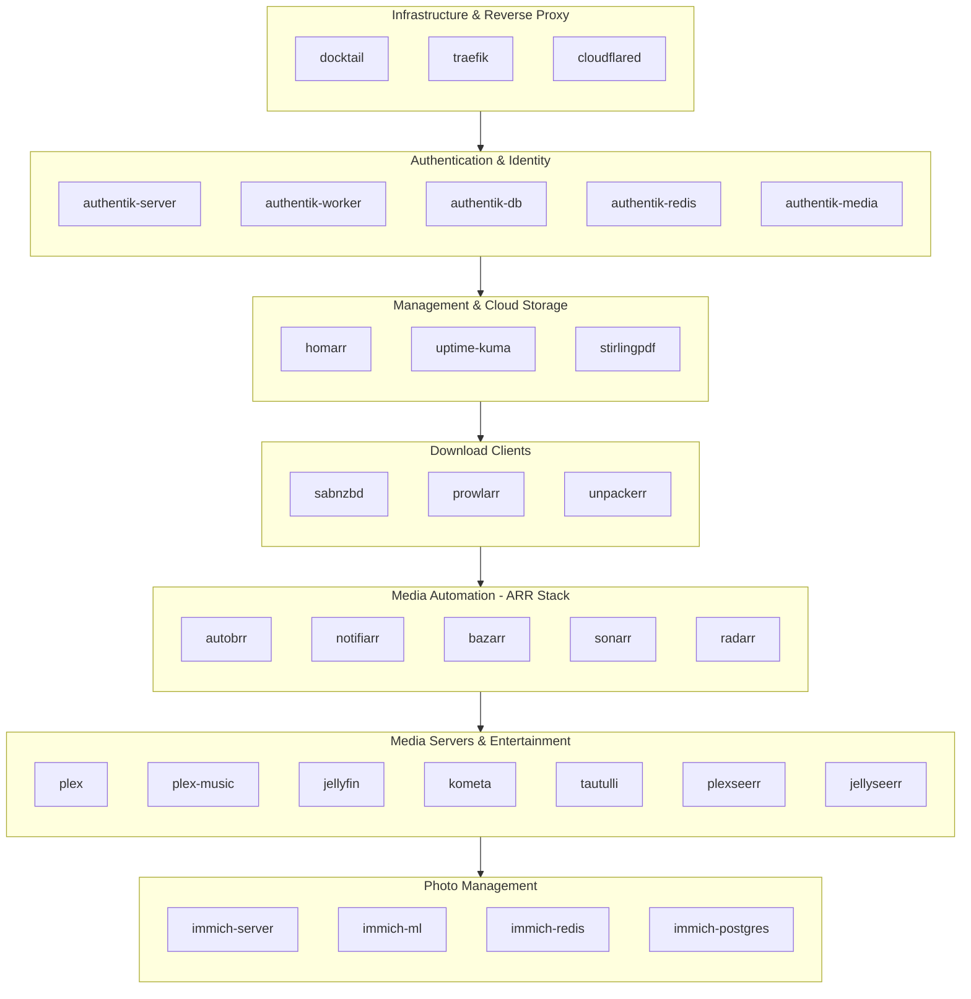
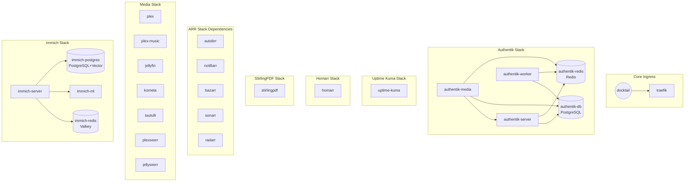
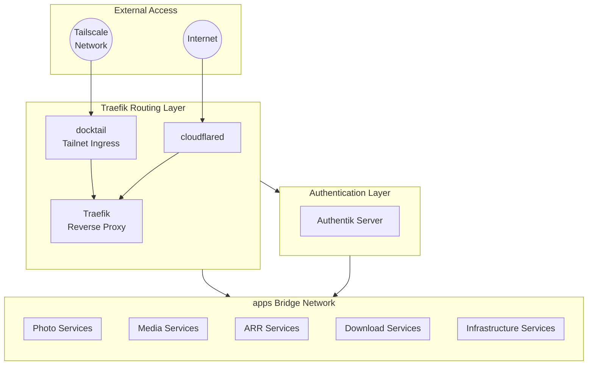
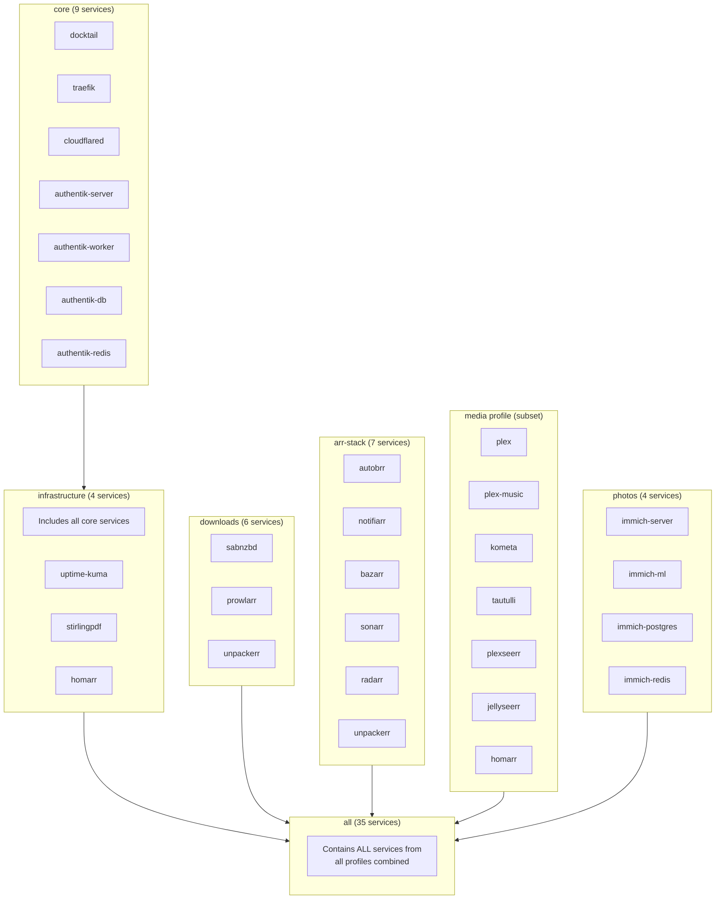
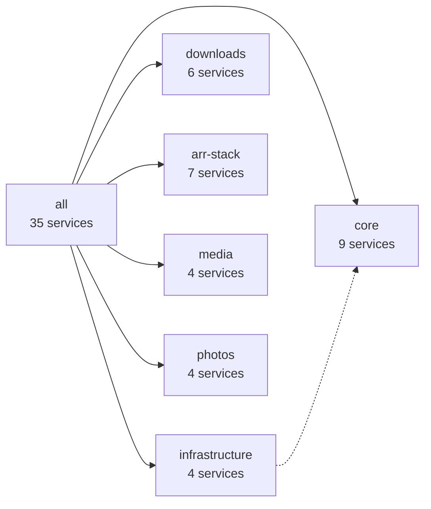
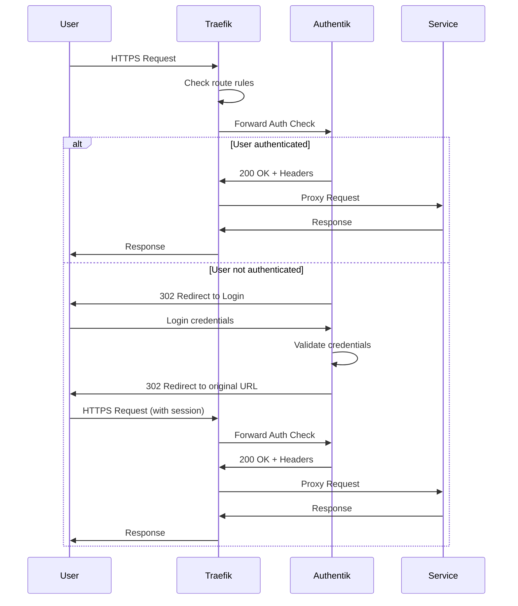
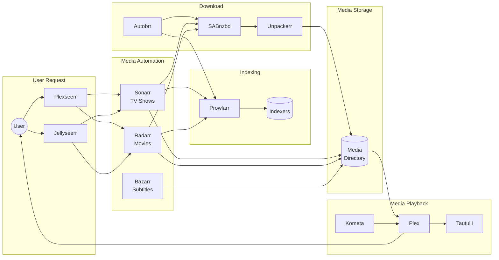
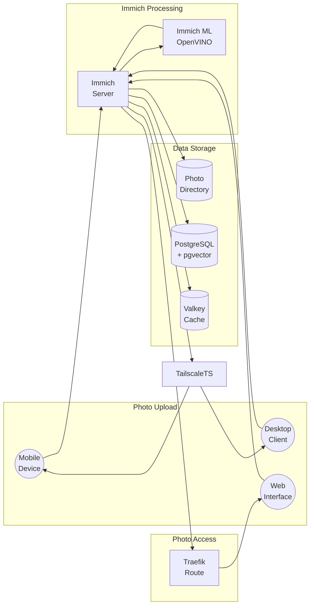

# Architecture Diagrams

This document provides comprehensive visual representations of the rfmedia-apps infrastructure using
Mermaid diagrams. These diagrams illustrate service relationships, network topology, profile
membership, and data flow patterns.

## Table of Contents

1. [Architecture Diagrams](#architecture-diagrams)
   1. [Table of Contents](#table-of-contents)
   2. [1. Service Overview Diagram](#1-service-overview-diagram)
      1. [All Services by Category](#all-services-by-category)
   3. [2. Service Dependencies Diagram](#2-service-dependencies-diagram)
      1. [Database Dependencies](#database-dependencies)
      2. [Dependency Legend](#dependency-legend)
   4. [3. Network Architecture Diagram](#3-network-architecture-diagram)
      1. [Network Topology](#network-topology)
      2. [Network Architecture Notes](#network-architecture-notes)
   5. [4. Profile Membership Diagram](#4-profile-membership-diagram)
      1. [Service-to-Profile Mapping](#service-to-profile-mapping)
      2. [Profile Hierarchy](#profile-hierarchy)
   6. [5. Data Flow Diagrams](#5-data-flow-diagrams)
      1. [Request Authentication Flow](#request-authentication-flow)
      2. [Media Acquisition Flow](#media-acquisition-flow)
      3. [Photo Management Flow](#photo-management-flow)
   7. [Service Count Summary](#service-count-summary)
   8. [Quick Reference](#quick-reference)
      1. [Services with Database Dependencies](#services-with-database-dependencies)
      2. [Profile Activation Commands](#profile-activation-commands)

## 1. Service Overview Diagram

This diagram shows all 35 services organized by their functional category. Each category represents
a logical grouping of related services.

### All Services by Category



The diagram above shows the logical flow of services from infrastructure through to end-user
applications. Services within each category work together to provide specific functionality.

## 2. Service Dependencies Diagram

This diagram illustrates the dependency relationships between services, including database backends.

### Database Dependencies



### Dependency Legend

| Symbol     | Meaning                                       |
| ---------- | --------------------------------------------- |
| `((name))` | Tailnet ingress service (e.g. docktail)       |
| `[(name)]` | Database service (PostgreSQL, MariaDB, Redis) |
| `[name]`   | Application service                           |
| `-->`      | Depends on / requires                         |

## 3. Network Architecture Diagram

This diagram shows how network traffic flows through the infrastructure, including external access
patterns and internal communication.

### Network Topology



### Network Architecture Notes

**External Access Paths:**

1. **Public Internet via Cloudflare Tunnel**: `cloudflared` forwards to Traefik on `apps`
2. **Tailnet via Docktail**: Docktail advertises Traefik, Jellyfin, Immich (`images`), and other labeled services
3. **Tailnet via tsdproxy**: Shareable hosts `git` (Forgejo), `plex`, and `plex-music`

**Internal Communication:**

- All application services communicate via the `apps` bridge network with explicit hostnames

**Authentication Middleware:**

- `authentik-dev@docker`: Forward authentication for infrastructure services (DOMAIN)
- `authentik-media@docker`: Forward authentication for media services (DOMAIN2)

## 4. Profile Membership Diagram

This diagram shows which services belong to which Docker Compose profiles.

### Service-to-Profile Mapping



### Profile Hierarchy



The `infrastructure` profile includes all services from `core` plus additional management services.
The `all` profile is the union of all other profiles.

## 5. Data Flow Diagrams

These diagrams illustrate how data flows through the system for common operations.

### Request Authentication Flow



### Media Acquisition Flow



### Photo Management Flow



## Service Count Summary

| Profile        | Service Count | Description                                      |
| -------------- | ------------- | ------------------------------------------------ |
| core           | 9             | Essential infrastructure (proxy, authentication) |
| infrastructure | 15            | Core + management tools and file sharing         |
| downloads      | 6             | Download clients and indexers                    |
| arr-stack      | 12            | Media automation (Sonarr, Radarr, etc.)          |
| media          | 10            | Media servers and management                     |
| photos         | 4             | Photo management (Immich)                        |
| **all**        | **35**        | Complete deployment                              |

## Quick Reference

### Services with Database Dependencies

| Service          | Database        | Type                     |
| ---------------- | --------------- | ------------------------ |
| authentik-server | authentik-db    | PostgreSQL 16            |
| authentik-server | authentik-redis | Redis                    |
| uptime-kuma      | uptime-kuma-db  | MariaDB                  |
| immich-server    | immich-postgres | PostgreSQL 14 + pgvector |
| immich-server    | immich-redis    | Valkey                   |

### Profile Activation Commands

```bash
# Deploy specific profiles using rfapps CLI
rfapps deploy -p core --yes
rfapps deploy -p media --yes
rfapps deploy -p core -p infrastructure -p media --yes

# Deploy everything
rfapps deploy -p all --yes

# npm script shortcuts
npm run apps:deploy        # Deploy all services
npm run apps:start         # Alias for deploy

# Using rfapps directly with service groups
rfapps deploy -g media-stack --yes     # plex, sonarr, radarr, lidarr, bazarr
rfapps deploy -g arr-stack --yes       # sonarr, radarr, lidarr, bazarr, prowlarr
rfapps deploy -g auth-stack --yes      # all authentik services
```
