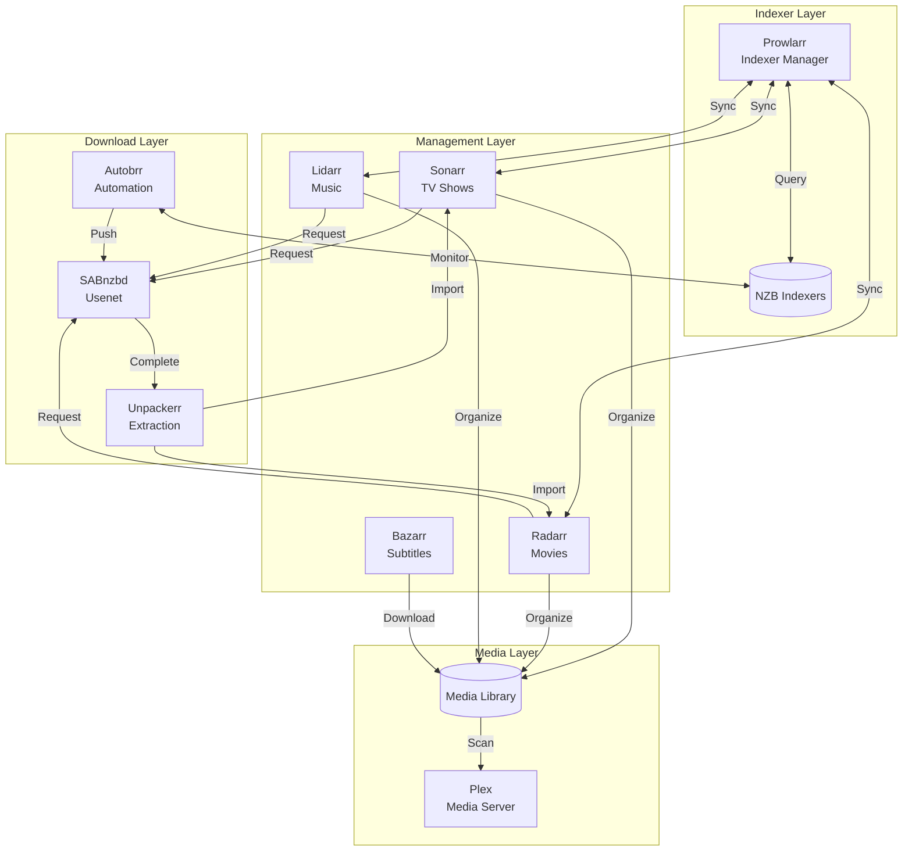

# Arr Stack Setup Guide

This guide covers the complete setup and configuration of the \*arr services (Sonarr, Radarr,
Lidarr, Bazarr, and Prowlarr) for automated media management, including indexer configuration,
download client integration, and quality profiles.

## Overview

The \*arr stack provides automated media acquisition and management:

| Service       | Purpose                          | Port |
| ------------- | -------------------------------- | ---- |
| **Prowlarr**  | Indexer manager for all arr apps | 9696 |
| **Sonarr**    | TV show automation               | 8989 |
| **Radarr**    | Movie automation                 | 7878 |
| **Lidarr**    | Music automation                 | 8686 |
| **Bazarr**    | Subtitle automation              | 6767 |
| **Autobrr**   | IRC announce automation          | 7474 |
| **Unpackerr** | Archive extraction               | -    |

## Prerequisites

Before setting up the arr stack, ensure you have:

- Docker and Docker Compose installed
- Traefik reverse proxy configured
- Tailscale network configured
- Usenet provider subscription (for SABnzbd)
- Indexer access (NZBGeek, DrunkenSlug, etc.)
- Media storage with sufficient space

### Required Environment Variables

Add these variables to your `.env.local` file:

```bash
# User/Group IDs (should own media files)
PUID=1000
PGID=1000
TZ=America/New_York

# Directory Paths
DOCKER_DIR=/path/to/docker/config
DATA_DIR=/path/to/media

# Domain Configuration
DOMAIN2=media.yourdomain.com

# Theme (optional)
TP_THEME=dracula

# Tailscale
TS_AUTHKEY=tskey-auth-xxxxx
```

## Architecture Overview

The arr stack works together to automatically find, download, and organize media.



## Setting Up Indexers with Prowlarr

Prowlarr centralizes indexer management and syncs to all arr applications.

### Step 1: Deploy Prowlarr

```bash
rfapps deploy -s prowlarr --yes
```

### Step 2: Initial Configuration

1. Access Prowlarr at `https://prowlarr.${DOMAIN2}`
2. Complete initial setup wizard
3. Configure authentication:
   - Go to **Settings** > **General**
   - Set **Authentication**: Forms (Login page)
   - Set **Username** and **Password**

### Step 3: Add Indexers

1. Go to **Indexers** > **Add Indexer**
2. Search for your indexer (e.g., "NZBGeek")
3. Configure:

   ```yaml
   # Example NZB Indexer
   Name: NZBGeek
   URL: https://api.nzbgeek.info
   API Key: your-api-key
   Categories: TV, Movies, Music
   ```

4. Test and save

### Step 4: Sync to Apps

1. Go to **Settings** > **Apps**
2. Add each arr application:

   **Sonarr:**

   ```yaml
   Name: Sonarr
   Sync Level: Full Sync
   Prowlarr Server: http://prowlarr:9696
   Sonarr Server: http://sonarr:8989
   API Key: (from Sonarr settings)
   ```

   **Radarr:**

   ```yaml
   Name: Radarr
   Sync Level: Full Sync
   Prowlarr Server: http://prowlarr:9696
   Radarr Server: http://radarr:7878
   API Key: (from Radarr settings)
   ```

3. Click **Test** then **Save**

## Connecting Download Clients

### SABnzbd (Usenet)

#### Deploy SABnzbd

```bash
rfapps deploy -s sabnzbd --yes
```

#### Configure SABnzbd

1. Access SABnzbd at `https://sabnzbd.${DOMAIN2}`
2. Complete the setup wizard:

   ```yaml
   # Server Configuration
   Server: news.usenetprovider.com
   Port: 563
   SSL: Yes
   Username: your-username
   Password: your-password
   Connections: 20-50
   ```

3. Configure categories (Settings > Categories):

   | Category | Folder                       | Priority |
   | -------- | ---------------------------- | -------- |
   | tv       | /data/usenet/complete/tv     | Default  |
   | movies   | /data/usenet/complete/movies | Default  |
   | music    | /data/usenet/complete/music  | Default  |

4. Get API key from **Config** > **General** > **Security**

#### Add SABnzbd to Arr Apps

In each arr application, go to **Settings** > **Download Clients** > **Add**:

```yaml
Name: SABnzbd
Host: sabnzbd
Port: 8080
API Key: your-sabnzbd-api-key
Category: tv # (or movies/music)
```

## Quality Profiles and Naming Conventions

### Sonarr Quality Profile Setup

1. Go to **Settings** > **Profiles**
2. Create or edit profiles:

**HD-1080p Profile:**

```yaml
Name: HD-1080p
Upgrades Allowed: Yes
Upgrade Until: Bluray-1080p
Qualities (ranked): 1. Bluray-1080p 2. WEB 1080p 3. HDTV-1080p 4. Bluray-720p 5. WEB 720p
```

**4K Profile:**

```yaml
Name: 4K Ultra HD
Upgrades Allowed: Yes
Upgrade Until: Bluray-2160p
Qualities (ranked): 1. Bluray-2160p Remux 2. Bluray-2160p 3. WEB 2160p
```

### Sonarr Naming Convention

Go to **Settings** > **Media Management** > **Episode Naming**:

```yaml
Standard Episode Format:
  {Series TitleYear} - S{season:00}E{episode:00} - {Episode CleanTitle} [{Quality Full}]{[MediaInfo VideoDynamicRangeType]}{[Mediainfo AudioCodec}-{Mediainfo AudioChannels]}{[MediaInfo VideoCodec]}{-Release Group}

Daily Episode Format:
  {Series TitleYear} - {Air-Date} - {Episode CleanTitle} [{Quality Full}]

Anime Episode Format:
  {Series TitleYear} - S{season:00}E{episode:00} - {absolute:000} - {Episode CleanTitle} [{Quality Full}]

Series Folder Format:
  {Series TitleYear}

Season Folder Format:
  Season {season:00}
```

### Radarr Quality Profile Setup

1. Go to **Settings** > **Profiles**
2. Create profiles:

**HD-1080p Profile:**

```yaml
Name: HD-1080p
Upgrades Allowed: Yes
Upgrade Until: Bluray-1080p
Minimum Custom Format Score: 0
Qualities (ranked): 1. Bluray-1080p 2. WEB 1080p 3. Bluray-720p 4. WEB 720p
```

### Radarr Naming Convention

Go to **Settings** > **Media Management** > **Movie Naming**:

```yaml
Movie Folder Format:
  {Movie CleanTitle} ({Release Year})

Standard Movie Format:
  {Movie CleanTitle} ({Release Year}) [{Quality Full}]{[MediaInfo VideoDynamicRangeType]}{[Mediainfo AudioCodec}-{Mediainfo AudioChannels]}{[MediaInfo VideoCodec]}{-Release Group}
```

## Integration Between Services

### praxrr (TRaSH Guides Integration)

praxrr helps sync quality profiles from TRaSH Guides:

1. Deploy praxrr:

   ```bash
   rfapps deploy -s praxrr --yes
   ```

2. Access at `https://praxrr.${DOMAIN2}`
3. Connect to Sonarr/Radarr:

   ```yaml
   Sonarr:
     URL: http://sonarr:8989
     API Key: your-sonarr-api-key

   Radarr:
     URL: http://radarr:7878
     API Key: your-radarr-api-key
   ```

4. Import TRaSH Guide profiles

### Connecting Bazarr to Sonarr/Radarr

Bazarr automatically downloads subtitles for your media.

#### Deploy Bazarr

```bash
rfapps deploy -s bazarr --yes
```

#### Configure Bazarr

1. Access at `https://bazarr.${DOMAIN2}`
2. Go to **Settings** > **Sonarr**:

   ```yaml
   Address: sonarr
   Port: 8989
   API Key: your-sonarr-api-key
   ```

3. Go to **Settings** > **Radarr**:

   ```yaml
   Address: radarr
   Port: 7878
   API Key: your-radarr-api-key
   ```

4. Configure subtitle providers:
   - OpenSubtitles.com
   - Subscene
   - Addic7ed

5. Set language preferences:
   - Primary: English
   - Secondary: (your preference)

## Automation with Autobrr and Unpackerr

### Autobrr Setup

Autobrr monitors IRC announce channels for instant releases.

#### Deploy Autobrr

```bash
rfapps deploy -s autobrr --yes
```

#### Configure Autobrr

1. Access at `https://autobrr.${DOMAIN2}`
2. Add IRC networks:

   ```yaml
   Network: irc.example.com
   Port: 6697
   SSL: Yes
   Nick: your-nick
   Auth: NickServ password
   Channels: #announce
   ```

3. Create filters matching your quality preferences
4. Connect to download clients (SABnzbd)
5. Optionally connect to arr apps for announce filtering

### Unpackerr Setup

Unpackerr automatically extracts downloaded archives.

#### Deploy Unpackerr

```bash
rfapps deploy -s unpackerr --yes
```

#### Configure Unpackerr

Create config at `${DOCKER_DIR}/unpackerr/unpackerr.conf`:

```ini
[sonarr]
  url = "http://sonarr:8989"
  api_key = "your-sonarr-api-key"
  paths = ["/data/usenet/complete/tv"]
  protocols = "usenet"
  timeout = "10s"
  delete_delay = "5m"
  delete_orig = false

[radarr]
  url = "http://radarr:7878"
  api_key = "your-radarr-api-key"
  paths = ["/data/usenet/complete/movies"]
  protocols = "usenet"
  timeout = "10s"
  delete_delay = "5m"
  delete_orig = false
```

## Notifiarr Integration

Notifiarr provides unified notifications for all arr apps.

### Deploy Notifiarr

```bash
rfapps deploy -s notifiarr --yes
```

### Configure Notifiarr

1. Create account at [notifiarr.com](https://notifiarr.com)
2. Get API key from dashboard
3. Configure at `${DOCKER_DIR}/notifiarr/notifiarr.conf`:

   ```yaml
   api_key = "your-notifiarr-api-key"

   [sonarr] url = "http://sonarr:8989" api_key = "your-sonarr-api-key"

   [radarr] url = "http://radarr:7878" api_key = "your-radarr-api-key"

   [plex] url = "http://plex:32400" token = "your-plex-token"
   ```

4. Set up Discord/Slack webhooks in Notifiarr dashboard

## Common Arr Stack Issues

### Indexer Connection Failed

**Symptoms:** "Unable to connect to indexer" errors.

**Solutions:**

1. **Verify Prowlarr connection:**

   ```bash
   docker exec sonarr curl -s http://prowlarr:9696/api/v1/system/status
   ```

2. **Check API key:**
   - Prowlarr: Settings > General > API Key
   - Ensure it matches in arr app settings

3. **Test network connectivity:**

   ```bash
   docker exec sonarr ping -c 3 prowlarr
   ```

### Downloads Not Importing

**Symptoms:** Downloads complete but don't appear in library.

**Solutions:**

1. **Check path mapping:**

   Both download client and arr app must see the same path:

   ```yaml
   # SABnzbd sees: /data/usenet/complete/tv
   # Sonarr must see: /data/usenet/complete/tv
   # NOT: /downloads/complete/tv (different path!)
   ```

2. **Verify permissions:**

   ```bash
   # Check file ownership
   ls -la /data/usenet/complete/tv

   # Files should be owned by PUID:PGID
   docker exec sonarr id
   ```

3. **Check download client settings:**
   - Remove completed downloads: No (let arr apps manage)
   - Category matches arr app configuration

### Quality Upgrade Not Working

**Symptoms:** Better quality versions not replacing existing files.

**Solutions:**

1. **Verify upgrade settings:**
   - Profile: "Upgrades Allowed" enabled
   - "Upgrade Until" set correctly

2. **Check if file is "unmonitored":**
   - Series/Movie detail page
   - Ensure episode/movie is monitored

3. **Review activity queue:**
   - Check for stuck downloads
   - Review rejection reasons

### Subtitle Download Failures

**Symptoms:** Bazarr not downloading subtitles.

**Solutions:**

1. **Check provider authentication:**
   - OpenSubtitles requires account
   - Verify username/password

2. **Review anti-captcha settings:**
   - Some providers require anti-captcha service

3. **Check language settings:**
   - Verify language codes match your preferences

### Arr Apps Cannot Communicate

**Symptoms:** Apps cannot reach each other, connection timeouts.

**Solutions:**

1. **Verify network configuration:**

   All services should be on `apps` network:

   ```bash
   docker network inspect apps | jq '.[0].Containers'
   ```

2. **Check service hostnames:**

   Use the Docker service name on the `apps` network:

   ```yaml
   # Correct
   url: http://sonarr:8989

   # Incorrect
   url: http://sonarr-host:8989
   ```

3. **Test connectivity:**

   ```bash
   docker exec prowlarr curl -s http://sonarr:8989/api/v3/system/status -H "X-Api-Key: your-api-key"
   ```

## Deployment Summary

### Deploy All Arr Services

```bash
# Deploy using service group (recommended)
rfapps deploy -g arr-stack --yes

# Or deploy individual services
rfapps deploy -s prowlarr -s sonarr -s radarr -s lidarr -s bazarr --yes

# With secrets injection (dotenvx)
rfapps deploy -g arr-stack --use-dotenvx .env.local --yes

# With secrets injection (1Password CLI)
rfapps deploy -g arr-stack --use-op .env --yes
```

### Deploy Download Stack

```bash
# Deploy download services group
rfapps deploy -g download-stack --yes

# Or deploy individual services
rfapps deploy -s sabnzbd -s nzbget -s autobrr -s unpackerr --yes
```

### Verify Deployment

```bash
# Check all arr services status
rfapps status -g arr-stack

# Check with health details
rfapps status -g arr-stack --health

# Check individual service
rfapps status -s sonarr --health

# Or using Docker Compose
docker compose ps | grep -E 'sonarr|radarr|prowlarr|bazarr|lidarr'
```

## Best Practices

### File Organization

1. **Use hardlinks:** Configure Sonarr/Radarr root folders to support hardlinks
2. **Single mount point:** Keep downloads and media on same filesystem
3. **Consistent naming:** Follow Plex naming conventions

### Security

1. **Change default passwords:** All arr apps have admin/admin initially
2. **Use API key authentication:** More secure than form authentication
3. **Enable Authentik middleware:** Protect all services with SSO

### Performance

1. **Schedule library scans:** Avoid constant scanning
2. **Limit concurrent downloads:** Prevent bandwidth saturation
3. **Use SSDs for config:** Databases benefit from fast storage

## Related Documentation

- [Plex Setup Guide](plex-setup.md)
- [Traefik Setup Guide](traefik-setup.md)
- [Authentik Setup Guide](authentik-setup.md)
- [Troubleshooting Guide](../guides/troubleshooting.md)

## External References

- [Sonarr Wiki](https://wiki.servarr.com/sonarr)
- [Radarr Wiki](https://wiki.servarr.com/radarr)
- [Prowlarr Wiki](https://wiki.servarr.com/prowlarr)
- [Bazarr Wiki](https://wiki.bazarr.media/)
- [TRaSH Guides](https://trash-guides.info/)
- [Autobrr Documentation](https://autobrr.com/docs/)
