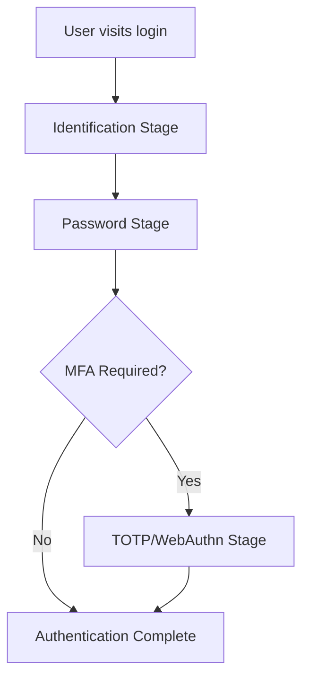

# Authentik Setup Guide

This guide covers the complete setup and configuration of Authentik as the identity provider for the
rfmedia-apps platform, including initial admin setup, forward authentication with Traefik, user
management, and multi-factor authentication.

## Prerequisites

Before setting up Authentik, ensure you have:

- Docker and Docker Compose installed
- Traefik reverse proxy configured and running
- Tailscale network configured
- SMTP server credentials for email notifications
- A strong, randomly generated secret key

### Required Environment Variables

Add these variables to your `.env.local` file:

```bash
# Authentik Core
AUTHENTIK_SECRET_KEY=generate-a-random-50-char-string
AUTHENTIK_TAG=2025.10
AUTHENTIK_IMAGE=ghcr.io/goauthentik/server

# Database Configuration
AUTHENTIK_POSTGRES_PASSWORD=secure-database-password
PG_USER=authentik
PG_DB=authentik

# Email Configuration
AUTHENTIK_EMAIL_HOST=smtp.gmail.com
AUTHENTIK_EMAIL_PORT=587
AUTHENTIK_EMAIL_USERNAME=your-email@gmail.com
AUTHENTIK_EMAIL_PASSWORD=your-app-password
AUTHENTIK_EMAIL_FROM=authentik@yourdomain.com
AUTHENTIK_EMAIL_USE_TLS=true
AUTHENTIK_EMAIL_USE_SSL=false
AUTHENTIK_EMAIL_TIMEOUT=10

# Authentik Media Proxy
AUTHENTIK_TOKEN=generate-after-setup
AUTHENTIK_HOST_BROWSER=https://authentik.yourdomain.com

# Domain Configuration
DOMAIN=yourdomain.com
DOMAIN2=media.yourdomain.com
```

## Architecture Overview

The platform uses a dual-instance Authentik architecture for separation of concerns between
infrastructure and media services.

```mermaid
flowchart TD
    subgraph Authentication Layer
        Auth1[authentik-server<br/>Infrastructure Auth]
        Auth2[authentik-media<br/>Media Auth]
    end

    subgraph Shared Components
        DB[(authentik-db<br/>PostgreSQL)]
        Redis[(authentik-redis<br/>Cache)]
        Worker[authentik-worker<br/>Background Tasks]
    end

    subgraph Infrastructure Services
        Traefik[Traefik Dashboard]
        Uptime Kuma[Uptime Kuma]
        Speedtest[Speedtest Tracker]
    end

    subgraph Media Services
        Sonarr[Sonarr]
        Radarr[Radarr]
        Bazarr[Bazarr]
        Others[Other Media Apps]
    end

    Auth1 --> DB
    Auth1 --> Redis
    Auth2 --> DB
    Auth2 --> Redis
    Worker --> DB
    Worker --> Redis

    Traefik -.->|authentik-dev| Auth1
    Infrastructure Services -.->|authentik-dev| Auth1
    Media Services -.->|authentik-media| Auth2
```

### Components

1. **authentik-server** - Main identity provider for infrastructure services
2. **authentik-media** - Proxy outpost for media services authentication
3. **authentik-worker** - Background worker for async tasks
4. **authentik-db** - PostgreSQL database for user and configuration data
5. **authentik-redis** - Redis cache for sessions and job queues

## Initial Admin Setup

### Step 1: Create Directory Structure

```bash
# Create Authentik directories
mkdir -p ${DOCKER_DIR}/authentik-server/data
mkdir -p ${DOCKER_DIR}/authentik-server/custom-templates

# Create database data directories
mkdir -p ${DOCKER_DATA_DIR}/authentik-db
mkdir -p ${DOCKER_DATA_DIR}/authentik-redis
```

### Step 2: Generate Secret Key

Generate a secure secret key for Authentik:

```bash
# Generate a random 50-character string
openssl rand -base64 36 | tr -d '\n' | head -c 50
```

Add this to your `.env.local` as `AUTHENTIK_SECRET_KEY`.

### Step 3: Deploy Authentik Services

```bash
# Deploy entire auth stack at once (recommended)
rfapps deploy -g auth-stack --yes

# Or deploy individual components
rfapps deploy -s authentik-db --yes
rfapps deploy -s authentik-redis --yes
rfapps deploy -s authentik-server --yes
rfapps deploy -s authentik-worker --yes

# With secrets injection (dotenvx)
rfapps deploy -g auth-stack --use-dotenvx .env.local --yes

# With secrets injection (1Password CLI)
rfapps deploy -g auth-stack --use-op .env --yes

# Or deploy all at once using Docker Compose
docker compose up -d authentik-db authentik-redis authentik-server authentik-worker authentik-media
```

### Step 4: Complete Initial Setup

1. **Access Authentik setup page:**

   Navigate to `https://authentik.${DOMAIN}/if/flow/initial-setup/`

2. **Create admin account:**
   - Enter admin email address
   - Set a strong password
   - Click "Create Account"

3. **Verify admin access:**

   Log in at `https://authentik.${DOMAIN}` with your new credentials.

### Step 5: Configure System Settings

1. Go to **System** > **Settings**
2. Configure:
   - **Default user group**: `authentik Users`
   - **Default token duration**: Set based on security requirements
   - **Event retention**: Configure log retention period

## Configuring Providers and Applications

### Create Proxy Provider for Traefik

1. Navigate to **Applications** > **Providers**
2. Click **Create** and select **Proxy Provider**
3. Configure the provider:

   ```
   Name: traefik-forward-auth
   Authorization flow: default-provider-authorization-implicit-consent
   Forward auth (single application): unchecked
   Authentication mode: Forward auth (domain level)
   External host: https://authentik.yourdomain.com
   ```

4. Click **Create**

### Create Application for Each Service

For each protected service, create an application:

1. Go to **Applications** > **Applications**
2. Click **Create**
3. Configure:

   ```
   Name: Service Name (e.g., "Sonarr")
   Slug: service-name (e.g., "sonarr")
   Provider: traefik-forward-auth
   ```

4. Click **Create**

### Example: Creating Sonarr Application

```yaml
Application Configuration:
  Name: Sonarr
  Slug: sonarr
  Group: Media Services
  Provider: traefik-forward-auth
  Launch URL: https://sonarr.media.yourdomain.com
  Open in new tab: true

Policy Bindings:
  - media-users group (required)
```

## Setting Up Forward Authentication for Traefik

### Understanding Authentik Outposts

Authentik uses outposts to handle forward authentication. The outpost receives authentication
requests from Traefik and validates user sessions.

### Embedded Outpost Configuration

1. Go to **Applications** > **Outposts**
2. Edit the **authentik Embedded Outpost**
3. Add your applications to the outpost
4. Configure:

   ```
   Type: Proxy
   Integration: Local Docker connection
   Applications: Select all applications to protect
   ```

### Create Authentik Media Outpost

For media services, deploy a separate proxy outpost:

1. Go to **Applications** > **Outposts**
2. Click **Create**
3. Configure:

   ```
   Name: authentik-media-outpost
   Type: Proxy
   Integration: Docker
   Applications: Select media applications
   ```

4. The `authentik-media` container in compose.yml connects to this outpost

### Outpost Token Configuration

After creating the outpost, generate a token:

1. Go to **Directory** > **Tokens & App passwords**
2. Click **Create**
3. Configure:

   ```
   Identifier: authentik-media-token
   User: akadmin (or service account)
   Intent: API Token
   ```

4. Copy the token to `AUTHENTIK_TOKEN` in your `.env.local`

## User and Group Management

### Creating User Groups

Create groups to manage access permissions:

1. Go to **Directory** > **Groups**
2. Click **Create**
3. Create these recommended groups:

   | Group Name             | Purpose                 | Permissions          |
   | ---------------------- | ----------------------- | -------------------- |
   | `admins`               | Full system access      | All applications     |
   | `infrastructure-users` | Infrastructure services | Traefik, Uptime kuma |
   | `media-users`          | Media services          | All media apps       |
   | `family`               | Family members          | Limited media access |

### Creating Users

1. Go to **Directory** > **Users**
2. Click **Create**
3. Configure user details:

   ```
   Username: johndoe
   Name: John Doe
   Email: john@example.com
   Groups: media-users, family
   Is active: Yes
   ```

4. Set initial password or send invite email

### Bulk User Import

For importing multiple users, use CSV import:

1. Go to **Directory** > **Users**
2. Click **Import**
3. Upload CSV with format:

   ```csv
   username,email,name,groups
   user1,user1@example.com,User One,"media-users,family"
   user2,user2@example.com,User Two,admins
   ```

## OAuth2/SAML Configuration

### OAuth2 Provider Setup

For applications supporting OAuth2:

1. Go to **Applications** > **Providers**
2. Click **Create** and select **OAuth2/OpenID Provider**
3. Configure:

   ```
   Name: app-name-oauth
   Authentication flow: default-authentication-flow
   Authorization flow: default-provider-authorization-explicit-consent
   Client type: Confidential
   Client ID: auto-generated
   Redirect URIs: https://app.domain.com/oauth/callback
   Signing Key: authentik Self-signed Certificate
   ```

4. Note the Client ID and Client Secret for the application

### SAML Provider Setup

For applications requiring SAML:

1. Go to **Applications** > **Providers**
2. Click **Create** and select **SAML Provider**
3. Configure:

   ```
   Name: app-name-saml
   ACS URL: https://app.domain.com/saml/acs
   Issuer: https://authentik.domain.com
   Service Provider Binding: Post
   ```

## MFA Setup

### Enable MFA for Users

1. Go to **Flows & Stages** > **Stages**
2. Find or create an **Authenticator Validation Stage**
3. Configure allowed devices:
   - TOTP Authenticators
   - WebAuthn Authenticators
   - Static Tokens

### Configure TOTP

1. Edit the authenticator validation stage
2. Enable **TOTP**
3. Configure:

   ```
   Device classes: TOTP
   Not configured action: Configure
   Configuration stage: default-authenticator-totp-setup
   ```

### Configure WebAuthn (Hardware Keys)

1. Edit the authenticator validation stage
2. Enable **WebAuthn**
3. Configure:

   ```
   Device classes: WebAuthn
   User verification: Preferred
   Resident key requirement: Preferred
   ```

### Enforce MFA Policy

Create a policy to enforce MFA for specific groups:

1. Go to **Flows & Stages** > **Policies**
2. Click **Create** and select **Expression Policy**
3. Configure:

   ```python
   # Require MFA for admin group
   return ak_is_group_member(request.user, name="admins")
   ```

4. Bind this policy to the authenticator validation stage

## Authentication Flow Customization

### Understanding Flows

Authentik uses flows to define authentication sequences:

- **Authentication flow** - Login process
- **Authorization flow** - Permission consent
- **Enrollment flow** - User registration
- **Recovery flow** - Password reset

### Custom Login Flow Example



### Create Custom Flow

1. Go to **Flows & Stages** > **Flows**
2. Click **Create**
3. Configure:

   ```
   Name: custom-authentication
   Title: Custom Login
   Slug: custom-authentication
   Designation: Authentication
   ```

4. Add stages in order:
   - identification
   - password
   - authenticator_validate (if MFA enabled)
   - user_login

## Common Authentication Issues

### Authentication Loop

**Symptoms:** User redirected to login repeatedly after successful authentication.

**Solutions:**

1. **Check cookie domain:**

   ```
   Settings > System Settings > Cookie domain
   Should match your base domain (e.g., .yourdomain.com)
   ```

2. **Verify outpost configuration:**

   ```bash
   docker logs authentik-server | grep -i outpost
   ```

3. **Check Traefik middleware address:**

   Ensure middleware points to correct Authentik server hostname.

### 403 Forbidden After Login

**Symptoms:** User authenticates but receives 403 error accessing applications.

**Solutions:**

1. **Check application bindings:**
   - Verify user is in required group
   - Check application policy bindings

2. **Review authorization flow:**
   - Ensure proper authorization flow is selected
   - Check for blocking policies

### Cannot Access Authentik UI

**Symptoms:** Authentik login page not loading.

**Diagnostic steps:**

```bash
# Check all Authentik containers
docker compose ps | grep authentik

# View server logs
docker compose logs -f authentik-server

# Check database connectivity
docker exec authentik-db pg_isready -U authentik

# Check Redis connectivity
docker exec authentik-redis redis-cli ping
```

### Password Reset Not Working

**Symptoms:** Password reset emails not arriving.

**Solutions:**

1. **Verify SMTP configuration:**

   ```bash
   # Test SMTP from Authentik
   docker exec authentik-server ak test_email --to your@email.com
   ```

2. **Check email settings in UI:**
   - Go to **System** > **Settings**
   - Verify email configuration

3. **Review email logs:**

   ```bash
   docker compose logs authentik-worker | grep -i email
   ```

## Troubleshooting Commands

### Check Service Health

```bash
# View all Authentik service status using rfapps
rfapps status -g auth-stack

# Check service health details
rfapps status -s authentik-server --health

# Or using Docker Compose
docker compose ps | grep authentik

# Check Authentik server health
docker inspect --format='{{json .State.Health}}' authentik-server | jq

# View recent errors
docker compose logs --tail 100 authentik-server | grep -i error
```

### Database Operations

```bash
# Check database connection
docker exec authentik-db pg_isready -U authentik -d authentik

# View user count
docker exec authentik-db psql -U authentik -d authentik -c "SELECT COUNT(*) FROM auth_user;"

# Backup database
docker exec authentik-db pg_dump -U authentik authentik > authentik-backup.sql
```

### Redis Operations

```bash
# Test Redis connection
docker exec authentik-redis redis-cli ping

# View session count
docker exec authentik-redis redis-cli DBSIZE

# Clear all sessions (caution)
docker exec authentik-redis redis-cli FLUSHALL
```

### Reset Admin Password

If you lose admin access:

```bash
# Generate new password
docker exec -it authentik-server ak create_recovery_key 10 akadmin

# Use the generated link to reset password
```

## Best Practices

### Security Recommendations

1. **Use strong passwords:** Enforce minimum 12 characters with complexity requirements
2. **Enable MFA:** Require MFA for all admin accounts
3. **Regular audits:** Review user access and application bindings monthly
4. **Rotate tokens:** Regenerate API tokens periodically
5. **Monitor logs:** Set up alerts for failed authentication attempts

### Performance Optimization

1. **Redis persistence:** Ensure Redis is configured for persistence
2. **Database maintenance:** Run periodic VACUUM on PostgreSQL
3. **Session cleanup:** Configure appropriate session expiration times
4. **Worker scaling:** Add workers for high-load environments

### Backup Strategy

```bash
# Full backup script
#!/bin/bash
BACKUP_DIR="/backups/authentik/$(date +%Y%m%d)"
mkdir -p $BACKUP_DIR

# Database backup
docker exec authentik-db pg_dump -U authentik authentik > $BACKUP_DIR/database.sql

# Media backup
cp -r ${DOCKER_DIR}/authentik-server/data $BACKUP_DIR/data

# Custom templates backup
cp -r ${DOCKER_DIR}/authentik-server/custom-templates $BACKUP_DIR/templates
```

## Related Documentation

- [Traefik Setup Guide](traefik-setup.md)
- [Tailscale Integration](../features/tailscale-integration.md)
- [Environment Variables Reference](../reference/environment-variables.md)
- [Troubleshooting Guide](../guides/troubleshooting.md)

## External References

- [Authentik Documentation](https://goauthentik.io/docs/)
- [Authentik GitHub](https://github.com/goauthentik/authentik)
- [Forward Auth Configuration](https://goauthentik.io/docs/providers/proxy/forward_auth)
- [Authentik API Reference](https://goauthentik.io/developer-docs/api/reference/authentik-api)
