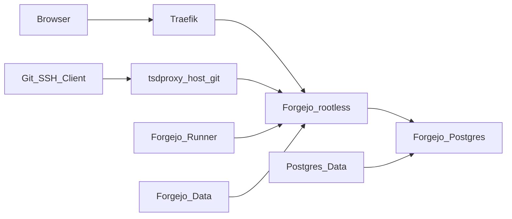

# Forgejo Setup Guide

This guide covers the complete setup and configuration of Forgejo as a self-hosted Git forge on the
rfmedia-apps platform, including host preparation, DNS configuration, first-run setup, and SSH
access.

## Overview

Forgejo provides:

- Self-hosted Git repositories with web UI
- Pull requests, issues, and project management
- Native authentication for web sessions, Git HTTP, webhooks, and API tokens
- SSH and HTTPS Git access
- Organization and team management

## Prerequisites

Before setting up Forgejo, ensure you have:

- Docker and Docker Compose installed
- Traefik reverse proxy configured and running
- DNS control for your primary infrastructure domain (`${DOMAIN}`)
- Tailscale host access through `tsdproxy-rfapps` for Git HTTPS and SSH on the tailnet

### Required Environment Variables

Add these variables to your `.env.local` file:

```bash
# User/Group IDs (rootless Forgejo runs as this user)
PUID=1000
PGID=1000
TZ=America/New_York

# Directory Paths
DOCKER_DIR=/path/to/docker/config
DOCKER_DATA_DIR=/path/to/docker/data

# Forgejo Database
FORGEJO_DB_NAME=forgejo
FORGEJO_DB_USER=forgejo
FORGEJO_DB_PASSWORD=secure-database-password

# Forgejo Actions runner (reference URLs; credentials live in runner-config.yml — see runner setup below)
FORGEJO_RUNNER_INSTANCE_URL=https://git.${DOMAIN}
FORGEJO_RUNNER_INTERNAL_URL=http://forgejo:3000

# Domain Configuration
DOMAIN=yourdomain.com
TS_DOMAIN=tailnet-name.ts.net

# tsdproxy-rfapps (Tailscale host for shareable Forgejo access)
# Populate authKey in ${DOCKER_DIR}/tsdproxy-rfapps/config/tsdproxy.yaml — not in compose
TSDPROXY_AUTHKEY=tskey-auth-xxxx
```

## Architecture Overview

Forgejo uses a dedicated PostgreSQL database and stores repository data on the host filesystem.



| Component        | Service                                | Purpose                                        |
| ---------------- | -------------------------------------- | ---------------------------------------------- |
| Application      | `forgejo`                              | Git forge web UI, Git HTTP, and SSH daemon     |
| Tailnet ingress  | `tsdproxy-rfapps`                      | Shareable Tailscale host `git` (HTTPS + SSH)   |
| Database         | `forgejo-postgres`                     | PostgreSQL 16 for metadata and user data       |
| Actions runner   | `forgejo-runner`                       | Executes Forgejo Actions workflows             |
| Runner DinD      | `forgejo-runner-dind`                  | Isolated Docker daemon for workflow jobs       |
| Config/Data      | `${DOCKER_DIR}/forgejo`                | Repositories, attachments, application data    |
| tsdproxy config  | `${DOCKER_DIR}/tsdproxy-rfapps/config` | Live `tsdproxy.yaml` (auth key, not committed) |
| tsdproxy state   | `${DOCKER_DIR}/tsdproxy-rfapps/data`   | Tailscale node identity for host `git`         |
| Runner config    | `${DOCKER_DIR}/forgejo-runner`         | Runner config, cache, registration state       |
| Database Storage | `${DOCKER_DATA_DIR}/forgejo-postgres`  | PostgreSQL data files                          |

Forgejo attaches directly to the Docker `apps` network. Other containers reach Forgejo at
`forgejo:3000` (HTTP) and `forgejo:2222` (SSH). Traefik routes public HTTPS to `forgejo:3000`.
`tsdproxy-rfapps` registers a shareable Tailscale **host** named `git` with HTTPS on port `443`
and Git SSH on port `22`, proxied to `forgejo:3000` and `forgejo:2222` respectively.

Unlike Docktail Tailscale Services, a tsdproxy host can be **shared** with users on other
tailnets via Tailscale device sharing.

## tsdproxy-rfapps Setup

Before first deploy, create isolated config and data directories (do **not** reuse praxrr's
`.tsdproxy` or `~/.config/docker/tsdproxy` paths):

```bash
mkdir -p "${DOCKER_DIR}/tsdproxy-rfapps/{config,data}"
cp config/tsdproxy-rfapps/tsdproxy.yaml.example \
  "${DOCKER_DIR}/tsdproxy-rfapps/config/tsdproxy.yaml"
```

Edit `${DOCKER_DIR}/tsdproxy-rfapps/config/tsdproxy.yaml` and set `authKey` under
`tailscale.providers.rfapps` (or use `TSDPROXY_AUTHKEY` as the value when populating the file).
Use a reusable auth key with tags appropriate for a named Tailscale host. Labeled containers must
set `tsdproxy.proxyprovider: rfapps` so praxrr-tsdproxy on the same Docker socket does not also
register host `git`.

Deploy the proxy with Forgejo:

```bash
rfapps deploy -s tsdproxy-rfapps --yes
rfapps rebuild -s forgejo --yes
```

Confirm the host is up:

```bash
docker logs tsdproxy-rfapps --tail 50
curl -I "https://git.${TS_DOMAIN}"
ssh -F /dev/null -p 22 -T "git@git.${TS_DOMAIN}"
```

To grant cross-tailnet access, share the `git` machine with the target user in the Tailscale
admin console (**Share machine**).

## Host Preparation

Rootless Forgejo requires the data directory to be writable by `${PUID}:${PGID}` before the first
start. Create the directory and set ownership on the Docker host:

```bash
# Create Forgejo data directory
mkdir -p "${DOCKER_DIR}/forgejo"

# Set ownership for rootless container user
sudo chown -R "${PUID}:${PGID}" "${DOCKER_DIR}/forgejo"
```

If ownership is incorrect, Forgejo will fail to start with permission errors when writing
repositories or configuration.

## DNS Configuration

Forgejo is exposed through Traefik on two hostnames:

| Hostname            | Purpose                       |
| ------------------- | ----------------------------- |
| `git.${DOMAIN}`     | Canonical Forgejo URL         |
| `forgejo.${DOMAIN}` | Alias hostname (same service) |

Create DNS records pointing both subdomains to your Traefik entry point (public ingress or
tailnet via `tsdproxy-rfapps` host `git`):

```text
git.yourdomain.com      → Traefik entry point
forgejo.yourdomain.com  → Traefik entry point
```

Traefik issues TLS certificates for both names. If either record is missing, certificate generation
or routing may fail.

## Deployment

Forgejo is optional. `forgejo`, `forgejo-postgres`, and every `forgejo-*runner*` service carry
only the Compose profile `forgejo` (deliberately not `all`), so neither a bare
`docker compose up -d` nor `--profile all` / a whole-project `rfapps deploy` starts them. Enable
them with `--profile forgejo` (or `COMPOSE_PROFILES=forgejo`). The `rfapps` CLI maps these services
to the `forgejo` profile and activates it automatically when you target them, e.g.
`rfapps deploy -g forgejo-stack --yes`.

Deploy Forgejo and its dependencies using the `rfapps` CLI:

```bash
# Deploy Forgejo stack
rfapps deploy -s forgejo --yes

# Or rebuild after compose changes
rfapps rebuild -s forgejo --yes

# Or deploy the whole Forgejo group (server, database, runners)
rfapps deploy -g forgejo-stack --yes

# Verify health
rfapps health -s forgejo-postgres --wait-for-ready
rfapps health -s forgejo --wait-for-ready
```

## First-Run Setup

1. Open `https://git.${DOMAIN}` in a browser (or `https://forgejo.${DOMAIN}`).
2. Complete the Forgejo installation wizard:
   - Confirm database settings (pre-configured via environment variables).
   - Set the site title and administrator account.
   - Review repository and service settings.
3. Log in with the administrator account you created.
4. Under **Site Administration**, verify:
   - **Server Domain** is `git.${DOMAIN}`
   - **Root URL** is `https://git.${DOMAIN}/`
   - **SSH Server Domain** is `git.${TS_DOMAIN}`
   - **SSH Port** is `22`

Forgejo uses native authentication for Git HTTP, webhooks, and API tokens. Authentik forward auth is
intentionally not applied on the Traefik route so those integrations work without SSO interference.

Optional OpenID Connect sign-in via Authentik is configured in Forgejo (**Site Administration →
Authentication → Authentication Sources**). Use Docker-internal Authentik URLs that resolve on the
`apps` network:

| Setting                           | Recommended value                                                                      |
| --------------------------------- | -------------------------------------------------------------------------------------- |
| OpenID Connect Auto Discovery URL | `https://authentik-server:9443/application/o/forgejo/.well-known/openid-configuration` |
| Alternative (HTTP)                | `http://authentik-server:9000/application/o/forgejo/.well-known/openid-configuration`  |

Enable **Skip TLS verification** (or equivalent) when using the `https://authentik-server:9443`
endpoint with Authentik's internal certificate. The issuer and token endpoints must stay on
`authentik-server`, not the public `authentik.${DOMAIN}` hostname.

If OIDC was previously configured with a public issuer URL, update the authentication source in
Forgejo, then restart Forgejo:

```bash
rfapps rebuild -s forgejo --yes
```

## SSH Access

Git SSH is available through the shareable Tailscale host `git`:

| Path                      | Host               | Port | Use when                                  |
| ------------------------- | ------------------ | ---- | ----------------------------------------- |
| **tsdproxy host** (`git`) | `git.${TS_DOMAIN}` | `22` | On the tailnet; standard Git SSH over TCP |

Rootless Forgejo listens for Git SSH on port `2222` in the `forgejo` container. `tsdproxy-rfapps`
maps tailnet TCP port `22` on host `git` to `forgejo:2222`. Traefik does not expose Forgejo SSH.

### Add an SSH Key

1. In Forgejo, go to **Settings → SSH / GPG Keys**.
2. Add your public SSH key.
3. Create or clone a repository using the SSH URL shown in the Forgejo UI.

### Test SSH Connectivity

```bash
ssh -F /dev/null -p 22 -T git@git.${TS_DOMAIN}
```

A successful connection returns a Forgejo greeting (for example, confirming authentication or
listing available commands). Connection refused usually means the port is blocked, the relevant
service is not advertised, or the client is using the wrong hostname.

### Example Clone

```bash
git clone ssh://git@git.${TS_DOMAIN}:22/username/repository.git
```

Or with an explicit tailnet FQDN:

```bash
git clone ssh://git@git.example.ts.net:22/username/repository.git
```

## Firewall and Network Security

Forgejo Git SSH is exposed only through the tsdproxy-managed Tailscale host `git` on port `22`.
Traefik exposes only Forgejo HTTP(S).

- Restrict access to the `git` host in Tailscale ACLs and use device sharing only for trusted users.
- Do not publish Forgejo SSH with Docker `ports:` unless required and protected by keys-only
  authentication.

## Troubleshooting

### Permission Denied on Startup

Ensure `${DOCKER_DIR}/forgejo` is owned by `${PUID}:${PGID}`:

```bash
ls -la "${DOCKER_DIR}/forgejo"
sudo chown -R "${PUID}:${PGID}" "${DOCKER_DIR}/forgejo"
rfapps rebuild -s forgejo --yes
```

### Database Connection Errors

Check that `forgejo-postgres` is healthy and credentials match `.env`:

```bash
rfapps health -s forgejo-postgres
docker logs forgejo-postgres
docker logs forgejo
```

### TLS or Routing Failures

Verify DNS for both `git.${DOMAIN}` and `forgejo.${DOMAIN}`, then inspect Traefik logs:

```bash
docker logs traefik
```

### Tailscale SSH Connection Refused

Verify tsdproxy and the Forgejo backend:

```bash
docker logs tsdproxy-rfapps --tail 100
docker exec forgejo ss -tlnp | grep 2222
ssh -F /dev/null -p 22 -T git@git.${TS_DOMAIN}
```

If a stale Docktail `svc:git` or old sidecar node still claims the `git` hostname, remove it from
the Tailscale admin console before tsdproxy registers the new host.

## Forgejo Actions Runner

Forgejo Actions is enabled on the `forgejo` service (`FORGEJO__actions__ENABLED=true`) with
`DEFAULT_ACTIONS_URL` set to `https://data.forgejo.org` for relative action references (for example
`uses: actions/checkout@v6`).

Workflow execution requires a separately deployed **Forgejo Runner** (`forgejo-runner`) with an
isolated Docker-in-Docker sidecar (`forgejo-runner-dind`). The runner connects to Forgejo over the
`apps` network and uses DinD for job containers.

### Host Preparation

Create the runner data directory and set ownership before first start:

```bash
mkdir -p "${DOCKER_DIR}/forgejo-runner"
sudo chown -R "${PUID}:${PGID}" "${DOCKER_DIR}/forgejo-runner"
```

Generate the default runner configuration:

```bash
docker run --rm data.forgejo.org/forgejo/runner:12 \
  forgejo-runner generate-config > "${DOCKER_DIR}/forgejo-runner/runner-config.yml"
sudo chown "${PUID}:${PGID}" "${DOCKER_DIR}/forgejo-runner/runner-config.yml"
```

Edit `${DOCKER_DIR}/forgejo-runner/runner-config.yml` and add runner labels. The legacy Gitea runner
config at `config/gitea/runners/runner1.yaml` shows useful label examples:

```yaml
runner:
  labels:
    - ubuntu-latest:docker://catthehacker/ubuntu:act-22.04
    - ubuntu-24:docker://catthehacker/ubuntu:act-22.04
    - node-22:docker://node:22-bullseye
```

For Docker-based workflows, configure DinD access in `runner-config.yml` per the
[Forgejo Docker-in-Docker guide](https://forgejo.org/docs/latest/admin/actions/docker-access/):

```yaml
runner:
  envs:
    DOCKER_HOST: tcp://forgejo-runner-dind:2375
container:
  docker_host: tcp://forgejo-runner-dind:2375
```

### Create a Runner in Forgejo (One-Time)

Forgejo Runner v12.7+ uses declarative `server.connections` in `runner-config.yml`. The legacy
`forgejo-runner register` command is **deprecated** and should not be used.

1. Log in to Forgejo as an administrator.
2. Go to **Site Administration → Actions → Runners**.
3. Click **Create new Runner**, enter a name (for example `rfmedia-apps-runner`), and copy the
   displayed **UUID** and **token** (one-time secret shown at creation).
4. Store the token on the host — never commit it:

```bash
install -m 600 /dev/null "${DOCKER_DIR}/forgejo-runner/runner-token"
# Paste the token into the file (single line, no trailing newline required)
${EDITOR:-nano} "${DOCKER_DIR}/forgejo-runner/runner-token"
sudo chown "${PUID}:${PGID}" "${DOCKER_DIR}/forgejo-runner/runner-token"
```

If the token was exposed (for example pasted in chat), delete the runner in Forgejo, create a new
one, and write the new token to `runner-token`.

### Configure `server.connections`

Add the connection block to `${DOCKER_DIR}/forgejo-runner/runner-config.yml`. Use the internal
Docker URL so the runner reaches Forgejo on the `apps` network without leaving the host:

```yaml
log:
  level: info

runner:
  labels:
    - ubuntu-latest:docker://catthehacker/ubuntu:act-22.04
    - ubuntu-24:docker://catthehacker/ubuntu:act-22.04
    - node-22:docker://node:22-bullseye
  envs:
    DOCKER_HOST: tcp://forgejo-runner-dind:2375

container:
  docker_host: tcp://forgejo-runner-dind:2375

server:
  connections:
    rfmedia-apps:
      url: http://forgejo:3000/
      uuid: 6d0d4cbf-4787-44f8-b1a5-7be2a356ea2a
      token_url: file:/data/runner-token
```

> **Note:** The runner must use `http://forgejo:3000/` on the Docker `apps` network.

Connection map keys (for example `rfmedia-apps`) are arbitrary labels for your own reference.
Replace the UUID with the value from Forgejo. Prefer `token_url: file:/data/runner-token` over an
inline `token:` field so secrets stay out of the config file.

If you previously used `forgejo-runner register`, remove any stale `.runner` file in
`${DOCKER_DIR}/forgejo-runner/` so the daemon uses `server.connections` only:

```bash
rm -f "${DOCKER_DIR}/forgejo-runner/.runner"
```

See [Forgejo Runner Registration](https://forgejo.org/docs/latest/admin/actions/registration/) for
multi-instance connections and offline registration.

### Deploy the Runner

Deploy Forgejo and DinD first if they are not already running, then start the runner daemon:

```bash
rfapps deploy -s forgejo --yes
rfapps deploy -s forgejo-runner-dind --yes
rfapps deploy -s forgejo-runner --yes

# Or deploy the whole Forgejo group (server, database, runners)
rfapps deploy -g forgejo-stack --yes

docker logs forgejo-runner
```

In Forgejo, confirm the runner appears under **Site Administration → Actions → Runners** with an
online status.

### Example Workflow

Create `.forgejo/workflows/ci.yml` in a repository:

```yaml
name: CI

on:
  push:
    branches: [main]

jobs:
  test:
    runs-on: ubuntu-latest
    steps:
      - uses: actions/checkout@v6
      - run: echo "Hello from Forgejo Actions"
```

Push to trigger the workflow on the registered runner.

### Workflow Location

Forgejo 15 reads workflows from `.forgejo/workflows/` (not `.github/workflows/`). This repository
ships a compatibility workflow at `.forgejo/workflows/ci.yml` that exercises runner labels
`ubuntu-latest`, `ubuntu-24`, and `node-22`, then runs a lightweight `npm` test job on
`ubuntu-latest`.

GitHub Actions workflows under `.github/workflows/` are not executed by Forgejo unless you mirror or
duplicate them under `.forgejo/workflows/`.

### Git Remote and Pull Requests

Keep the existing GitHub `origin` remote and add Forgejo as a separate remote. Choose the port for
your access path: Tailscale port `22`, or Traefik/public domain port `2222`:

```bash
# Tailscale (standard SSH port 22)
git remote add forgejo ssh://git@git:22/yandy/rfmedia-apps.git

# Traefik / public domain (non-standard port 2222)
git remote add forgejo ssh://git@git.example.com:2222/yandy/rfmedia-apps.git

# Verify remotes
git remote -v

# Push a feature branch
git push -u forgejo feat/forgejo-ci-test
```

Create the repository on Forgejo first if it does not exist (**+ New Repository** in the web UI, or
API with a personal access token). Push-to-create is disabled on this instance, so `git push` will
fail until the empty repository exists.

```bash
# Optional: create repo via API (requires FORGEJO_TOKEN with repo scope)
curl -X POST "https://git.example.com/api/v1/user/repos" \
  -H "Authorization: token ${FORGEJO_TOKEN}" \
  -H "Content-Type: application/json" \
  -d '{"name":"rfmedia-apps","private":true}'
```

Then open a pull request from the pushed branch to `master` (or `main`) in the Forgejo web UI.

Watch workflow runs under **Actions** on the repository page, or **Site Administration → Actions →
Runners** to confirm the runner picks up jobs.

## Backup

Back up Forgejo regularly:

- Application data: `${DOCKER_DIR}/forgejo`
- Runner config and cache: `${DOCKER_DIR}/forgejo-runner`
- Database: `pg_dump` from `forgejo-postgres`

See [Backup and Restore Guide](../guides/backup-restore.md) for commands and restore procedures.

## Related Documentation

- [Environment Variables Reference](../reference/environment-variables.md) - Forgejo configuration
  variables
- [Traefik Reverse Proxy](../features/traefik-reverse-proxy.md) - Routing without Authentik
  middleware
- [Service Healthchecks](../features/service-healthchecks.md) - Health probe policy
- [Backup and Restore Guide](../guides/backup-restore.md) - Backup and disaster recovery
