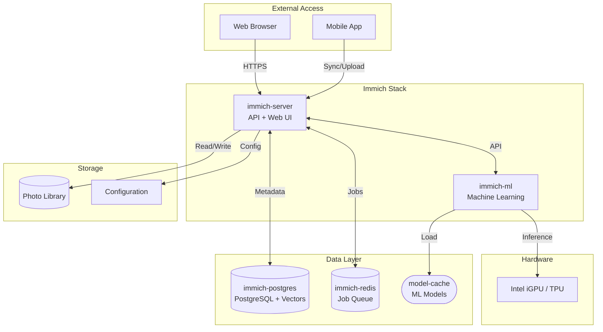

# Immich Setup Guide

This guide covers the complete setup and configuration of Immich as a self-hosted photo and video
management solution on the rfmedia-apps platform, including machine learning configuration, mobile
app setup, and performance optimization.

## Overview

Immich provides:

- Automatic photo/video backup from mobile devices
- AI-powered face recognition and object detection
- Timeline view with date-based organization
- Shared albums and libraries
- Fast search using CLIP semantic search
- Hardware-accelerated machine learning

## Prerequisites

Before setting up Immich, ensure you have:

- Docker and Docker Compose installed
- Traefik reverse proxy configured
- Intel integrated GPU for hardware acceleration (optional but recommended)
- Sufficient storage for photo library

### Hardware Requirements

| Component | Minimum          | Recommended                              |
| --------- | ---------------- | ---------------------------------------- |
| CPU       | Quad-core        | 6+ cores with AVX2                       |
| RAM       | 4GB              | 8GB+ (16GB for large libraries)          |
| Storage   | SSD for database | NVMe for database, large HDD for photos  |
| GPU       | None             | Intel iGPU or Intel Neural Compute Stick |

### Required Environment Variables

Add these variables to your `.env.local` file:

```bash
# User/Group IDs
PUID=1000
PGID=1000
TZ=America/New_York

# Directory Paths
DOCKER_DIR=/path/to/docker/config
DOCKER_DATA_DIR=/path/to/docker/data
DATA_DIR=/path/to/media

# Immich Configuration
IMMICH_VERSION=release
IMMICH_DB_NAME=immich
IMMICH_DB_USERNAME=immich
IMMICH_DB_PASSWORD=secure-database-password

# Domain Configuration
DOMAIN2=media.yourdomain.com

```

## Architecture Overview

Immich uses a microservices architecture with dedicated components for different functions.



### Components

1. **immich-server** - Main application server (API and web UI)
2. **immich-ml** - Machine learning service for AI features
3. **immich-postgres** - PostgreSQL database with vector extensions
4. **immich-redis** - Redis/Valkey for job queue and caching
5. **model-cache** - Docker volume for ML model storage

## Initial Configuration

### Step 1: Create Directory Structure

```bash
# Create Immich directories
mkdir -p ${DOCKER_DIR}/immich
mkdir -p ${DOCKER_DATA_DIR}/immich-postgres
mkdir -p ${DATA_DIR}/photos
```

### Step 2: Review Compose Configuration

The Immich services in `compose.yml`:

```yaml
immich-server:
  <<: *service-base
  container_name: immich-server
  networks:
    apps: {}
  logging: *logging-default
  environment:
    <<: *common-env
    DB_NAME: ${IMMICH_DB_NAME}
    DB_USERNAME: ${IMMICH_DB_USERNAME}
    DB_PASSWORD: ${IMMICH_DB_PASSWORD}
    DB_HOSTNAME: immich-postgres
    DB_PORT: 5432
    REDIS_HOSTNAME: immich-redis
    REDIS_PORT: 6379
  depends_on:
    - immich-ml
    - immich-postgres
    - immich-redis
  labels:
    traefik.enable: true
    traefik.http.routers.immich.rule: Host(`images.${DOMAIN2}`)
    traefik.http.routers.immich.entrypoints: websecure
    traefik.http.routers.immich.tls: true
    traefik.http.routers.immich.tls.certresolver: letsencrypt
    traefik.http.routers.immich.tls.domains[0].main: images.${DOMAIN2}
    traefik.http.services.immich.loadbalancer.server.port: 2283
    traefik.http.services.immich.loadbalancer.server.scheme: http
  devices:
    - /dev/dri:/dev/dri
  volumes:
    - /etc/localtime:/etc/localtime:ro
    - ${DOCKER_DIR}/immich:/config
    - ${DATA_DIR}/photos:/data
  image: ghcr.io/immich-app/immich-server:${IMMICH_VERSION:-release}
```

### Step 3: Deploy Immich

```bash
# Deploy entire Immich stack at once (recommended)
rfapps deploy -g photo-stack --yes

# Or deploy using the photos profile
rfapps deploy -p photos --yes

# With secrets injection (dotenvx)
rfapps deploy -g photo-stack --use-dotenvx .env.local --yes

# With secrets injection (1Password CLI)
rfapps deploy -g photo-stack --use-op .env --yes

# Or deploy individually using Docker Compose
docker compose up -d immich-postgres immich-redis immich-ml immich-server
```

### Step 4: Complete Initial Setup

1. Access Immich at `https://images.${DOMAIN2}`
2. Create admin account:
   - Enter email address
   - Set strong password
   - Complete setup wizard
3. Configure storage template (optional):
   - Settings > Storage Template
   - Example: `{{y}}/{{MM}}/{{filename}}`

## Photo Library Import

### Upload via Web Interface

1. Open Immich web interface
2. Click **Upload** button
3. Select files or drag-and-drop
4. Wait for upload and processing

### Import Existing Library

For large existing libraries, use the CLI import:

```bash
# Install Immich CLI
npm install -g @immich/cli

# Configure CLI
immich login https://images.${DOMAIN2} your-api-key

# Dry-run import
immich upload --dry-run /path/to/existing/photos

# Import with album creation
immich upload --album-name "Imported Photos" /path/to/existing/photos
```

### Server-Side Import

For photos already on the server:

1. Mount your photos directory:

   ```yaml
   volumes:
     - ${DATA_DIR}/photos:/data
     - /path/to/existing/photos:/import:ro
   ```

2. Use the web interface:
   - Go to **Administration** > **Jobs**
   - Configure external library path
   - Run library scan

### Directory Structure

Recommended organization:

```
${DATA_DIR}/photos/
├── library/           # Immich-managed library
│   └── {user-id}/     # User libraries
│       ├── 2024/
│       │   ├── 01/
│       │   └── ...
│       └── ...
├── upload/            # Upload staging
└── thumbs/            # Generated thumbnails
```

## Machine Learning Configuration

### OpenVINO Optimization (Intel Hardware)

The default ML image uses OpenVINO for Intel hardware acceleration:

```yaml
immich-ml:
  <<: *service-base
  container_name: immich-ml
  networks:
    apps: {}
  environment:
    <<: *common-env
  device_cgroup_rules:
    - "c 189:* rmw"
  devices:
    - /dev/dri:/dev/dri
  volumes:
    - /etc/localtime:/etc/localtime:ro
    - /dev/bus/usb:/dev/bus/usb
    - model-cache:/cache
  image: ghcr.io/immich-app/immich-machine-learning:${IMMICH_VERSION:-release}-openvino
```

### CUDA Configuration (NVIDIA GPU)

For NVIDIA GPUs, use the CUDA image:

```yaml
immich-ml:
  image: ghcr.io/immich-app/immich-machine-learning:${IMMICH_VERSION:-release}-cuda
  deploy:
    resources:
      reservations:
        devices:
          - driver: nvidia
            count: 1
            capabilities: [gpu]
```

### Intel Neural Compute Stick (NCS2)

For Intel NCS2 USB accelerator:

```yaml
immich-ml:
  image: ghcr.io/immich-app/immich-machine-learning:${IMMICH_VERSION:-release}-openvino
  device_cgroup_rules:
    - "c 189:* rmw"
  volumes:
    - /dev/bus/usb:/dev/bus/usb
```

### ML Model Settings

Configure ML settings in the web UI:

1. Go to **Administration** > **Machine Learning**
2. Configure models:

   ```yaml
   Face Detection:
     Model: buffalo_l
     Min Score: 0.7

   Face Recognition:
     Model: buffalo_l
     Min Score: 0.7
     Max Distance: 0.6

   Image Classification:
     Model: ViT-B-32
     Enabled: true

   CLIP Search:
     Model: ViT-B-32
     Enabled: true
   ```

## Mobile App Setup

### iOS Setup

1. Download Immich from App Store
2. Open app and tap **Sign In**
3. Enter server URL: `https://images.${DOMAIN2}`
   - Or Tailscale: `https://images.your-tailnet.ts.net`
4. Sign in with your credentials
5. Configure auto-upload:
   - Settings > Backup
   - Enable **Auto Backup**
   - Select albums to backup
   - Choose **WiFi only** or **WiFi + Cellular**

### Android Setup

1. Download Immich from Google Play
2. Open app and sign in
3. Enter server URL
4. Configure permissions:
   - Allow photo access
   - Enable battery optimization exemption (for background upload)
5. Configure auto-upload in settings

### Background Upload Tips

1. **iOS:** Ensure background app refresh is enabled
2. **Android:** Disable battery optimization for Immich
3. **Both:** Keep app open occasionally to trigger sync

## Backup Configuration

### Database Backup

```bash
#!/bin/bash
BACKUP_DIR="/backups/immich/$(date +%Y%m%d)"
mkdir -p $BACKUP_DIR

# Backup PostgreSQL database
docker exec immich-postgres pg_dump -U ${IMMICH_DB_USERNAME} ${IMMICH_DB_NAME} > $BACKUP_DIR/database.sql

echo "Database backup completed: $BACKUP_DIR/database.sql"
```

### Photo Library Backup

```bash
#!/bin/bash
BACKUP_DIR="/backups/immich-photos"

# Sync photos to backup location
rsync -av --delete ${DATA_DIR}/photos/ $BACKUP_DIR/

echo "Photo backup completed"
```

### Automated Backup Script

```bash
#!/bin/bash
# Full Immich backup script
BACKUP_DIR="/backups/immich/$(date +%Y%m%d)"
mkdir -p $BACKUP_DIR

echo "Starting Immich backup..."

# Database backup
echo "Backing up database..."
docker exec immich-postgres pg_dump -U ${IMMICH_DB_USERNAME} ${IMMICH_DB_NAME} | gzip > $BACKUP_DIR/database.sql.gz

# Configuration backup
echo "Backing up configuration..."
tar -czf $BACKUP_DIR/config.tar.gz -C ${DOCKER_DIR} immich

# Photo library backup (optional - can be large)
# rsync -av ${DATA_DIR}/photos/ $BACKUP_DIR/photos/

echo "Backup completed: $BACKUP_DIR"
```

### Restore from Backup

```bash
#!/bin/bash
BACKUP_DIR="/backups/immich/20240101"

# Stop Immich services
docker compose stop immich-server

# Restore database
gunzip -c $BACKUP_DIR/database.sql.gz | docker exec -i immich-postgres psql -U ${IMMICH_DB_USERNAME} ${IMMICH_DB_NAME}

# Restore configuration
tar -xzf $BACKUP_DIR/config.tar.gz -C ${DOCKER_DIR}

# Start services
docker compose up -d immich-server

echo "Restore completed"
```

## Performance Optimization

### Database Optimization

PostgreSQL settings in compose.yml:

```yaml
immich-postgres:
  environment:
    POSTGRES_INITDB_ARGS: "--data-checksums"
    DB_STORAGE_TYPE: "HDD" # or "SSD" for faster storage
  shm_size: 128mb # Increase for large libraries
```

Optimize existing database:

```bash
# Analyze tables
docker exec -it immich-postgres psql -U ${IMMICH_DB_USERNAME} -d ${IMMICH_DB_NAME} -c "ANALYZE VERBOSE;"

# Vacuum database
docker exec -it immich-postgres psql -U ${IMMICH_DB_USERNAME} -d ${IMMICH_DB_NAME} -c "VACUUM ANALYZE;"
```

### ML Processing Optimization

1. **Batch processing:** Run ML jobs during off-hours
2. **Model caching:** The `model-cache` volume prevents re-downloading
3. **Hardware acceleration:** Ensure GPU passthrough is working

### Storage Optimization

1. **Thumbnail storage:** Use SSD for thumbnails
2. **Original storage:** Can use slower HDD/NAS
3. **Separate volumes:**

   ```yaml
   volumes:
     - ${DATA_DIR}/photos:/data # Large storage
     - ${SSD_PATH}/thumbs:/config/thumbs # Fast storage
   ```

## Common Immich Issues

### Check Service Status

Before troubleshooting, check the service status:

```bash
# Check Immich stack status
rfapps status -g photo-stack

# Check with health details
rfapps status -g photo-stack --health

# Check individual services
rfapps status -s immich-server --health
rfapps status -s immich-ml --health
rfapps status -s immich-postgres --health
```

### ML Service Not Working

**Symptoms:** Face detection/recognition not working, no smart search.

**Solutions:**

1. **Check ML service status:**

   ```bash
   docker compose logs immich-ml | tail -50
   ```

2. **Verify GPU access:**

   ```bash
   docker exec immich-ml ls -la /dev/dri
   ```

3. **Check model cache:**

   ```bash
   docker volume inspect model-cache
   ```

4. **Restart ML service:**

   ```bash
   rfapps rebuild -s immich-ml --yes
   ```

### Upload Failures

**Symptoms:** Mobile uploads fail, timeout errors.

**Solutions:**

1. **Check server logs:**

   ```bash
   docker compose logs immich-server | grep -i error
   ```

2. **Verify storage permissions:**

   ```bash
   docker exec immich-server ls -la /data
   ```

3. **Check disk space:**

   ```bash
   df -h ${DATA_DIR}
   ```

### Database Connection Issues

**Symptoms:** "Unable to connect to database" errors.

**Solutions:**

1. **Check PostgreSQL status:**

   ```bash
   docker compose ps immich-postgres
   docker compose logs immich-postgres
   ```

2. **Verify connection:**

   ```bash
   docker exec immich-postgres pg_isready -U ${IMMICH_DB_USERNAME} -d ${IMMICH_DB_NAME}
   ```

3. **Check environment variables:**
   - Verify DB_HOSTNAME matches PostgreSQL container name
   - Confirm credentials match

### Slow Performance

**Symptoms:** Slow page loads, timeline takes long to display.

**Solutions:**

1. **Check resource usage:**

   ```bash
   docker stats immich-server immich-ml immich-postgres
   ```

2. **Optimize database:**

   ```bash
   docker exec immich-postgres psql -U ${IMMICH_DB_USERNAME} -d ${IMMICH_DB_NAME} -c "VACUUM ANALYZE;"
   ```

3. **Check ML queue:**
   - Administration > Jobs
   - Clear stuck jobs if needed

### Face Recognition Not Working

**Symptoms:** Faces not detected or not grouped correctly.

**Solutions:**

1. **Check ML settings:**
   - Administration > Machine Learning
   - Ensure face detection is enabled
   - Adjust minimum confidence if needed

2. **Re-run face detection:**
   - Administration > Jobs
   - Clear and re-run Face Detection job

3. **Verify ML service:**

   ```bash
   docker compose logs immich-ml | grep -i face
   ```

## Administration Commands

### Useful CLI Commands

```bash
# Check server status
docker compose logs -f immich-server

# Restart all services
docker compose restart immich-server immich-ml

# Re-process all photos
# (via web UI: Administration > Jobs)

# Check database size
docker exec immich-postgres psql -U ${IMMICH_DB_USERNAME} -d ${IMMICH_DB_NAME} -c "SELECT pg_size_pretty(pg_database_size('${IMMICH_DB_NAME}'));"

# List users
docker exec immich-postgres psql -U ${IMMICH_DB_USERNAME} -d ${IMMICH_DB_NAME} -c "SELECT email, name FROM users;"
```

### Job Management

Access via Administration > Jobs:

| Job                  | Purpose              | When to Run          |
| -------------------- | -------------------- | -------------------- |
| Thumbnail Generation | Create thumbnails    | After import         |
| Metadata Extraction  | Read EXIF data       | After import         |
| Face Detection       | Find faces in photos | After import         |
| Face Recognition     | Group detected faces | After face detection |
| Smart Search         | Index for search     | Periodically         |
| Video Transcode      | Convert videos       | After import         |

## Updating Immich

### Standard Update

```bash
# Pull latest images
docker compose pull immich-server immich-ml

# Restart services
docker compose up -d immich-server immich-ml
```

### Major Version Updates

1. **Backup database first:**

   ```bash
   docker exec immich-postgres pg_dump -U ${IMMICH_DB_USERNAME} ${IMMICH_DB_NAME} > backup.sql
   ```

2. **Check release notes** for breaking changes
3. **Update version:**

   ```bash
   export IMMICH_VERSION=v1.x.x
   docker compose pull
   docker compose up -d
   ```

4. **Verify update:**

   ```bash
   docker compose logs immich-server | grep -i version
   ```

## Related Documentation

- [Traefik Setup Guide](traefik-setup.md)
- [Tailscale Integration](../features/tailscale-integration.md)
- [Troubleshooting Guide](../guides/troubleshooting.md)
- [Backup and Restore Guide](../guides/backup-restore.md)

## External References

- [Immich Documentation](https://immich.app/docs)
- [Immich GitHub](https://github.com/immich-app/immich)
- [Immich Discord](https://discord.immich.app)
- [Hardware Transcoding Guide](https://immich.app/docs/features/hardware-transcoding)
- [Machine Learning Guide](https://immich.app/docs/features/machine-learning)
