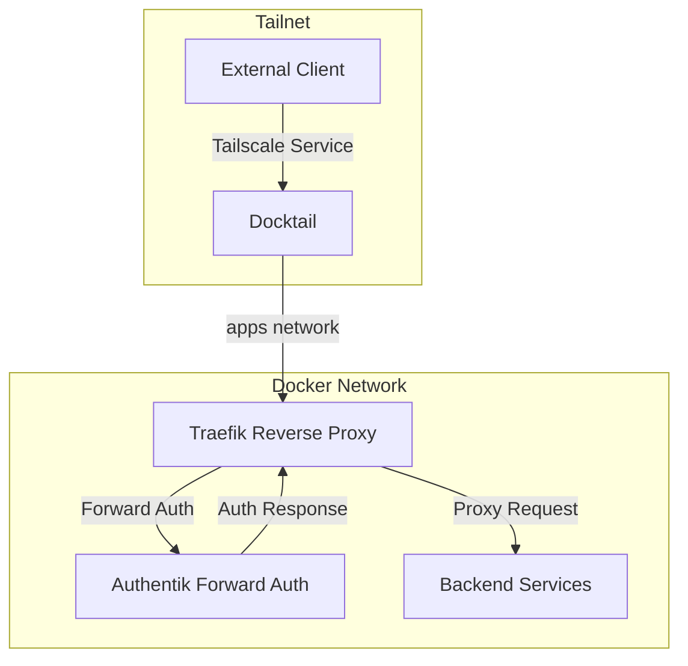
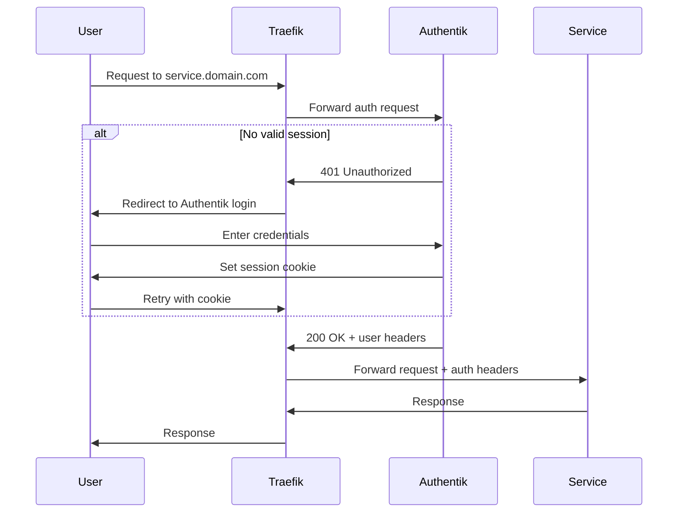

# Traefik Setup Guide

This guide covers the complete setup and configuration of Traefik as the reverse proxy for the
rfmedia-apps platform, including SSL certificate management, routing configuration, and Authentik
middleware integration.

## Prerequisites

Before setting up Traefik, ensure you have:

- Docker and Docker Compose installed
- A domain name with DNS control (Cloudflare recommended)
- Cloudflare API token with DNS edit permissions
- Tailscale account and authentication key
- Basic understanding of reverse proxy concepts

### Required Environment Variables

Add these variables to your `.env.local` file:

```bash
# Domain configuration
DOMAIN=example.com                    # Primary domain for infrastructure
DOMAIN2=media.example.com             # Secondary domain for media services

# Cloudflare configuration
CF_API_EMAIL=your-email@example.com   # Cloudflare account email
CF_DNS_API_TOKEN=your-cloudflare-token # DNS API token with edit permissions

# Tailscale configuration
TS_AUTHKEY=tskey-auth-xxxxx           # Tailscale authentication key
TS_DOMAIN=your-tailnet.ts.net         # Tailscale MagicDNS domain

# Optional
LOG_LEVEL=INFO                        # Traefik log level (DEBUG, INFO, WARN, ERROR)
HOMEAUTO_SERVER=192.168.1.100         # Home automation server IP (if applicable)
```

## Architecture Overview

Traefik serves as the central reverse proxy on the Docker `apps` network. Tailnet clients reach it
through **Docktail**; public tunnel traffic reaches it through **cloudflared**.



### Components

1. **docktail** - Advertises Traefik (and selected services) as Tailscale Services on the tailnet
2. **traefik** - Main reverse proxy on `apps`; handles routing and SSL termination
3. **Authentik middlewares** - Forward authentication for protected services

## Initial Configuration

### Step 1: Create Directory Structure

Create the required directories for Traefik configuration and certificates:

```bash
# Create Traefik configuration directories
mkdir -p ${DOCKER_DIR}/traefik/acme
mkdir -p ${DOCKER_DIR}/traefik/dynamic

# Set proper permissions for ACME storage
touch ${DOCKER_DIR}/traefik/acme/acme.json
chmod 600 ${DOCKER_DIR}/traefik/acme/acme.json
```

Ensure **Docktail** prerequisites are met for tailnet access (host Tailscale daemon, OAuth
credentials). See [Tailscale Integration](../features/tailscale-integration.md).

### Step 2: Verify Compose Configuration

The Traefik service is defined in `compose.yml` on the `apps` network with Docktail labels for
tailnet exposure:

```yaml
docktail:
  <<: *service-base
  container_name: docktail
  hostname: docktail
  networks:
    apps: {}
  volumes:
    - /var/run/docker.sock:/var/run/docker.sock:ro
    - /var/run/tailscale:/var/run/tailscale
  image: ghcr.io/marvinvr/docktail:latest

traefik:
  <<: *service-base
  container_name: traefik
  hostname: traefik
  networks:
    apps: {}
  logging: *logging-default
  labels:
    traefik.enable: true
    # ... Traefik routing labels ...
    docktail.service.enable: true
    docktail.service.name: traefik
    docktail.service.port: 443
    docktail.service.protocol: https
    docktail.service.service-port: 443
    docktail.service.service-protocol: https
    docktail.service.network: apps
  environment:
    <<: *common-env
    CF_DNS_API_TOKEN: ${CF_DNS_API_TOKEN}
    DOMAIN: ${DOMAIN}
    DOMAIN2: ${DOMAIN2}
  command:
    - --log
    - --log.level=${LOG_LEVEL:-INFO}
    - --providers.docker
    - --entrypoints.websecure.address=:443
    # ... additional Traefik flags ...
  volumes:
    - /var/run/docker.sock:/var/run/docker.sock:ro
    - ${DOCKER_DIR}/traefik:/etc/traefik
  image: traefik:v3
```

## SSL Certificate Setup with Let's Encrypt

Traefik automatically manages SSL certificates using Let's Encrypt with Cloudflare DNS challenge.

### How It Works

1. Traefik requests a certificate from Let's Encrypt
2. Let's Encrypt issues a DNS challenge
3. Traefik uses the Cloudflare API to create a TXT record
4. Let's Encrypt verifies the record and issues the certificate
5. Traefik stores the certificate in `acme.json`

### Cloudflare API Token Setup

Create a Cloudflare API token with these permissions:

1. Log in to Cloudflare dashboard
2. Go to **My Profile** > **API Tokens**
3. Click **Create Token**
4. Use the **Edit zone DNS** template
5. Configure permissions:
   - **Zone - DNS - Edit** (for your domains)
   - **Zone - Zone - Read** (for your domains)
6. Copy the token to `CF_DNS_API_TOKEN` in your `.env.local`

### Certificate Storage

Certificates are stored in `${DOCKER_DIR}/traefik/acme/acme.json`. This file:

- Must have `600` permissions (read/write for owner only)
- Should be backed up regularly
- Contains private keys - keep it secure

### Testing with Staging Server

For initial setup, use the Let's Encrypt staging server to avoid rate limits:

```yaml
# Uncomment this line in compose.yml to use staging
- --certificatesresolvers.letsencrypt.acme.caserver=https://acme-staging-v02.api.letsencrypt.org/directory
```

Once certificates work correctly, remove this line and recreate Traefik to get production
certificates.

## Adding New Services to Traefik Routing

To add a new service to Traefik, add Docker labels to the service definition in `compose.yml`.

### Standard Service Pattern

```yaml
new-service:
  <<: *service-base
  container_name: new-service
  hostname: new-service
  networks:
    apps: {}
  labels:
    # Enable Traefik for this service
    traefik.enable: true

    # Define routing rule (Host-based)
    traefik.http.routers.new-service.rule: Host(`new-service.${DOMAIN}`)

    # Configure HTTPS entrypoint
    traefik.http.routers.new-service.entrypoints: websecure

    # Enable TLS with Let's Encrypt
    traefik.http.routers.new-service.tls: true
    traefik.http.routers.new-service.tls.certresolver: letsencrypt
    traefik.http.routers.new-service.tls.domains[0].main: new-service.${DOMAIN}

    # Define backend service
    traefik.http.services.new-service.loadbalancer.server.port: 8080
    traefik.http.services.new-service.loadbalancer.server.scheme: http

    # Apply authentication middleware
    traefik.http.routers.new-service.middlewares: authentik-dev@docker
  # ... rest of service configuration
```

### Service on the apps Network (Standard Pattern)

All services in this repo use the `apps` network directly. For tailnet exposure, apply
`docktail.service.*` labels instead of `network_mode: service:`. See
[Tailscale Integration](../features/tailscale-integration.md) for the Docktail label pattern.

```yaml
new-service:
  <<: *service-base
  container_name: new-service
  hostname: new-service
  networks:
    apps: {}
  labels:
    traefik.enable: true
    traefik.http.routers.new-service.rule: Host(`new-service.${DOMAIN}`)
    traefik.http.routers.new-service.entrypoints: websecure
    traefik.http.routers.new-service.tls: true
    traefik.http.routers.new-service.tls.certresolver: letsencrypt
    traefik.http.routers.new-service.tls.domains[0].main: new-service.${DOMAIN}
    traefik.http.services.new-service.loadbalancer.server.port: 8080
    traefik.http.services.new-service.loadbalancer.server.scheme: http
    traefik.http.routers.new-service.middlewares: authentik-dev@docker
```

### Choosing the Right Middleware

| Middleware               | Use Case                         | Domain       |
| ------------------------ | -------------------------------- | ------------ |
| `authentik-dev@docker`   | Infrastructure services          | `${DOMAIN}`  |
| `authentik-media@docker` | Media management services        | `${DOMAIN2}` |
| (none)                   | Services with native auth (Plex) | `${DOMAIN2}` |

### TCP Routing for Non-HTTP Services

For services requiring TCP routing (databases, SSH):

```yaml
labels:
  traefik.enable: true
  # TCP router configuration
  traefik.tcp.routers.service-name.rule: HostSNI(`service.${DOMAIN}`)
  traefik.tcp.routers.service-name.entrypoints: custom-tcp-port
  traefik.tcp.routers.service-name.tls: true
  traefik.tcp.routers.service-name.tls.certresolver: letsencrypt
  traefik.tcp.services.service-name.loadbalancer.server.port: 5432
```

Define the entrypoint in Traefik's command section:

```yaml
- --entrypoints.custom-tcp-port.address=:15432
```

## Authentik Middleware Integration

Traefik uses Authentik for forward authentication via middleware.

### Middleware Configuration

Two middlewares are defined in the `authentik-server` container labels:

**authentik-dev (Infrastructure):**

```yaml
traefik.http.middlewares.authentik-dev.forwardauth.address: https://authentik-server:9443/outpost.goauthentik.io/auth/traefik
traefik.http.middlewares.authentik-dev.forwardauth.tls.insecureSkipVerify: true
traefik.http.middlewares.authentik-dev.forwardauth.trustForwardHeader: true
traefik.http.middlewares.authentik-dev.forwardauth.maxResponseBodySize: "1048576"
traefik.http.middlewares.authentik-dev.forwardauth.authResponseHeaders: X-authentik-username,X-authentik-groups,X-authentik-entitlements,X-authentik-email,X-authentik-name,X-authentik-uid,X-authentik-jwt,X-authentik-meta-jwks,X-authentik-meta-outpost,X-authentik-meta-provider,X-authentik-meta-app,X-authentik-meta-version
```

**authentik-media (Media Services):**

```yaml
traefik.http.middlewares.authentik-media.forwardauth.address: https://authentik-media:9443/outpost.goauthentik.io/auth/traefik
traefik.http.middlewares.authentik-media.forwardauth.tls.insecureSkipVerify: true
traefik.http.middlewares.authentik-media.forwardauth.trustForwardHeader: true
traefik.http.middlewares.authentik-media.forwardauth.maxResponseBodySize: "1048576"
traefik.http.middlewares.authentik-media.forwardauth.authResponseHeaders: X-authentik-username,X-authentik-groups,X-authentik-entitlements,X-authentik-email,X-authentik-name,X-authentik-uid,X-authentik-jwt,X-authentik-meta-jwks,X-authentik-meta-outpost,X-authentik-meta-provider,X-authentik-meta-app,X-authentik-meta-version
```

### Authentication Flow



## Common Configuration Scenarios

### Scenario 1: HTTPS Backend Service

For services that only expose HTTPS (like Uptime Kuma):

```yaml
labels:
  traefik.http.services.uptime-kuma.loadbalancer.server.port: 3001
  traefik.http.services.uptime-kuma.loadbalancer.server.scheme: https
```

### Scenario 2: Multiple Domains for Same Service

```yaml
labels:
  traefik.http.routers.service.rule: Host(`service.${DOMAIN}`) || Host(`alt-name.${DOMAIN}`)
  traefik.http.routers.service.tls.domains[0].main: service.${DOMAIN}
  traefik.http.routers.service.tls.domains[1].main: alt-name.${DOMAIN}
```

### Scenario 3: Path-Based Routing

```yaml
labels:
  traefik.http.routers.api.rule: Host(`example.com`) && PathPrefix(`/api`)
  traefik.http.routers.api.middlewares: stripprefix@docker
  traefik.http.middlewares.stripprefix.stripprefix.prefixes: /api
```

### Scenario 4: External Service Routing

For services running outside Docker, use file-based configuration:

```yaml
# config/traefik/external-service.yml
http:
  routers:
    external-service:
      rule: Host(`external.{{ env "DOMAIN" }}`)
      entryPoints:
        - websecure
      service: external-service
      middlewares:
        - authentik-dev-file
      tls:
        certResolver: letsencrypt

  services:
    external-service:
      loadBalancer:
        servers:
          - url: http://192.168.1.100:8080
```

## Deployment and Verification

### Deploy Traefik

```bash
# Deploy core ingress (Docktail + Traefik)
rfapps deploy --services docktail,traefik --yes

# With secrets injection (dotenvx)
rfapps deploy -s traefik --use-dotenvx .env.local --yes

# Or using Docker Compose directly
docker compose up -d docktail traefik
```

### Verify Deployment

1. **Check container status:**

   ```bash
   # Using rfapps CLI
   rfapps status -s traefik

   # With health check details
   rfapps status -s traefik --health

   # Or using Docker Compose
   docker compose ps | grep traefik
   ```

2. **Verify Docktail and tailnet service:**

   ```bash
   docker compose logs docktail --tail 30
   tailscale status --json | jq '.Self.CapMap'
   ```

3. **Check Traefik logs:**

   ```bash
   docker compose logs -f traefik
   ```

4. **Access Traefik dashboard:**

   Open `https://traefik.${DOMAIN}` in your browser (requires Authentik authentication).

## Troubleshooting

### Certificate Not Issuing

**Symptoms:** Browser shows SSL certificate error, service uses self-signed certificate.

**Diagnostic steps:**

```bash
# Check Traefik logs for ACME errors
docker compose logs traefik | grep -i acme

# View current certificates
docker exec traefik cat /etc/traefik/acme/acme.json | jq '.letsencrypt.Certificates'

# Verify DNS propagation
dig +short TXT _acme-challenge.service.${DOMAIN}
```

**Common causes:**

1. **Invalid Cloudflare token** - Regenerate token with correct permissions
2. **DNS propagation delay** - Increase `delaybeforecheck` value
3. **Rate limiting** - Wait 1 hour and retry (use staging server for testing)

### Service Not Accessible

**Symptoms:** 404 Not Found or 502 Bad Gateway errors.

**Diagnostic steps:**

```bash
# Check if service has Traefik labels
docker inspect [service_name] | jq '.[0].Config.Labels' | grep traefik

# Verify service is on correct network
docker network inspect apps | jq '.[0].Containers'

# Check Traefik can reach service
docker exec traefik ping -c 1 [service_hostname]
```

**Common causes:**

1. **Service not on `apps` network** - Add `networks: apps: {}` to service
2. **Wrong port number** - Verify port matches service's exposed port
3. **Service not running** - Check service container status

### Authentication Loop

**Symptoms:** Redirected to login page repeatedly after successful login.

**Diagnostic steps:**

```bash
# Check Authentik server health
docker compose logs authentik-server | tail -50

# Verify middleware address resolution
docker exec traefik ping -c 1 authentik-server
```

**Common causes:**

1. **Authentik outpost not configured** - Create outpost in Authentik admin
2. **Cookie domain mismatch** - Check Authentik cookie domain settings
3. **Browser blocking cookies** - Check browser privacy settings

### Tailnet Access Not Working

**Symptoms:** Service not accessible via Tailscale hostname.

**Diagnostic steps:**

```bash
# Check Docktail reconciler logs
docker compose logs docktail --tail 50

# Verify host Tailscale daemon and advertised services
tailscale status
tailscale serve status  # if applicable on host

# Confirm Traefik is reachable on apps network
docker exec traefik wget --no-verbose --tries=1 --spider https://localhost:443
```

**Common causes:**

1. **Host Tailscale not running** - Start or restart the host `tailscaled` service
2. **OAuth credentials missing** - Verify `TAILSCALE_OAUTH_CLIENT_ID` and
   `TAILSCALE_OAUTH_CLIENT_SECRET` in `.env`
3. **ACL tag not approved** - Ensure host node can advertise the Docktail service tag
4. **Missing Docktail labels** - Verify `docktail.service.*` labels on Traefik in `compose.yml`

### Debug Mode

Enable debug logging for detailed troubleshooting:

```bash
# Set debug log level
export LOG_LEVEL=DEBUG

# Restart Traefik
rfapps rebuild -s traefik --yes
```

## Related Documentation

- [Authentik Setup Guide](authentik-setup.md)
- [Tailscale Integration](../features/tailscale-integration.md)
- [Environment Variables Reference](../reference/environment-variables.md)
- [Troubleshooting Guide](../guides/troubleshooting.md)

## External References

- [Traefik Documentation](https://doc.traefik.io/traefik/)
- [Let's Encrypt Documentation](https://letsencrypt.org/docs/)
- [Cloudflare API Documentation](https://developers.cloudflare.com/api/)
- [Tailscale Serve Documentation](https://tailscale.com/kb/1242/tailscale-serve)
