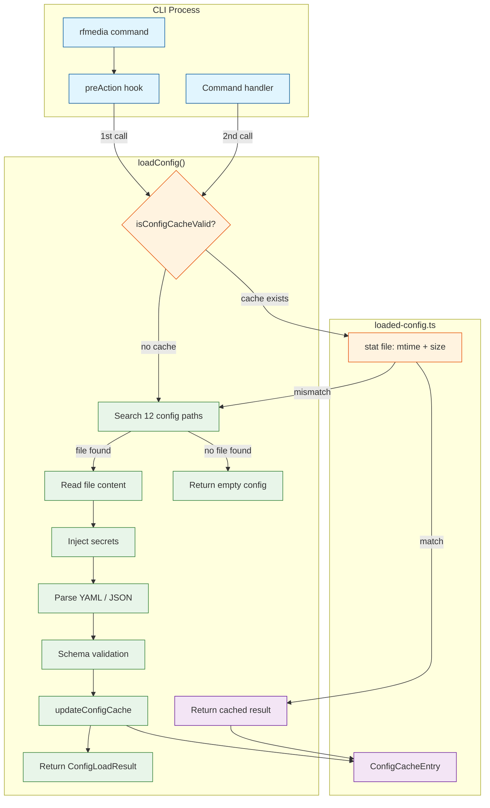

# Config Validation Caching

This document describes the in-memory mtime+size cache for configuration loading in rfmedia-cli. The cache eliminates redundant config file reads, parsing, and validation within a single CLI process, improving performance for commands that call `loadConfig()` more than once.

## Overview

Every rfmedia-cli command triggers `loadConfig()` via a Commander.js `preAction` hook before command execution begins. Some commands -- such as `undo` -- call `loadConfig()` a second time in their own handler to access configuration for database initialization. Without caching, each call performs the full pipeline: searching up to 12 file paths, reading and parsing YAML/JSON, injecting secrets from environment variables, and running deep schema validation.

The config cache intercepts these repeated calls at the top of `loadConfig()`, returning the stored result immediately when the underlying file has not changed.

The cache is:

- **In-memory only** -- stored in a module-level variable that lives for the duration of one CLI process
- **mtime+size validated** -- each cache hit stats the file to verify modification time and size match
- **Single entry** -- holds at most one cached config (the most recently loaded file)
- **Transparent** -- callers of `loadConfig()` have no awareness of caching; it is handled entirely within `config.ts` and `loaded-config.ts`

## How It Works

The cache sits at the entry point of `loadConfig()`. Before beginning the 12-path search, the function checks whether a valid cached result exists. On a hit, it returns a defensive copy of the cached result. On a miss, it runs the full pipeline and stores the result for future calls.



**Diagram key:**

| Color  | Meaning                                        |
| ------ | ---------------------------------------------- |
| Blue   | CLI entry points (command, preAction, handler) |
| Orange | Cache validity checks                          |
| Green  | Full load pipeline (search, parse, validate)   |
| Purple | Cache module (`loaded-config.ts`)              |

**First call (cache miss):**

1. `loadConfig()` calls `isConfigCacheValid()` -- returns `false` (no cache exists)
2. Searches 12 paths across CWD, `~/.config/rfmedia/`, `~/.rfmedia/`, and home directory
3. Reads the first file found, injects secrets, parses YAML/JSON, validates schema
4. Calls `updateConfigCache(result, configPath)` to store the result with file metadata
5. Returns the `ConfigLoadResult`

**Second call (cache hit):**

1. `loadConfig()` calls `isConfigCacheValid()` -- stats the cached file path
2. If `mtimeMs` and `size` match the stored values, returns `true`
3. `loadConfig()` retrieves the cached entry and returns a defensive copy of the result
4. The entire 12-path search, file read, secrets injection, parsing, and validation are skipped

## Cache Invalidation

### Filesystem-Based Invalidation (mtime + size)

Every cache hit check calls `stat()` on the cached file path and compares both `mtimeMs` and `size` against the stored values. If either has changed, the cache is treated as invalid and `loadConfig()` runs the full pipeline.

```typescript
export async function isConfigCacheValid(): Promise<boolean> {
  if (configCache === null) {
    return false;
  }

  try {
    const stats = await stat(configCache.key);
    const valid = stats.mtimeMs === configCache.mtimeMs && stats.size === configCache.size;

    if (valid) {
      logDebug(`Config cache hit: ${configCache.key}`);
    } else {
      logDebug(`Config cache miss: ${configCache.key} (file changed)`);
    }

    return valid;
  } catch {
    return false;
  }
}
```

Using both `mtimeMs` and `size` provides stronger invalidation than either alone. A file could be edited to the same size with different content (caught by mtime change), or a filesystem operation could touch the mtime without changing content (caught by size comparison). The combination handles both cases reliably.

If `stat()` throws (e.g., file deleted), the function returns `false`, forcing a full reload.

### Explicit Invalidation via clearConfigCache()

The `clearConfigCache()` function sets the module-level cache to `null`. This is called after any action that modifies the config file to prevent stale reads.

Currently, the `filter save` action in `src/actions/filter.ts` calls `clearConfigCache()` immediately after writing to the config file:

```typescript
await writeFile(configPath, output, "utf-8");
clearConfigCache();

return { configPath, created: isNewFile };
```

This ensures that any subsequent `loadConfig()` call within the same process reads the updated file rather than returning the now-stale cached version.

## Key Functions

All cache functions are exported from `src/lib/loaded-config.ts`:

| Function             | Signature                                                         | Description                                                                                       |
| -------------------- | ----------------------------------------------------------------- | ------------------------------------------------------------------------------------------------- |
| `isConfigCacheValid` | `() => Promise<boolean>`                                          | Stats the cached file and compares mtime+size; returns `true` if cache is valid                   |
| `updateConfigCache`  | `(result: ConfigLoadResult, configPath: string) => Promise<void>` | Stats the config file and stores the result with metadata; sets cache to `null` on `stat` failure |
| `clearConfigCache`   | `() => void`                                                      | Sets cache to `null`; used after config writes and for test isolation                             |
| `getConfigCache`     | `() => ConfigCacheEntry \| null`                                  | Returns the raw cache entry or `null` if no cache exists                                          |

## Cache Key

The cache key is the **resolved absolute file path** of the config file, computed via `resolve(configPath)` at store time. This ensures that relative and absolute references to the same file produce identical keys.

Since the cache holds a single entry (not a `Map`), the key is stored as the `key` field within the `ConfigCacheEntry` struct:

```typescript
interface ConfigCacheEntry {
  /** Resolved config file path */
  key: string;
  /** File modification time in milliseconds */
  mtimeMs: number;
  /** File size in bytes */
  size: number;
  /** The full config load result (config, loadedFrom, searchedPaths) */
  result: ConfigLoadResult;
}
```

The `ConfigLoadResult` stored in the cache entry contains:

```typescript
export interface ConfigLoadResult {
  /** Loaded configuration (empty object if no config found) */
  config: ConfigFile;
  /** Path the config was loaded from, if any */
  loadedFrom?: string;
  /** All paths that were searched */
  searchedPaths: string[];
}
```

## Debug Logging

The cache module emits debug-level log messages for all cache operations. These messages are visible when the `--debug` global flag is enabled:

```bash
rfmedia copy /source /dest --range=001-005 --debug
```

### Log Messages

| Event       | Log Message Format                         | Example                                                      |
| ----------- | ------------------------------------------ | ------------------------------------------------------------ |
| Cache hit   | `Config cache hit: ${key}`                 | `Config cache hit: /home/user/.rfmedia.yaml`                 |
| Cache miss  | `Config cache miss: ${key} (file changed)` | `Config cache miss: /home/user/.rfmedia.yaml (file changed)` |
| Cache store | `Config cache stored: ${configPath}`       | `Config cache stored: /home/user/.rfmedia.yaml`              |
| Cache clear | `Config cache cleared`                     | `Config cache cleared`                                       |

When no cache exists (first invocation), no "miss" message is logged. The function returns `false` immediately and the full load pipeline begins, which produces its own `Loaded config from: ${configPath}` debug message.

## Design Decisions

### Single Entry, Not a Map

The Plex API cache uses a `Map<string, CachedResponse>` because multiple endpoints are cached simultaneously (libraries, playlists, collections). The config cache holds at most one entry because rfmedia-cli loads a single config file per process. A Map would add complexity with no benefit -- there is never a second config file to cache alongside the first.

### Placed in loaded-config.ts, Not config.ts

The cache state lives in `src/lib/loaded-config.ts` rather than `src/lib/config.ts` for two reasons:

1. **Avoids circular imports.** The `loaded-config.ts` module is a lightweight state holder with minimal dependencies (`node:fs/promises`, `node:path`, types, and `logger.ts`). Placing cache state in `config.ts` would not cause immediate circular imports, but `config.ts` is already a large module (~2600 lines) with many dependencies. Keeping state in the dedicated state module follows the existing pattern where `setLoadedConfig` and `getLoadedConfig` already reside.

2. **Separation of concerns.** The `loaded-config.ts` module owns all configuration _state_ (the loaded config object and now the cache entry). The `config.ts` module owns configuration _logic_ (search paths, parsing, validation, secrets injection). The cache is state, so it belongs with the other state.

### No TTL-Based Expiration

Unlike the Plex API cache, the config cache does not use time-to-live expiration. TTL makes sense for network API responses that can change on the server between calls. Config files only change when the user edits them or a CLI action writes to them. The mtime+size check detects file changes with certainty, making TTL unnecessary and potentially harmful -- a TTL that expires mid-process would force an unnecessary full reload.

### Defensive Copy of searchedPaths

When returning a cached result, `loadConfig()` spreads the `searchedPaths` array into a new array:

```typescript
return {
  config: cached.result.config,
  loadedFrom: cached.result.loadedFrom,
  searchedPaths: [...cached.result.searchedPaths],
};
```

This prevents callers from mutating the cached array, which would corrupt the cache for subsequent calls. The `config` object is not deep-copied because it is treated as read-only by all consumers.

### "No Config Found" Is Not Cached

When `loadConfig()` exhausts all 12 search paths without finding a valid file, it returns an empty config (`{}`) with no `loadedFrom` path. This result is not cached because there is no file to key on -- the cache requires a file path to stat for invalidation. Caching a "not found" result would also require invalidating on file _creation_, which would mean statting all 12 paths on every cache check instead of just one.

## Limitations

1. **In-memory only.** The cache is a module-level variable that exists only for the duration of the current Node.js process. It is not persisted to disk and does not survive across separate `rfmedia` command invocations.

2. **Per-process scope.** Each CLI execution starts with no cached config. There is no shared state between concurrent or sequential `rfmedia` processes.

3. **Single entry.** The cache holds at most one config file. If a hypothetical future feature loaded multiple config files in one process, only the most recent would be cached.

4. **No cross-process sharing.** The cache cannot be accessed by other processes. If multiple rfmedia commands run in parallel (e.g., from a queue), each maintains its own independent cache.

5. **stat() overhead on every check.** Each cache validity check performs a filesystem `stat()` call. This is fast (sub-millisecond on local filesystems) but is not free. For the typical case of 1-2 `loadConfig()` calls per process, this overhead is negligible compared to the cost of the full load pipeline.

## Performance Benefits

The primary performance benefit is eliminating redundant work when `loadConfig()` is called multiple times within a single process. The full pipeline performs:

- **12-path file search** -- up to 12 `stat()` calls checking for config file existence
- **File read** -- reading the config file content from disk
- **Secrets injection** -- scanning for `{{ VAR_NAME }}` templates and resolving environment variables
- **YAML/JSON parsing** -- parsing the file content into a JavaScript object
- **Schema validation** -- deep validation of all configuration sections (plex, copy, tracking, undo, filters, plugins)

With the cache, the second call performs a single `stat()` and returns the stored result.

**Example scenario -- the `undo` command:**

Without caching:

- `preAction` hook calls `loadConfig()`: full pipeline (12-path search, read, parse, validate)
- Command handler calls `loadConfig()`: full pipeline again (12-path search, read, parse, validate)
- Total: 2 full pipeline runs

With caching:

- `preAction` hook calls `loadConfig()`: full pipeline, result cached
- Command handler calls `loadConfig()`: single `stat()`, cache hit, returns stored result
- Total: 1 full pipeline run + 1 `stat()` call

The benefit is most pronounced when the config file is loaded from a location that requires checking many non-existent paths first (e.g., the file is in `~/.rfmedia/config.yaml`, requiring 6 failed `stat()` calls before finding it).

## Related Documentation

- [plex-api-caching.md](plex-api-caching.md) -- In-memory TTL cache for Plex API responses (a related but distinct caching mechanism)
- [plex-configuration.md](plex-configuration.md) -- Full Plex configuration reference, including cache settings for Plex API responses

---

_Last Updated: February 2026_
