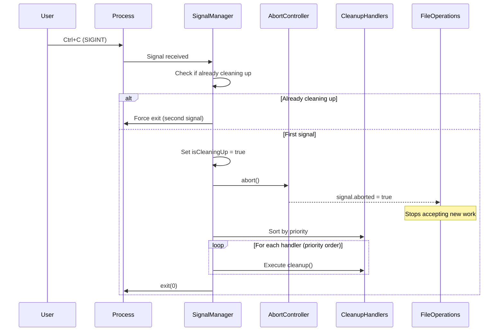
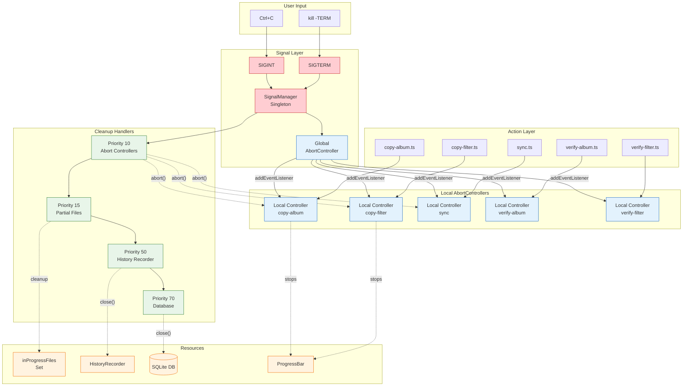
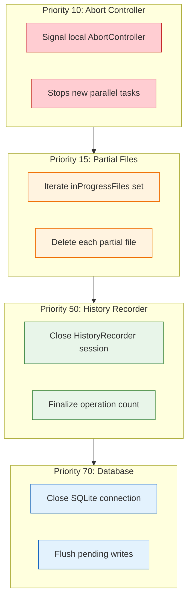
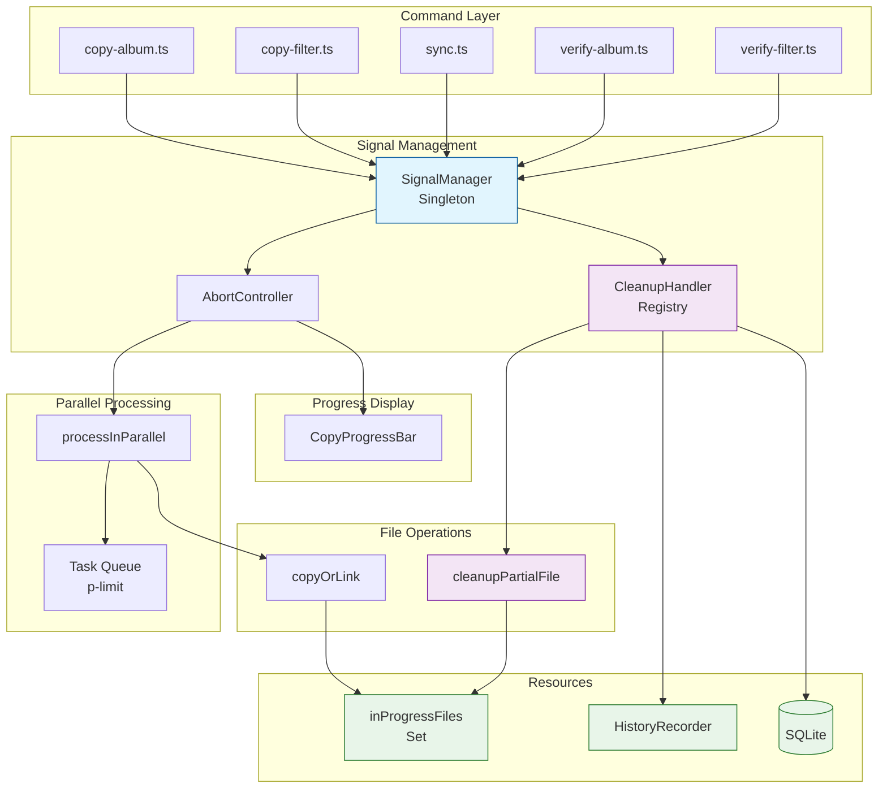

# Graceful Interruption

This document describes the graceful interruption feature in rfmedia-cli, which enables safe handling of SIGINT/SIGTERM signals during long-running file operations.

## Overview

When a user presses Ctrl+C during a copy operation, the system:

1. Stops accepting new work items
2. Propagates cancellation into signal-aware in-progress file streams
3. Cleans up helper-owned, newly created partial files
4. Saves tracking/history state
5. Closes database connections
6. Exits cleanly

This prevents data corruption and ensures the operation can be safely resumed.

### Why This Matters

Long-running copy operations can take hours for large music libraries. Without graceful interruption:

- Partial files would be left on disk, consuming space
- Database/tracking state could be corrupted
- The user would need to manually clean up before resuming
- Progress would be lost

With graceful interruption, the user can safely stop and resume at any time.

## Implementation Status

### Phase Summary

| Phase   | Description                                                                   | Status   |
| ------- | ----------------------------------------------------------------------------- | -------- |
| Phase 1 | Infrastructure (SignalManager, AbortController pattern, filesystem utilities) | Complete |
| Phase 2 | Integration (All major actions integrated with graceful interruption)         | Complete |

### Action Implementation Status

| Action File        | Status   | Notes                                                         |
| ------------------ | -------- | ------------------------------------------------------------- |
| `copy-album.ts`    | Complete | Full integration with all cleanup handlers                    |
| `copy-filter.ts`   | Complete | Signal propagation through processAlbumMode and standard mode |
| `sync.ts`          | Complete | Full integration with inventory persistence                   |
| `verify-album.ts`  | Complete | Signal propagation through verification loops                 |
| `verify-filter.ts` | Complete | Signal propagation through parallel rating scans              |
| `clean.ts`         | Pending  | Lower priority (typically fast operation)                     |

### Phase 2 Completion Details

All 5 major copy/sync/verify actions now have full graceful interruption support:

- **Signal propagation complete**: AbortSignal flows through all nested function calls
- **Partial file cleanup working**: Interrupted copy/convert operations have partial files removed
- **Database cleanup integrated**: SQLite connections closed properly with priority 70
- **History session finalization**: HistoryRecorder sessions closed with priority 50

## Architecture

### Signal Flow Diagram

The following diagram illustrates how signals flow through the system from user interrupt to cleanup completion:



### Complete Signal Flow Architecture



### Cleanup Priority System

Cleanup handlers are executed in priority order (lower number = higher priority):



### Cleanup Priority Order Table

| Priority | Handler Name Pattern     | Purpose                 | Resources Affected    |
| -------- | ------------------------ | ----------------------- | --------------------- |
| 10       | `{action}-abort`         | Stop accepting new work | Local AbortController |
| 15       | `{action}-partial-files` | Remove incomplete files | inProgressFiles Set   |
| 50       | `{action}-history`       | Finalize undo session   | HistoryRecorder       |
| 70       | `{action}-database`      | Close DB connection     | SQLite DbConnection   |

### Component Architecture



## User Experience

### What Users See When Pressing Ctrl+C

When a user presses Ctrl+C during an operation:

1. **Immediate feedback**: The progress bar stops and displays a cancellation message

   ```
   Operation cancelled - cleaning up...
   ```

2. **Cleanup progress**: The system silently cleans up resources

3. **Clean exit**: The process exits with code 0 (success)

4. **Resume capability**: Running the same command again will resume from the last completed source

### Double-Signal Behavior

If the user presses Ctrl+C twice quickly:

1. First signal: Triggers graceful cleanup
2. Second signal: Forces immediate exit with message

   ```
   Forced exit (received second signal)
   ```

   Exit code: 1

## Technical Details

### SignalManager Singleton

The `SignalManager` class provides centralized signal handling for the entire process:

```typescript
export class SignalManager {
  private static instance: SignalManager | null = null;
  private abortController: AbortController;
  private cleanupHandlers: Map<string, CleanupHandler> = new Map();
  private isCleaningUp = false;
  private signalHandlersRegistered = false;

  static getInstance(): SignalManager {
    if (!SignalManager.instance) {
      SignalManager.instance = new SignalManager();
      SignalManager.instance.registerSignalHandlers();
    }
    return SignalManager.instance;
  }

  getSignal(): AbortSignal {
    return this.abortController.signal;
  }

  registerCleanup(handler: CleanupHandler): void {
    if (this.isAborted()) {
      throw new Error("Cannot register cleanup handler after abort");
    }
    this.cleanupHandlers.set(handler.name, handler);
  }

  unregisterCleanup(name: string): void {
    this.cleanupHandlers.delete(name);
  }

  isAborted(): boolean {
    return this.abortController.signal.aborted;
  }
}
```

**Key features:**

- **Singleton pattern**: Ensures one global signal manager per process
- **Lazy initialization**: Signal handlers registered on first getInstance() call
- **Double-signal detection**: Second Ctrl+C forces immediate exit
- **Cleanup ordering**: Handlers sorted by priority before execution

### AbortController Pattern

Each action creates a local AbortController linked to the global signal:

```mermaid
flowchart LR
    subgraph Global["Global Signal"]
        GS[SignalManager<br/>AbortSignal]
    end

    subgraph Action["Action Handler"]
        LAC[Local<br/>AbortController]
        LAS[Local<br/>AbortSignal]
    end

    subgraph Parallel["processInParallel"]
        OPT[options.signal]
        CHK1[Check aborted<br/>before each item]
        PROC[processor<br/>receives signal]
    end

    subgraph FileOps["copyOrLink"]
        CHK2[Check aborted<br/>before operation]
        CHK3[Check aborted<br/>in retry loop]
    end

    subgraph Progress["CopyProgressBar"]
        LISTEN[addEventListener<br/>'abort']
        STOP[stop() + message]
    end

    GS -->|"addEventListener"| LAC
    LAC --> LAS
    LAS --> OPT
    OPT --> CHK1
    OPT --> PROC
    PROC --> CHK2
    PROC --> CHK3
    LAS --> LISTEN
    LISTEN --> STOP
```

**Signal propagation pattern:**

1. Global signal is obtained from `SignalManager.getInstance().getSignal()`
2. Local `AbortController` is linked to global signal via event listener
3. Local signal is passed to `processInParallel()` and file operations
4. Each operation checks `signal.aborted` before starting work
5. Progress bar listens for abort to display cancellation message

### Partial File Tracking

The `inProgressFiles` Set tracks files currently being written:

```typescript
const inProgressFiles = new Set<string>();

// Before copying a file
inProgressFiles.add(destPath);
try {
  await copyOrLink(source, destPath, useHardlink, signal);
} finally {
  inProgressFiles.delete(destPath);
}
```

**Cleanup handler for partial files:**

```typescript
registerGlobalCleanup({
  priority: 15,
  name: "copy-album-partial-files",
  cleanup: async () => {
    const { cleanupPartialFile } = await import("../lib/filesystem.js");
    for (const filePath of inProgressFiles) {
      await cleanupPartialFile(filePath);
    }
  },
});
```

For fingerprinted stream copies, `copyOrLinkWithHash()` also enforces cleanup ownership inside the
filesystem boundary. It checks whether the destination existed before the operation, passes the
action's `AbortSignal` to the read/hash/write `pipeline()`, and removes the destination after
cancellation or exhausted retries only when the helper may have created that path. It never
recursively removes a pre-existing destination. Cleanup failure is best effort and does not replace
the primary abort or filesystem error.

Every retry creates fresh streams, a fresh transparent hash transform, and fresh SHA-256 state. A
failed attempt therefore cannot contaminate the fingerprint from a later successful attempt. No
inventory row or completion marker is written after copy or hash failure. See
[Content Hashing During Copy Operations](./content-hashing-during-copy-operations.md) for the full
fingerprint contract.

### Database Connection Cleanup

Database connections are closed with priority 70, ensuring all dependent operations complete first:

```typescript
if (db) {
  registerGlobalCleanup({
    priority: 70,
    name: "copy-album-database",
    cleanup: () => {
      if (db) {
        closeDatabase(db);
      }
    },
  });
}
```

### History Session Finalization

History sessions are closed with priority 50, after partial file cleanup but before database closure:

```typescript
if (recorder) {
  registerGlobalCleanup({
    priority: 50,
    name: "copy-album-history",
    cleanup: async () => {
      if (recorder) {
        await recorder.close();
      }
    },
  });
}
```

## Integration Pattern

### Adding Graceful Interruption to New Actions

Follow this pattern to add graceful interruption support to a new action:

#### Step 1: Import Signal Utilities

```typescript
// Lazy import to avoid circular dependencies
const { getGlobalSignal, registerGlobalCleanup, unregisterGlobalCleanup } = await import("../lib/signal-handler.js");
```

#### Step 2: Create Local AbortController

```typescript
const localAbortController = new AbortController();
const globalSignal = getGlobalSignal();
const inProgressFiles = new Set<string>();

// Link local controller to global signal
if (globalSignal) {
  globalSignal.addEventListener("abort", () => {
    localAbortController.abort();
  });
}
```

#### Step 3: Register Cleanup Handlers

```typescript
// Priority 10: Stop accepting new work
registerGlobalCleanup({
  priority: 10,
  name: "my-action-abort",
  cleanup: () => {
    if (!localAbortController.signal.aborted) {
      localAbortController.abort();
    }
  },
});

// Priority 15: Clean up partial files
registerGlobalCleanup({
  priority: 15,
  name: "my-action-partial-files",
  cleanup: async () => {
    const { cleanupPartialFile } = await import("../lib/filesystem.js");
    for (const filePath of inProgressFiles) {
      await cleanupPartialFile(filePath);
    }
  },
});

// Priority 50: Close history recorder (if using)
if (recorder) {
  registerGlobalCleanup({
    priority: 50,
    name: "my-action-history",
    cleanup: async () => {
      await recorder.close();
    },
  });
}

// Priority 70: Close database (if using)
if (db) {
  registerGlobalCleanup({
    priority: 70,
    name: "my-action-database",
    cleanup: () => {
      closeDatabase(db);
    },
  });
}
```

#### Step 4: Pass Signal to Operations

```typescript
// Pass to parallel processing
await processInParallel(items, processor, {
  workers: options.workers,
  signal: localAbortController.signal,
  onProgress: (completed, total) => updateProgress(completed, total),
});

// Pass to file operations
await copyOrLink(source, dest, useHardlink, localAbortController.signal);

// Pass to progress bar
const progressBar = new CopyProgressBar({
  totalFiles,
  totalBytes,
  operationName,
  signal: localAbortController.signal,
});
```

#### Step 5: Track In-Progress Files

```typescript
async function processFile(source: string, dest: string): Promise<void> {
  inProgressFiles.add(dest);
  try {
    await copyOrLink(source, dest, useHardlink, signal);
  } finally {
    inProgressFiles.delete(dest);
  }
}
```

#### Step 6: Unregister Handlers in Finally Block

```typescript
try {
  // ... operation code ...
} finally {
  // Unregister cleanup handlers
  unregisterGlobalCleanup("my-action-abort");
  unregisterGlobalCleanup("my-action-partial-files");
  unregisterGlobalCleanup("my-action-history");
  unregisterGlobalCleanup("my-action-database");

  // Close resources manually (they may not have been cleaned up if no signal)
  if (recorder) await recorder.close();
  if (db) closeDatabase(db);
}
```

### Complete Integration Example

Here is a complete example from `sync.ts`:

```typescript
export async function executeSyncWithFileInput(destination: string, options: SyncOptions): Promise<SyncResult> {
  // ... setup code ...

  // Initialize database
  if (!useLegacy && !dryRun) {
    db = await initializeDatabase(config?.tracking?.database);
    // Create operation record...
  }

  // Setup graceful interruption
  const { getGlobalSignal, registerGlobalCleanup, unregisterGlobalCleanup } = await import("../lib/signal-handler.js");
  const localAbortController = new AbortController();
  const globalSignal = getGlobalSignal();
  const inProgressFiles = new Set<string>();

  // Link local controller to global signal
  if (globalSignal) {
    globalSignal.addEventListener("abort", () => {
      localAbortController.abort();
    });
  }

  // Register cleanup handlers
  registerGlobalCleanup({
    priority: 10,
    name: "sync-abort",
    cleanup: () => {
      if (!localAbortController.signal.aborted) {
        localAbortController.abort();
      }
    },
  });

  registerGlobalCleanup({
    priority: 15,
    name: "sync-partial-files",
    cleanup: async () => {
      const { cleanupPartialFile } = await import("../lib/filesystem.js");
      for (const filePath of inProgressFiles) {
        await cleanupPartialFile(filePath);
      }
    },
  });

  if (db) {
    registerGlobalCleanup({
      priority: 70,
      name: "sync-database",
      cleanup: () => {
        if (db) {
          closeDatabase(db);
        }
      },
    });
  }

  try {
    // Process each source, passing signal to inner functions
    for (const sourcePath of sourcePaths) {
      if (copyOptions.mode.type === "filter") {
        sourceResult = await syncFilterSource(
          sourcePath,
          destination,
          sourceInventory,
          { ...copyOptions, dryRun, force },
          inventoryContext,
          options.deleteDowngraded,
          localAbortController.signal, // Signal passed through
          inProgressFiles, // Shared partial file tracking
        );
      } else {
        sourceResult = await syncAlbumSource(
          sourcePath,
          destination,
          sourceInventory,
          { ...copyOptions, dryRun, force },
          inventoryContext,
          localAbortController.signal,
          inProgressFiles,
        );
      }
      // ... aggregate results ...
    }
  } finally {
    // Unregister cleanup handlers
    unregisterGlobalCleanup("sync-abort");
    unregisterGlobalCleanup("sync-partial-files");
    unregisterGlobalCleanup("sync-database");

    // Close database connection
    if (db) {
      closeDatabase(db);
    }
  }

  return result;
}
```

## API Reference

### Exported Functions

| Function                         | Description                                                 |
| -------------------------------- | ----------------------------------------------------------- |
| `getGlobalSignal()`              | Returns the global `AbortSignal` from `SignalManager`       |
| `registerGlobalCleanup(handler)` | Registers a cleanup handler with the global `SignalManager` |
| `unregisterGlobalCleanup(name)`  | Removes a cleanup handler by name                           |
| `isAborted()`                    | Returns `true` if the global signal has been aborted        |

### SignalManager Methods

| Method                     | Description                                        |
| -------------------------- | -------------------------------------------------- |
| `static getInstance()`     | Returns the singleton instance (creates if needed) |
| `static resetInstance()`   | Resets the singleton (for testing)                 |
| `getSignal()`              | Returns the `AbortSignal` for this process         |
| `isAborted()`              | Returns `true` if abort has been triggered         |
| `registerCleanup(handler)` | Adds a cleanup handler to the registry             |
| `unregisterCleanup(name)`  | Removes a cleanup handler by name                  |

### CleanupHandler Interface

```typescript
interface CleanupHandler {
  priority: number; // 0 = highest, 100 = lowest
  name: string; // Unique identifier for unregistration
  cleanup: () => Promise<void> | void; // Cleanup function
}
```

### File Operation Signal Support

| Function                                           | Signal Parameter | Behavior                                     |
| -------------------------------------------------- | ---------------- | -------------------------------------------- |
| `copyOrLink(src, dest, hardlink, signal?)`         | `AbortSignal`    | Checks abort before each retry attempt       |
| `copyOrLinkWithHash(src, dest, hardlink, signal?)` | `AbortSignal`    | Cancels stream I/O and cleans up owned paths |
| `processInParallel(items, processor, options)`     | `options.signal` | Stops accepting new items when aborted       |
| `mapInParallel(items, mapper, workers, signal?)`   | `AbortSignal`    | Throws on abort                              |
| `CopyProgressBar(options)`                         | `options.signal` | Shows cancellation message on abort          |

## Testing Recommendations

### Unit Testing SignalManager

```typescript
import { describe, it, expect, beforeEach } from "vitest";
import { SignalManager } from "./signal-handler.js";

describe("SignalManager", () => {
  beforeEach(() => {
    // Reset singleton between tests
    SignalManager.resetInstance();
  });

  it("should return same instance", () => {
    const instance1 = SignalManager.getInstance();
    const instance2 = SignalManager.getInstance();
    expect(instance1).toBe(instance2);
  });

  it("should execute cleanup handlers in priority order", async () => {
    const manager = SignalManager.getInstance();
    const order: number[] = [];

    manager.registerCleanup({
      priority: 30,
      name: "third",
      cleanup: () => {
        order.push(30);
      },
    });

    manager.registerCleanup({
      priority: 10,
      name: "first",
      cleanup: () => {
        order.push(10);
      },
    });

    manager.registerCleanup({
      priority: 20,
      name: "second",
      cleanup: () => {
        order.push(20);
      },
    });

    // After triggering cleanup, order should be [10, 20, 30]
    expect(order).toEqual([10, 20, 30]);
  });

  it("should not allow registration after abort", () => {
    const manager = SignalManager.getInstance();
    // Simulate abort state...

    expect(() => {
      manager.registerCleanup({
        priority: 10,
        name: "late",
        cleanup: () => {},
      });
    }).toThrow("Cannot register cleanup handler after abort");
  });
});
```

### Integration Testing with Abort

```typescript
import { describe, it, expect } from "vitest";
import { processInParallel } from "./parallel.js";

describe("processInParallel with abort", () => {
  it("should stop processing when signal is aborted", async () => {
    const controller = new AbortController();
    const processed: number[] = [];

    // Abort after a short delay
    setTimeout(() => controller.abort(), 10);

    const items = [1, 2, 3, 4, 5];
    const results = await processInParallel(
      items,
      async (item) => {
        await new Promise((resolve) => setTimeout(resolve, 50));
        processed.push(item);
        return item * 2;
      },
      { workers: 2, signal: controller.signal },
    );

    // Some items should have failed with abort error
    const aborted = results.filter((r) => !r.success && r.error?.message === "Operation aborted");
    expect(aborted.length).toBeGreaterThan(0);
  });

  it("should return abort errors for all items when aborted before start", async () => {
    const controller = new AbortController();
    controller.abort(); // Already aborted

    const results = await processInParallel([1, 2, 3], async (item) => item * 2, {
      workers: 2,
      signal: controller.signal,
    });

    expect(results.every((r) => !r.success)).toBe(true);
    expect(results.every((r) => r.error?.message === "Operation aborted")).toBe(true);
  });
});
```

### Testing Cleanup Handlers

```typescript
import { describe, it, expect, vi } from "vitest";

describe("Cleanup handler execution", () => {
  it("should clean up partial files on abort", async () => {
    const cleanupPartialFile = vi.fn();
    const inProgressFiles = new Set(["/tmp/file1.flac", "/tmp/file2.flac"]);

    // Simulate cleanup handler
    const cleanup = async () => {
      for (const filePath of inProgressFiles) {
        await cleanupPartialFile(filePath);
      }
    };

    await cleanup();

    expect(cleanupPartialFile).toHaveBeenCalledTimes(2);
    expect(cleanupPartialFile).toHaveBeenCalledWith("/tmp/file1.flac");
    expect(cleanupPartialFile).toHaveBeenCalledWith("/tmp/file2.flac");
  });
});
```

### Manual Testing Procedure

1. **Start a long-running copy operation**:

   ```bash
   rfmedia copy /large/music/library /destination --range=001-020
   ```

2. **Press Ctrl+C during operation**

3. **Verify expected behavior**:
   - Progress bar displays "Operation cancelled - cleaning up..."
   - Process exits cleanly (exit code 0)
   - No partial files remain in destination
   - Database is not corrupted

4. **Resume the operation**:

   ```bash
   rfmedia copy /large/music/library /destination --range=001-020
   ```

5. **Verify resume behavior**:
   - Already-completed sources are skipped
   - Operation continues from where it left off

## Known Limitations

### Currently Supported

- SIGINT (Ctrl+C) and SIGTERM handling
- Cleanup handler priority ordering
- Partial file deletion
- History recorder session closing
- Database connection closing
- Progress bar abort display

### Planned Features

- [ ] Graceful handling of running FFmpeg conversions
- [ ] Save partial progress to tracking database
- [ ] Integration in `clean.ts` action

### Not Currently Supported

- **Resume from exact file position**: Operations resume from the last completed source, not mid-file
- **FFmpeg process termination**: Running FFmpeg conversions are not explicitly killed (they finish or orphan)
- **Windows signal handling**: SIGINT behavior may differ on Windows

## Implementation Files

| File                           | Purpose                                                                    |
| ------------------------------ | -------------------------------------------------------------------------- |
| `src/lib/signal-handler.ts`    | Singleton `SignalManager`, cleanup handler registry, global signal access  |
| `src/lib/parallel.ts`          | `AbortSignal` support in `processInParallel()`, abort checks between items |
| `src/lib/filesystem.ts`        | `copyOrLink()` abort checks, `cleanupPartialFile()` utility                |
| `src/lib/progress-bar.ts`      | `CopyProgressBar` abort listener, cancellation message display             |
| `src/actions/copy-album.ts`    | Full graceful interruption integration                                     |
| `src/actions/copy-filter.ts`   | Full graceful interruption integration                                     |
| `src/actions/sync.ts`          | Full graceful interruption integration                                     |
| `src/actions/verify-album.ts`  | Signal propagation through verification                                    |
| `src/actions/verify-filter.ts` | Signal propagation through verification                                    |

## Related Documentation

- **Content Hashing During Copy Operations** - See [the fingerprint contract](./content-hashing-during-copy-operations.md) for signal-aware stream hashing and new-path-only cleanup
- **File Integrity Verification** - See [the verification guide](../../../../docs/features/file-integrity-verification.md) for the separate immediate source/destination comparison
- **Parallel Processing** - See `CLAUDE.md` section "Parallel Processing Pattern" for details on `processInParallel()` and abort signal integration
- **Tracking System** - See `CLAUDE.md` section "Tracking System Architecture" for how tracking state is preserved on interruption
- **Undo/History System** - See `CLAUDE.md` section "Undo/History System" for how history sessions are finalized on abort
