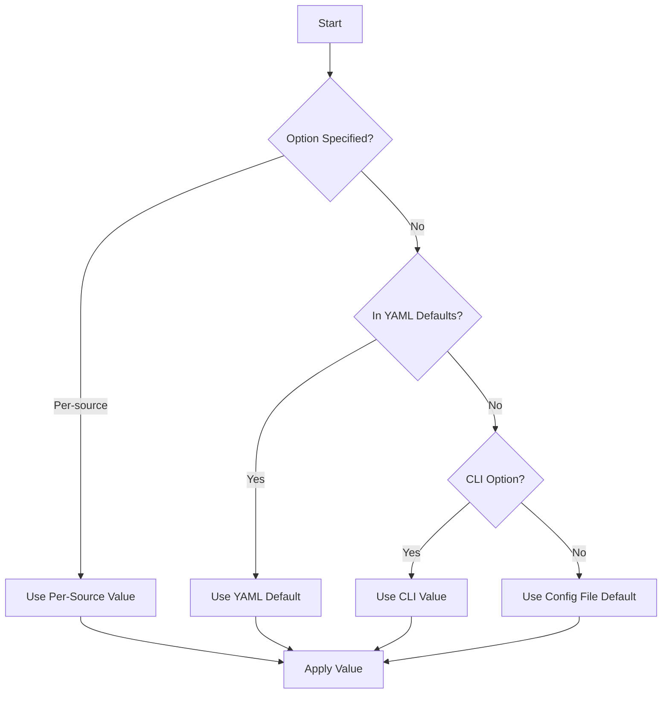
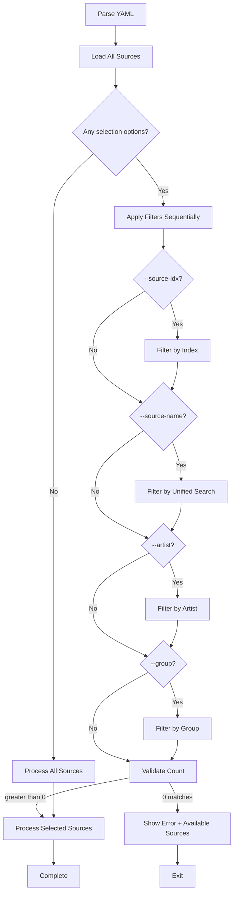

# YAML-Based Paths with Source Selection

## Overview

The `--paths` option provides a YAML-based alternative to command-line arguments and `--file` for specifying sources and destination. It offers enhanced capabilities including defaults, per-source options, and selective source processing.

## Key Features

- **Single File Configuration**: Define destination, defaults, and all sources in one YAML file
- **Defaults Section**: Set common options (filter, count, range, outputFolder, convert) that apply to all sources
- **Per-Source Overrides**: Override defaults for individual sources
- **Auto-Detection**: Automatically enables filter mode when filters are present in YAML
- **Source Selection**: Selectively process sources by index, name, artist, or group
- **Group Support**: Assign sources to groups for batch operations (e.g., "pop-divas", "rock-favorites")

## Basic Usage

### YAML File Structure

```yaml
destination: /data/media/music-manual

# Optional: defaults apply to all sources unless overridden
defaults:
  filter: liked
  count: 5
  outputFolder: liked-songs

sources:
  - path: /music/Artist1
  - path: /music/Artist2
    count: 10 # Override default count
```

### Command Execution

```bash
# Process all sources from YAML
rfmedia copy --paths paths.yml

# Sync mode
rfmedia sync --paths paths.yml
```

## YAML Schema

### Top-Level Fields

| Field         | Type   | Required | Description                     |
| ------------- | ------ | -------- | ------------------------------- |
| `destination` | string | Yes      | Output directory path           |
| `defaults`    | object | No       | Default options for all sources |
| `sources`     | array  | Yes      | Array of source configurations  |

### Defaults Section

Available fields that apply to all sources unless overridden:

| Field          | Type   | Description                                                  |
| -------------- | ------ | ------------------------------------------------------------ |
| `filter`       | string | Smart filter name from config                                |
| `count`        | number | Number of copies to create (mutually exclusive with `range`) |
| `range`        | string | Range of suffixes (e.g., `"001-005"`)                        |
| `outputFolder` | string | Output folder name for filter mode                           |
| `convert`      | string | Audio conversion format: `alac`, `mp3`, `aac`, `opus`        |

**Note:** `count` and `range` are mutually exclusive in defaults.

### Source Configuration

Each source in the `sources` array:

| Field          | Type               | Required | Description                                 |
| -------------- | ------------------ | -------- | ------------------------------------------- |
| `path`         | string             | Yes      | Source directory path                       |
| `groups`       | string or string[] | No       | Group identifier(s) for `--group` selection |
| `artist`       | string             | No       | Artist name for `--artist` selection        |
| `count`        | number             | No       | Override default count                      |
| `range`        | string             | No       | Override default range (e.g., `"001-010"`)  |
| `filter`       | string             | No       | Override default filter name                |
| `outputFolder` | string             | No       | Override default output folder              |
| `convert`      | string             | No       | Override default conversion format          |
| `type`         | string             | No       | Source type (metadata, not processed)       |
| `media`        | string             | No       | Media type (metadata, not processed)        |

**Note:** `count` and `range` are mutually exclusive per source.

## Source Selection

### By Index (`--source-idx`)

Select sources by 1-based index:

```bash
# Process only source 2
rfmedia copy --paths paths.yml --source-idx 2

# Process sources 1, 3, and 5
rfmedia copy --paths paths.yml --source-idx 1,3,5

# Process sources 2 through 5
rfmedia copy --paths paths.yml --source-idx 2-5

# Mixed: indices 1, 3-5, and 8
rfmedia copy --paths paths.yml --source-idx 1,3-5,8
```

**Index Format:**

- Single index: `2`
- Comma-separated: `1,3,5`
- Ranges: `2-5` (expands to 2,3,4,5)
- Mixed: `1,3-5,8`

### By Unified Search (`--source-name`)

Search across groups, artist, and basename using case-insensitive contains matching:

```bash
# Matches against groups + artist + basename
rfmedia copy --paths paths.yml --source-name britney
rfmedia copy --paths paths.yml --source-name pop-divas
rfmedia copy --paths paths.yml --source-name "britney,taylor"
```

### By Group (`--group`)

Select sources by group membership:

```yaml
sources:
  - groups: pop-divas
    artist: Britney Spears
    path: /music/Britney Spears

  - groups:
      - pop-divas
      - latin-divas
    artist: Shakira
    path: /music/Shakira
```

```bash
# Select all sources in pop-divas group
rfmedia copy --paths paths.yml --group pop-divas

# Multiple groups (comma-separated, OR logic)
rfmedia copy --paths paths.yml --group "pop-divas,rock-favorites"
```

### By Artist (`--artist`)

Select sources by artist name:

```bash
# Select by artist (case-insensitive)
rfmedia copy --paths paths.yml --artist britney

# Multiple artists (comma-separated, OR logic)
rfmedia copy --paths paths.yml --artist "britney,shakira"
```

### Combined Selection

Apply multiple filters (intersection/AND logic between filter types):

```bash
# Process sources in pop-divas group that match artist shakira
rfmedia copy --paths paths.yml --group pop-divas --artist shakira

# Process sources 1-5 that are in pop-divas group
rfmedia copy --paths paths.yml --source-idx 1-5 --group pop-divas
```

**Selection Logic:**

- Within each filter type: values are OR'd (match any)
- Between filter types: results are AND'd (must match all)

## Precedence Rules

### Option Precedence

When the same option is specified in multiple places:

1. **Per-source value** (highest priority)
2. **YAML defaults section**
3. **CLI options**
4. **Config file defaults** (lowest priority)

### Example

```yaml
defaults:
  filter: liked
  count: 5

sources:
  - path: /music/Artist1
    # Uses: filter=liked (defaults), count=5 (defaults)

  - path: /music/Artist2
    filter: rock-classics
    # Uses: filter=rock-classics (per-source), count=5 (defaults)

  - path: /music/Artist3
    filter: pop-divas
    count: 10
    # Uses: filter=pop-divas (per-source), count=10 (per-source)
```

## Automatic Mode Detection

### Filter Mode Auto-Detection

When a YAML file contains any filters (in `defaults` or `sources`) and no explicit filter mode options are provided on the CLI, filter mode is automatically enabled:

```bash
# YAML has filter: liked in defaults
# Auto-enables filter mode without requiring --filter on CLI
rfmedia copy --paths paths.yml
```

**Manual Override:**

You can still provide CLI filter options to override the auto-detection:

```bash
# Uses CLI filter as fallback for sources without YAML filters
rfmedia copy --paths paths.yml --filter rock-classics
```

## Examples

### Basic Example

```yaml
destination: /data/media/music-manual

sources:
  - path: /music/Artist1
    count: 5

  - path: /music/Artist2
    range: 001-010
```

```bash
rfmedia copy --paths basic.yml
```

### With Defaults

```yaml
destination: /data/media/music-manual

defaults:
  filter: liked
  count: 5
  outputFolder: liked-songs

sources:
  - path: /music/Artist1 # Uses all defaults

  - path: /music/Artist2
    count: 10 # Override count only

  - path: /music/Artist3
    filter: rock-classics
    outputFolder: rock-tracks
    # Override filter and outputFolder, keep count from defaults
```

```bash
rfmedia copy --paths with-defaults.yml
```

### With Groups and Artists

```yaml
destination: /data/media/music-manual

defaults:
  filter: liked
  count: 5

sources:
  - groups: pop-divas
    artist: Britney Spears
    path: /music/Britney Spears (uuid)
    count: 3

  - groups: pop-divas
    artist: Christina Aguilera
    path: /music/Christina Aguilera (uuid)

  - groups:
      - pop-divas
      - latin-divas
    artist: Shakira
    path: /music/Shakira (uuid)

  - artist: Mariah Carey # No group, selectable by artist
    path: /music/Mariah Carey (uuid)
    filter: rock-classics
```

```bash
# Process all pop-divas sources
rfmedia copy --paths named.yml --group pop-divas

# Process only Shakira (matches both groups)
rfmedia copy --paths named.yml --artist shakira

# Process Mariah Carey
rfmedia copy --paths named.yml --artist mariah
```

### Complete Example with All Options

```yaml
destination: /data/media/music-manual

defaults:
  filter: liked
  count: 5
  outputFolder: liked-songs
  convert: mp3

sources:
  - groups: music-library
    path: /music/Library
    range: 001-005

  - groups: pop-divas
    artist: Britney Spears
    type: directory
    media: music
    path: /music/Britney Spears (uuid)
    filter: pop-divas
    outputFolder: pop-tracks
    convert: alac
    count: 3

  - groups:
      - pop-divas
      - latin-divas
    artist: Shakira
    path: /music/Shakira (uuid)
    range: 001-003
```

```bash
# Process all sources
rfmedia copy --paths complete.yml

# Process only source 1
rfmedia copy --paths complete.yml --source-idx 1

# Process pop-divas group
rfmedia copy --paths complete.yml --group pop-divas

# Process by artist
rfmedia copy --paths complete.yml --artist shakira

# Preview what would happen
rfmedia copy --paths complete.yml --dry-run
```

## Comparison with --file

| Feature              | --file                         | --paths                     |
| -------------------- | ------------------------------ | --------------------------- |
| Format               | Plain text (one path per line) | YAML                        |
| Destination          | CLI argument                   | In YAML file                |
| Per-source options   | Limited (suffix only)          | Full support                |
| Defaults             | No                             | Yes                         |
| Source selection     | No                             | Yes (by index/name)         |
| Filter specification | No                             | Yes (defaults + per-source) |
| Auto-detection       | No                             | Yes (filter mode)           |

### Migration from --file

**Before (--file):**

```text
# paths.txt
/music/Artist1,001-005
/music/Artist2,006-010
```

```bash
rfmedia copy --file paths.txt /dest --filter liked
```

**After (--paths):**

```yaml
# paths.yml
destination: /dest

defaults:
  filter: liked

sources:
  - path: /music/Artist1
    range: 001-005

  - path: /music/Artist2
    range: 006-010
```

```bash
rfmedia copy --paths paths.yml
```

## Use Cases

### Group Operations

Process related sources together:

```yaml
sources:
  - groups: 90s-pop
    artist: Britney Spears
    path: /music/Britney Spears

  - groups: 90s-pop
    artist: NSYNC
    path: /music/NSYNC

  - groups: rock-classics
    artist: Linkin Park
    path: /music/Linkin Park
```

```bash
# Process only 90s pop artists
rfmedia copy --paths groups.yml --group 90s-pop

# Process by artist
rfmedia copy --paths groups.yml --artist linkin
```

### Incremental Processing

Process sources in batches:

```bash
# First batch: indices 1-10
rfmedia copy --paths large.yml --source-idx 1-10

# Second batch: indices 11-20
rfmedia copy --paths large.yml --source-idx 11-20
```

### Testing Configurations

Test specific sources before running all:

```bash
# Test with a single source
rfmedia copy --paths config.yml --source-idx 1 --dry-run

# Test a specific artist
rfmedia copy --paths config.yml --artist britney --dry-run

# Test a specific group
rfmedia copy --paths config.yml --group pop-divas --dry-run
```

## Validation

The YAML parser validates:

- Required fields (`destination`, `sources`, `path`)
- Mutual exclusivity of `count` and `range`
- Valid audio conversion formats
- Non-empty strings for optional fields
- Filter names exist in config (when specified)

**Validation Errors:**

```bash
# Missing destination
Error: Missing required field 'destination' in paths file

# Both count and range in defaults
Error: Defaults section has both 'count' and 'range' - use only one

# Invalid conversion format
Error: Invalid convert format in defaults: "xyz". Valid formats: alac, mp3, aac, opus

# Unknown filter in config (structured output with suggestions)
Error: Unknown filter: 'rock-clasics'

Suggestions:
  • Did you mean 'rock-classics'?
  • Available filters: liked, rock-classics
  • Context: source path: /music/Artist
  • Run with --debug for more details
```

## Error Handling

### Source Selection Errors

```bash
# Index out of bounds
rfmedia copy --paths paths.yml --source-idx 99
# Error: Invalid source selection: Index out of bounds: 99. Valid range is 1-10.
# Suggestions include selection context and available sources

# No matches found
rfmedia copy --paths paths.yml --group nonexistent
# Error: Invalid source selection: No sources matched the selection criteria.
# Suggestions:
#   • Selection: --group=nonexistent
#   • Available sources:
#       1: groups: pop-divas, artist: Britney Spears
#       2: groups: pop-divas, artist: Mariah Carey
#       3: artist: Taylor Swift
```

### Invalid Selection Options

```bash
# Selection options without --paths
rfmedia copy /music /dest --source-idx 1
# Error: --source-idx, --source-name, --artist, and --group options require --paths
```

## Mermaid Diagram: Option Precedence Flow



## Mermaid Diagram: Source Selection Flow



## See Also

- [Smart Filters](./smart-filters.md) - Creating and using smart filters
- [Multiple Source Arguments](./multiple-source-arguments.doc.md) - Direct command-line source specification
- [Sync Command](./sync-command.doc.md) - Incremental sync with --paths support
- Main README - Copy and Sync command reference
