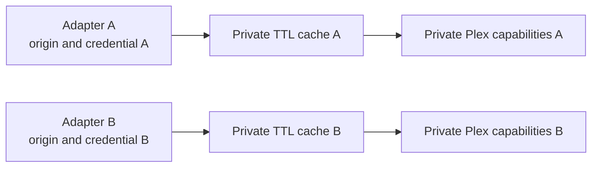
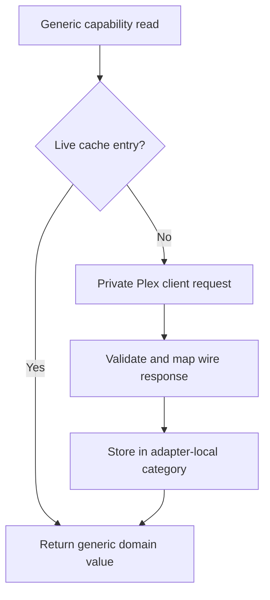

# Plex API Response Caching

This document describes the adapter-local in-memory TTL cache used by the private Plex
implementation. It reduces repeated Plex reads during one adapter lifecycle without exposing cache
behavior to actions or sharing responses across credentials.

## Overview

Caching is:

- **Opt-in**: disabled by default.
- **In-memory only**: entries are never persisted and do not survive the process.
- **Adapter-local**: every `PlexAdapter` receives a new cache instance.
- **Credential-isolated**: adapter and credential lifecycles cannot read each other's entries.
- **TTL-based**: the default lifetime is 300 seconds when caching is enabled.
- **Mutation-aware**: confirmed writes invalidate the categories they can make stale.
- **Secret-free**: keys cannot contain credentials, URLs, authorization fields, or control
  characters.

The cache is constructed in `src/lib/adapters/plex-adapter.ts` and implemented privately in
`src/lib/adapters/plex/cache.ts`. Actions and the generic `MediaServerAdapter` contract have no
cache API.

## Lifecycle and Isolation

`PlexAdapter` captures cache configuration when it is constructed. Later config changes do not
alter an existing adapter, and there is no process-global Plex response map.



Even when two adapters target the same Plex origin, their caches remain separate. This is why
cache keys do not include the server URL or credential: the adapter instance itself is the
isolation boundary.

## Configuration

The existing `.rfmedia.yaml` shape is unchanged:

```yaml
plex:
  url: "http://localhost:32400"
  token: "YOUR_PLEX_TOKEN"

  cache:
    enabled: true # Default: false
    ttlSeconds: 300 # Default when enabled: 300
```

| Option       | Type    | Default | Description                                            |
| ------------ | ------- | ------- | ------------------------------------------------------ |
| `enabled`    | boolean | `false` | Enables the adapter-local Plex response cache          |
| `ttlSeconds` | number  | `300`   | Positive-integer lifetime captured at adapter creation |

When caching is disabled, reads always miss and writes are no-ops. `ttlSeconds` is still validated
as a positive integer so invalid configuration fails consistently.

For the full configuration reference, see [plex-configuration.md](plex-configuration.md).

## Cached Categories

The private cache accepts only five bounded categories:

| Category      | Cached data                        | Discriminator                       |
| ------------- | ---------------------------------- | ----------------------------------- |
| `identity`    | Plex machine identifier            | None                                |
| `libraries`   | Library section listing            | None                                |
| `queries`     | Track, album, and artist pages     | Kind plus a non-secret query digest |
| `queries`     | Tracks for one album               | `album-tracks` plus opaque album ID |
| `playlists`   | Audio playlist listing             | None                                |
| `collections` | Collection listing for one library | `list` plus opaque library ID       |

Cache hits return the same generic domain values as live requests and skip both the network call
and its pacing delay.

The following operations are intentionally not cached:

- Playlist tracks
- A single collection and collection items
- Scans
- Mutations

## Read Path



Expired entries are removed lazily when read. A miss performs the normal origin-bound,
header-authenticated request; only a validated and mapped successful result is stored.

## Cache Keys and Secret Exclusion

Keys are structured values rather than concatenated request URLs:

```typescript
interface PlexCacheKey {
  category: "identity" | "libraries" | "queries" | "playlists" | "collections";
  discriminator?: readonly (string | number | boolean)[];
}
```

String discriminators are length-bounded and encoded. The cache rejects:

- URL-like content
- `X-Plex-Token` or authorization material
- Token-shaped key/value content
- Control characters
- Non-finite numbers
- Excessively long or numerous discriminator parts

The opaque Plex credential is held outside cache state and is never part of a key or value
namespace. Cache isolation comes from constructing a separate cache for every adapter lifecycle,
not from embedding an origin or credential in a global key.

## Mutation Invalidation

Invalidation operates by bounded category, not string-prefix matching. A write invalidates only
after the adapter has evidence that the server accepted a mutation.

| Mutation                                                   | Invalidated category |
| ---------------------------------------------------------- | -------------------- |
| Create or delete playlist                                  | `playlists`          |
| Add playlist tracks after at least one confirmed request   | `playlists`          |
| Create or delete collection                                | `collections`        |
| Add collection items after at least one confirmed addition | `collections`        |
| Successfully update a track rating                         | `queries`            |

Playlist and collection invalidation clears all entries in the category so subsequent listings
cannot reuse stale container data. Collection invalidation therefore covers every library listing
owned by that adapter. Rating updates invalidate query pages and album-track query results because
those values may include the changed rating.

Empty mutations, failed writes without a confirmed change, and dry runs do not invalidate as
successful writes. If a batched add partially succeeds before a later failure, the relevant
category is still invalidated in a `finally` path.

## Performance Behavior

Every live Plex request retains the existing pacing delay. A cache hit bypasses the request and
that delay, which is most useful when a command repeatedly resolves server identity, libraries,
query pages, playlists, or collections in one adapter lifecycle.

Caching does not alter returned values, command output, JSON/MCP shapes, or error handling. No cache
event is written to normal command output.

## Design Decisions

### Private to the Plex Adapter

Private endpoint families receive the cache through dependency injection. They do not read global
configuration or import a global cache, and the action layer cannot clear or inspect cache state.
This keeps cache policy inside the same boundary that owns Plex requests and wire mapping.

### Captured Configuration

Enablement and TTL are copied at adapter construction. This makes one command's behavior
deterministic and prevents later config mutation from silently changing existing entries.

### Category Invalidation

Mutations invalidate a small, explicit category. This favors correctness over retaining narrowly
related entries and avoids coupling mutation methods to request URL formats.

### Backward-Compatible Defaults

Caching remains disabled by default, with the existing 300-second default when enabled. No config
migration or new CLI/completion option is required.

## Limitations

1. **Process-local only.** Separate or concurrent `rfmedia` processes do not share entries.
2. **No persistence.** Cache state is not written to disk or restored on startup.
3. **No size-based eviction.** Entries expire by TTL or category invalidation; there is no LRU or
   memory quota.
4. **Lazy expiration.** Expired entries are removed when their key is read or when the adapter
   lifecycle ends.
5. **Selected reads only.** Playlist items, collection items, scans, and mutations continue to use
   live requests.

## Related Documentation

- [media-server-adapter.md](media-server-adapter.md) -- Generic boundary, auth rules, and imports
- [plex-configuration.md](plex-configuration.md) -- Full Plex configuration reference
- [plex-collections.md](plex-collections.md) -- Collection management commands
- [plex-filters.md](plex-filters.md) -- Query and collection filter syntax

---

_Last Updated: July 2026_
