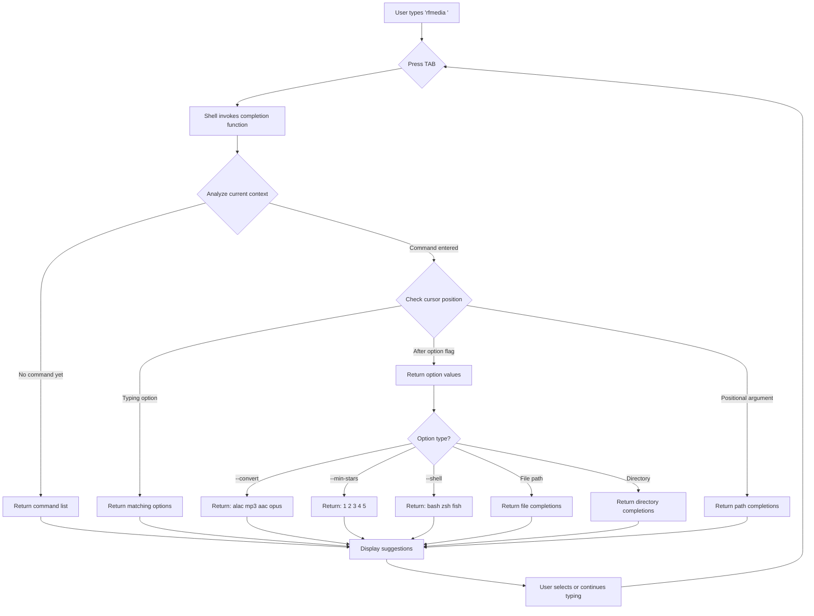

# Shell Completion

This document describes the shell completion feature for rfmedia CLI, which provides intelligent
command-line autocompletion for Bash, Zsh, and Fish shells.

## Overview

The `rfmedia completion` command generates shell-specific completion scripts that enable tab completion for commands, options, and option values. This feature improves productivity by reducing typing and helping users discover available commands and options.

Shell completion provides:

- **Command completion**: Suggests the current command tree, including nested `lidarr policy`
  `evaluate` and `plan` leaves
- **Option completion**: Suggests available flags and options for each command
- **Value completion**: Provides intelligent suggestions for option values (formats, ratings, ranges)
- **Path completion**: Completes directory and file paths where appropriate

## Supported Shells

| Shell | Config File                  | Completion Location                       | Installation                |
| ----- | ---------------------------- | ----------------------------------------- | --------------------------- |
| Bash  | `~/.bashrc`                  | Inline in config                          | Appended to bashrc          |
| Zsh   | `~/.zshrc`                   | `~/.zfunc/_rfmedia`                       | Separate file + fpath setup |
| Fish  | `~/.config/fish/config.fish` | `~/.config/fish/completions/rfmedia.fish` | Separate file               |

## Quick Start

### Generate and Install (Recommended)

The fastest way to enable completion is using the `--install` flag:

```bash
# Bash
rfmedia completion bash --install

# Zsh
rfmedia completion zsh --install

# Fish
rfmedia completion fish --install
```

After installation, restart your shell or source the configuration file.

### Generate Only (Manual Installation)

To view the completion script without installing:

```bash
# Print bash completion script
rfmedia completion bash

# Save to file for manual installation
rfmedia completion zsh > ~/.zfunc/_rfmedia
```

## Detailed Installation Instructions

### Bash

The bash completion script is appended directly to `~/.bashrc`.

#### Automatic Installation

```bash
rfmedia completion bash --install
source ~/.bashrc
```

#### Manual Installation

```bash
# Generate and append to bashrc
rfmedia completion bash >> ~/.bashrc

# Or save to a separate file and source it
rfmedia completion bash > ~/.local/share/bash-completion/completions/rfmedia
```

#### Verification

```bash
# After sourcing, test completion
rfmedia <TAB>           # Includes the current command tree, including reconcile
rfmedia copy --<TAB>    # Should show copy command options
```

### Zsh

Zsh completions use a separate file in the `fpath` and require `compinit` initialization.

#### Automatic Installation

```bash
rfmedia completion zsh --install
source ~/.zshrc
```

This creates:

1. `~/.zfunc/_rfmedia` - The completion script
2. Updates `~/.zshrc` with fpath setup (if not already present)

#### Manual Installation

```bash
# Create zfunc directory if it doesn't exist
mkdir -p ~/.zfunc

# Generate completion script
rfmedia completion zsh > ~/.zfunc/_rfmedia

# Add to ~/.zshrc (before compinit):
fpath=(~/.zfunc $fpath)
autoload -Uz compinit && compinit

# Reload shell
source ~/.zshrc
```

#### Verification

```bash
# Test completion after sourcing
rfmedia <TAB>                    # Shows commands with descriptions
rfmedia copy --convert <TAB>     # Shows: alac mp3 aac opus
```

### Fish

Fish completions are placed in the standard completions directory and loaded automatically.

#### Automatic Installation

```bash
rfmedia completion fish --install
# Fish loads completions automatically, no restart needed
```

This creates `~/.config/fish/completions/rfmedia.fish`.

#### Manual Installation

```bash
# Create completions directory if needed
mkdir -p ~/.config/fish/completions

# Generate completion script
rfmedia completion fish > ~/.config/fish/completions/rfmedia.fish
```

#### Verification

```bash
# Test immediately (Fish loads completions automatically)
rfmedia <TAB>              # Shows commands with descriptions
rfmedia sync --min-stars <TAB>  # Shows: 1 2 3 4 5
```

## Command Line Interface

### Usage

```bash
rfmedia completion <shell> [options]
rfmedia completion --shell=<shell> [options]
```

### Arguments

| Argument  | Description                            |
| --------- | -------------------------------------- |
| `<shell>` | Target shell: `bash`, `zsh`, or `fish` |

### Options

| Option                | Description                                       |
| --------------------- | ------------------------------------------------- |
| `-s, --shell <shell>` | Target shell (alternative to positional argument) |
| `--install`           | Install completion script to shell configuration  |
| `--force`             | Overwrite existing installation without prompting |

### Global Options

| Option                 | Description                                      |
| ---------------------- | ------------------------------------------------ |
| `--debug`              | Enable debug output                              |
| `--json`               | Output in JSON format                            |
| `--output <format>`    | Select `json`, `yaml`, `csv`, `table`, or `text` |
| `--use-dotenvx <file>` | Use dotenvx for secrets injection                |
| `--use-op <file>`      | Use 1Password CLI for secrets injection          |
| `--help`               | Show help                                        |
| `--version`            | Show version                                     |

`--dry-run` is not global. Commands that support it declare it locally. In particular,
`rfmedia reconcile apply` previews by default when `--execute` is absent and has no `--dry-run`
option.

### Examples

```bash
# Generate bash completion to stdout
rfmedia completion bash

# Inspect zsh completion without installing it
rfmedia completion zsh

# Force reinstall fish completion
rfmedia completion fish --install --force

# Get JSON output for scripting
rfmedia completion zsh --json
```

## What Gets Completed

### Commands

All current rfmedia commands are completed at the top level:

| Command            | Purpose                                              |
| ------------------ | ---------------------------------------------------- |
| `copy`             | Copy albums or filtered tracks                       |
| `clean`            | Delete empty album folders                           |
| `delete`           | Delete previously copied content                     |
| `filter`           | List and inspect smart filters                       |
| `history`          | Query operation history                              |
| `init`             | Generate a configuration template                    |
| `lidarr`           | Run Lidarr management commands                       |
| `link-videos`      | Hardlink music videos to matching audio tracks       |
| `migrate`          | Migrate legacy tracking and history                  |
| `migrate-tracking` | Migrate legacy tracking and history                  |
| `playlist`         | Manage M3U playlists                                 |
| `plex`             | Run Plex operations                                  |
| `plugin`           | Manage installed rfmedia plugins                     |
| `queue`            | Manage queued copy jobs                              |
| `reconcile`        | Reconcile file, inventory, and media-server metadata |
| `stats`            | Show operation and storage statistics                |
| `sync`             | Sync previously copied sources                       |
| `undo`             | Undo copy or clean operations                        |
| `verify`           | Verify copied album or filtered-track destinations   |
| `watch`            | Watch directories and process new content            |
| `completion`       | Generate Bash, Zsh, or Fish completion scripts       |
| `mcp`              | Run the rfmedia MCP server                           |

### Global Options

These options are available for all commands:

- `--debug` - Enable debug output
- `--json` - Output in JSON format
- `--output <json|yaml|csv|table|text>` - Select an output format
- `--use-dotenvx <file>` - Use dotenvx for secrets injection
- `--use-op <file>` - Use 1Password CLI for secrets injection
- `--help` - Show help
- `--version` - Show version

`--dry-run` appears only on commands that define it. It is not suggested as a root or universal
option.

### Command-Specific Options

Each command has its own set of options. For example, the `copy` command completes:

- `--range`, `-r` - Range of suffixes (001-010)
- `--album-only` - Treat source as single album
- `--hardlink` - Use hardlinks instead of copies
- `--force` - Overwrite existing copies
- `--min-stars` - Minimum star rating (1-5)
- `--min-rating` - Minimum rating (0-100)
- `--convert`, `-c` - Audio conversion format
- `--workers`, `-w` - Number of parallel workers
- And more...

#### Metadata reconciliation completion

Bash, Zsh, and Fish expose the same static top-level hierarchy:

```text
rfmedia reconcile
├── scan <source-path>
└── apply <source-path>
```

| Leaf    | Completed leaf-specific options                                                                                                       |
| ------- | ------------------------------------------------------------------------------------------------------------------------------------- |
| `scan`  | `--library`, `--tracking-database`, `--operation-id`, `--workers`, `--no-progress`                                                    |
| `apply` | All scan options, plus `--file-wins`, `--db-wins`, `--server-wins`, `--popm-email`, `--execute`, `--allow-partial`, `-y`, and `--yes` |

For `apply`, `--workers` offers the static suggestions `1`, `2`, `4`, and `8`. Source paths use
directory completion. The three winner flags are mutually exclusive in the CLI. Mutation options
and winner flags are not suggested for `scan`.

The reconciliation subtree is declarative and static. Pressing Tab performs no media file scan,
database open, configuration or provider lookup, prompt, or write. Completing `--execute`,
`--allow-partial`, or `--yes` does not authorize or perform an apply. An apply still previews until
the executed command includes `--execute` and receives interactive approval or explicit `--yes`.

The generated Bash, Zsh, and Fish templates are maintained as one parity contract: all three must
expose the same `reconcile` hierarchy, leaf options, and static choices.

#### Lidarr quality preset completion

Bash, Zsh, and Fish expose the same static quality-preset subtree:

```text
rfmedia lidarr presets list
rfmedia lidarr presets show <pack-ref>
rfmedia lidarr presets diff <pack-ref>
rfmedia lidarr presets apply <pack-ref>
```

For `<pack-ref>`, each shell suggests `builtin:balanced`, `builtin:lossless`, and
`builtin:space-saver`. Config-defined pack references remain valid when entered explicitly, but the
completion scripts do not load `.rfmedia.yaml` to discover them.

| Operation | Completed operation-specific options                                      |
| --------- | ------------------------------------------------------------------------- |
| `list`    | Global options only                                                       |
| `show`    | Static built-in pack references and global options                        |
| `diff`    | `--lidarr-url`, `--lidarr-api-key`, `-v`, `--verbose`, and global options |
| `apply`   | `--dry-run`, `--yes`, connection options, verbose options, and globals    |

The subtree is declarative completion only. Selecting `apply` or completing `--yes` never reads
Lidarr, loads credentials, approves a prompt, or performs a mutation.

#### Lidarr ratings sync completion

Bash, Zsh, and Fish expose the same flat leaf, completed between `policy` and `validate-import` in
the `lidarr` subtree:

```text
rfmedia lidarr sync-ratings
```

It is a leaf, not a group: there is no further subcommand to complete, only its options. Two of
those options carry static value lists:

| Option       | Completions                     |
| ------------ | ------------------------------- |
| `--decision` | `quality-profile`, `monitoring` |
| `--mode`     | `recommend`, `plan`, `apply`    |

`--min-stars` reuses the CLI-wide `1 1.5 2 2.5 3 3.5 4 4.5 5` list and `--max-proposals` the
CLI-wide `1 5 10 25 50 100` list; `--max-plays` completes `0 1 3 5 10 25`. There is no `--plan` or
`--apply` flag here — the safety ladder is the single value-taking `--mode`, which leaves `--apply`
its shipped file-valued meaning elsewhere in the CLI (`copy --apply <plan-file>`). Every suggestion
is static: completing `--mode apply` never reads Lidarr or Plex, loads credentials, or mutates
anything.

#### Lidarr consumption policy completion

Bash, Zsh, and Fish expose the same nested policy subtree:

```text
rfmedia lidarr policy
├── evaluate
└── plan
```

The leaves keep separate option surfaces so completion does not suggest evaluation-only gates or
planning shortcuts in the wrong context:

| Leaf       | Completed leaf-specific options                                                                                                                              |
| ---------- | ------------------------------------------------------------------------------------------------------------------------------------------------------------ |
| `evaluate` | `--plex-library`, `--rule`, `--max-proposals`, `--explain`, `--fail-on`, `-v`, `--verbose`, `--plex-url`, `--plex-token`, `--lidarr-url`, `--lidarr-api-key` |
| `plan`     | `--plex-library`, `--rule`, `--max-proposals`, `--mode`, `--explain`, `-v`, `--verbose`, `--plex-url`, `--plex-token`, `--lidarr-url`, `--lidarr-api-key`    |

Both leaves complete the static rule ids `rating-quality-upgrade`, `stale-monitoring-cleanup`, and
`discovery-seed`. Only `plan --mode` completes `recommend` and `plan`; omission means the
write-free `recommend` rung. The plan leaf does not suggest `apply`, `--apply`, `--yes`,
`--dry-run`, `--plan-file`, threshold overrides, or dynamic proposal keys.

This subtree is declarative and side-effect free. Pressing Tab never reads `.rfmedia.yaml`, loads
credentials, contacts Plex or Lidarr, evaluates policy, writes a plan artifact, or authorizes an
apply. The three generated templates are maintained as one parity contract for the nested children,
the exact leaf option sets above, all three rule ids, and the two plan-mode values.

### Option Values

Intelligent value completion is provided for options that accept specific values:

| Option                  | Completions                                |
| ----------------------- | ------------------------------------------ |
| `--convert`             | `alac`, `mp3`, `aac`, `opus`               |
| `--min-stars`           | `1`, `2`, `3`, `4`, `5`                    |
| `--min-rating`          | `20`, `40`, `60`, `80`, `100`              |
| `--range`               | `001-005`, `001-010`, `001-020`, `001-050` |
| `--workers`             | `1`, `2`, `4`, `8`                         |
| `--mode` (watch)        | `album`, `filter`                          |
| `--mode` (policy plan)  | `recommend`, `plan`                        |
| `--mode` (sync-ratings) | `recommend`, `plan`, `apply`               |
| `--shell` (completion)  | `bash`, `zsh`, `fish`                      |
| `--preferred-format`    | `mkv`, `mp4`, `m4v`, `webm`, `avi`         |
| `--min-bitrate`         | `128`, `192`, `256`, `320`                 |
| `--min-plays`           | `1`, `5`, `10`, `20`, `50`                 |
| `--debounce`            | `1000`, `2000`, `5000`, `10000`            |

#### Filter name completion (two namespaces)

Filter-related flags complete names from **two separate config namespaces**:

| Flags            | Commands                                                                                  | Config source                                                 | CLI for completions                  |
| ---------------- | ----------------------------------------------------------------------------------------- | ------------------------------------------------------------- | ------------------------------------ |
| `--filter`, `-f` | `copy`, `delete`, `playlist create`                                                       | `config.filters` (smart filters for local files)              | `rfmedia filter list --names`        |
| `-F`, `--filter` | `plex query`, `plex copy query`, `plex playlist create/add`, `plex collection create/add` | `config.plexFilters` (Plex smart filters for library queries) | `rfmedia filter list --plex --names` |

- **Smart filters** (`filters`): Used by copy, delete, and playlist to select by rating/genre/etc. from local audio metadata. Completion sources names from `rfmedia filter list --names`.
- **Plex filters** (`plexFilters`): Used by Plex subcommands to apply named filters to Plex library queries. Completion sources names from `rfmedia filter list --plex --names`.

If no names are defined in the relevant section, the suggestion list stays empty without errors.

### Path Completion

Directory and file paths are completed where appropriate:

- **Directory arguments**: `copy <source>`, `clean <directory>`,
  `reconcile scan|apply <source-path>`, etc.
- **File options**: `--file`, `--completed-file`, `--path`

## Completion Flow



## Implementation Files

| File                                 | Purpose                                             |
| ------------------------------------ | --------------------------------------------------- |
| `src/commands/completion.ts`         | CLI command definition and argument parsing         |
| `src/actions/completion.ts`          | Installation logic for each shell type              |
| `src/lib/shell-completions/index.ts` | Exports shell-specific completion generators        |
| `src/lib/shell-completions/bash.ts`  | Bash completion script generator                    |
| `src/lib/shell-completions/zsh.ts`   | Zsh completion script generator                     |
| `src/lib/shell-completions/fish.ts`  | Fish completion script generator                    |
| `src/types/completion.ts`            | Type definitions for completion options and results |

The completion generators are split by shell to keep each implementation maintainable and avoid a single extremely large generator file.

## Key Types

### SupportedShell

```typescript
type SupportedShell = "bash" | "zsh" | "fish";

const SUPPORTED_SHELLS: readonly SupportedShell[] = ["bash", "zsh", "fish"];
```

### CompletionOptions

```typescript
interface CompletionOptions {
  shell: SupportedShell; // Target shell
  install: boolean; // Install to shell config
  dryRun: boolean; // Preview without changes
  force: boolean; // Overwrite existing
}
```

### CompletionResult

```typescript
interface CompletionResult {
  success: boolean; // Operation succeeded
  script: string; // Generated completion script
  installedPath?: string; // Where script was installed
  error?: string; // Error message if failed
  alreadyInstalled?: boolean; // Skipped due to existing install
}
```

## Troubleshooting

### Completions Not Working After Installation

**Symptom**: Tab completion does not show suggestions after running `--install`.

**Solutions**:

1. **Restart your shell** or source the config file:

   ```bash
   # Bash
   source ~/.bashrc

   # Zsh
   source ~/.zshrc

   # Fish (automatic, but can force reload)
   exec fish
   ```

2. **Verify the installation** by checking if the completion is loaded:

   ```bash
   # Bash - check if function exists
   type _rf_media_completions

   # Zsh - check fpath includes ~/.zfunc
   echo $fpath | grep -o '.zfunc'

   # Fish - check completion file exists
   ls ~/.config/fish/completions/rfmedia.fish
   ```

### Zsh: "command not found: compdef"

**Symptom**: Error about `compdef` not being found.

**Solution**: Ensure `compinit` is loaded before the completion. Add to `~/.zshrc`:

```zsh
autoload -Uz compinit && compinit
```

### Zsh: fpath Not Set Correctly

**Symptom**: Completions not loading despite file existing in `~/.zfunc`.

**Solution**: Ensure fpath is set before `compinit` in `~/.zshrc`:

```zsh
# Must be BEFORE compinit
fpath=(~/.zfunc $fpath)
autoload -Uz compinit && compinit
```

### Bash: \_init_completion Not Found

**Symptom**: Error about `_init_completion` function not found.

**Solution**: Install bash-completion package:

```bash
# Ubuntu/Debian
sudo apt install bash-completion

# macOS
brew install bash-completion@2
```

Then ensure it's sourced in `~/.bashrc`:

```bash
# For bash-completion@2 on macOS
[[ -r "/usr/local/etc/profile.d/bash_completion.sh" ]] && . "/usr/local/etc/profile.d/bash_completion.sh"
```

### Permission Denied During Installation

**Symptom**: Cannot write to completion file or config.

**Solution**: Check file permissions:

```bash
# Check ownership
ls -la ~/.bashrc ~/.zshrc ~/.config/fish/

# Fix ownership if needed
chown $USER:$USER ~/.bashrc
chmod 644 ~/.bashrc
```

### Stale Completions After Update

**Symptom**: New commands or options not appearing in completions.

Installed completion scripts are static snapshots. After upgrading rfmedia, regenerate and
reinstall the script for the active shell with `--force`, then refresh that shell's completion
state:

```bash
# Bash
rfmedia completion bash --install --force
source ~/.bashrc

# Zsh
rfmedia completion zsh --install --force
source ~/.zshrc

# Fish
rfmedia completion fish --install --force
exec fish
```

If Zsh still serves a cached definition, rebuild its `compinit` cache before retrying.

### Fish: Completions Not Updating

**Symptom**: Fish completions seem cached.

**Solution**: Fish caches completions. Force reload:

```bash
# Remove cached completions
rm -f ~/.cache/fish/completions/rfmedia.fish 2>/dev/null

# Reinstall
rfmedia completion fish --install --force
```

## Inspect Before Installing

The completion command has no global `--dry-run` option. To inspect a generated script without
changing shell configuration, omit `--install`:

```bash
rfmedia completion zsh
```

Add `--install` only after reviewing the generated script. Generation writes the script to stdout;
installation is the operation that writes shell configuration.

## JSON Output

With `--json`, results are output in JSON format for scripting:

```json
{
  "command": "completion",
  "result": {
    "success": true,
    "shell": "zsh",
    "script": "#compdef rfmedia\n...",
    "installedPath": "/home/user/.zfunc/_rfmedia"
  }
}
```

## Related Documentation

- README.md - General CLI usage
- docs/features/watch-mode.doc.md - Watch command options
- docs/features/sync-command.doc.md - Sync command options
- docs/features/audio-conversion.doc.md - Convert format options
- CLAUDE.md - Development patterns and command structure
