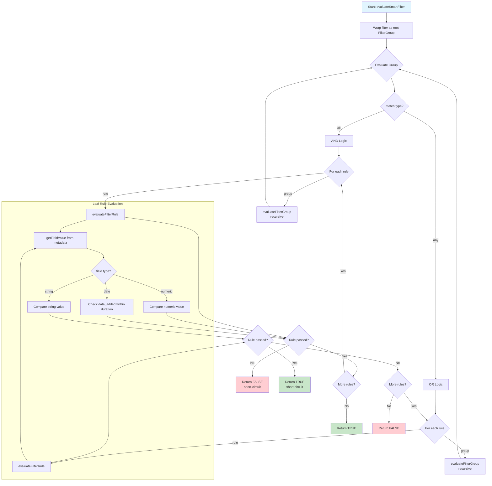

# Smart Filters

This document provides comprehensive guidance for using smart filters in rfmedia-cli. Smart filters enable iTunes-style filtering with nested boolean logic, allowing complex criteria for selecting audio tracks based on rating, genre, artist, year, BPM, and date added.

## Overview

### What Are Smart Filters?

Smart filters are named, reusable filter definitions stored in your configuration file that support:

- **Nested Boolean Logic**: Combine rules with AND (all) or OR (any) at any nesting level
- **Multiple Field Types**: Filter by rating, genre, artist, year, BPM, and date_added
- **Flexible Operators**: Use comparison operators appropriate for each field type
- **Recursive Nesting**: Create arbitrary depth of nested groups for complex logic
- **Optional Playlist Sequencing**: Add radio-style spacing and variety after track selection

### Benefits Over Simple Rating Thresholds

| Feature              | Simple Filters        | Smart Filters                   |
| -------------------- | --------------------- | ------------------------------- |
| Rating threshold     | Yes (`--min-stars=4`) | Yes (`rating >= 4.0`)           |
| Multiple criteria    | Implicit AND only     | AND/OR with nesting             |
| Genre filtering      | No                    | Yes (`genre contains "Rock"`)   |
| Artist filtering     | No                    | Yes (`artist contains "Name"`)  |
| Year filtering       | No                    | Yes (`year >= 2020`)            |
| BPM filtering        | No                    | Yes (`bpm >= 120`)              |
| Date-based filtering | No                    | Yes (`date_added within 30d`)   |
| Reusable definitions | No                    | Yes (named filters in config)   |
| Complex logic        | No                    | Yes (nested AND/OR groups)      |
| Playlist sequencing  | No                    | Yes (optional separation rules) |

### When to Use Smart Filters vs Simple Filters

**Use Simple Filters (`--min-stars`, `--min-rating`) When:**

- You only need a rating threshold
- One-off operations without complex criteria
- Quick command-line filtering

**Use Smart Filters (`--filter`) When:**

- You need to combine multiple criteria
- You want OR logic (e.g., Rock OR Alternative genres)
- You need to filter by genre, artist, year, or BPM
- You want reusable filter definitions
- You need complex nested boolean expressions

## Quick Start

### Creating Your First Smart Filter

1. Create your configuration file in the default YAML format using the `init` command:

```bash
rfmedia init
```

2. Edit the `.rfmedia.yaml` file to add your filter under the `filters` section:

```yaml
# .rfmedia.yaml
filters:
  high-rated-rock:
    match: all
    rules:
      - field: rating
        operator: ">="
        value: 4.0
      - field: genre
        operator: contains
        value: Rock
```

3. Apply the filter:

```bash
rfmedia copy /music/Artist /dest --filter high-rated-rock
```

### Testing a Filter with Dry-Run

Preview what tracks would match without copying:

```bash
rfmedia copy /music/Artist /dest --filter high-rated-rock --dry-run
```

The dry-run output shows which files match and which are filtered out.

### Listing and Inspecting Filters

```bash
# List all defined filters
rfmedia filter list

# Show detailed filter definition
rfmedia filter show high-rated-rock
```

Output example:

```
Filter: high-rated-rock
------------------------------------------------------------
Match: AND (all rules must pass)

Rules:
  |-- rating >= 4
  |-- genre contains "Rock"
------------------------------------------------------------
```

### Creating Filters Interactively

Use the interactive builder to create filters step by step:

```bash
rfmedia filter create
```

The wizard guides you through:

1. Entering a filter name
2. Selecting root match type (AND/OR)
3. Adding rules or nested groups
4. Previewing the filter
5. Saving to your config file

## Filter Syntax

### YAML Structure

Smart filters use a declarative YAML/JSON structure with two main components:

**Top-Level Filter Definition:**

```yaml
filters:
  filter-name:
    match: all # or 'any'
    rules:
      -  # Rule or group definitions
```

**Leaf Rules (Single Conditions):**

```yaml
- type: rule
  field: rating
  operator: ">="
  value: 4.0
```

**Groups (Nested Boolean Logic):**

```yaml
- type: group
  match: any # OR logic for this group
  rules:
    - type: rule
      field: genre
      operator: contains
      value: Rock
    - type: rule
      field: genre
      operator: contains
      value: Alternative
```

### match: all vs match: any

| Match Type | Logic | Behavior                         |
| ---------- | ----- | -------------------------------- |
| `all`      | AND   | All rules in the group must pass |
| `any`      | OR    | At least one rule must pass      |

**Example - AND Logic:**

```yaml
match: all
rules:
  - field: rating
    operator: ">="
    value: 4.0
  - field: genre
    operator: contains
    value: Rock
```

This matches tracks that are BOTH rated 4+ stars AND contain "Rock" in the genre.

**Example - OR Logic:**

```yaml
match: any
rules:
  - field: genre
    operator: contains
    value: Rock
  - field: genre
    operator: contains
    value: Alternative
```

This matches tracks that contain EITHER "Rock" OR "Alternative" in the genre.

### Rule Types

**Leaf Rules** have a `field`, `operator`, and `value`:

```yaml
type: rule
field: rating
operator: ">="
value: 4.0
```

**Groups** contain nested rules with their own match strategy:

```yaml
type: group
match: any
rules:
  - type: rule
    field: genre
    operator: contains
    value: Rock
```

### Operator Reference

| Operator   | Description                        | Compatible Fields                |
| ---------- | ---------------------------------- | -------------------------------- |
| `>=`       | Greater than or equal              | rating, year, bpm                |
| `<=`       | Less than or equal                 | rating, year, bpm                |
| `==`       | Exact match                        | rating, year, bpm, genre, artist |
| `contains` | Substring match (case-insensitive) | genre, artist                    |
| `within`   | Within time period                 | date_added                       |

### Field Reference

| Field        | Type     | Description             | Example Values      |
| ------------ | -------- | ----------------------- | ------------------- |
| `rating`     | number   | Star rating (1.0-5.0)   | `4.0`, `3.5`, `5.0` |
| `genre`      | string   | Audio genre tag (array) | `"Rock"`, `"Pop"`   |
| `artist`     | string   | Artist name (array)     | `"Artist Name"`     |
| `year`       | number   | Release year            | `2024`, `1990`      |
| `bpm`        | number   | Beats per minute        | `120`, `140`        |
| `date_added` | duration | Time since file added   | `30d`, `7d`, `90d`  |

**Notes:**

- **Rating values**: Enter star ratings directly (1.0-5.0); internally converted to 0.0-1.0 scale
- **Genre/Artist**: These are array fields in metadata; `contains` checks if any element matches
- **date_added**: Uses file modification time; accepts duration strings like `30d` (30 days)

## Examples by Use Case

### High-Quality Rock Tracks

Select tracks rated 4+ stars that are Rock or Alternative:

```yaml
filters:
  high-quality-rock:
    match: all
    rules:
      - type: rule
        field: rating
        operator: ">="
        value: 4.0
      - type: group
        match: any
        rules:
          - type: rule
            field: genre
            operator: contains
            value: Rock
          - type: rule
            field: genre
            operator: contains
            value: Alternative
```

### Recent Favorites

Tracks rated 4.5+ stars added in the last 30 days:

```yaml
filters:
  recent-favorites:
    match: all
    rules:
      - type: rule
        field: rating
        operator: ">="
        value: 4.5
      - type: rule
        field: date_added
        operator: within
        value: 30d
```

### Genre Collections

Create themed playlists based on genre:

```yaml
filters:
  electronic-collection:
    match: all
    rules:
      - type: rule
        field: rating
        operator: ">="
        value: 3.0
      - type: group
        match: any
        rules:
          - type: rule
            field: genre
            operator: contains
            value: Electronic
          - type: rule
            field: genre
            operator: contains
            value: Dance
          - type: rule
            field: genre
            operator: contains
            value: House
          - type: rule
            field: genre
            operator: contains
            value: Techno
```

### BPM-Based Workout Mixes

High-energy tracks for workouts:

```yaml
filters:
  workout-mix:
    match: all
    rules:
      - type: rule
        field: rating
        operator: ">="
        value: 3.5
      - type: rule
        field: bpm
        operator: ">="
        value: 120
      - type: group
        match: any
        rules:
          - type: rule
            field: genre
            operator: contains
            value: Dance
          - type: rule
            field: genre
            operator: contains
            value: Electronic
          - type: rule
            field: genre
            operator: contains
            value: Pop
```

### Artist-Specific Filter

Select specific artists with rating threshold:

```yaml
filters:
  favorite-artists:
    match: all
    rules:
      - type: rule
        field: rating
        operator: ">="
        value: 3.5
      - type: group
        match: any
        rules:
          - type: rule
            field: artist
            operator: contains
            value: "Britney Spears"
          - type: rule
            field: artist
            operator: contains
            value: "Lady Gaga"
          - type: rule
            field: artist
            operator: contains
            value: "Shakira"
```

### Complex Nested Logic Example

AND within OR within AND:

```yaml
filters:
  complex-filter:
    match: all # Outer AND
    rules:
      - type: rule
        field: rating
        operator: ">="
        value: 3.0
      - type: group
        match: any # Middle OR
        rules:
          - type: group
            match: all # Inner AND: Modern Rock
            rules:
              - type: rule
                field: genre
                operator: contains
                value: Rock
              - type: rule
                field: year
                operator: ">="
                value: 2000
          - type: group
            match: all # Inner AND: Classic Pop
            rules:
              - type: rule
                field: genre
                operator: contains
                value: Pop
              - type: rule
                field: year
                operator: "<="
                value: 1999
```

This matches: rated 3+ AND (Modern Rock with year >= 2000 OR Classic Pop with year <= 1999).

### Post-Filter Radio Sequencing

The optional `separation` block changes playlist order, not filter membership. It is applied by
`rfmedia playlist create --filter` and by later playlist updates using that named filter. Other
smart-filter consumers continue to use only `match` and `rules`.

```yaml
filters:
  radio-rock:
    match: all
    rules:
      - type: rule
        field: genre
        operator: contains
        value: Rock
    separation:
      artist: 5
      genre: 3
      tempo: alternate
      era: distribute
      energy: wave
```

| Field    | Allowed values                      | Behavior                                                                   |
| -------- | ----------------------------------- | -------------------------------------------------------------------------- |
| `artist` | Integer `1..100`                    | Require that many intervening tracks before any artist repeats             |
| `genre`  | Integer `1..100`                    | Require that many intervening tracks before any genre repeats              |
| `tempo`  | `alternate`                         | Prefer a different library-relative BPM band from the previous known tempo |
| `era`    | `distribute`                        | Prefer the least-used release decade                                       |
| `energy` | `alternate`, `rise`, `fall`, `wave` | Follow a repeating low/medium/high BPM-derived arc                         |

All fields are optional and composable. BPM bands are derived from the matched tracks, so the
preferences adapt to a personal library. `energy` is a sequencing proxy based on BPM, not acoustic
analysis or persisted energy metadata.

Artist and genre gaps are hard preferences rather than exclusion rules. The scheduler uses greedy
selection and progressively wider bounded local backtracking. When bounded search cannot find a
valid rearrangement, it emits a warning, relaxes the least costly placement, and still returns every
selected track exactly once. Missing artist, genre, year, or BPM values remain uncategorized and do
not collide with each other.

## Advanced Topics

### Nested Groups (AND within OR, OR within AND)

Smart filters support arbitrary nesting depth (up to 10 levels for safety). This enables complex boolean expressions.

**Pattern: OR of ANDs**

"Match tracks that are (high-rated Rock) OR (any Electronic)"

```yaml
match: any # Outer OR
rules:
  - type: group
    match: all # First AND group
    rules:
      - field: rating
        operator: ">="
        value: 4.5
      - field: genre
        operator: contains
        value: Rock
  - type: rule # Simple rule in OR
    field: genre
    operator: contains
    value: Electronic
```

**Pattern: AND of ORs**

"Match tracks that are (Rock OR Metal) AND (2020s OR highly rated)"

```yaml
match: all # Outer AND
rules:
  - type: group
    match: any # Genre OR
    rules:
      - field: genre
        operator: contains
        value: Rock
      - field: genre
        operator: contains
        value: Metal
  - type: group
    match: any # Condition OR
    rules:
      - field: year
        operator: ">="
        value: 2020
      - field: rating
        operator: ">="
        value: 4.5
```

### Performance Considerations

Smart filters are optimized for performance:

- **Single-Pass Metadata Reading**: File metadata is read once and cached during evaluation
- **Short-Circuit Evaluation**: AND groups stop on first failure; OR groups stop on first success
- **O(n) Complexity**: Linear in total number of rules across all nesting levels
- **Negligible Overhead**: Nested filters add less than 1% overhead vs flat filters

**Best Practices:**

1. Put most selective rules first (e.g., rating before genre)
2. Avoid deeply nested structures when simpler logic works
3. Use specific genre/artist matches rather than many loose `contains` rules

### Debugging Filter Logic with Verbose Mode

Use `--debug` to see detailed filter evaluation:

```bash
rfmedia copy /music/Artist /dest --filter my-filter --dry-run --debug
```

Debug output shows:

- Which rules pass/fail for each file
- The actual metadata values compared
- The first failing rule for rejected files

### Combining Filters with Album Mode and Ranges

Smart filters work with album mode and range options:

```bash
# Apply filter with album-based organization and numbered copies
rfmedia copy /music/Artist /dest --filter high-quality-rock --range=001-005

# Preserve album structure with filtering
rfmedia copy /music/Artist /dest --filter recent-favorites --preserve-structure

# Convert filtered tracks to MP3
rfmedia copy /music/Artist /dest --filter workout-mix --convert=mp3
```

### Using --count with Smart Filters

The `--count` option provides automatic range detection when combined with smart filters. Instead of specifying an explicit range, you specify how many additional copies to create, and rfmedia automatically detects the next available suffix range.

#### Basic --count Usage

```bash
# Create 3 numbered copies of filtered tracks (auto-detects start suffix)
rfmedia copy /music/Artist /dest --filter myfavorites --count=3

# If no existing copies: creates 001, 002, 003
# If Album-003 already exists: creates 004, 005, 006
```

#### How Auto-Detection Works

When you use `--count`, rfmedia scans the destination directory for existing numbered folders matching the pattern `*-XXX` (where XXX is 3+ digits). It then:

1. Finds the highest existing suffix number
2. Sets the start of the new range to highest + 1
3. Creates the specified number of copies

**Example scenario:**

```bash
# First run - no existing copies
rfmedia copy /music/Artist /dest --filter workout-mix --count=2
# Creates: Artist/Album-001/, Artist/Album-002/

# Second run - add 3 more copies
rfmedia copy /music/Artist /dest --filter workout-mix --count=3
# Detects highest suffix: 002
# Creates: Artist/Album-003/, Artist/Album-004/, Artist/Album-005/
```

#### Hybrid Mode: --filter + --count + --album-mode

Combining all three options creates the most flexible workflow for managing filtered music libraries:

```bash
# Copy only liked tracks, organized by album, with auto-detected numbering
rfmedia copy /music/Artist /dest --filter myfavorites --count=3 --album-mode
```

**What this does:**

1. **--filter myfavorites**: Applies the smart filter to select only matching tracks
2. **--album-mode**: Groups filtered tracks by their original album structure
3. **--count=3**: Creates 3 numbered copies with auto-detected suffix range

**Output structure:**

```
/dest/
  Artist/
    AlbumA-001/
      track1.flac  # Only tracks matching filter
      track3.flac
    AlbumA-002/
      track1.flac
      track3.flac
    AlbumA-003/
      track1.flac
      track3.flac
    AlbumB-001/
      track2.flac
    AlbumB-002/
      track2.flac
    AlbumB-003/
      track2.flac
```

#### --count vs --range

| Feature              | --count               | --range                       |
| -------------------- | --------------------- | ----------------------------- |
| Explicit control     | No                    | Yes                           |
| Auto-detection       | Yes                   | No                            |
| Idempotent additions | Yes                   | Requires manual range updates |
| Use case             | Incremental additions | One-time batch creation       |

**Use --count when:**

- You want to add copies incrementally over time
- You do not want to track which suffixes already exist
- You prefer automatic range management

**Use --range when:**

- You need specific suffix numbers
- You want explicit control over the range
- You are creating a fixed set of copies

#### Practical Examples

**DJ preparation workflow:**

```bash
# Initial sync: create 2 USB copies of workout tracks
rfmedia copy /music/Library /usb-prep --filter workout-mix --count=2 --album-mode

# Later: add 2 more copies for additional USB drives
rfmedia copy /music/Library /usb-prep --filter workout-mix --count=2 --album-mode
# Auto-detects existing 001-002, creates 003-004
```

**Seasonal playlist updates:**

```bash
# Define seasonal filter in config
# filters:
#   summer-hits:
#     match: all
#     rules:
#       - field: rating
#         operator: ">="
#         value: 4.0
#       - type: group
#         match: any
#         rules:
#           - field: genre
#             operator: contains
#             value: Dance
#           - field: genre
#             operator: contains
#             value: Pop

# Create initial batch
rfmedia copy /music/Library /summer-party --filter summer-hits --count=5 --album-mode

# Party was a hit! Add more copies
rfmedia copy /music/Library /summer-party --filter summer-hits --count=3 --album-mode
# Automatically continues from 006-008
```

**Combining with conversion:**

```bash
# Create MP3 copies for portable devices
rfmedia copy /music/Library /portable --filter myfavorites --count=2 --album-mode --convert=mp3
```

#### Dry-Run Preview

Always preview with `--dry-run` to see the auto-detected range:

```bash
rfmedia copy /music/Artist /dest --filter myfavorites --count=3 --album-mode --dry-run
# Output shows:
# Auto-detected range for /music/Artist: 004-006
# [DRY-RUN] Would copy track: ...
```

## Filter Evaluation Flow

The following diagram illustrates how smart filters are evaluated:



**Key Points:**

1. The filter is wrapped as a root FilterGroup
2. Groups are evaluated recursively based on match type
3. AND groups short-circuit on first failure
4. OR groups short-circuit on first success
5. Leaf rules extract field values and apply operators
6. Maximum recursion depth is 10 levels

## Workflow Integration

### Using filter Command to Manage Definitions

```bash
# List all filters with rule counts
rfmedia filter list

# Display detailed filter structure
rfmedia filter show my-filter

# Create new filter interactively
rfmedia filter create

# Create with pre-set name
rfmedia filter create --name new-filter

# Specify config file location
rfmedia filter create --config /path/to/.rfmedia.yaml
```

### Applying Filters with Copy Command

```bash
# Basic filter application
rfmedia copy /source /dest --filter filter-name

# Combine with other options
rfmedia copy /source /dest --filter filter-name \
  --range=001-005 \
  --convert=mp3 \
  --hardlink

# Multiple sources with filter
rfmedia copy --file=sources.txt /dest --filter filter-name
```

### Config File Organization

**Single Config File (Recommended for Simple Setups):**

```yaml
# .rfmedia.yaml
copy:
  outputFolder: liked-songs
  workers: 4

plex:
  url: http://localhost:32400
  token: YOUR_TOKEN

filters:
  high-rated:
    match: all
    rules:
      - field: rating
        operator: ">="
        value: 4.0

  rock-favorites:
    match: all
    rules:
      - field: rating
        operator: ">="
        value: 3.5
      - match: any
        rules:
          - field: genre
            operator: contains
            value: Rock
```

**Multiple Config Locations:**

The configuration system searches in priority order:

| Priority    | Location                        |
| ----------- | ------------------------------- |
| 1 (Highest) | `./.rfmedia.yaml`               |
| 2           | `./.rfmedia.yml`                |
| 3           | `./.rfmedia.json`               |
| 4           | `~/.config/rfmedia/config.yaml` |
| 5           | `~/.config/rfmedia/config.yml`  |
| 6           | `~/.config/rfmedia/config.json` |
| 7           | `~/.rfmedia/config.yaml`        |
| 8           | `~/.rfmedia/config.yml`         |
| 9           | `~/.rfmedia/config.json`        |
| 10          | `~/.rfmedia.yaml`               |
| 11          | `~/.rfmedia.yml`                |
| 12 (Lowest) | `~/.rfmedia.json`               |

### Sharing Filter Definitions Across Projects

**Option 1: Global Config File**

Place shared filters in `~/.config/rfmedia/config.yaml`:

```yaml
filters:
  universal-favorites:
    match: all
    rules:
      - field: rating
        operator: ">="
        value: 4.0
```

**Option 2: Copy Filter Sections**

Export and import filter YAML between projects.

**Option 3: Include in Version Control**

Add `.rfmedia.yaml` to your project repository for team sharing.

## Troubleshooting

### Common Syntax Errors

**Issue: YAML indentation error**

```
Error: YAML parsing failed: bad indentation
```

**Solution**: Use 2-space indentation consistently:

```yaml
# Correct
filters:
  my-filter:
    match: all
    rules:
      - field: rating
        operator: ">="
        value: 4.0

# Wrong (tabs or inconsistent spaces)
filters:
 my-filter:
    match: all
```

**Issue: Unquoted operators**

```
Error: can not read a block mapping entry
```

**Solution**: Quote operators with special characters:

```yaml
# Correct
operator: ">="

# Wrong
operator: >=
```

**Issue: Missing type field in JSON**

```
Error: Unknown rule type: undefined
```

**Solution**: JSON format requires explicit `type` fields:

```json
{
  "filters": {
    "my-filter": {
      "match": "all",
      "rules": [{ "type": "rule", "field": "rating", "operator": ">=", "value": 4.0 }]
    }
  }
}
```

### Understanding Filter Rejection Reasons

When a track is filtered out, use `--debug` to see why:

```bash
rfmedia copy /music /dest --filter my-filter --dry-run --debug
```

**Common Rejection Patterns:**

| Symptom             | Likely Cause                       | Solution                                  |
| ------------------- | ---------------------------------- | ----------------------------------------- |
| All tracks rejected | Filter too restrictive             | Lower thresholds or use OR logic          |
| Genre filter fails  | Metadata uses different genre name | Check actual genre tags with media tools  |
| Rating filter fails | Unrated tracks                     | Unrated tracks always fail rating filters |
| date_added fails    | File mtime not set correctly       | Check file modification times             |

### Verbose Output Interpretation

Debug output format:

```
[DEBUG] Evaluating filter for: /path/to/track.mp3
[DEBUG]   rating >= 4.0: PASS (actual: 0.9 = 4.5 stars)
[DEBUG]   genre contains "Rock": PASS (actual: ["Rock", "Alternative"])
[DEBUG]   Result: PASS
```

**Field value mappings:**

- `rating`: Shown as normalized (0.0-1.0) with star equivalent
- `genre`/`artist`: Shown as array of all values
- `year`/`bpm`: Shown as numeric value
- `date_added`: Shown as ISO date string

### Filter Not Found Errors

```
Error: Filter "my-filter" not found. Available filters: other-filter
```

**Causes:**

1. Filter name typo
2. Config file not found (check with `--debug`)
3. Wrong config file loaded (YAML takes priority over JSON)

**Solution**: Verify config location and filter name:

```bash
rfmedia filter list
```

## Related Documentation

- [README.md](../../README.md) - Command reference and usage examples
- [tracking-system.md](tracking-system.md) - Operation tracking details
- [half-star-ratings.doc.md](half-star-ratings.doc.md) - Rating precision information
