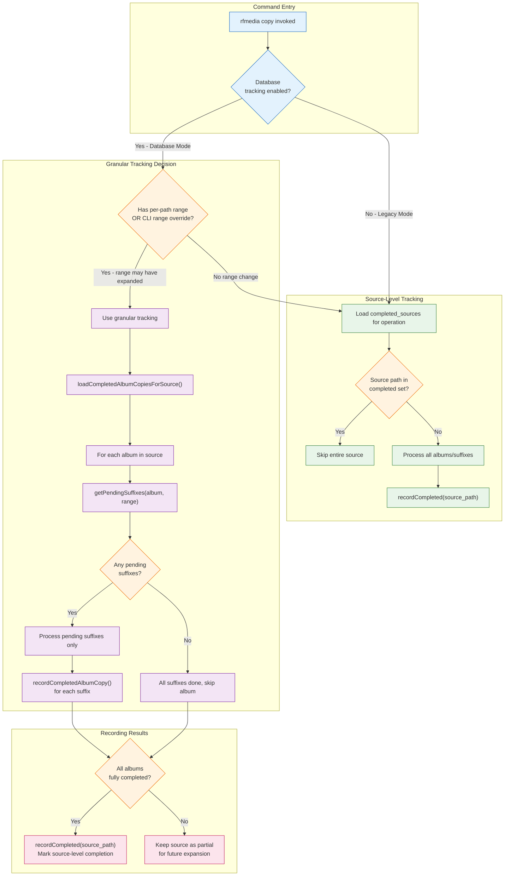
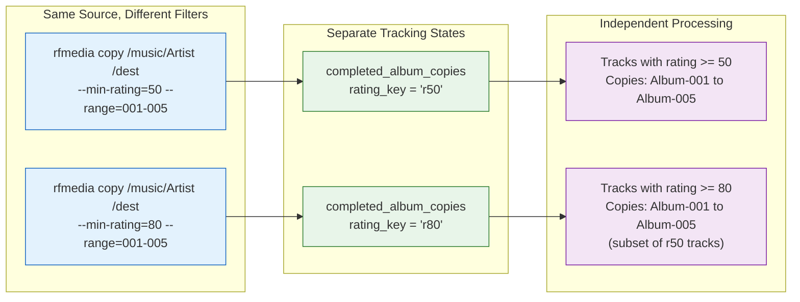

# Tracking System

This document describes the granular tracking system in rfmedia-cli, with a focus on the range expansion feature that enables efficient incremental album copying.

## Overview

The tracking system enables idempotent operations by recording which sources and album copies have been successfully processed. The granular tracking feature (introduced in schema version 2/3) provides per-album-suffix tracking, enabling efficient range expansion without reprocessing completed work.

### Unified Database Storage

All tracking data is stored in a single SQLite database at `~/.rfmedia/tracking.db`. This database serves as the unified storage for:

- **Tracking State** - Operation progress for copy, sync, and delete commands; completed sources; failed sources; inventory; and granular album copy tracking
- **Undo/History Data** - Session records and filesystem operations for rollback support

This unified approach consolidates what was previously scattered across multiple file types (`.completed.*`, `.failed.*`, `.inventory.*`, and JSONL history files) into a single, queryable database.

## Key Features

- **Resume interrupted operations** - Pick up where processing left off
- **Range expansion support** - Expand ranges without reprocessing completed suffixes
- **Rating-aware tracking** - Different rating filters are tracked independently
- **Dual-mode routing** - Supports both SQLite database and legacy file-based tracking
- **Unified storage** - Single database file contains both tracking state and undo/history data

## Granular Range Expansion

### Problem Statement

Without granular tracking, the system could only track at the source directory level. If a user ran a copy operation with range `001-002` and later wanted to expand to `001-020`, the system would either:

1. Skip the entire source (already marked as "completed")
2. Reprocess everything (if using `--force`)

Neither approach was efficient.

### Solution: Per-Suffix Tracking

The `completed_album_copies` table tracks individual album-suffix combinations:

```sql
CREATE TABLE completed_album_copies (
  id INTEGER PRIMARY KEY AUTOINCREMENT,
  operation_id INTEGER NOT NULL,
  source_path TEXT NOT NULL,          -- Source album directory
  album_name TEXT NOT NULL,           -- Album folder name (basename)
  suffix TEXT NOT NULL,               -- Suffix that was completed (e.g., '001', '002')
  rating_key TEXT,                    -- Rating filter key (e.g., 'r80', 's3', null)
  completed_at TEXT NOT NULL,         -- ISO timestamp
  FOREIGN KEY (operation_id) REFERENCES operations(id) ON DELETE CASCADE,
  UNIQUE(operation_id, source_path, album_name, suffix, rating_key)
);
```

This enables the system to know exactly which suffixes have been completed for each album, allowing efficient range expansion.

> **Note**: The unified database also contains `history_sessions` and `history_operations` tables for undo/rollback support. See [Undo/History System](undo-history-system.md) for details on those tables.

## Range Expansion Flow Diagram

The following diagram illustrates how the granular tracking system handles range expansion:

```mermaid
flowchart TD
    subgraph Run1["First Run: rfmedia copy /music/Artist /dest --range=001-002"]
        A1[CLI invoked with range 001-002]
        A2[Initialize database & operation]
        A3[Load completed_album_copies<br/>for source path]
        A4{Any completed<br/>suffixes?}
        A5[No records found]
        A6[Process Album 1]
        A7[Create Album1-001]
        A8["recordCompletedAlbumCopy()<br/>Album1, suffix=001"]
        A9[Create Album1-002]
        A10["recordCompletedAlbumCopy()<br/>Album1, suffix=002"]
        A11[Process Album 2]
        A12[Create Album2-001]
        A13["recordCompletedAlbumCopy()<br/>Album2, suffix=001"]
        A14[Create Album2-002]
        A15["recordCompletedAlbumCopy()<br/>Album2, suffix=002"]
        A16[Mark source as completed]
    end

    subgraph DB1["Database State After Run 1"]
        D1[(completed_album_copies)]
        D1a["Album1 | 001 | completed"]
        D1b["Album1 | 002 | completed"]
        D1c["Album2 | 001 | completed"]
        D1d["Album2 | 002 | completed"]
    end

    subgraph Run2["Second Run: rfmedia copy /music/Artist /dest --range=001-020"]
        B1[CLI invoked with range 001-020]
        B2[Initialize database & find existing operation]
        B3["loadCompletedAlbumCopiesForSource()<br/>Returns: Album1={001,002}, Album2={001,002}"]
        B4{Source in<br/>completed_sources?}
        B5["Yes, but has CLI range override<br/>Proceed to granular check"]
        B6[For each album, call getPendingSuffixes]
        B7["getPendingSuffixes(Album1, 001-020)<br/>Returns: 003,004...020"]
        B8["getPendingSuffixes(Album2, 001-020)<br/>Returns: 003,004...020"]
        B9[Skip suffixes 001-002<br/>Already in completedSuffixes]
        B10[Process only suffixes 003-020]
        B11[Create Album1-003 through Album1-020]
        B12[Record each as completed]
        B13[Create Album2-003 through Album2-020]
        B14[Record each as completed]
    end

    subgraph DB2["Database State After Run 2"]
        E1[(completed_album_copies)]
        E1a["Album1 | 001-020 | all completed"]
        E1b["Album2 | 001-020 | all completed"]
    end

    %% Flow connections
    A1 --> A2 --> A3 --> A4
    A4 -->|No| A5 --> A6
    A6 --> A7 --> A8 --> A9 --> A10
    A10 --> A11 --> A12 --> A13 --> A14 --> A15
    A15 --> A16
    A16 --> D1
    D1 --> D1a & D1b & D1c & D1d

    D1d --> B1
    B1 --> B2 --> B3 --> B4
    B4 --> B5 --> B6
    B6 --> B7 & B8
    B7 --> B9
    B8 --> B9
    B9 --> B10
    B10 --> B11 --> B12
    B12 --> B13 --> B14
    B14 --> E1
    E1 --> E1a & E1b

    %% Styling
    classDef cli fill:#e3f2fd,stroke:#1565c0,stroke-width:2px
    classDef db fill:#e8f5e9,stroke:#2e7d32,stroke-width:2px
    classDef decision fill:#fff3e0,stroke:#ef6c00,stroke-width:2px
    classDef process fill:#f3e5f5,stroke:#7b1fa2,stroke-width:2px
    classDef skip fill:#ffebee,stroke:#c62828,stroke-width:2px

    class A1,B1 cli
    class D1,D1a,D1b,D1c,D1d,E1,E1a,E1b db
    class A4,B4 decision
    class A6,A7,A9,A11,A12,A14,B6,B7,B8,B10,B11,B13 process
    class B9 skip
```



## Tracking Decision Flow

This diagram shows when to use granular (per-suffix) tracking versus source-level tracking:



## Database Query Flow

Detailed view of the database operations during granular tracking:

```mermaid
flowchart TD
    subgraph Init["Initialization"]
        I1["initializeDatabase(dbPath)"]
        I2["findOperation(db, {inputFile, optionsHash, mode})"]
        I3{Operation<br/>exists?}
        I4["Reuse existing operation.id"]
        I5["createOperation(db, params)"]
        I6["Set trackingConfig.operationId"]
    end

    subgraph Load["Load Completed State"]
        L1["loadCompletedAlbumCopiesForSource(db, operationId, sourcePath, ratingKey)"]
        L2["SELECT * FROM completed_album_copies<br/>WHERE operation_id = ?<br/>AND source_path = ?<br/>AND rating_key IS ?"]
        L3["Build Map: albumName -> Set of suffixes"]
        L4["Return completedAlbumCopies map"]
    end

    subgraph Filter["Filter Pending Work"]
        F1["For each album in source"]
        F2["getCompletedSuffixesForAlbum(db, operationId, sourcePath, albumName)"]
        F3["getPendingSuffixes(completedSuffixes, range)"]
        F4["Generate suffixes from range.start to range.end"]
        F5["Filter out suffixes in completedSuffixes set"]
        F6["Return pendingSuffixes array"]
    end

    subgraph Record["Record Completion"]
        R1["recordCompletedAlbumCopy(config, sourcePath, albumName, suffix, ratingKey)"]
        R2["INSERT OR IGNORE INTO completed_album_copies<br/>(operation_id, source_path, album_name, suffix, rating_key, completed_at)<br/>VALUES (?, ?, ?, ?, ?, ?)"]
        R3["Log: Recorded completed album copy"]
    end

    subgraph Complete["Check Full Completion"]
        C1["isSourceFullyCompleted(db, operationId, sourcePath, albumNames, suffixes, ratingKey)"]
        C2["SELECT COUNT(*) FROM completed_album_copies<br/>WHERE all expected combinations exist"]
        C3{count == expected?}
        C4["Source fully completed"]
        C5["Source partially completed"]
    end

    %% Connections
    I1 --> I2 --> I3
    I3 -->|Yes| I4 --> I6
    I3 -->|No| I5 --> I6

    I6 --> L1
    L1 --> L2 --> L3 --> L4

    L4 --> F1
    F1 --> F2 --> F3
    F3 --> F4 --> F5 --> F6

    F6 --> R1
    R1 --> R2 --> R3

    R3 --> C1
    C1 --> C2 --> C3
    C3 -->|Yes| C4
    C3 -->|No| C5

    %% Styling
    classDef init fill:#e3f2fd,stroke:#1565c0
    classDef load fill:#e8f5e9,stroke:#2e7d32
    classDef filter fill:#fff3e0,stroke:#ef6c00
    classDef record fill:#f3e5f5,stroke:#7b1fa2
    classDef complete fill:#fce4ec,stroke:#c2185b
    classDef decision fill:#ffecb3,stroke:#ffa000

    class I1,I2,I4,I5,I6 init
    class L1,L2,L3,L4 load
    class F1,F2,F3,F4,F5,F6 filter
    class R1,R2,R3 record
    class C1,C2,C4,C5 complete
    class I3,C3 decision
```



## Rating-Aware Tracking

The system supports rating-aware tracking, where different rating filters create separate tracking states. This allows reprocessing with different rating criteria:



## Implementation Details

### Key Files

| File                           | Purpose                                                        |
| ------------------------------ | -------------------------------------------------------------- |
| `src/lib/completed-tracker.ts` | Core tracking logic, routing between database and legacy modes |
| `src/lib/db.ts`                | Database CRUD operations for tracking tables                   |
| `src/lib/schema.sql`           | SQLite schema including `completed_album_copies` table         |
| `src/actions/copy-album.ts`    | Album copy action with granular tracking integration           |
| `src/types/tracking.ts`        | TypeScript type definitions for tracking                       |

### Key Functions

#### `loadCompletedAlbumCopiesForSource()`

Loads all completed album-suffix combinations for a source path:

```typescript
function loadCompletedAlbumCopiesForSource(
  db: DbConnection,
  operationId: number,
  sourcePath: string,
  ratingKey?: string | null,
): Map<string, Set<string>>;
```

Returns a map where keys are album names and values are sets of completed suffixes.

#### `getPendingSuffixes()`

Calculates which suffixes still need processing:

```typescript
function getPendingSuffixes(completedSuffixes: Set<string>, range: CopyRange): string[];
```

#### `recordCompletedAlbumCopy()`

Records a single album-suffix completion:

```typescript
async function recordCompletedAlbumCopy(
  config: TrackingConfig,
  sourcePath: string,
  albumName: string,
  suffix: string,
  ratingKey?: string | null,
): Promise<void>;
```

### AlbumTrackingContext

The context passed to `processAlbum()` for granular tracking:

```typescript
interface AlbumTrackingContext {
  config: TrackingConfig; // Tracking configuration
  sourcePath: string; // Source path (artist or album directory)
  completedSuffixes: Set<string>; // Already completed suffixes for this album
  ratingKey?: string | null; // Rating filter key for rating-aware tracking
}
```

## Usage Examples

### Basic Range Expansion

```bash
# First run: create copies 001-002
rfmedia copy /music/Artist /dest --range=001-002

# Second run: expand to 001-020 (only 003-020 will be created)
rfmedia copy /music/Artist /dest --range=001-020
```

### With File Input and Per-Path Ranges

```bash
# Create sources.txt with different ranges per artist:
# /music/Artist1,001-003
# /music/Artist2,001-005
# /music/Artist3,001-010

rfmedia copy --file=sources.txt /dest

# Later, expand ranges:
# /music/Artist1,001-010
# /music/Artist2,001-020
# /music/Artist3,001-010  (unchanged)

rfmedia copy --file=sources.txt /dest
# Only processes new suffixes for Artist1 and Artist2
```

### Rating-Aware Tracking

```bash
# First run: copy 4+ star tracks
rfmedia copy /music/Artist /dest --min-stars=4 --range=001-005

# Second run: different rating filter (tracked separately)
rfmedia copy /music/Artist /dest --min-stars=3 --range=001-005
# Creates new copies with 3+ star tracks (different content)
```

## Configuration

### Enable Database Tracking (Default)

```json
{
  "tracking": {
    "useLegacy": false,
    "database": "~/.rfmedia/tracking.db"
  }
}
```

### Use Legacy File-Based Tracking

```json
{
  "tracking": {
    "useLegacy": true
  }
}
```

Note: Granular album copy tracking is only available with database tracking. Legacy mode tracks at the source level only.

### Undo/History Configuration

The unified database also stores undo/history data. For undo-specific configuration options, see the [Undo/History System](undo-history-system.md) documentation.

## Schema Version History

| Version | Changes                                                                         |
| ------- | ------------------------------------------------------------------------------- |
| 1       | Initial schema with operations, completed_sources, failed_sources, inventory    |
| 2       | Added `completed_album_copies` table for granular per-suffix tracking           |
| 3       | Added `rating_key` column to `completed_album_copies` for rating-aware tracking |

## Related Systems

The tracking system is part of a unified database architecture. The single database file (`~/.rfmedia/tracking.db`) contains both tracking state and undo/history operations.

### Undo/History System

The [Undo/History System](undo-history-system.md) records all filesystem operations for rollback support. It uses the same database with additional tables:

- `history_sessions` - Tracks undo sessions with metadata
- `history_operations` - Records individual filesystem operations (copy, mkdir, remove, etc.)

### Database Schema Reference

For the complete database schema including all tables:

- **Tracking Tables**: `operations`, `completed_sources`, `failed_sources`, `inventory`, `completed_album_copies`
- **History Tables**: `history_sessions`, `history_operations`

See `src/lib/schema.sql` for the full schema definition.

## Related Documentation

- [Centralized Tracking Database](centralized-tracking-db.doc.md) - Overview of the SQLite tracking system
- [Undo/History System](undo-history-system.md) - Undo command and history recording
- [CLAUDE.md](../../CLAUDE.md) - Tracking System Architecture section with dual-mode routing diagram
