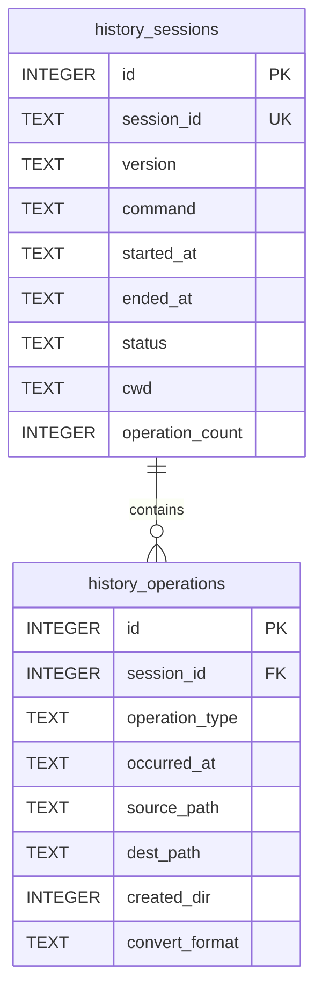
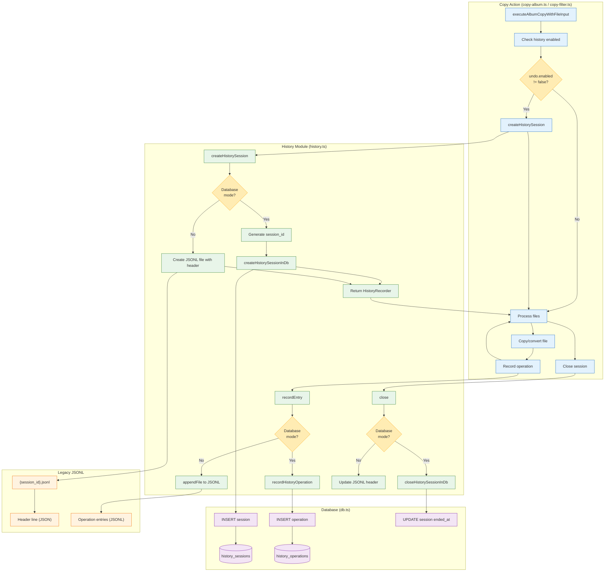
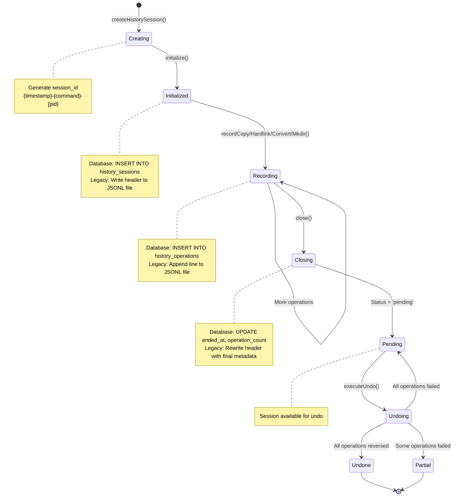
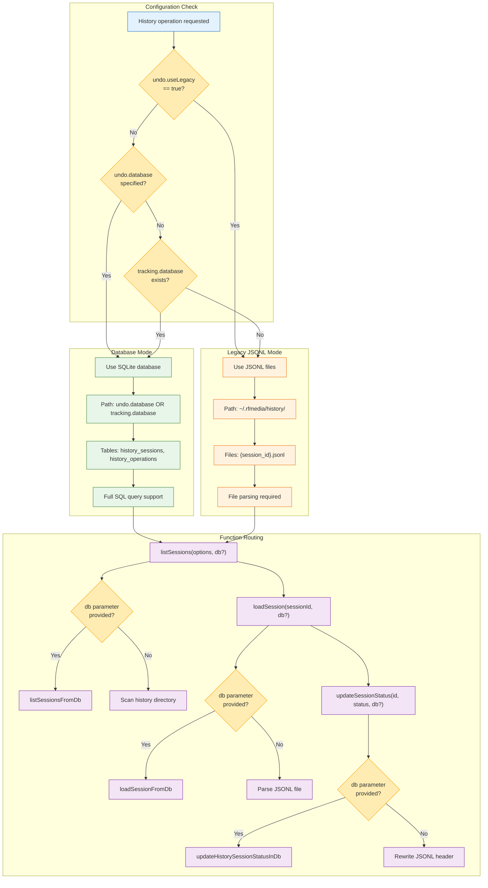
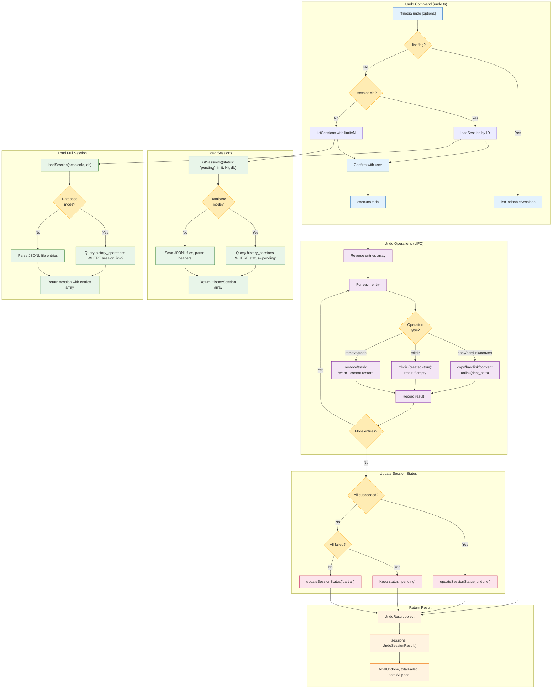

# Undo/History System

This document describes the undo/history system in rfmedia-cli, which records filesystem operations for later reversal. Phase 2.5 introduced SQLite database storage as the primary backend, with legacy JSONL file support for backward compatibility.

## Overview

The undo/history system provides:

- **Operation recording** - All filesystem operations (copy, hardlink, convert, mkdir, remove, trash) are logged during command execution
- **Session-based tracking** - Each command invocation creates a session grouping all its operations
- **LIFO undo** - Operations are reversed in last-in-first-out order to maintain filesystem consistency
- **Dual-mode storage** - Supports both SQLite database (default) and legacy JSONL files
- **Automatic migration** - Legacy JSONL files are automatically migrated when database mode is used

### Phase 2.5 Migration

Phase 2.5 introduced SQLite database storage for the undo/history system, aligning it with the tracking system's database architecture. Key improvements:

| Feature           | Legacy (JSONL)            | Database (SQLite)         |
| ----------------- | ------------------------- | ------------------------- |
| Storage format    | Individual `.jsonl` files | Centralized `tracking.db` |
| Query capability  | File parsing required     | SQL queries supported     |
| Concurrent access | File locking issues       | SQLite transaction safety |
| Session metadata  | Header line parsing       | Structured table columns  |
| Migration path    | N/A                       | Automatic on first use    |

## Database Schema

### history_sessions Table

Stores session metadata (replaces JSONL file headers):

```sql
CREATE TABLE IF NOT EXISTS history_sessions (
  id INTEGER PRIMARY KEY AUTOINCREMENT,
  session_id TEXT NOT NULL UNIQUE,        -- {timestamp}-{command}-{pid}
  version TEXT NOT NULL,                  -- Format version "1"
  command TEXT NOT NULL,                  -- 'copy', 'clean', etc.
  started_at TEXT NOT NULL,               -- ISO timestamp
  ended_at TEXT,                          -- ISO timestamp (nullable)
  status TEXT NOT NULL DEFAULT 'pending', -- 'pending', 'undone', 'partial'
  cwd TEXT NOT NULL,                      -- Working directory
  operation_count INTEGER DEFAULT 0       -- Total operations
);
```

| Column            | Type    | Description                                                  |
| ----------------- | ------- | ------------------------------------------------------------ |
| `id`              | INTEGER | Primary key (auto-increment)                                 |
| `session_id`      | TEXT    | Unique session identifier: `{ISO-timestamp}-{command}-{pid}` |
| `version`         | TEXT    | History format version (currently "1")                       |
| `command`         | TEXT    | Command that was executed (e.g., "copy", "clean")            |
| `started_at`      | TEXT    | ISO timestamp when session started                           |
| `ended_at`        | TEXT    | ISO timestamp when session ended (nullable)                  |
| `status`          | TEXT    | Session status: `pending`, `undone`, or `partial`            |
| `cwd`             | TEXT    | Working directory when command was run                       |
| `operation_count` | INTEGER | Total number of operations recorded                          |

**Indexes:**

```sql
CREATE INDEX idx_history_sessions_session_id ON history_sessions(session_id);
CREATE INDEX idx_history_sessions_started_at ON history_sessions(started_at DESC);
CREATE INDEX idx_history_sessions_status ON history_sessions(status);
```

### history_operations Table

Stores individual filesystem operations:

```sql
CREATE TABLE IF NOT EXISTS history_operations (
  id INTEGER PRIMARY KEY AUTOINCREMENT,
  session_id INTEGER NOT NULL,            -- FK to history_sessions.id
  operation_type TEXT NOT NULL,           -- 'copy', 'hardlink', 'convert', 'mkdir', 'remove', 'trash'
  occurred_at TEXT NOT NULL,              -- ISO timestamp
  source_path TEXT,                       -- Source file (nullable for mkdir/remove/trash)
  dest_path TEXT NOT NULL,                -- Destination file/directory
  created_dir INTEGER DEFAULT 0,          -- Boolean: 1 if mkdir created dir
  convert_format TEXT,                    -- Target format for convert ops
  FOREIGN KEY (session_id) REFERENCES history_sessions(id) ON DELETE CASCADE
);
```

| Column           | Type    | Description                                                               |
| ---------------- | ------- | ------------------------------------------------------------------------- |
| `id`             | INTEGER | Primary key (auto-increment)                                              |
| `session_id`     | INTEGER | Foreign key to `history_sessions.id`                                      |
| `operation_type` | TEXT    | Operation type: `copy`, `hardlink`, `convert`, `mkdir`, `remove`, `trash` |
| `occurred_at`    | TEXT    | ISO timestamp when operation occurred                                     |
| `source_path`    | TEXT    | Source file path (nullable for mkdir/remove/trash)                        |
| `dest_path`      | TEXT    | Destination file or directory path                                        |
| `created_dir`    | INTEGER | Boolean flag (1 if mkdir actually created the directory)                  |
| `convert_format` | TEXT    | Target audio format for convert operations (nullable)                     |

**Indexes:**

```sql
CREATE INDEX idx_history_operations_session ON history_operations(session_id);
CREATE INDEX idx_history_operations_type ON history_operations(operation_type);
```

### Entity Relationship



## Mermaid Diagrams

### History Recording Flow

Shows how operations are recorded from copy action through to database storage:



### Session Lifecycle

Shows the complete lifecycle of a history session from start to finish:



### Dual-Mode Routing

Decision tree for database vs legacy JSONL mode:



### Undo Execution Flow

Shows how the undo command reads from database and reverses operations:



## Configuration

### Undo Configuration Options

Add to `.rfmedia.yaml` (default) or `.rfmedia.json`:

```yaml
undo:
  enabled: true
  retentionDays: 30
  maxSizeMB: 100
  historyPath: null
  database: null
  useLegacy: false
```

| Option          | Type    | Default              | Description                                               |
| --------------- | ------- | -------------------- | --------------------------------------------------------- |
| `enabled`       | boolean | `true`               | Enable/disable history recording                          |
| `retentionDays` | number  | `30`                 | Days to retain history before cleanup                     |
| `maxSizeMB`     | number  | `100`                | Maximum history directory size in MB                      |
| `historyPath`   | string  | `~/.rfmedia/history` | Custom history directory path (legacy mode)               |
| `database`      | string  | `null`               | Path to SQLite database (defaults to `tracking.database`) |
| `useLegacy`     | boolean | `false`              | Use JSONL files instead of database                       |

### Mode Selection Logic

```typescript
// Pseudo-code for mode selection
if (config.undo?.useLegacy === true) {
  // Legacy JSONL mode
  mode = "legacy";
} else if (config.undo?.database) {
  // Explicit database path
  mode = "database";
  dbPath = config.undo.database;
} else if (config.tracking?.database) {
  // Share tracking database
  mode = "database";
  dbPath = config.tracking.database;
} else {
  // Default to legacy mode if no database configured
  mode = "legacy";
}
```

### Example Configurations

**Database mode (recommended):**

```yaml
tracking:
  database: "~/.rfmedia/tracking.db"
undo:
  enabled: true
  retentionDays: 30
```

**Explicit undo database:**

```yaml
undo:
  enabled: true
  database: "~/.rfmedia/history.db"
  retentionDays: 60
```

**Legacy JSONL mode:**

```yaml
undo:
  enabled: true
  useLegacy: true
  historyPath: "~/.rfmedia/history"
```

## Usage Examples

### Viewing History Sessions

```bash
# List undoable sessions (status = 'pending')
rfmedia undo --list

# Output:
# Undoable sessions:
#
#   2026-01-18T10-30-45Z-copy-12345
#     Command: copy | Operations: 150 | Date: 1/18/2026, 10:30:45 AM
#
#   2026-01-18T09-15-22Z-copy-12346
#     Command: copy | Operations: 75 | Date: 1/18/2026, 9:15:22 AM
```

### Viewing Operations for a Session

Currently, detailed operation viewing requires direct database queries (see Database Analytics section below). The CLI shows summary information in the undo preview.

### Using the Undo Command

```bash
# Undo the most recent session
rfmedia undo

# Undo the last 3 sessions
rfmedia undo --last=3

# Undo a specific session by ID
rfmedia undo --session=2026-01-18T10-30-45Z-copy-12345

# Preview undo without executing (dry-run)
rfmedia undo --dry-run

# Skip confirmation prompt
rfmedia undo --force

# Combine options
rfmedia undo --last=2 --dry-run
```

### Querying Database for History Analytics

```bash
# Open the database with sqlite3
sqlite3 ~/.rfmedia/tracking.db

# List all sessions
SELECT session_id, command, status, operation_count, started_at
FROM history_sessions
ORDER BY started_at DESC
LIMIT 10;

# View operations for a specific session
SELECT ho.operation_type, ho.source_path, ho.dest_path, ho.occurred_at
FROM history_operations ho
JOIN history_sessions hs ON ho.session_id = hs.id
WHERE hs.session_id = '2026-01-18T10-30-45Z-copy-12345'
ORDER BY ho.occurred_at;

# Count operations by type for recent sessions
SELECT hs.session_id, ho.operation_type, COUNT(*) as count
FROM history_operations ho
JOIN history_sessions hs ON ho.session_id = hs.id
WHERE hs.started_at > datetime('now', '-7 days')
GROUP BY hs.session_id, ho.operation_type
ORDER BY hs.started_at DESC;

# Find sessions with convert operations
SELECT DISTINCT hs.session_id, hs.command, hs.started_at
FROM history_sessions hs
JOIN history_operations ho ON hs.id = ho.session_id
WHERE ho.operation_type = 'convert';

# Get total files created in the last 30 days
SELECT COUNT(*) as total_operations
FROM history_operations ho
JOIN history_sessions hs ON ho.session_id = hs.id
WHERE hs.started_at > datetime('now', '-30 days')
  AND ho.operation_type IN ('copy', 'hardlink', 'convert');
```

## Implementation Details

### HistoryRecorder Class Structure

The `HistoryRecorder` class manages session-based operation logging:

```typescript
class HistoryRecorder {
  // Private fields
  private readonly sessionId: string; // Generated session ID
  private readonly filePath: string; // JSONL file path (legacy)
  private readonly command: string; // Command name
  private operationCount: number = 0; // Operations recorded
  private closed: boolean = false; // Session closed flag
  private readonly enabled: boolean; // History enabled flag
  private readonly db?: DbConnection; // Database connection (optional)
  private readonly dbSessionId?: number; // Database session ID (optional)

  // Public methods
  constructor(command: string, options?: { db?: DbConnection; dbSessionId?: number });
  getId(): string;
  getFilePath(): string;
  async initialize(): Promise<void>;
  async recordCopy(src: string, dest: string): Promise<void>;
  async recordHardlink(src: string, dest: string): Promise<void>;
  async recordConvert(src: string, dest: string, format: ConvertFormat): Promise<void>;
  async recordMkdir(path: string, wasCreated: boolean): Promise<void>;
  async recordRemove(path: string): Promise<void>;
  async recordTrash(path: string): Promise<void>;
  async close(): Promise<void>;
  getOperationCount(): number;

  // Private methods
  private async recordEntry(entry: HistoryEntry): Promise<void>;
  private recordEntryToDb(entry: HistoryEntry): void;
}
```

### Database CRUD Operations

Key functions in `src/lib/db.ts`:

```typescript
// Session operations
function createHistorySession(db: DbConnection, params: CreateHistorySessionParams): number;
function findHistorySession(db: DbConnection, sessionId: string): DbHistorySession | null;
function getHistorySessions(db: DbConnection, filter?: HistorySessionFilter): DbHistorySession[];
function closeHistorySession(db: DbConnection, sessionId: number, endedAt: string, operationCount: number): void;
function updateHistorySessionStatus(db: DbConnection, sessionId: string, status: SessionStatus): void;

// Operation recording
function recordHistoryOperation(db: DbConnection, params: RecordHistoryOperationParams): void;
function getHistoryOperations(db: DbConnection, sessionId: number): DbHistoryOperation[];
```

### Mode Selection Logic

In `src/lib/history.ts`:

```typescript
export async function createHistorySession(command: string, db?: DbConnection): Promise<HistoryRecorder> {
  let dbSessionId: number | undefined;

  // Database mode: create session record in database first
  if (db) {
    const sessionId = generateSessionId(command);
    dbSessionId = createHistorySessionInDb(db, {
      sessionId,
      version: HISTORY_VERSION,
      command,
      startedAt: new Date().toISOString(),
      cwd: process.cwd(),
    });
  }

  const recorder = new HistoryRecorder(command, { db, dbSessionId });
  await recorder.initialize();
  return recorder;
}
```

### Integration with Copy Actions

The history recorder is integrated into copy actions:

```typescript
// In copy-album.ts or copy-filter.ts
async function executeCopyWithHistory(options: CopyOptions, db?: DbConnection) {
  // Create history session
  const history = await createHistorySession("copy", db);

  try {
    // Process files
    for (const file of files) {
      const destPath = await copyFile(file.source, file.dest);
      await history.recordCopy(file.source, destPath);
    }

    // Close session on success
    await history.close();
  } catch (error) {
    // Session auto-closes on error, preserving recorded operations
    throw error;
  }
}
```

## Migration Notes

### Legacy JSONL Migration

When switching from legacy JSONL mode to database mode:

1. **Existing JSONL files remain untouched by the mode switch** - They are not deleted or modified
2. **New sessions go to the database** - All new history is stored in SQLite
3. **Manual migration is available** - Use `rfmedia migrate --history-only` for explicit control
4. **Undo can migrate automatically** - In database mode, `rfmedia undo` imports legacy history
   before processing

Each session is fully validated before import, committed atomically, and read back for exact
equivalence. An already-equivalent database session is also a successful migration outcome.
Malformed, incomplete, or conflicting JSONL files are retained.

### Auto-Migration During Undo

The undo command includes automatic migration:

```typescript
export async function executeUndo(options: UndoOptions, db?: DbConnection): Promise<UndoResult> {
  // Auto-migrate legacy history files if using database
  if (db) {
    await autoMigrateHistoryIfNeeded(db);
  }
  // ... rest of undo logic
}
```

### Manual Migration and Cleanup

Use one explicit history root for discovery and import:

```bash
# Use the configured/default history directory
rfmedia migrate --history-only

# Discover and import from this exact directory
rfmedia migrate --history-only --history-path=/path/to/history

# Remove only JSONL files proven imported or already equivalent
rfmedia migrate --history-only --history-path=/path/to/history --delete-old
```

`--delete-old` evaluates each proven file independently. Failed or unproven files remain available
for repair and retry, even when safe siblings are deleted. `--force` skips only the cleanup
confirmation; it cannot bypass durable equivalence, root containment, regular-file identity, or
symlink checks. Dry-run performs no database initialization, prompt, or deletion.

### What Gets Migrated

- Session headers (version, command, timestamps, status, cwd, operation count)
- All operation entries (type, timestamps, paths, format)
- Session status preserved (pending, undone, partial)

### What Does NOT Get Migrated

- Original JSONL files are not deleted unless `--delete-old` receives durable per-file proof
- Malformed, partial, conflicting, changed, or unsafe JSONL files are not deleted
- File modification times are not preserved
- Custom metadata outside the standard schema

## Troubleshooting

### Common Issues

#### 1. "No undoable sessions found"

**Cause:** All sessions have status `undone` or `partial`, or history is disabled.

**Solutions:**

```bash
# Check if history is enabled in config
cat .rfmedia.json | jq '.undo.enabled'

# Check database for all sessions (not just pending)
sqlite3 ~/.rfmedia/tracking.db "SELECT session_id, status FROM history_sessions"

# Verify history was recorded for recent operations
sqlite3 ~/.rfmedia/tracking.db \
  "SELECT COUNT(*) FROM history_sessions WHERE started_at > datetime('now', '-1 day')"
```

#### 2. "Session not found"

**Cause:** Session ID is incorrect or session is in legacy JSONL format while using database mode.

**Solutions:**

```bash
# List all session IDs
rfmedia undo --list

# Check legacy history directory
ls -la ~/.rfmedia/history/

# Force legacy mode for old sessions
# Edit .rfmedia.json: "undo": { "useLegacy": true }
```

#### 3. "Failed to undo operation: ENOENT"

**Cause:** File was already deleted or moved.

**Solution:** This is normal - the system skips already-removed files and continues.

#### 4. "Directory not empty, skipping"

**Cause:** mkdir operation created a directory that now contains files from other operations.

**Solution:** This is expected behavior - only empty directories created by the session are removed during undo.

### Checking History State in Database

```bash
# Open database
sqlite3 ~/.rfmedia/tracking.db

# Check session counts by status
SELECT status, COUNT(*) as count
FROM history_sessions
GROUP BY status;

# Find sessions with failures
SELECT session_id, operation_count, started_at
FROM history_sessions
WHERE status = 'partial';

# Check for orphaned operations (should be 0)
SELECT COUNT(*)
FROM history_operations ho
LEFT JOIN history_sessions hs ON ho.session_id = hs.id
WHERE hs.id IS NULL;

# Verify foreign key constraints
PRAGMA foreign_key_check;

# Check database integrity
PRAGMA integrity_check;
```

### Debugging Mode Selection

Add debug logging to see which mode is being used:

```bash
# Run with debug flag
rfmedia undo --list --debug

# Look for log messages like:
# [DEBUG] History session initialized in database mode: 2026-01-18T10-30-45Z-copy-12345
# or
# [DEBUG] Created history session: 2026-01-18T10-30-45Z-copy-12345
```

### Recovery from Corrupted Database

If the database is corrupted:

```bash
# Backup existing database
cp ~/.rfmedia/tracking.db ~/.rfmedia/tracking.db.bak

# Check integrity
sqlite3 ~/.rfmedia/tracking.db "PRAGMA integrity_check"

# If corrupted, remove and let rfmedia recreate
rm ~/.rfmedia/tracking.db

# Next command will create fresh database
rfmedia copy /source /dest --range=001-001 --dry-run
```

## Key Files

| File                   | Purpose                                                       |
| ---------------------- | ------------------------------------------------------------- |
| `src/lib/history.ts`   | HistoryRecorder class and session management                  |
| `src/lib/db.ts`        | Database CRUD operations for history tables                   |
| `src/lib/schema.sql`   | SQLite schema including history tables                        |
| `src/actions/undo.ts`  | Undo action implementation                                    |
| `src/commands/undo.ts` | Undo command CLI definition                                   |
| `src/types/history.ts` | TypeScript types for history system                           |
| `src/types/db.ts`      | Database types including DbHistorySession, DbHistoryOperation |
| `src/types/config.ts`  | Configuration types including UndoConfigOptions               |

## Related Documentation

- [Tracking System](packages/rfmedia-cli/docs/features/tracking-system.md) - Granular tracking with range expansion
- [Centralized Tracking Database](packages/rfmedia-cli/docs/features/centralized-tracking-db.doc.md) - Database architecture overview
- [CLAUDE.md](packages/rfmedia-cli/CLAUDE.md) - Undo/History System section
